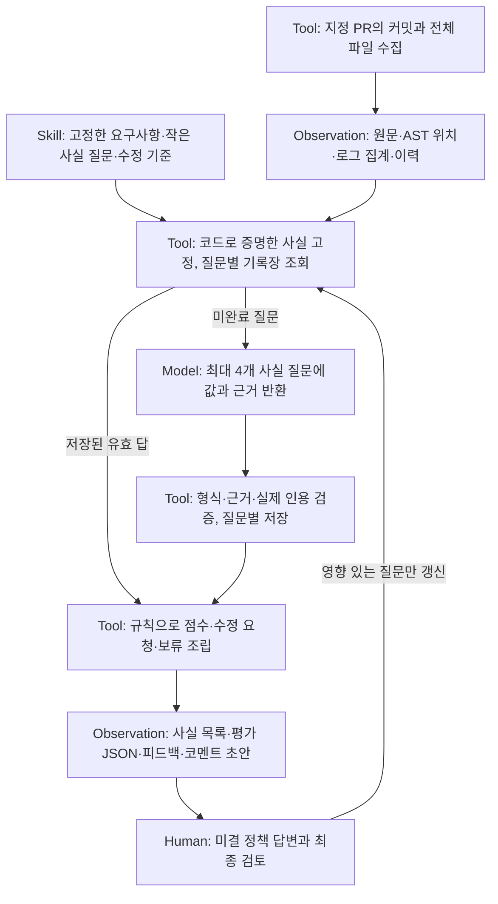

# 작은 사실 검사로 구성한 평가 계약

필수항목을 세분화해도 배점은 늘어나지 않습니다. 필수항목당 1점과 무배점
consistency/intent 영역을 유지하며, 내부 사실 검사로 원래 항목을 판정합니다.



모델이 추출한 사실의 의미상 정확성과 자유 가산 후보의 발견은 이 그림에서도
모델·사람의 책임입니다. 기록장 재생의 동일성을 신규 모델 판단의 동일성으로
해석하지 않습니다.

## 계약과 근거

`assessment.obligations`는 원래 요구사항의 관측 영역이고,
`assessment.atoms`는 영역을 판정하기 위한 작은 질문입니다. 각 질문에는 고정 ID,
상위 영역, 질문, 수정 요청 템플릿, 효과, 근거 계산 방식이 있습니다.
`effect=core`는 원래 항목의 충족 여부에 관여하고 `correction`은 국소 사실 오류를
수정 요청으로 남깁니다. 국소 오류만으로 필수항목의 점수를 자동 감점하지 않습니다.

모델은 `true / false / null`, 짧은 설명과 실제 근거 ID를 반환합니다.
점수·중요도·피드백 유형이나 새로운 검사 항목을 반환하지 않습니다.
`false`는 구체적 반례, `null`은 확인 불가입니다. 확인 불가를 미충족으로 바꾸지 않습니다.
모델이 추출한 값은 의미 판단이며 결정적인 관측을 보장하지 않습니다.

지원되는 에피소드 요약의 모든 필드가 일치하거나 Git 조상 관계로 사실을 확인할
수 있으면 코드가 그 사실을 고정합니다. 요약의 동일성은 실제 도구 호출 횟수,
로그의 진실성 또는 프로그램의 모든 실행 경로를 증명하지 않습니다.
지원하지 않는 형식은 기록 누락으로 판정하지 않습니다.

지원되는 JSON 이벤트 로그에서는 도구 호출 인자·응답 대응·에피소드 종료와
결과표의 호출·거부·행동 수를 추가 대조합니다. 긍정적인 구조 증명만 코드 소유
사실로 고정합니다. 이름이 비슷한 임의 필드를 추측해 읽거나, 지원하지 않는
로그·불일치를 곧바로 미충족으로 바꾸지 않습니다. 이 경우 원문 검토를 유지합니다.

`source=semantic-claim`인 모순 질문의 `false`에는 `claim_quote`와
`counter_quote`가 필요합니다. 두 인용은 서로 달라야 하고 인용한 근거 구간에
실제로 존재해야 합니다. 없는 주장을 만들어 지적한 답은 검증을 실패시킵니다.
실제 인용이 의미상 모순인지까지 이 검사가 증명하지는 않습니다.

AST 인덱스는 함수·분기 조건·원문 위치를 자료로 제공합니다. 학생 코드를
실행·import하거나, 분기문이 있다는 이유만으로 유효한 검사가 있다고 인증하지 않습니다.

## 실행과 조립

관련 질문은 최대 4개씩 묶어 호출합니다. 각 묶음에는 선택된 질문과 관련 파일
전체를 제공하며, 파일을 잘라내지 않습니다. 로그는 온전한 파일 묶음으로 나눌 수
있고, 모든 파일 부분의 결과를 보수적으로 조립합니다.

각 질문의 값·근거는 `atomic-facts.json`, 비교용 값은
`metrics.atomic_decisions`에 보존합니다. `atomic-leaves/`에는 질문별로 검증한
답과 요청 해시를 저장합니다. 같은 묶음에서 한 답의 검증이 실패해도 나머지 답은
보존합니다. 실패한 묶음 자체는 완료로 표시하지 않습니다. 명시적
`--retry-failed` 때 검증에 실패한 질문만 다시 묻고 나머지는 재사용합니다.
부분 결과의 영수증에는 그 시점의 유효한 질문별 기록 키와 미해결 목록을 고정합니다.
나중에 재시도가 성공해도 과거의 불완전한 실행을 재생한 결과가 소급해 바뀌지 않습니다.

상위 영역의 core 질문에 반례가 있으면 미충족, 반례가 없고 확인 불가가 있으면
보류, 모두 지지되면 충족입니다. 수정 요청의 유형과 문구는 고정된 템플릿으로
조립하고 원문 근거를 연결합니다. 해결되지 않은 사실 검사가 남으면 완전한
게시용 평가로 취급하지 않습니다.

질문함의 미결 정책은 관련 항목만 대기시킵니다. 교수자 답변의 적용과 기록
갱신은 기존 `answer-policy`·`refresh-policy` 경로를 사용합니다.
작은 사실 추출은 `assessment.policy_questions`에 선언된 질문만 선택할 수 있습니다.
기본 목록은 비어 있으며, 자료를 못 읽었다는 이유로 새 교수자 정책을 만들지 않습니다.
이미 코드로 관리하는 정책 질문은 계속 질문함에서 처리합니다. 새로운 명세 해석
문제가 발견되면 교수자가 질문을 평가 계약에 넣고 버전을 올려 동일 묶음에 적용합니다.
사실 불확실성 자체는 해당 질문의 `null`과 확인 필요 설명으로 남습니다.

다른 과제에서 선언할 정책 질문의 예시는 다음과 같습니다. 질문은 근거 부족을
묻는 대신 명세의 실제 해석 선택지를 명시해야 합니다.

```json
{
  "policy_questions": [
    {
      "policy": "course.allowed-format",
      "question": "명세의 출력과 의미가 같은 다른 파일 형식을 인정하나요?",
      "options": ["allow", "disallow"]
    }
  ]
}
```

이 객체는 해당 항목의 `assessment`에 넣습니다. 코드가 교수자의 답을 해석해
임의로 사실 값을 바꾸지는 않습니다. 답변을 적용한 해당 항목만 다시 검토합니다.

## 학생 간 작업과 가산

`batch`의 모든 PR은 하나의 제한된 항목 작업 풀을 공유합니다. 항목·가산 후보
발견·가산 자격 작업의 실제 동시 작업 상한이 `--workers`입니다. PR 진행을
관리하는 스레드는 모델 작업 풀을 점유하지 않아 중첩 대기를 피합니다.
진행 기록은 잠금 아래 합치며, 제공자 한도가 확인되면 대기 중인 모델 요청을
추가로 보내지 않습니다. 이미 전송한 요청은 사용량이 발생할 수 있습니다.

판정 키에는 제출자·제출 커밋·선택 파일·기준·정책·모델·구현 버전이 들어갑니다.
다른 학생의 판정을 재사용하지 않습니다. 표준 파일 순서는 정규화합니다.

가산 후보 발견과 기여의 의미·독립성은 여전히 모델 판단입니다. 같은 파일이나
폴더를 사용한다는 이유만으로 기여를 합치지 않습니다. 모델이 명시한 중복 관계는
연결된 그룹으로 조립해, 검증된 대표 기여 하나만 가산합니다. 상호 중복 지목과
순환 관계도 처리하며, 요건을 충족한 명시 가산을 우선합니다. 검증이 부족한
기여를 중복 그룹에 속한다는 이유만으로 승격시키지 않습니다. 가산 수의 임의
상한이나 필수사항 가산은 추가하지 않습니다.

## 재현성 측정

저장 판정 재생, 기록장 없이 모든 모델 단계를 새로 실행하는 평가, 파일 순서,
무관한 줄, 주입 문장을 분리합니다. 기존 항목별 상태·점수·피드백 유형과 함께
어느 사실 질문의 값부터 달라졌는지도 기록합니다. 일관성은 정확도가 아니므로
구체적 정상·오류 사례와 처리 완료 상태를 함께 확인해야 합니다.

일반 `prepare`·`judge`·`batch`가 이 경로를 기본으로 사용합니다. `judge-items`도
계속 지원합니다. `--legacy-review`는 이전 단일 응답 경로를 명시적으로 시험할
때만 사용합니다. `prepare --excerpt`는 제한된 사람이 읽을 패킷을 만드는 용도이며
항목별 자동 평가에는 사용할 수 없습니다. 옛 관측 계약의 저장 결과 재생은 유지합니다.

새 과제에도 먼저 필수항목과 원래 관측 영역을 고정한 뒤 질문을 정의합니다.
`source=semantic`부터 시작할 수 있으며 `source`를 붙였다는 이유만으로 새로운
자동검사기가 생기는 것은 아닙니다. 코드로 증명할 수 있는 자료 계약과 회귀 검사가
있는 부분만 전용 어댑터로 옮깁니다. 일반 문장 이해·보안 동작·자유 가산 판단은
여전히 모델 또는 사람 검토가 필요합니다.
