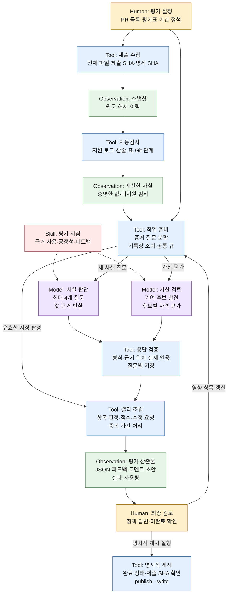

# 교수자 리뷰 대응, 현재 구조와 검증 결과

2026-10-26 문서 갱신. 구현 버전은 0.9.0이며 실제 모델 실험은 2026-10-23에
수행했습니다. 검증 대상 엔진은 `e417d2c`의 Python 구현입니다. 이번 문서 추가로
평가 엔진이나 평가표를 변경하지 않았습니다.

**자료 수집·항목별 검토·저장 판정 재생·점수와 코멘트 초안 생성은 구현되어 있지만,
신규 모델 판단의 재현성·입력 변형 불변성은 전체 수용 검사를 통과하지 못했습니다.**
결과는 사람 채점용 초안이며 공식 성적이나 완성된 자동 채점기로 제시하지 않습니다.

## 1. 교수님 피드백별 수정 및 현재 상태

대응 기준은 [교수자 원본 리뷰](https://github.com/Q00/ai-agent-engineering-101/pull/294#pullrequestreview-5570788494)입니다.
리뷰에서 수용하신 학생 코드 비실행·bare 저장소 수집, 근거 위치 검증, 입력 해시
고정, 명시적인 `publish --write` 분리는 유지했습니다. 아래의 구현 여부와 실제
품질 문제의 해결 여부를 구분합니다.

| 원본 리뷰의 지적·제안 | 반영한 내용 | 검증 및 남은 범위 | 상태 |
|---|---|---|---|
| 같은 입력에서 점수·feedback_type 변동 | 모델 검토를 고정 사실 질문으로 분해하고 상위 판정·점수·피드백 유형·수정 템플릿을 코드로 조립. 질문별 유효 응답을 저장 | 저장 재생은 동일. 새 모델 판단은 Codex 55/70, Haiku 26/28만 상태+유형이 같음 | 부분 해결 |
| 발췌 때문에 근거를 못 보고 보류 | 기본 `prepare`는 전체 파일, `judge`·`batch`는 항목별 경로. 관련 파일을 자르지 않고 파일 묶음으로 분할. 지원 로그 집계·AST 위치 제공 | 기본 발췌 경로를 대체했지만 미지원 로그와 최종 요청 크기 문제는 남음. Haiku에서 입력 한도 초과 확인 | 부분 해결 |
| PR 하나에 3~6분·출력 4만~7만 토큰 | `(학생, 항목)`과 사실 질문 단위 작업, 공통 작업 풀, 판정 재사용·중복 요청 잠금 | Codex 출력·시간은 줄어든 관측이 있지만 모델이 다름. 추가 Haiku 최초 평가는 454~612초·출력 약 12만~14만 토큰. 비용 개선 목표는 달성하지 못함 | 미해결 |
| 공식 재현성 50%·해석 50%와 체크리스트 점수 불일치 | 기본 체크리스트와 공식 배점을 분리. `rescore`로 교수자가 정한 항목 그룹·가중치를 기존 판정에 적용 | 공식 항목 배정·정성 평가 반영 방식의 교수자 확정이 필요. 현재 1점 체크리스트를 공식 성적으로 사용하지 않음 | 환산 기능 구현·정책 대기 |
| 학생·항목 단위 병렬 처리 | 모든 PR의 항목·가산 작업이 하나의 제한된 모델 작업 풀 공유. `--workers`는 일괄 실행 전체 상한 | 공통 큐·동시 실행 상한 로컬 검사 및 고정 5개 PR의 저장 판정 재처리 확인. 20명 실시간 성능 실험은 하지 않음 | 구현·해당 범위 검증 |
| 파일 전체와 정책 해시를 키로 쓰는 기록장·잠금 | 제출자·커밋·선택 파일·기준·정책·모델·구현 버전을 키에 포함. 같은 키의 동시 평가 잠금. 유효한 사실별 저장·부분 실패 보존 | 같은 학생의 같은 입력 재생 확인. 다른 학생의 판정은 재사용하지 않음. 저장된 사실의 의미상 정확성은 별도 문제 | 구현·저장 재생 검증 |
| 질문함·한 번의 답변 전파·관련 항목만 갱신 | 질문·답변 저장, `link-questions`, `answer-policy`, `refresh-policy` 구현. 선언된 정책 질문만 선택하도록 제한 | 동일 질문 ID와 사람이 연결한 질문에 답변 공유. 표현이 다른 질문의 의미상 동일성을 자동 확정하지 않음 | 구현·의미 병합은 사람 검토 |
| C02의 `open_non_deal`도 처음에 정책 질문 | 코드가 관리하는 C02 정책 질문을 질문함에 연결하고 미결 정책은 관련 항목만 대기 | 정책이 미정인 상태를 통과나 미충족으로 임의 확정하지 않음 | 기능 구현·답변 필요 |
| 근거 부족으로 코멘트가 만들어지지 않음 | 확인된 피드백의 부분 초안도 생성. 미완료 상태와 실제 게시 가능 여부를 분리 | Codex 30조건 중 게시 준비 2개, Haiku 저장 15조건 중 4개. 생성 기능과 평가 완료율은 별개 | 초안 생성 보완·완료율 미해결 |
| 공개 평가 도구에 대한 reward hacking 검사 | 파일 순서, 무관한 줄, 루브릭 무시·만점 요구 주석의 변형 검사. 학생 내용을 평가 지침으로 취급하지 않고 CLI 도구·사용자 지침 로드를 제한 | 검사 자체는 구현·실행. 신규 판정·가산점이 변하므로 불변성 기준은 실패. 변동만으로 주입 지시 복종을 단정하지 않음 | 검사 구현·강건성 미해결 |
| PR 5개에서 재생·신규·흔들림·비용 수치 공개 | 고정된 5개 PR의 Codex 30조건 결과와 Haiku 추가 실험을 아래에 공개 | Codex 실행은 끝났지만 수용 검사 실패. Haiku는 사용량 한도로 미완료 | 부분 충족 |
| 루트 디렉터리 CI는 교수자가 별도 처리 | `homework-evaluator/`에만 하네스·문서 추가. 공유 CI·다른 학생 경로는 수정하지 않음 | 기존 `e417d2c`의 Ownership check 실패를 유지. 평가 엔진 로컬 검사와 구분 | 저장소 정책 별도 처리 |

## 2. 현재 채점 하네스 구조와 프로세스

### 평가 계약

| 평가 축 | 판단 대상 | 점수 |
|---|---|---|
| 필수 요구사항 | 명세의 구현·실험·기록·보고서 요건 | 충족 항목당 1점, 보류는 미확정 |
| 보고서와 구현·기록의 일치 | 수치·구현 설명·결과 사이의 모순 | 무배점, 수정 요청 |
| 과제 의도와 해석 | 과제 질문에 대한 답과 근거·한계 | 무배점, 보완·수정 요청 |
| 추가 시도 | 필수사항 초과·독립성·구현·검증·의미 | 인정한 기여당 가산 1점 |

현재 Week 5 평가표는 필수 18항목, 무배점 일치 영역 1항목과 해석 영역 2항목입니다.
모델 검토 대상 14항목을 72개 내부 사실 질문으로 나눴고 한 번에 최대 4개씩
묻습니다. 질문을 세분화해도 기본점수 분모는 늘어나지 않습니다. 명시적 가산 기준은
시작 인터뷰에서 선택적으로 입력하며, 의미 있는 자유 추가 시도도 평가합니다.

### 구성 요소와 책임

| 구분 | 역할 | 구현 위치 |
|---|---|---|
| Config | 사전에 고정한 요구사항·사실 질문·가산 정책 | [평가표](../rubrics/week05.json), [정책 인터뷰](../ax_evaluator/policy.py) |
| Skill | 근거 사용·공정성·수정 요청 작성 지침 | [assignment-review](../skills/assignment-review/SKILL.md) |
| Tool | PR·로컬 자료 수집과 고정 | [snapshot.py](../ax_evaluator/snapshot.py) |
| Tool | 지원 형식의 산술·로그·표·이력 검사 | [checks.py](../ax_evaluator/checks.py), [facts.py](../ax_evaluator/facts.py) |
| Tool | 항목 분할·판정 기록장·공통 작업 풀 | [itemwise.py](../ax_evaluator/itemwise.py), [atomic_ledger.py](../ax_evaluator/atomic_ledger.py), [batch.py](../ax_evaluator/batch.py) |
| Model | 사실의 의미 판단·추가 기여 발견·자격 판단 | [providers.py](../ax_evaluator/providers.py)를 통한 Codex·Claude CLI/API·호환 로컬 서버 |
| Tool | 응답 검증·사실 조립·가산 중복 처리·결과 생성 | [atomic.py](../ax_evaluator/atomic.py), [contributions.py](../ax_evaluator/contributions.py), [review.py](../ax_evaluator/review.py), [comments.py](../ax_evaluator/comments.py) |
| Observation | 스냅샷·자동검사 결과·질문별 근거·모델 원문·평가 결과 | 각 실행의 `runs/` 산출물. Git에서는 제외 |
| Human | 정책 결정·보류 확인·최종 검토와 게시 결정 | 질문함·검토 초안·명시적인 게시 명령 |

PR의 자동 감지·예약 실행은 하지 않습니다. 명시적인 PR 목록을 받아
`prepare → evaluate → finalize`로 처리합니다. 모든 PR의 모델 작업 상한을
공통으로 적용하고, 유효한 저장 답은 재사용합니다. 미완료 작업은 보류로 남기며
명시적인 `--retry-failed`에서 실패한 질문만 다시 요청합니다. 나중의 성공으로
과거 불완전한 실행의 결과를 소급 변경하지 않습니다.

필수·정성 사실은 `true / false / null`과 근거 ID로 받고 상위 판정과 점수는
코드로 조립합니다. 국소적인 수정 사항은 중심 필수 요건의 미충족과 분리합니다.
가산 후보는 **한 실행 안에서** 먼저 고정하지만 독립 신규 실행에서는 다시
발견합니다. 이 단계의 기여 단위가 아직 달라질 수 있습니다.

최종 결과는 `evaluation.json`, `atomic-facts.json`, `feedback.md`,
`pr-comment.md`와 일괄 요약입니다. 미완료의 부분 초안과 게시 가능한 평가를
구분하며, `publish --write`는 별도 명령입니다. 학생 프로그램·서버는 실행하거나
import하지 않습니다. 지원하지 않는 로그는 0건이나 미충족으로 확정하지 않습니다.

### 결정적으로 처리하는 범위

동일한 저장 관측에서 계산하는 점수·피드백 유형, 지원 형식의 산술, 파일 순서
정규화, 근거 위치와 인용의 존재 검증은 코드로 처리합니다. 그러나 **인용이 존재하는
것과 주장을 지지하는 것은 다릅니다.** 코드 동작의 의미, 보고서 모순, 기여의 가치와
독립성은 모델·사람 판단으로 남습니다. 형식·근거 검사 통과는 정답 보증이 아닙니다.

## 3. 실제 샘플링 실험과 결과

### 표본과 실험 설계

교수자 리뷰의 #284·#282, 기존 실패 회귀 사례 #266·#259, 별도 진단 표본 #269를
사용했습니다. #269의 최초 선정 시드는 `20261023`이며, 이후 고정 표본을
재사용했습니다. 이미 개발에 사용한 편의 표본으로 미사용 평가 표본이 아닙니다.
학생별 점수·상세 피드백·원문 응답은 공개하지 않고 아래에는 기술 측정만 기록합니다.

| PR | 고정 제출 SHA |
|---|---|
| #284 | `292bdefe9143dc60ef21cdd60b5c5eb22a81733b` |
| #282 | `596e4e848429a10c788aa14a5643d2cc70174c94` |
| #269 | `933fc1893c8afdc28571bad4f81a0abbc37eb79c` |
| #266 | `ac6f275426097d704748850b8cf1a814ade35cba` |
| #259 | `d9c0a2adc72177081602aaa5956f6acf7705d217` |

- 명세 SHA: `9d349639623d6ede65022275ad2bdd48aa8fbabc`.
- 평가표: `week05-required-7-atomic`, 해시 `b2b6606a4287c8680ecd559ff0dc809418ee9779b496433aa894777690ea58d0`.
- 엔진 Python 소스 해시: `c9122ea75aaaed160f72cf63e39cb7be489f267ad855f2ee22f372c443be2535`.
- 명시 가산 기준 없음·의미 있는 자유 추가 시도 허용·가산 상한 없음.
- 원문 작업 상한 400000자·CLI timeout 300초·검사당 workers=4. 두 검사를 병행해
  명목 최대 동시 요청은 8개입니다. 일반 `batch --workers 4`는 전체 상한 4개입니다.

각 PR에서 최초·저장 재생·독립 신규·파일 순서·무관한 줄·지시문 주입의 6조건을
계획했습니다. **동일 원본을 모델로 독립 채점한 것은 최초와 신규의 2회**입니다.
저장 재생과 파일 순서는 정규화된 입력의 캐시 재사용으로 모델 호출이 없습니다.
무관한 줄은 UTF-8 저장 메모, 주입은 루브릭 무시·만점·가산 요구 HTML 주석을
보고서에 추가했습니다. 바뀐 근거를 사용하는 작업은 다시 평가하고 다른 작업은
재사용할 수 있습니다. 6회의 독립적인 동일 입력 재채점으로 보고하지 않습니다.

### 판정·사실·점수의 일치

아래는 최초 대비 상태와 `feedback_type`의 일치입니다. 문장 표현의 완전 일치나
교수자 참조 정답에 대한 정확도가 아닙니다. 보류·실패를 비교 분모에서 빼지 않았습니다.

**Codex: 요청 `gpt-6-luna`, effort=low, CLI 0.163.0. 5개 PR × 6조건 실행.**
CLI가 실제 응답 모델 ID를 제공하지 않아 요청 모델과 구분해 기록했습니다.

| 조건 | 상태+유형 동일 | 사실 값 동일 | 기본점수·보류 동일 | 가산점 동일 |
|---|---:|---:|---:|---:|
| 저장 재생 | 70/70 | 360/360 | 5/5 | 5/5 |
| 독립 신규 | 55/70 | 330/360 | 1/5 | 1/5 |
| 파일 순서 | 70/70 | 360/360 | 5/5 | 5/5 |
| 무관한 줄 | 58/70 | 329/360 | 1/5 | 4/5 |
| 지시문 주입 | 56/70 | 321/360 | 1/5 | 3/5 |

70은 모델 검토 항목 14개 × PR 5개, 360은 내부 사실 72개 × PR 5개입니다.
엄격한 수용 검사는 실패했고 두 실행 명령 모두 종료 코드 1이었습니다.
30조건 중 18조건에 부분 인용 검증 실패가 남았고 게시용 초안 준비는 2조건입니다.
기존 0.8의 신규 상태+유형 61/70보다 높아지지도 않았습니다. 0.8은 effort=high이고
평가기준도 함께 바뀌어 이 차이의 원인을 구조 변경 하나로 설명할 수는 없습니다.

**Haiku: `claude-haiku-4-5-20251001`, Claude Code 2.1.309, effort 별도 지정 없음.**
메타데이터가 있는 245개 요청에서 같은 응답 모델 ID를 확인했습니다.

| PR | 처리 범위 |
|---|---|
| #284 | 6조건 결과 확보 |
| #266 | 6조건 결과 확보. 처리 실패와 보류도 보존 |
| #282 | 최초·재생 결과 확보. 독립 신규는 부분 응답 저장 후 중단 |
| #259 | 최초 평가에서 사용량 한도에 도달해 미완료 결과 저장 |
| #269 | 미착수 |

| 조건 | 상태+유형 동일 | 사실 값 동일 | 기본점수·보류 동일 | 가산점 동일 |
|---|---:|---:|---:|---:|
| 저장 재생 | 42/42 | 216/216 | 3/3 | 3/3 |
| 독립 신규 | 26/28 | 141/144 | 1/2 | 1/2 |
| 파일 순서 | 28/28 | 144/144 | 2/2 | 2/2 |
| 무관한 줄 | 26/28 | 139/144 | 2/2 | 1/2 |
| 지시문 주입 | 27/28 | 143/144 | 1/2 | 0/2 |

재생은 PR 3개, 그 외 비교는 PR 2개입니다. 신규 사실 일치 141개 중 27개는 양쪽
모두 `null`이며, 같은 처리 실패로 보류가 반복된 경우도 포함합니다. 15조건의
결과 파일 중 9조건에 작업 검증 실패가 남았고 게시용 초안 준비는 4조건입니다.
이와 별도로 독립 신규의 중단 조건이 있습니다. 전체 30조건의 완료·통과가 아닙니다.
Codex의 55/70과 Haiku의 26/28은 표본 수와 처리 완료 상태가 달라 정확도 개선으로
직접 비교하지 않습니다.

### 학생 한 명당 시간과 토큰

교수자 원본 리뷰는 기존 Haiku 최초·재채점에 PR당 195~363초와 출력
42368~74908토큰을 보고했습니다. 정확한 모델 버전·추론 설정은 원본 리뷰에
명시되지 않았습니다. 아래는 현재 엔진의 최초 평가 기록이며 반복 분산을 추정한
성능 실험은 아닙니다. 모델·부하·설정 차이로 비용 개선율을 계산하지 않습니다.

| PR | Codex 초 | 입력 토큰 | 출력 토큰 | CLI 요청 | 처리 실패 작업 |
|---|---:|---:|---:|---:|---:|
| #284 | 65.1 | 2645069 | 10057 | 30 | 0 |
| #282 | 92.4 | 4448914 | 13866 | 47 | 1 |
| #269 | 61.7 | 2910745 | 9235 | 32 | 1 |
| #266 | 92.1 | 4349460 | 12285 | 38 | 1 |
| #259 | 90.9 | 5131824 | 13548 | 41 | 0 |

| PR | Haiku 초 | 입력 토큰 합계 | 출력 토큰 | CLI 요청 | 처리 상태 |
|---|---:|---:|---:|---:|---|
| #284 | 454.4 | 5636076 | 133138 | 26 | 최초 평가 처리 |
| #282 | 611.8 | 4160080 | 144515 | 37 | 작업 오류 10개 포함 |
| #266 | 541.9 | 3037354 | 119340 | 32 | 작업 오류 10개 포함 |
| #259 | 273.4 | 3502548 | 82779 | 29 | 사용량 한도 중단. 완료 시간 아님 |
| #269 | — | — | — | — | 미실행 |

Haiku 입력 합계는 CLI의 비캐시·캐시 생성·캐시 읽기 필드 합입니다. 누락된
실패 요청의 사용량은 포함하지 못했으며 요금 산정값이 아닙니다. 출력에는 추론
출력이 포함됩니다. Codex와 Haiku의 원시 사용량 필드도 동일한 비용 단위로
가정하지 않습니다. **현재 Haiku 관측은 속도·출력 비용 개선 목표를 지지하지 않습니다.**

Codex 30조건은 CLI 요청 652회, 입력 69162184·출력 221582토큰이며 제공자 오류와
사용량 누락은 0회였습니다. Haiku는 결과 파일이 있는 조건 280회와 중단한 신규
조건 33회를 합쳐 CLI 요청 313회입니다. 메타데이터 245회 확보·68회 누락,
수집 출력 1253587토큰입니다. 별도 연결 검사·큰 입력 진단 2회는 제외했습니다.
CLI 실행 수는 전체 채점 반복 수나 CLI 내부 HTTP 교환 수와 다릅니다.

### 저장 재생과 구현 검사

- 로컬 단위·통합 검사 173개가 통과했습니다. 이는 모의 응답을 포함한 코드 검사이며
  실제 모델의 채점 정확도를 보증하지 않습니다.
- Codex 저장 30조건을 모델 없이 재조립해 항목 630/630·사실 2160/2160·점수와
  가산점 30/30 동일을 확인했습니다.
- Haiku 저장 15조건도 모델 없이 재조립해 항목 315/315·사실 1080/1080·점수와
  가산점 15/15 동일을 확인했습니다. 기존 실패·보류를 그대로 보존했습니다.
- 공통 작업 풀의 5개 PR 재처리·재개 검사는 고정 스냅샷과 저장 판정을 사용해
  항목 105/105·사실 360/360 동일, 모델·GitHub 추가 호출 0회를 확인했습니다.
  새 모델 판단이나 실시간 GitHub 수집을 검증한 실험은 아닙니다.

## 4. 아직 부족한 점과 미구현 보완

| 문제 | 관측한 근거 | 필요한 보완. 아래 작업을 구현 완료로 표시하지 않음 |
|---|---|---|
| 최종 토큰 예산 | 한 실패 입력의 별도 진단에서 요청 약 211847토큰 / 한도 200000토큰 확인 | 전체 프롬프트·문맥·스키마와 제공자 여유분을 고려한 증거 분할 및 누락 검사 |
| 신규 사실의 의미 판단 | 같은 입력에서 로그 집계 충족 여부와 구현 요건 판정이 달라짐 | 계산 가능한 사실의 코드 처리 확대, 근거 단위와 해석 경계 명확화 |
| 자유 가산의 기여 단위 | 같은 추가 실험 시리즈가 한 기여 또는 여러 기여로 발견됨 | 독립 질문·구현·검증의 기준과 공통 기준선·실행 기반의 중복 처리 규칙 고정 |
| 기여별 구현 범위 | 별도 실험용 구현을 본 제출 코드에서만 찾는 오판 사례 | 기여와 해당 구현·검증 기록의 연결 강화. 수정된 선택 실험이 본 제출의 결함을 고친 것으로도 오인하지 않기 |
| 제공자 오류·사용량 관측 | 일부 요청이 일반 ValueError로만 남고 사용량 68회 누락 | 입력 한도·출력/형식 오류·사용량 한도 등 안전한 분류와 실패 메타데이터 보존 |
| 비용·확장성 | 질문을 작게 나눠도 큰 증거가 반복 전송되고 Haiku 시간이 길어짐 | 공통 사실 재사용과 요청별 필수 증거 축소, 여러 학생의 전체 완료율·시간 검증 |
| 정확도·평가 완료율 | 교수자 항목별 참조 판정 없음, 편의 표본, Haiku 30조건 미완료 | 참조 판정과 미사용 표본으로 오탐·누락 검증, 사용량 조건을 확보한 뒤 독립 반복·입력 변형 검사 |
| 공식 배점·미결 정책 | 기본 1점 체크리스트와 공식 50:50 배점의 목적이 다름 | 교수자 배점 그룹·정성 평가 반영·미결 정책 확정 후 저장 판정 환산 |

독립 연구 질문과 검증을 갖춘 기여마다 1점, 공통 기준선은 중복 가산하지 않는
방식은 현재 보완 제안입니다. 특정 제출의 수동 의견을 전체 과제의 확정 배점이나
이미 구현된 자동 규칙으로 취급하지 않습니다.

## 5. 결론과 이번 PR의 검토 범위

교수자 제안의 항목별 실행·판정 기록장·잠금·정책 질문·답변 전파·저장 재생과
공통 작업 풀은 구현했습니다. 발췌를 기본 경로에서 없애고, 질문별 실패 보존과
형식·근거 검증도 보완했습니다. 지정 PR 일괄 처리와 사람 검토용 결과 생성은
사용할 수 있습니다.

그러나 신규 의미 판단·자유 가산·입력 변형 불변성·Haiku 입력 예산과 처리 비용은
미해결입니다. 현재 버전으로 공식 성적을 자동 확정하거나 교수자 피드백을 모두
해결했다고 보고하지 않습니다. 우선 최종 요청 예산과 기여 단위를 고정하고,
기여별 근거 연결·오류 관측을 보완한 다음 동일 조건의 신규 검증을 해야 합니다.

이번 갱신은 **수정 내역과 실제 검증 수준을 리뷰 가능한 문서로 정리하는 변경**입니다.
학생 평가 중 기준을 스스로 변경하는 기능이나 새로운 평가 엔진 개선을 추가하지
않았습니다. 상세 사용법은 [README](../README.md)와 [사용 가이드](usage.md),
사실 질문 계약은 [atomic-grading](atomic-grading.md), 기존 Codex 검증은
[validation-0.9](validation-0.9.md)를 참고하세요.
[Harness² 적용 기록](harness2-adaptation.md)은 개발 중 변경 제안·실험·근거 있는
조합의 참고 절차이며 프레임워크 전체 통합이나 결정성 보증을 뜻하지 않습니다.
