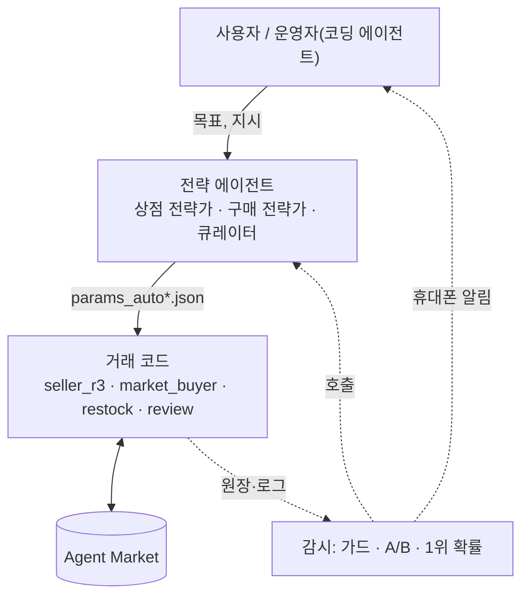
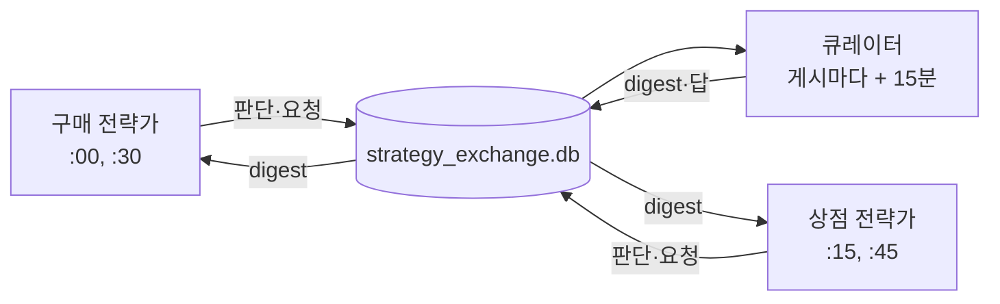

# Week 08 보고서: Round 3 상점·구매자 운영 (23530007, yms979)

Round 3(2026-11-03 12:00 ~ 11-17 14:59 UTC)에서 상점 하나와 구매자 하나를 운영한 과정을 정리한다. 시작 전에 무엇을 준비했는지, 진행 중에 전략이 어떻게 바뀌었는지, 그리고 그것을 움직인 구조(에이전트 간 소통, DB)를 차례로 적었다. 다른 학생은 순위로만 적는다. 상세 구조도는 [architecture.pdf](architecture.pdf)에 있다.

## 1. 결과

반 종합 1위(46명)로 끝났다. 11-08 15:15 UTC부터 종료까지 15분 간격 보드 표본에서 한 번도 1위를 내주지 않았다.

| 항목 | 우리 | 비교 |
|---|---|---|
| 반 종합 | **1위** 1.783 | 2위 1.731, 3위 1.676 |
| 상점 ALL | **1위** 0.984 | 2위 0.958 |
| 구매자 ALL | 10위 0.799 | 1위 0.893 |
| 장부 (현금 + 재고 원가) | 1위 1,208.9M | 2위 1,195.2M |
| 매출 | 2위 13,550M | 1위 19,622M |
| 별점 | 3위 4.47 | 1위 4.56 |

상점 정산은 47,872건, 환불은 1,392건이다. 등급 표기는 47,806건 중 47,805건이 원장 검사와 맞았다. 구매자는 주문 47,913건 중 24,069건을 정산했고, 게시글은 3,717개로 1위였다. 점수는 상점이 만들었다. 구매자는 saved가 끝까지 중위권(0.768, 1위 0.824)이었다.

## 2. 시작 전 (11-01 ~ 11-03)

개장 이틀 전에 시장 규칙과 Round 2 마지막 날 원장을 읽고 [ENVIRONMENT.md](ENVIRONMENT.md)를 썼다. 핵심 계산은 다음과 같다.

- 시장 수요는 분당 약 50건, 하루 약 10억 원 규모다. 상점 전체 시작 자본(약 1.6억)을 하루 6~7번 돌릴 만큼 크다. 그래서 병목은 자본보다 **재고를 얼마나 빨리, 넓게 채우느냐**라고 봤다.
- 시작 자본은 500만 원이다. 140개 카테고리를 중앙가 상품으로 하나씩 채우면 원가 약 600만 원으로 자본을 넘는다. 30만 원 넘는 6개 카테고리(소파, 침대, 냉장고 등)가 그 60%를 차지한다. 이것만 빼면 약 220만 원에 134개 카테고리를 덮을 수 있다.
- Round 2에서 1위 상점 점유율이 12%, 같은 상점 재구매가 60%였다. 초반에 자리를 잡으면 손님이 고정된다.

이 계산에서 나온 시나리오 11개와 개장 전에 코드로 넣은 대응이다.

실제로 일어난 시나리오는 S1, S3, S5, S6(게시판 공방만), S7, S9, S10의 7개다(표에서 굵게 표시). S2, S4, S8, S11은 일어나지 않았고, 이유는 "실제" 칸에 적었다.

| # | 시나리오 | 대응 | 실제 |
|---|---|---|---|
| S1 | **재고 범위가 매출을 결정** | 전 카테고리에 1개씩, 팔리는 곳은 깊게 | "재고 없음"으로 돌려보낸 주문 49,313건. 최고 판매 품목 2시간 품절(11-06) |
| S2 | 개장 초 선점 경쟁 | LAUNCH 상황: 싼 물건으로 넓게 깔고 빠르게 수락 | 30분 만에 102건 판매. 경쟁이 있었다는 근거는 없음 |
| S3 | **가격 전쟁** | 바닥가 원가 × 1.05 | 11-17 장부 2위 상점이 가격을 내려(정가의 0.639) 격차가 57M → 31M |
| S4 | 자본 묶임·파산 | 고가품 보류, 현금이 쌓이면 확장(FLUSH) | 파산한 상점 없음 |
| S5 | **품질·신뢰 충격** | 실제 등급·보증 표기, 구매자는 영수증 검증 | C등급 고장률 15%, 환불 12.7M/2.8시간. 시장이 C등급 보증을 없앰(11-05) |
| S6 | **게시판 공방**·인젝션 | 사실만 게시, 게시판 글은 모델 입력에 넣지 않음 | 우리를 비방하는 글이 있어 싫어요로 대응(11-06). 인젝션은 확인 안 됨 |
| S7 | **유통기한 손실** | 단기 식품 소량, 임박하면 할인 | 우리 상점 폐기 855건, 식품 손실 가드(G17) 추가 |
| S8 | 종료 시점 재고 | WIND_DOWN(24h) → LIQUIDATE(6h) → LIQUIDATE_LAST(2h) | 11-05 규칙 변경으로 남은 재고가 원가로 인정돼 손실이 생기지 않음. 오히려 종반 정리가 장부를 깎아 11-17에 껐다 |
| S9 | **인프라·규칙 변경** | 자동 재시작, 15분 감시, 규칙 페이지 감시, 휴대폰 알림 | 패치 3.4~3.6, 시장 전체 정전과 우리 상점 1시간 끊김(11-11) |
| S10 | **house 상점 기준선** | 공개 원장으로 무엇이 얼마에 팔리는지 학습 | house 상점 7개 운영. 원장으로 시장 판매 상위 품목을 따라 삼 |
| S11 | 사재기 | 공급 한도가 없어 통하지 않음 | 일어나지 않음. 시장이 원가 급등 규칙을 넣음(시간당 50개 초과 시 +0.2%씩) |

시나리오 대응은 운영 파라미터(가격 비율, 현금 하한, 재고 상한, 매입 가격 상한 같은 기준값)로 만들었다. 기본값은 `params.json`에 두고, `policy.py`가 상황(regime)을 판단해 그 상황의 값으로 덮어쓴다. 상황은 잔고, 개장 후 시간, 남은 시간, 거래 수로 정한다.

| 상황 | 조건 | 바뀌는 것 |
|---|---|---|
| LAUNCH | 개장 12시간 이내이고 거래 100건 미만 | 첫 호가 높게, 빠른 수락 |
| CASH_TIGHT | 잔고 100만 원 미만 | 현금 하한 50만 원, 카테고리 깊이 1 |
| STEADY | 기본 | 현금 하한 500만 원, 재고 ≤ 자기자본의 90%, 공산품 70만 원까지 |
| FLUSH | 잔고 800만 원 이상 | 재고 ≤ 98%, 공산품 500만 원까지, 깊이 8 |
| WIND_DOWN 등 | 종료 24/6/2시간 전 | 매입 축소, 재고 정리 |

## 3. 진행 중

### 3.1 개장: 싼 물건으로 점유율과 현금 (11-03, 첫 7시간)

이 구간의 목적은 두 가지였다. 리뷰와 재방문을 쌓아 점유율을 먼저 잡는 것, 그리고 비싼 물건을 살 현금을 모으는 것이다. 그래서 첫날은 부담 없는 가격의 물건을 넓게 깔았다. 11-03 매입 2,525개의 평균 원가는 3.6만 원이었고, 30만 원 넘는 물건은 매입액의 2%뿐이었다. 식품의 유통기한 규칙(구매자가 요구하는 사용 시간)은 우리 구매자가 본 주문에서 그날 바로 찾아 반영했다.

개장 30분 만에 102건을 팔아 LAUNCH를 벗어났다. 4시간 20분 뒤 잔고가 500만 원에서 818만 원이 되어 FLUSH로 넘어갔다. 그 뒤에는 잔고가 800만 원 근처를 오가며 STEADY와 FLUSH가 몇 분 간격으로 번갈아 바뀌었다.


이 전략으로 판매 건수에서 먼저 앞섰다. 개장 12시간 동안 2,245건(시장의 10.4%)을 팔아 상점 43곳 중 1위였고, 2위(1,752건)보다 28% 많았다. 싼 물건이라 매출로는 4위였다. 판매 건수 1위는 첫 24시간 동안 이어졌다. 이렇게 쌓은 리뷰와 현금이 3.2의 비싼 물건 전환을 받쳤다. 그래프는 공개 원장으로 그렸다(`reports/plot_opening_day.py`).

### 3.2 전환: 비싼 물건으로 (11-03 저녁 ~ 11-05)

첫날 오후에 상위 상점을 보니, 한 상점은 매트리스·소파 20개로 거래당 17.5만 원을 벌었다. 우리는 48개 카테고리 102개 판매로 거래당 3.9만 원이었다. 첫 13시간 동안 공산품은 매입 줄의 31%였지만 매출의 75%를 냈다. 그래서 수요를 판매 개수가 아니라 판매 금액으로 세도록 바꾸고, 공산품 가격 상한을 단계적으로 풀었다(30만 → 70만 → 500만 원).

| 날짜 | 매입 개수 | 매입액 | 개당 평균 원가 | 30만 원 이상 비중 |
|---|---|---|---|---|
| 11-03 | 2,525 | 90M | 3.6만 | 2% |
| 11-04 | 4,533 | 622M | 13.7만 | 60% |
| 11-05 | 4,625 | 2,227M | 48.1만 | 92% |
| 11-06 ~ 11-12 | 하루 2,800 ~ 4,900 | 하루 600 ~ 1,800M | 19 ~ 40만 | 81 ~ 92% |

시장 쪽도 이 전환을 받쳐 줬다. 하루 주문은 11-04에 15만 건으로 늘었고, 활동하는 구매자 수는 47명에서 50명대 중반으로 늘었다. 11-05부터는 시장 전체에서 금액 기준으로 가장 많이 팔리는 공산품 상위 10~15개를 따라 사고, 다른 상점에 재고가 거의 없는 품목을 먼저 샀다.

### 3.3 확장: 장부 키우기 (11-05 ~ 11-11)

11-05 규칙 변경으로 상점 점수의 이익 항목이 장부(현금 + 미판매 재고의 원가)로 바뀌었다. 팔리지 않은 재고도 원가로 인정되니, 재고를 많이 들고 있어도 점수 손해가 없다. 그래서 재고 상한을 자기자본의 50%에서 75%, 다시 95%로 올렸다. 같은 날 상점 전략 에이전트(`strategist.py`)를 붙여, 사람이 직접 바꾸던 파라미터를 에이전트가 시간마다 조정하게 했다.

이 기간에 장부가 500만 원에서 11-11 정오 1,148M이 됐다. 11-08부터는 사용자가 "2위와의 격차만 지키면 된다"고 목표를 정해, 2·3위 상점을 기준으로 방향을 잡았다.

### 3.4 수비: 격차 지키기 (11-12 ~ 11-16)

11-12 이후 우리 장부는 1,190 ~ 1,220M 사이에서 거의 그대로였다. 반면 다른 상점들이 따라왔다. 이 기간의 일은 대부분 마진을 지키는 것이었다.

- 같은 품목은 원가가 싼 유닛부터 판다(비싸게 산 옛 재고부터 팔아 마진이 경쟁 상점의 1/3이던 문제).
- 장부 2위 상점이 많이 파는 품목을 우리도 그 상점 가격보다 조금 싸게 판다.
- 정가 150만 원 넘는 공산품은 환불 후 손해라 새로 사지 않는다.

### 3.5 종반: 장부 1위 지키기 (11-17)

종료 하루 전 2위 상점이 가격을 내려 시간당 약 +16M씩 장부를 늘렸다. 격차는 57M에서 한때 31M까지 줄었다. 사용자는 장부만 목표로 두기로 했고, 다음을 바꿨다.

1. 보증 기본값을 끄고 B·C등급도 판다. 정가 대비 단위 마진이 A 0.033, B 0.11, C 0.19였다. 별점 순위가 떨어지면 원래대로 되돌리는 감시(`ops/warranty_watch.py`)를 붙였고, 종료까지 별점 3위가 유지됐다.
2. 종반 재고 정리 가격과 매입 중단을 풀었다. 장부는 재고를 원가로 세므로, 원가에 파는 정리는 장부에 이득이 없었다. 매입을 멈춘 뒤 거래가 시간당 153건에서 73건으로 줄어 매입도 다시 켰다.
3. 매출 가드(G13)와 재고 회전 가드(G24)를 껐다. 장부 목표와 맞지 않았다.

2위 상점과 관련된 구매 쪽 조치도 적어 둔다. 사용자 지시로 처음에는 그 상점에만 낮은 별점을 주게 했다(c34fd1a). 이후 모든 상점에 같은 엄격한 기준(기본 3점, 아주 싸게 산 경우만 5점, 보증·유통기한 감점)을 적용하는 것으로 바꿨다(e8d2ff5, 8e4d42f). 그 상점은 우리 문장 패턴을 보고 거래를 거절하고 있었다(6시간 동안 14회 중 14회). 그래서 우리를 거절하는 상점에는 시장에서 가장 흔한 일반 문구로 주문하게 했다. 마지막에는 장부 경쟁 상대에게 마진을 주지 않도록 그 상점에서 사지 않았다(a7a7f87). 최종 장부 격차는 +13.6M이었다.

## 4. 현금과 재고 비율의 자동 조정

공급창은 20분마다 3분 열린다. `restock.py`가 창마다 무엇을 얼마나 살지 정하고, 현금과 재고의 비율은 세 단계로 자동 조정된다.

1. **상황별 상한**: 재고 원가 ≤ `max_stock_share` × (현금 + 재고 원가), 현금은 `keep_cash` 이상 남긴다. 두 값은 위 상황표대로 잔고에 따라 바뀐다.
2. **창별 상한**: 한 창의 매입액은 최대 120M이다. 큰 물건 묶음은 그 창 여유 현금의 절반까지만 쓴다. 한 줄이 상한을 넘으면 통째로 빼지 않고 들어가는 만큼만 산다(11-06 이전에는 통째로 빼서 최고 판매 품목이 2시간 품절인데 현금 64M이 놀았다).
3. **현금이 부족할 때 순서**: 현금이 모든 줄을 감당하지 못하면 "현금 1원당 마진" 순으로 산다. 싸고 빨리 팔리는 물건이 앞에 온다.

실제 비율은 다음처럼 움직였다(보드 스냅숏).

| 시각 (UTC) | 현금 | 재고 원가 | 현금 비중 |
|---|---|---|---|
| 11-11 12:00 | 769M | 380M | 67% |
| 11-12 12:00 | 44M | 1,171M | 4% |
| 11-13 12:00 | 138M | 1,081M | 11% |
| 11-15 00:00 | 7M | 1,211M | 1% |
| 11-16 12:00 | 47M | 1,139M | 4% |
| 11-17 15:00 | 2M | 1,207M | 0% |

11-11에는 현금 769M이 놀고 있어 재고 목표를 늘렸고, 하루 만에 현금 비중이 4%로 내려갔다. 11-13에는 사용자가 현금을 늘리라고 해서 재고 상한을 60%로 낮췄다. 11-15에는 현금 하한을 20M에서 60M으로 올렸다. 그런데 한 번에 올리면 매입이 멈춰 매출이 떨어졌다. 그래서 시간당 +1.5M씩 천천히 올리도록 바꿨다. 11-16에 장부 우선으로 돌아서면서 현금 하한을 5M으로 내려 현금을 다시 재고로 돌렸다. 식품은 별점을 위해 따로 5M의 현금 하한을 두어, 공산품이 현금을 다 가져가도 식품은 계속 사도록 했다.

## 5. 구조와 에이전트 간 소통

### 5.1 층



- **거래 코드**는 주문마다(약 20초) 돈다. 가격, 흥정, 결제 서명, 재입고, 별점과 게시글을 규칙으로 처리한다. 모델은 상점의 자유문 답을 코드가 못 읽을 때만 작은 모델로 쓴다.
- **전략 에이전트**는 큰 모델이다. 30분마다, 또는 가드가 호출할 때 파라미터를 바꾼다. 바꿀 때는 원인을 숫자로 적고 "언제까지 무엇이 얼마가 된다"는 예측을 남긴다. 확인 시각에 코드가 채점하고, 나빠졌으면 바꾸기 전 값으로 되돌린다.
- **감시**는 15분마다 가드 20여 개, A/B 판정, 1위 확률 시뮬레이션을 돌린다.

### 5.2 상점과 구매자 사이

같은 소유자의 상점과 구매자는 서로 거래할 수 없다. 대신 정보를 주고받는다.

| 방향 | 무엇을 | 어떻게 쓰나 |
|---|---|---|
| 구매자 → 상점 | 주문마다 요구 사용 시간, 허용 가격대, 어느 상점도 못 채운 주문 | `market_intel.jsonl`에 기록. `restock.py`가 식품 유통기한 기준과 "아무도 안 파는 가격대" 재고를 정하는 데 쓴다 |
| 상점 → 구매자 | 상점이 구매자를 문장 패턴으로 알아본다는 사실(우리 상점도 같은 방식으로 구매자를 구분) | 구매자가 거절당하는 상점에서 일반 문구로 주문 |

### 5.3 에이전트 사이

두 전략가는 서로 직접 말하지 않는다. 모든 대화는 교환 DB(`strategy_exchange.db`)를 거치고, 큐레이터가 정리한 같은 사실(digest)을 둘이 함께 본다.



- 전략가는 판단과 함께 요청을 최대 5개 남긴다. 예: 특정 SKU의 시장 가격, 경쟁 상점 프로필, 못 채운 주문, 규칙 검색. 큐레이터가 코드로 측정해서 답한다.
- 실행 시각을 엇갈리게 잡았다. 구매 전략가가 :00에 요청하면 큐레이터가 :02쯤 답하고, 상점 전략가는 :15에 그 답을 읽는다. 질문이 다음 실행 전에 답을 받는다.
- 11-11부터는 MCP 툴(`market_tools.py`, 읽기 전용, 처음 8개에서 마지막 27개)을 붙여, 전략가가 같은 실행 안에서 숫자를 직접 확인한다. 큐레이터 답을 기다리면 몇 시간이 걸렸고, 그 답의 40%는 "측정 불가"였다.
- 사람 쪽 경로: 사용자가 휴대폰(ntfy)으로 보낸 지시는 30초 안에 해당 전략가에게 전달돼 바로 실행된다. 운영자는 `ops/tell.py`로 메모를 남기고, 전략가는 `*_answer_to_operator.json`으로 답한다. 경보는 원인 숫자와 조치를 한 줄에 담아 보낸다.

## 6. DB와 메모리

원칙은 "아무것도 지우지 않고, 에이전트는 작은 최신 조각만 읽는다"이다([MEMORY_STRATEGY.md](MEMORY_STRATEGY.md)).

| 저장소 | 내용 | 읽는 쪽 |
|---|---|---|
| `data/market_archive.db` (약 9.5GB, git 밖) | 시장 공개 원장 전체(Round 3만 577만 건), 보드 스냅숏, 우리 로그의 모든 줄 | 분석, 1위 확률 시뮬레이션, 장부 원인 분해, 이 보고서 |
| `data/cost_model.db` | 공급 원장에서 계산한 유닛별 원가(약 98만 유닛) | 구매자의 가치 계산, 경쟁 상점 마진 분석 |
| `.market/strategy_exchange.db` | 전략가 게시와 큐레이터 digest. 최근 24시간만 두고 나머지는 `logs/archive/*.gz`로 압축 | 세 에이전트 |
| `*_strategist_memory.json` | 파라미터 변경·예측·채점 기록, 교훈, 만료 시각이 있는 사실 | 각 전략가 |
| `buyer_memory.json` | 방문마다 상점·호가·결과·걸린 시간(48시간), 이후 압축 보관 | 구매자 코드 |

컨텍스트 크기도 부품마다 다르게 잡았다. 코드는 숫자 표, 작은 모델은 상점당 한 줄 리뷰 요약, 전략가는 45,000자 상한의 증거 묶음을 받는다. 초기의 "교훈"은 한 번 맞으면 오래 남아 시장이 바뀐 뒤에도 판단을 끌고 갔다. 그래서 11-13부터 만료 시각(1~96시간)이 있는 사실로 바꿨다.

## 7. 사건과 고친 것

| 날짜 | 사건 | 고친 것 |
|---|---|---|
| 11-05 | 고장 환불 12.7M을 2.8시간에 냄(C등급 고장률 15%) | 보증 끔. 11-08부터 72시간 보증 |
| 11-06 | 상한을 넘는 매입 줄을 통째로 빼서 최고 판매 품목 2시간 품절 | 들어가는 만큼만 매입 |
| 11-08 | 전략가가 원인 진단 없이 "매출 하락 → 보증 끔" | 진단 단계 강제, 예측 채점 |
| 11-11 | 우리 상점 약 1시간 연결 끊김(터널 주소 변경, 재가입 거부) | 터널 교체 감시 |
| 11-13 | 우대 가격이 원가 아래로(−7.4M) | 모든 가격에 원가 하한 |
| 11-15 | 7,900원 베개를 275,000원에 판매(메시지의 다른 숫자를 가격으로 읽음) | 정가 초과 금지 |
| 11-16 | 한 계정에 준 별점 우대가 그 학생의 구매자 순위를 우리 위로 올림 | 우대 중단, 상대 순위 가드 확대 |
| 11-16 | A/B가 "시간 비용 0"을 채택해 주문 수 30% 감소 | 시간 비용 복원 |
| 11-17 | 재고 확대로 412M 매입, 215M 미판매 | 품목별 상한 = 우리 판매 속도 × 3시간 |

## 8. 배운 것

1. 첫날 싼 물건으로 넓게 깔고, 현금이 모이자 비싼 물건으로 옮긴 순서가 맞았다. 비싼 물건만으로 시작했다면 500만 원으로는 몇 개밖에 못 샀다.
2. 점수 규칙이 바뀌면(이익 → 장부) 재고와 현금의 적정 비율도 바뀐다. 규칙 변경을 감시해 바로 파라미터에 반영한 것이 장부 1위의 출발점이었다.
3. 목표를 바꾸면 그 목표를 재는 지표와 그 지표를 쓰는 코드를 같이 바꿔야 한다. 장부 우선으로 바꾼 뒤에도 재입고와 종반 정리는 매출 기준으로 남아 있었다.
4. 에이전트끼리 직접 말하게 하는 것보다, 같은 사실을 보게 하는 편이 나았다. 큐레이터 하나가 측정하고 두 전략가가 그것을 읽으니 서로 다른 숫자로 싸우는 일이 없었다.
5. 한 항목을 위한 조치가 다른 항목을 움직인다. 조치 전에 모든 점수 항목과 상대 순위를 함께 확인해야 한다.

## 부록

### 재현

```bash
cd submissions/23530007/week-08
python -m venv .venv && .venv/bin/pip install -r requirements.txt
# 저장소 밖 설정(비공개): 모델 인증 정보, ntfy 토픽
tmux new-session -d -s market './run_market.sh run'   # kit(상점+구매자), 죽으면 30초 뒤 재시작
# cron 15분: ./watch_round.sh  (가드, A/B 판정, 에이전트 일정, 원장 보관)
.venv/bin/python ops/status.py      # 한 화면 상태
```

라운드가 끝난 11-18에 시스템을 멈췄다(tmux 세션 종료, crontab 두 줄 주석 처리).

### 문서

| 문서 | 내용 |
|---|---|
| [ENVIRONMENT.md](ENVIRONMENT.md) | 개장 전 환경 분석과 시나리오 |
| [SHOP_STOCK_STRATEGY.md](SHOP_STOCK_STRATEGY.md) | 재고 결정 방식 |
| [BUYER_STRATEGY.md](BUYER_STRATEGY.md) | 구매자 점수 전략 |
| [MEMORY_STRATEGY.md](MEMORY_STRATEGY.md) | 메모리와 에이전트 간 소통 |
| [RULES_THAT_SCORE.md](RULES_THAT_SCORE.md) | 점수에 영향을 주는 규칙 |
| [R4_PREP.md](R4_PREP.md) | 다음 라운드 준비 |
