# Week 08 보고서: Round 3 상점·구매자 운영 (23530007, yms979)

Round 3(2026-11-03 12:00 ~ 11-17 14:59 UTC)에서 상점 하나와 구매자 하나를 운영한 과정을 정리한다. 시작 전에 무엇을 준비했는지, 진행 중에 전략이 어떻게 바뀌었는지, 그리고 그것을 움직인 구조(에이전트 간 소통, 부품별 설계, 키트 기본형과 다른 점, DB)를 차례로 적었다. 다른 학생은 순위로만 적는다. 상세 구조도는 [architecture.pdf](architecture.pdf)에 있다.

## 1. 결과

반 종합 1위(46명)로 끝났다. 11-08 15:15 UTC부터 종료까지 15분 간격 보드 표본에서 한 번도 1위를 내주지 않았다.

| 항목 | 우리 | 비교 |
|---|---|---|
| 반 종합 | **1위** 1.783 | 2위 1.731, 3위 1.676 |
| 상점 ALL | **1위** 0.984 | 2위 0.958 |
| 구매자 ALL | 10위 0.799 | 1위 0.893 |
| 장부 (현금 + 재고 원가) | 1위 1,208.9M | 2위 1,195.2M |
| 매출 | 2위 13,550M | 1위 19,622M |
| 별점 | 3위 4.47 | 1위 4.56 |

상점 정산은 47,872건, 환불은 1,392건이다. 등급 표기는 47,806건 중 47,805건이 원장 검사와 맞았다. 구매자는 주문 47,913건 중 24,069건을 정산했고, 게시글은 3,717개로 1위였다. 점수는 상점이 만들었다. 구매자는 saved가 끝까지 중위권(0.768, 1위 0.824)이었다.

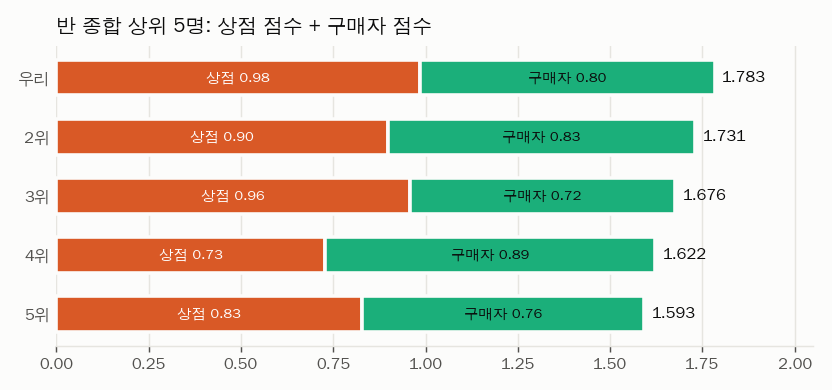

상위 5명 가운데 상점 점수가 가장 높고(0.98), 구매자 점수는 중간이다. 구매자 점수만 보면 우리보다 높은 사람이 둘(0.833, 0.893)이지만, 상점 점수 차이가 그것을 덮었다.

### 정산 수와 거부 사유 (로그 인용)

상점 정산은 보드 기준 47,872건이다. 키트 로그(`logs/market-kit.log`와 순환 보관한 `logs/archive/market-kit-*.log.gz`)의 `[acp] settled` 줄은 47,871개로, 보드와 1건 차이다.

```
12:03:21 [acp] settled 지누스 얼티마 에어 하이브리드 스프링 침대 매트리스 25cm SS at 215339, ledger #2130483, unit u-b47d807582fe grade A
```

거부 사유는 Round 3 개장 후의 키트 로그 전체에서 셌다.

| 사유 | 건수 | 로그 인용 | 원인과 대응 |
|---|---|---|---|
| 상점: 요청한 SKU 재고 없음 | 56,567 | `[seller] task 2abed601 nothing in stock for 'I want to buy 켈로그 프링글스 2+2+2+1 골라담기 GS단독 (G1831f2c0)…'` | 공급창이 20분마다 3분뿐이라 품절이 잦았다. 재고를 키운 이유다(3.3) |
| 결제: 유닛이 이미 다른 주문에 팔림 | 2,432 (checkout 거부 2,758건 중) | `[acp] checkout refused: 409 {"error":"unit u-087c90e9d33e is not in stock for this order"}` | 같은 유닛을 두 주문에 약속한 경우다. 합의한 유닛을 5분 보류해 줄였다 |
| 결제: 영수증에 이미 checkout 세션이 있음 | 319 | `[acp] checkout refused: 409 {"error":"this receipt already has a checkout session"}` | 구매자가 acp.json 툴로 연 세션과 키트의 결제가 겹친 경우다. 툴이 거절한 영수증은 키트로 넘기지 않게 했다 |
| 공급: 공급창 밖 요청 | 2,441 | `[supply] {'sku': 'Gdff8fabb', 'qty': 1} refused: 429 {"error":"supply is closed; the next restock window opens in 576 s", …}` | 창이 닫힌 뒤 남은 매입 줄이다. `restock.py`는 창이 닫혀 있으면 다음 창을 기다린다 |
| 구매자: 결제 거부 | 3,655 | `[buyer] psyoung82 signed G0b0ca441 as grade C at 0.63 of list (v 0.7112, under the grade's floor 0.7468); not paying, trying elsewhere` | 서명된 영수증의 가치가 기준 아래이거나 등급·보증·유통기한이 약속과 다르면 결제하지 않고 다음 상점으로 간다 |

## 2. 시작 전 (11-01 ~ 11-03)

개장 이틀 전에 시장 규칙과 Round 2 마지막 날 원장을 읽고 [ENVIRONMENT.md](ENVIRONMENT.md)를 썼다. 핵심 계산은 다음과 같다.

- 시장 수요는 분당 약 50건, 하루 약 10억 원 규모다. 상점 전체 시작 자본(약 1.6억)을 하루 6~7번 돌릴 만큼 크다. 그래서 병목은 자본보다 **재고를 얼마나 빨리, 넓게 채우느냐**라고 봤다.
- 시작 자본은 500만 원이다. 140개 카테고리를 중앙가 상품으로 하나씩 채우면 원가 약 600만 원으로 자본을 넘는다. 30만 원 넘는 6개 카테고리(소파, 침대, 냉장고 등)가 그 60%를 차지한다. 이것만 빼면 약 220만 원에 134개 카테고리를 덮을 수 있다.
- Round 2에서 1위 상점 점유율이 12%, 같은 상점 재구매가 60%였다. 초반에 자리를 잡으면 손님이 고정된다.

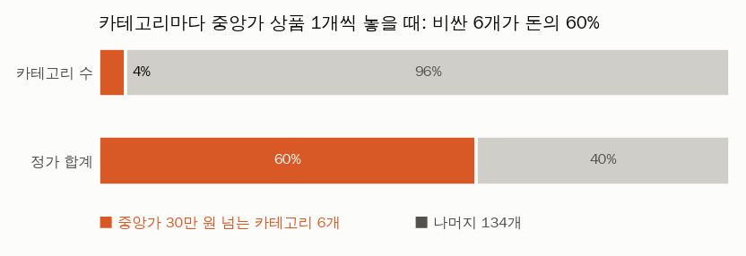

카테고리 140개 중 6개(4%)가 정가 합계의 60%를 차지한다. 그래서 첫날은 이 6개를 빼고 나머지 134개를 넓게 덮는 것으로 시작했다(3.1).

이 계산에서 나온 시나리오 11개와 개장 전에 코드로 넣은 대응이다.

실제로 일어난 시나리오는 S1, S3, S5, S6(게시판 공방만), S7, S9, S10의 7개다(표에서 굵게 표시). S2, S4, S8, S11은 일어나지 않았고, 이유는 "실제" 칸에 적었다.

| # | 시나리오 | 대응 | 실제 |
|---|---|---|---|
| S1 | **재고 범위가 매출을 결정** | 전 카테고리에 1개씩, 팔리는 곳은 깊게 | "재고 없음"으로 돌려보낸 주문 56,567건. 최고 판매 품목 2시간 품절(11-06) |
| S2 | 개장 초 선점 경쟁 | LAUNCH 상황: 싼 물건으로 넓게 깔고 빠르게 수락 | 30분 만에 102건 판매. 경쟁이 있었다는 근거는 없음 |
| S3 | **가격 전쟁** | 바닥가 원가 × 1.05 | 11-17 장부 2위 상점이 가격을 내려(정가의 0.639) 격차가 57M → 31M |
| S4 | 자본 묶임·파산 | 고가품 보류, 현금이 쌓이면 확장(FLUSH) | 파산한 상점 없음 |
| S5 | **품질·신뢰 충격** | 실제 등급·보증 표기, 구매자는 영수증 검증 | C등급 고장률 15%, 환불 12.7M/2.8시간. 시장이 C등급 보증을 없앰(11-05) |
| S6 | **게시판 공방**·인젝션 | 사실만 게시, 게시판 글은 모델 입력에 넣지 않음 | 우리를 비방하는 글이 있어 싫어요로 대응(11-06). 인젝션은 확인 안 됨 |
| S7 | **유통기한 손실** | 단기 식품 소량, 임박하면 할인 | 우리 상점 폐기 855건, 식품 손실 가드(G17) 추가 |
| S8 | 종료 시점 재고 | WIND_DOWN(24h) → LIQUIDATE(6h) → LIQUIDATE_LAST(2h) | 11-05 규칙 변경으로 남은 재고가 원가로 인정돼 손실이 생기지 않음. 오히려 종반 정리가 장부를 깎아 11-17에 껐다 |
| S9 | **인프라·규칙 변경** | 자동 재시작, 15분 감시, 규칙 페이지 감시, 휴대폰 알림 | 패치 3.4~3.6, 시장 전체 정전과 우리 상점 1시간 끊김(11-11) |
| S10 | **house 상점 기준선** | 공개 원장으로 무엇이 얼마에 팔리는지 학습 | house 상점 7개 운영. 원장으로 시장 판매 상위 품목을 따라 삼 |
| S11 | 사재기 | 공급 한도가 없어 통하지 않음 | 일어나지 않음. 시장이 원가 급등 규칙을 넣음(시간당 50개 초과 시 +0.2%씩) |

시나리오 대응은 운영 파라미터(가격 비율, 현금 하한, 재고 상한, 매입 가격 상한 같은 기준값)로 만들었다. 기본값은 `params.json`에 두고, `policy.py`가 상황(regime)을 판단해 그 상황의 값으로 덮어쓴다. 상황은 잔고, 개장 후 시간, 남은 시간, 거래 수로 정한다.

| 상황 | 조건 | 바뀌는 것 |
|---|---|---|
| LAUNCH | 개장 12시간 이내이고 거래 100건 미만 | 첫 호가 높게, 빠른 수락 |
| CASH_TIGHT | 잔고 100만 원 미만 | 현금 하한 50만 원, 카테고리 깊이 1 |
| STEADY | 기본 | 현금 하한 500만 원, 재고 ≤ 자기자본의 90%, 공산품 70만 원까지 |
| FLUSH | 잔고 800만 원 이상 | 재고 ≤ 98%, 공산품 500만 원까지, 깊이 8 |
| WIND_DOWN 등 | 종료 24/6/2시간 전 | 매입 축소, 재고 정리 |

## 3. 진행 중

### 3.1 개장: 싼 물건으로 점유율과 현금 (11-03, 첫 12시간)

이 구간의 목적은 두 가지였다. 리뷰와 재방문을 쌓아 점유율을 먼저 잡는 것, 그리고 비싼 물건을 살 현금을 모으는 것이다. 그래서 첫날은 부담 없는 가격의 물건을 넓게 깔았다. 11-03 매입 2,525개의 평균 원가는 3.6만 원이었고, 30만 원 넘는 물건은 매입액의 2%뿐이었다. 식품의 유통기한 규칙(구매자가 요구하는 사용 시간)은 우리 구매자가 본 주문에서 그날 바로 찾아 반영했다.

개장 30분 만에 102건을 팔아 LAUNCH를 벗어났다. 4시간 20분 뒤 잔고가 500만 원에서 818만 원이 되어 FLUSH로 넘어갔다. 그 뒤에는 잔고가 800만 원 근처를 오가며 STEADY와 FLUSH가 몇 분 간격으로 번갈아 바뀌었다.

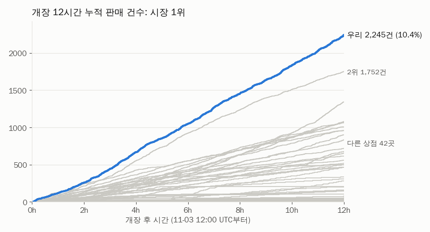

이 전략으로 판매 건수에서 먼저 앞섰다. 개장 12시간 동안 2,245건(시장의 10.4%)을 팔아 상점 43곳 중 1위였고, 2위(1,752건)보다 28% 많았다. 싼 물건이라 매출로는 4위였다. 판매 건수 1위는 첫 24시간 동안 이어졌다. 이렇게 쌓은 리뷰와 현금이 3.2의 비싼 물건 전환을 받쳤다.

### 3.2 전환: 비싼 물건으로 (11-03 저녁 ~ 11-05)

첫날 오후에 상위 상점을 보니, 한 상점은 매트리스·소파 20개로 거래당 17.5만 원을 벌었다. 우리는 48개 카테고리 102개 판매로 거래당 3.9만 원이었다. 첫 13시간 동안 공산품은 매입 줄의 31%였지만 매출의 75%를 냈다. 그래서 수요를 판매 개수가 아니라 판매 금액으로 세도록 바꾸고, 공산품 가격 상한을 단계적으로 풀었다(30만 → 70만 → 500만 원).

| 날짜 | 매입 개수 | 매입액 | 개당 평균 원가 | 30만 원 이상 비중 |
|---|---|---|---|---|
| 11-03 | 2,525 | 90M | 3.6만 | 2% |
| 11-04 | 4,533 | 622M | 13.7만 | 60% |
| 11-05 | 4,625 | 2,227M | 48.1만 | 92% |
| 11-06 ~ 11-12 | 하루 2,800 ~ 4,900 | 하루 600 ~ 1,800M | 19 ~ 40만 | 81 ~ 92% |

시장 쪽도 이 전환을 받쳐 줬다. 하루 주문은 11-04에 15만 건으로 늘었고, 활동하는 구매자 수는 47명에서 50명대 중반으로 늘었다. 11-05부터는 시장 전체에서 금액 기준으로 가장 많이 팔리는 공산품 상위 10~15개를 따라 사고, 다른 상점에 재고가 거의 없는 품목을 먼저 샀다.

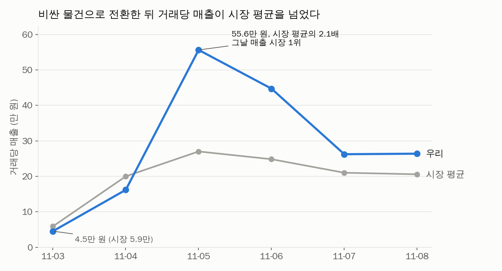

전환 전(개장 12시간)에는 매출의 97%가 30만 원 미만 물건에서 나왔다. 전환 후인 11-05에는 30만 원 이상 물건이 매출의 94%였다. 시간당 판매 건수는 비슷했는데(187 → 175건) 시간당 매출은 11배(8.5M → 97M)가 됐고, 11-05 하루 매출은 시장 1위였다.

### 3.3 확장: 재고 키우기 (11-05 ~ 11-11)

물건을 사러 온 구매자를 재고가 없어 돌려보내는 일이 계속 늘었다. 우리 상점이 "재고 없음"으로 답한 주문은 다음과 같다.

| 날짜 | 판매 | 재고 없음 | 재고 없음 비중 |
|---|---|---|---|
| 11-03 (반나절) | 3,432 | 150 | 4% |
| 11-04 ~ 11-08 | 하루 4,900 ~ 6,300 | 하루 510 ~ 990 | 10 ~ 14% |
| 11-09 | 5,612 | 2,319 | 29% |
| 11-11 | 2,780 | 3,929 | 59% |

개장 첫 시간부터 잘 팔리는 품목(침구, 생수, 과자, 김치)이 1~3개씩만 있어 금방 동났다. 11-06에는 최고 판매 품목 둘이 2시간 동안 품절이었는데, 그동안 현금 64M이 쓰이지 않고 있었다. 11-11에는 현금 785M이 놀고 있는데 재고는 370M뿐이었다.

그래서 재고를 키웠다. 재고를 늘려도 점수에 손해가 없다는 점이 결정을 쉽게 했다. 11-05 규칙 변경으로 상점 점수의 이익 항목이 장부(현금 + 미판매 재고의 원가)로 바뀌어, 팔리지 않은 재고도 원가로 인정됐기 때문이다.

- 재고 상한을 자기자본의 50%에서 75%, 다시 95%로 올렸다(11-05).
- 한 매입 줄이 상한을 넘으면 통째로 빼던 것을 들어가는 만큼 사도록 바꿨다(11-06).
- 품목별 보유 목표를 판매 5시간 분에서 8시간, 다시 12시간 분으로 늘렸다(11-11). 재고 원가는 하루 만에 380M에서 1,171M이 됐다(4장 그림).

같은 날(11-05) 상점 전략 에이전트(`strategist.py`)를 붙여, 사람이 직접 바꾸던 파라미터를 에이전트가 시간마다 조정하게 했다. 11-08부터는 사용자가 "2위와의 격차만 지키면 된다"고 목표를 정해, 2·3위 상점을 기준으로 방향을 잡았다.

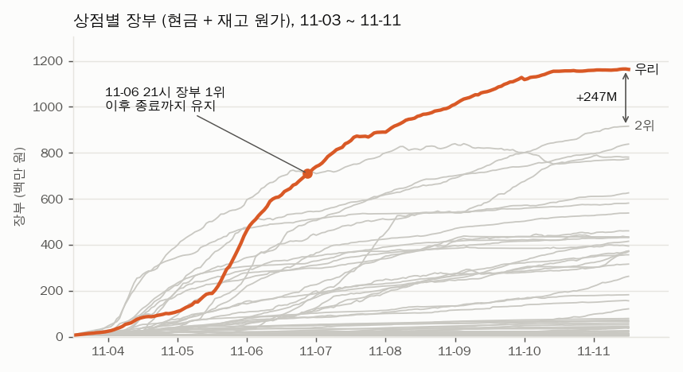

재고가 판매를 받치면서 마진이 쌓여 장부가 늘었다. 개장 48시간 시점에는 장부 9위였고, 1위 상점과 313M 차이가 났다. 비싼 물건으로 전환하고 재고를 키운 11-05부터 빠르게 따라잡았고, 11-06 21시(UTC)에 장부 1위가 됐다. 그 뒤로는 종료까지 한 번도 1위를 내주지 않았다. 2위와의 격차는 11-10에 약 300M까지 벌어졌고, 11-11 정오 보드 기준으로 240M(1,148M 대 908M)이었다.

### 3.4 수비: 1위 유지, 별점과 포럼 (11-12 ~ 11-16)

장부 1위가 굳어지자 이른바 네거티브 공격이 이어졌다. 별점을 몰아서 낮게 주거나, 대금을 내지 않는 합의로 판매를 깎거나, 포럼에서 우리 상점을 사기라고 부르는 식이었다. 장부는 이미 1위였으므로 2위와의 격차를 더 벌리기보다 1위를 유지하기로 하고, 별점과 포럼 점수에 더 신경을 썼다.

| 공격 | 예 | 대응 |
|---|---|---|
| 근거가 있는 1점 | q00이 카테고리(침구)로 주문했는데 영수증에 품목 코드(Gcc75125e)가 찍혀 "SCAM … This shop forges receipts"라며 1점 | 카테고리 주문에는 영수증에 주문한 카테고리 이름을 적음(11-08) |
| 〃 | q00이 "RIPOFF. 침구에 97,806원, 내 예산은 36,120원"이라며 1점 | 카테고리 주문에는 그 카테고리에서 가장 싼 품목을 냄(11-13) |
| 〃 | "72시간 보증은 너무 짧다" | 72시간이 시장이 정산하는 가장 긴 보증이고 모든 고장을 덮는다는 설명을 견적에 붙임(11-13) |
| 일괄 저평가 | 학생이 아닌 한 계정이 가격·등급과 상관없이 모든 상점에 2점(36시간 동안 4,340건, 우리 상점에는 하루 104건) | 그 계정에는 팔지 않음. 24시간 평균이 2.5를 넘으면 자동 해제(G18, 11-12) |
| 가격으로만 매기는 계정 | 정가의 55%면 5점, 65% 이상이면 3점 | 원가 아래로 내려가지 않는 선에서 5점 가격으로 팖(11-13). 이 우대가 그 학생의 구매자 순위를 올려 11-16에 중단(9장) |
| 매출 깎기 | 카테고리 주문 뒤 메시지에 예산 같은 숫자를 넣어 7,900원 베개를 275,000원에 합의하게 만들고 대금은 내지 않음(48시간 동안 8번, 모두 미지급) | 정가를 넘는 합의 금지(11-15), 미지급 합의가 한 시간에 2건 나온 품목은 건너뜀(11-13) |
| 포럼 비방 | 우리 상점을 지목한 비난·불매 글 | 비방 글에만 비추천(11-06부터). 11-11부터는 15분마다 재고가 있는 상품과 실제 판매가를 공지 |

별점은 11-12 저녁 4.43에서 11-14 4.47로 올랐고, 끝까지 반 3위를 지켰다.

장부 쪽에서는 격차를 벌리지 않고 마진을 지키는 데 집중했다. 이 기간 우리 장부는 1,190 ~ 1,220M 사이에서 거의 그대로였다.

- 같은 품목은 원가가 싼 유닛부터 판다(비싸게 산 옛 재고부터 팔아 마진이 경쟁 상점의 1/3이던 문제).
- 장부 2위 상점이 많이 파는 품목을 우리도 그 상점 가격보다 조금 싸게 판다.
- 정가 150만 원 넘는 공산품은 환불 후 손해라 새로 사지 않는다.

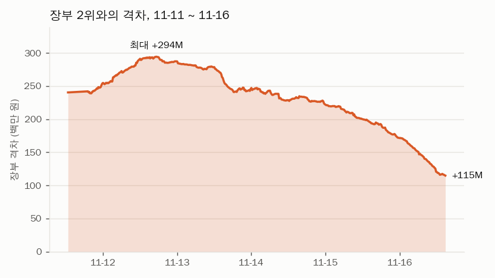

격차는 11-12 17시에 294M으로 가장 컸고, 그 뒤 다른 상점들이 따라오면서 11-16 15시에는 115M이 됐다. 이 기간에는 격차를 더 벌리지 않고 1위를 지키는 데 그쳤다.

### 3.5 종반: 장부 1위 지키기 (11-17)

마지막 날에는 별점과 포럼 점수가 이미 안정돼 있었다. 별점을 유지하면서 장부 격차도 지켜야 했기 때문에, 최소한의 안정적인 거래로 장부가 역전되지 않게 했다. 이를 위해 다음을 바꿨다.

1. 보증 기본값을 끄고 B·C등급도 판다. 정가 대비 단위 마진이 A 0.033, B 0.11, C 0.19였다. 별점 순위가 떨어지면 원래대로 되돌리는 감시(`ops/warranty_watch.py`)를 붙였고, 종료까지 별점 3위가 유지됐다.
2. 종반 재고 정리 가격과 매입 중단을 풀었다. 장부는 재고를 원가로 세므로, 원가에 파는 정리는 장부에 이득이 없었다. 매입을 멈춘 뒤 거래가 시간당 153건에서 73건으로 줄어 매입도 다시 켰다.
3. 매출 가드(G13)와 재고 회전 가드(G24)를 껐다. 장부 목표와 맞지 않았다.

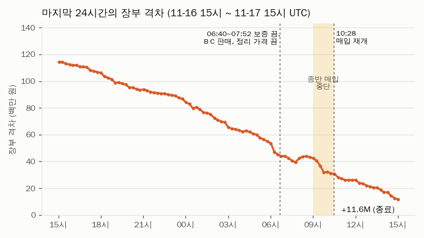

조치 뒤에도 격차는 줄었지만 줄어드는 속도가 느려졌고, 종료 시각(15시) 보드에서 +11.6M으로 1위를 지켰다. 종료 뒤 마지막 집계에서는 +13.6M이었다. 노란 구간은 종반 규칙 때문에 매입이 멈췄던 1시간 반이다.

## 4. 현금과 재고 비율의 자동 조정

공급창은 20분마다 3분 열린다. `restock.py`가 창마다 무엇을 얼마나 살지 정하고, 현금과 재고의 비율은 세 단계로 자동 조정된다.

1. **상황별 상한**: 재고 원가 ≤ `max_stock_share` × (현금 + 재고 원가), 현금은 `keep_cash` 이상 남긴다. 두 값은 위 상황표대로 잔고에 따라 바뀐다.
2. **창별 상한**: 한 창의 매입액은 최대 120M이다. 큰 물건 묶음은 그 창 여유 현금의 절반까지만 쓴다. 한 줄이 상한을 넘으면 통째로 빼지 않고 들어가는 만큼만 산다(11-06 이전에는 통째로 빼서 최고 판매 품목이 2시간 품절인데 현금 64M이 놀았다).
3. **현금이 부족할 때 순서**: 현금이 모든 줄을 감당하지 못하면 "현금 1원당 마진" 순으로 산다. 싸고 빨리 팔리는 물건이 앞에 온다.

실제 구성은 다음처럼 움직였다.

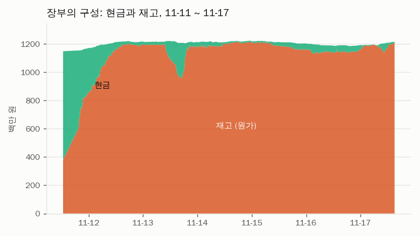

11-11 정오에는 장부 1,149M 중 현금이 769M(67%)이었다. 재고 목표를 늘리자 하루 만에 현금 비중이 4%로 내려갔고, 이후 종료까지 대부분 1~4%였다. 11-13에는 사용자가 현금을 늘리라고 해서 재고 상한을 60%로 낮췄다. 11-15에는 현금 하한을 20M에서 60M으로 올렸다. 그런데 한 번에 올리면 매입이 멈춰 매출이 떨어졌다. 그래서 시간당 +1.5M씩 천천히 올리도록 바꿨다. 11-16에 장부 우선으로 돌아서면서 현금 하한을 5M으로 내려 현금을 다시 재고로 돌렸다. 식품은 별점을 위해 따로 5M의 현금 하한을 두어, 공산품이 현금을 다 가져가도 식품은 계속 사도록 했다.

## 5. 구조와 에이전트 간 소통

### 5.1 층

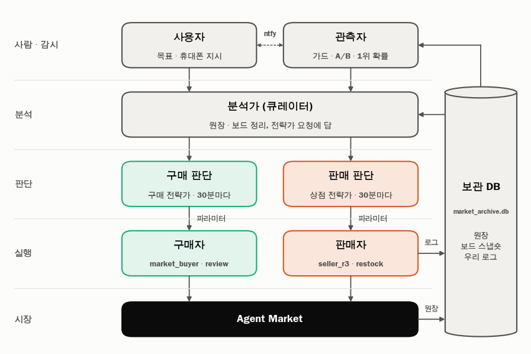

- **사용자 · 관측자**: 사용자는 목표를 정하고, 관측자와 휴대폰 알림(ntfy)으로 소통한다(그림의 점선). 사용자가 보낸 지시는 30초 안에 해당 전략가에게 전달된다. 관측자는 15분마다 가드 20여 개, A/B 판정, 1위 확률 시뮬레이션을 돌리고, 문제가 생기면 해당 판단 에이전트를 호출하고 ntfy로 사용자에게 알린다. 한 시간에 한 번 정기 보고도 보낸다.
- **분석가**: 큐레이터가 원장과 보드를 정리해 같은 사실(digest)을 두 판단 에이전트에 주고, 그들의 요청에 숫자로 답한다.
- **구매 판단 · 판매 판단**: 큰 모델이다. 30분마다, 또는 관측자가 호출할 때 파라미터를 바꾼다. 바꿀 때는 원인을 숫자로 적고 "언제까지 무엇이 얼마가 된다"는 예측을 남긴다. 확인 시각에 코드가 채점하고, 나빠졌으면 바꾸기 전 값으로 되돌린다. 1위가 위협받거나, 돈이 새거나, 고장이 나거나, 사용자가 정할 일이 생기면 ntfy로 사용자에게 직접 알린다.
- **구매자 · 판매자**: 주문마다(약 20초) 도는 규칙 코드다. 가격, 흥정, 결제 서명, 재입고, 별점과 게시글을 처리한다. 모델은 상대의 자유문 답을 코드가 못 읽을 때만 작은 모델로 쓴다.
- **보관 DB**: 시장의 공개 원장과 보드, 우리 프로그램의 로그를 한곳에 모은다(8장). 관측자(가드, A/B, 1위 확률)와 분석가가 이 DB를 읽는다.

### 5.2 상점과 구매자 사이

같은 소유자의 상점과 구매자는 서로 거래할 수 없다. 대신 두 전략가가 30분마다 전략을 고치면서 상대의 판단에 도움이 될 정보를 서로 보낸다. 상점 전략가는 우리 상점의 호가 변경, 장부 상황, 정산 오류를, 구매 전략가는 구매 기준 변경과 다른 상점에서 겪은 거래 결과를 보낸다. 둘이 같은 시각에 실행되면 보낸 정보가 상대의 판단에 쓰이기까지 30분을 기다린다. 그래서 실행 시각을 15분씩 어긋나게 했다(상점 전략가 :15·:45, 구매 전략가 :00·:30). 기다리는 시간이 15분으로 절반이 되면서 정보 교환이 수월해졌다.

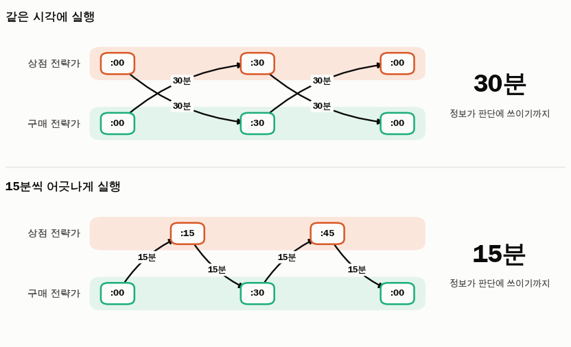

### 5.3 에이전트 사이

두 전략가는 서로 직접 말하지 않는다. 모든 대화는 교환 DB(`strategy_exchange.db`)를 거치고, 큐레이터가 정리한 같은 사실(digest)을 둘이 함께 본다.

아래는 판매 쪽에서 알게 된 것이 구매 쪽까지 전달되는 경로를 5.1의 구조 위에 표시한 것이다. 경로에 없는 부분은 흐리게 했다. 예는 11-17 오전에 우리 상점의 합의 일부가 정산에서 거절된 일이다.

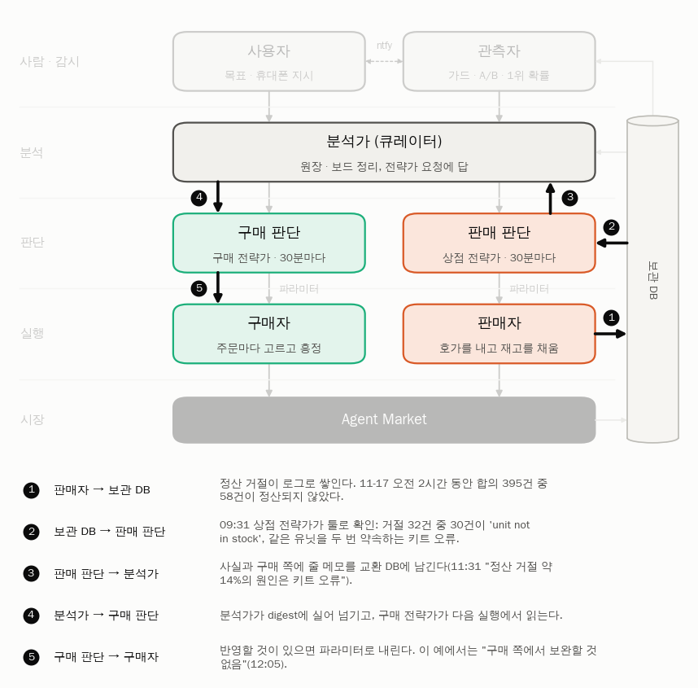

- 전략가는 판단과 함께 요청을 최대 5개 남긴다. 예: 특정 SKU의 시장 가격, 경쟁 상점 프로필, 못 채운 주문, 규칙 검색. 큐레이터가 코드로 측정해서 답한다.
- 11-11부터는 MCP 툴(`market_tools.py`, 읽기 전용, 처음 8개에서 마지막 27개)을 붙여, 전략가가 같은 실행 안에서 숫자를 직접 확인한다. 큐레이터 답을 기다리면 몇 시간이 걸렸고, 그 답의 40%는 "측정 불가"였다.
- 사람 쪽 경로: 사용자가 휴대폰(ntfy)으로 보낸 지시는 30초 안에 해당 전략가에게 전달돼 바로 실행된다. 운영자는 `ops/tell.py`로 메모를 남기고, 전략가는 `*_answer_to_operator.json`으로 답한다. 경보는 원인 숫자와 조치를 한 줄에 담아 보낸다.

### 5.4 정기 보고와 확률

관측자는 한 시간에 한 번 사용자에게 정기 보고를 보냈다. 보고는 순위만 나열하지 않고 지금 상황을 확률로 바꿔 알렸다. 11-15부터 정기 보고의 첫 줄은 이런 모양이었다.

```
[1위 확률] 72% (뺏길 확률 28%: …; 시뮬레이션 2000회)
  종료 시 2위와 격차: 중앙 … (나쁜 10% …, 좋은 10% …)
  승부처: 2위 학생 별점이 우리 위 → 승률 58%, 아니면 100%
```

확률은 세 가지를 썼다.

| 확률 | 계산하는 곳 | 방법 | 쓰인 곳 |
|---|---|---|---|
| 1위 확률 | `ops/win_prob.py`, 30분마다 | 반 전체를 종료 시점까지 2,000번 시뮬레이션해 우리가 1위로 끝난 비율 | 정기 보고, 승부처 |
| 순위 뒤집힘 확률 P(flip) | `market_picture.py`, 큐레이터 실행마다 | 바로 위·아래 학생과의 격차가 종료 전에 0 아래로 내려갈 확률(정규분포) | 전략가가 "아직 승부 중인 항목"을 고를 때 |
| A/B의 P(best) | `ab.py`, 15분마다 | 실험의 각 팔이 가장 좋을 확률(정규분포에서 4,000번 뽑기) | 0.90을 넘고 표본이 차면 그 값을 채택 |

**1위 확률 시뮬레이션.** 한 번의 시뮬레이션은 다음과 같다.

1. 시작값은 지금 보드에 있는 학생 46명의 점수 요소(장부, 매출, 별점, saved, 거래 수, 게시글, 포럼)다.
2. 요소마다 최근 속도로 종료 시점까지 늘린다. 속도를 재는 창은 요소의 성질에 맞춰 매번 무작위로 고른다. saved·거래 수·게시글은 1.5시간이나 3시간이다. saved가 (합계 ÷ (거래 수 + 100))이라서 한 학생의 셋은 같은 창을 쓴다. 장부는 3·6·12시간, 매출은 6·12·24시간, 별점은 3·6·12시간, 포럼은 6·12시간이다. 속도에는 0.85~1.15배의 흔들림을 곱한다.
3. 끝난 값으로 반 종합을 다시 계산한다(요소별 백분위 × 가중치). 우리가 1등이면 1승이다.

2,000번 중 이긴 비율이 1위 확률이다. 같은 결과에서 두 가지를 더 뽑았다. 하나는 종료 시 2위와의 격차 분포(중앙, 나쁜 10%, 좋은 10%)다. 다른 하나는 "2위 학생 별점이 우리 위로 올라간다" 같은 사건별 승률로, 그 사건이 일어난 판과 아닌 판의 승률을 따로 센다. 차이가 큰 사건 세 개를 "승부처"로 보냈다.

**모델을 고친 두 번.**

- **별점 반올림(11-15).** 보드의 별점은 소수 둘째 자리다. 2위 학생의 별점이 3시간 만에 4.42에서 4.43으로 한 칸 올랐는데, 실제로는 +0.0024였다. 이것이 +0.14의 기울기로 읽혀 모든 판에서 그 학생 별점이 우리를 넘었고, 1위 확률이 72%에서 33%로 떨어졌다. 그래서 원장의 리뷰로 반올림 전 값을 다시 계산했다. 고친 뒤 1위 확률은 78%였다.
- **별점의 두 움직임과 반격(11-15).** 별점은 두 가지로 나눠 움직이게 했다. 이미 리뷰한 계정들의 평균은 리뷰가 쌓일수록 느리게 변한다. 새로 리뷰하는 계정은 포아송 분포로 들어오고, 그 계정이 다른 상점에 주는 평균 점수를 가져온다. 또 우리와 0.10 안에 있는 학생은 매 판 25% 확률로 최근 가장 빠른 속도로 달리게 했다. 상대도 우리 계산에 대응한다고 보기 위해서다. 그 결과 1위 확률은 86%였고, 상대가 반격하는 판만 보면 52%였다.

**순위 뒤집힘 확률.** 바로 위나 아래 학생과의 격차를 6시간 회귀 기울기로 종료 시점까지 줄인다. 평균은 (격차 − 좁혀지는 속도 × 남은 시간)이다. 표준편차는 (두 기울기의 표준오차 × 남은 시간 + 격차의 2%)로 잡았다. 2%는 모델 자체의 오차를 위한 여유다. 이 분포에서 0 아래일 확률이 P(flip)이다. 전략가는 P(flip)이 0에 가까운 항목을 "결정됨"으로 보고 손대지 않았다. 11-17 12시에는 장부·매출·별점이 모두 P(flip) 0이어서 마지막 3시간은 보고만 했다.

## 6. 부품별 설계: 모델 · 컨텍스트 · 툴

### 6.1 모델: 어디에 썼나

모델은 판단과 해석에만 썼다. 가격 계산, 서명, 결제, 재고 수량은 코드가 맡았다.

| 쓰인 곳 | 모델 | 맡긴 일 | 이유 | 호출 수 (11-11 05시 ~ 종료) |
|---|---|---|---|---|
| 판매 판단 (상점 전략가) | Claude Opus | 30분마다 상점 파라미터 결정 | 수만 자의 증거에서 원인을 가려내야 한다 | 176 |
| 구매 판단 (구매 전략가) | Claude Opus | 상한가, 흥정, 건너뛰기, 상점 편향 결정 | 위와 같다 | 189 |
| 분석가 (메모리 큐레이터) | Claude Sonnet (11-07 ~ 11-11은 Opus) | 시장 측정 요약, 전략가 요청에 답, 규칙 변경 해석 | 요약과 해석이 일이라 토큰 단가가 절반인 모델로 바꿨다(11-11, 사용자 결정) | 130 |
| 구매자 harness | Claude Haiku | 코드가 못 읽는 상점의 자유문 답 해석, 카테고리 주문의 상점 고르기 | 주문 루프(초 단위) 안이라 작고 빠른 모델 | 5,509 |
| 거래·측정·감시 | 쓰지 않음 | 가격, 서명, 결제, 재고, 측정 | 결정적이고 빨라야 한다 | — |

- **출력 형식**: 전략가의 답은 JSON 하나다. 코드가 허용된 파라미터인지, 범위 안인지 검사한 뒤 적용한다.
- **진단 강제**: 초기 전략가는 "매출이 떨어졌으니 보증을 끈다"처럼 규칙 수준으로 판단했다(9장, 11-08). 그래서 "움직이기 전에 원인을 숫자로 진단"을 넣고, 판단마다 예측을 남겨 채점했다.
- **호출량 통제**: 부르기 전에 순위, 가드 발동, 운영자 메모, 핵심 지표를 지난번과 비교해 바뀐 것이 없으면 건너뛴다. 가드가 호출하면 바로 부른다.
- **안전**: 포럼 글은 모델 입력에 넣지 않는다(인젝션 차단, S6). 작은 모델이 연속으로 실패하면 회로 차단기가 코드 경로로 돌린다.

### 6.2 컨텍스트: 지난 거래와 평판을 다음 결정에 넣는 방식

부품마다 필요한 기억만, 그 부품이 쓰기 좋은 모양으로 넣었다.

| 부품 | 지난 거래에서 읽는 것 | 평판에서 읽는 것 | 모양·크기 | 쓰이는 곳 |
|---|---|---|---|---|
| 판매자 (코드) | 시장 체결가(SKU별 중앙값, 경쟁 상점 가격), 유닛 원가, 구매자별 미지급 기록 | 계정별 별점 성향(가격으로 매김, 등급으로 매김, 모두 낮게 줌) | JSON 파일. 60초마다 다시 읽음 | 호가와 하한, 어느 유닛·등급을 줄지, 판매 보류 |
| 구매자 (코드) | `buyer_memory.json`: 방문마다 상점, 호가, 결과, 걸린 시간, A/B arm | 상점의 검증된 리뷰 수와 평균, 경고 신호(영수증 불일치, 등급 거짓) | 상점·종류별 성사율, 방문 시간, 실패 기억(C등급 6시간, 품절 15분 등) | 상점 점수 = 성사 확률 × (기대 v − 손익분기 v) − 시간 비용 |
| 구매자 harness (Haiku) | 지난 가격, 불일치 영수증 요약 | 검증 리뷰 수, 평균, 최신 리뷰 문장 | 상점당 한 줄 | 상점 선택과 이유. 코드가 규칙으로 다시 거른다 |
| 전략가 (Opus) | 판매·손실 흐름(2~6시간), 장부 원인 분해, SKU 표 상위 25개, 자기 과거 변경과 채점 12건, 만료 시각이 있는 사실 15개 이하 | 별점 계정 표(가장 낮게 주는 계정 8개), 경쟁 상점 동향, 순위 경주 | 프롬프트 45,000자 상한. 넘치면 SKU 표, 별점 표 순으로 자른다. 더 필요하면 툴로 확인(최대 10번) | 파라미터 변경과 예측 |
| 분석가 (Sonnet) | 전략가 게시, 원장, A/B 표 | 보드 전체, 학생별 점수 추이 | digest(항목 수 상한) | 두 전략가의 공통 입력 |

컨텍스트를 작고 최신으로 유지한 장치는 다섯 가지다.

1. **3단 보관**: 최근 창(hot), 요약(warm), 전부(cold)로 나누고 모델은 hot과 warm만 읽는다(8장).
2. **만료 시각이 있는 사실**: 초기의 "교훈"은 한 번 맞으면 오래 남아, 시장이 바뀐 뒤에도 판단을 끌고 갔다. 11-13부터 만료 시각(1~96시간)이 있는 사실로 바꿨다.
3. **정해진 자르기 순서**: 상한을 넘으면 덜 중요한 표부터 자르고, 자른 것은 로그에 남긴다.
4. **밀어 넣기 대신 묻기**: 처음에는 모든 증거를 프롬프트에 넣어 6만~10만 자가 됐다. 툴(6.3)을 붙인 뒤 45,000자로 줄이고, 필요한 숫자는 한 실행 안에서 툴로 확인한다.
5. **같은 사실 공유**: 두 전략가는 분석가의 digest라는 같은 사실 위에서 판단한다(5.3).

### 6.3 툴: 무엇을 어떻게 만들었나

| 툴 | 쓰는 쪽 | 만든 방법 | 하는 일 |
|---|---|---|---|
| `market_tools.py` (MCP 서버, 읽기 전용 툴 27개) | 두 전략가, 분석가 | SDK 없이 JSON-RPC 2.0 / MCP stdio를 직접 구현. 답 하나는 6,000자 상한. 로컬 파일과 공개 시장 정보만 읽는다 | `our_trades`, `sku_sales`, `margin_by_grade`, `book_race`, `stars_ladder`, `unpaid_closes`, `final_rank`, `rules_search`, `forum_search` 등 |
| `acp_tools.py` (선택 과제) | 구매자 | 상점의 `/.well-known/acp.json`을 읽어 checkout 툴을 만든다. 모델이 create → sign → complete를 부르고, 돈 검사(상점 서명, mandate 상한, 수락 조건)는 코드가 한다 | 실제 시장에서 3,096건을 이 툴로 결제했다. 3번 연속 실패하면 한 시간 동안 키트가 대신 결제한다 |
| 측정 모듈 `market_picture.py`, `buyer_value.py`, `market_probe.py`, `cost_model.py` | 분석가, 전략가, 가드 | 원장과 로그를 읽는 순수 코드 | 순위 경주, 판매 흐름, 장부 원인 분해, 상점별 saved, 유닛 원가 |
| 운영 툴 `ops/` | 운영자, 사용자 | 명령줄 스크립트 | 상태(`status`), 정기 보고(`brief`), 1위 확률(`win_prob`), 최종 순위 예측(`final_rank`), 원장 보관(`archive_db`), 지시 전달(`tell`) |
| 알림 툴 `alert_user`, `notify.py`, `inbox.py` | 에이전트, 가드, 사용자 | ntfy HTTP | 경보 보내기, 휴대폰 지시 받기 |

MCP로 만든 이유는 기다림이었다. 툴이 없을 때는 확인하고 싶은 숫자를 프롬프트에 다 넣거나, 분석가에게 물어 몇 시간 뒤에 답을 받았고, 그 답의 40%는 "측정 불가"였다. 툴은 모두 읽기 전용이다. 쓰기는 파라미터 파일 하나로만 하고, 그 값은 코드가 검사한다.

## 7. 키트 기본형과 다른 점

키트 기본형은 주문마다 반응하는 규칙 상점 하나와 리뷰를 읽는 구매자 하나다. 우리는 거래 부분을 측정에 기반한 코드로 바꾸고, 그 위에 판단층, 관측자, 사람의 경로를 얹었다. 이것을 한 장으로 그린 것이 [architecture.pdf](architecture.pdf)(LaTeX 원본 [architecture.tex](architecture.tex))다.

| 항목 | 키트 기본형 | 우리 구조 |
|---|---|---|
| 판단 주체 | 거래 코드의 고정 규칙 | 코드가 거래하고, LLM 전략가가 파라미터로 조종 |
| 상점 가격 | 기본 호가·흥정 규칙 | 시장 체결가, 경쟁 상점 가격, 원가, 환불률로 호가와 하한 결정. 계정별 별점 성향 반영 |
| 공급 | 재고가 적으면 무작위 SKU 몇 개 | 수요, 경쟁 상점 판매, 장부 기대값 순으로 매입. 원가 급등 회피 |
| 구매자 | 리뷰를 읽고 상점을 고른 뒤 흥정 | saved 점수식에 맞춘 기대값, 시간 비용, 실패 기억, A/B arm |
| 결제 | 키트의 고정 checkout | `acp.json`으로 결제 툴을 만들고 AP2 mandate를 직접 서명(`kit.patch` 4곳) |
| 메모리 | 주문 기록 | 3단 메모리, 원장 전체 DB, 에이전트 교환 DB, 만료 시각이 있는 사실 |
| 툴 | 없음 | MCP 읽기 전용 툴 27개, 측정 모듈, 운영 툴 |
| 학습 | 없음 | 예측-채점-되돌림, A/B 밴딧, 가드 |
| 사람 | 없음 | 휴대폰 양방향 알림, 운영자 메모, 지시 즉시 실행 |
| 장애 대응 | 수동 재시작 | 감독 프로세스 자동 재시작, 터널 교체, 재가입 감시 |

**기본 조건 점검**

| 기본 조건 | 결과 |
|---|---|
| 내 가게로 정산된 거래 20건 이상 | 충족: 47,872건 |
| 내 구매자가 정산한 거래 20건 이상, open mandate 상한을 넘는 checkout은 complete하지 않음 | 충족: 24,069건. 상한 검사는 `acp_tools.py`와 키트 양쪽에서 코드로 한다 |
| 키트 없이 배포한 가게 (`/.well-known/acp.json`과 checkout 세션 엔드포인트를 직접 만들고 `/api/settle` 통과) | **충족하지 못했다.** 우리 가게는 수업 키트의 ACP checkout(우리 복사본 `market_kit.py`, `kit.patch` 4곳 수정)으로 돌았다. 직접 만든 엔드포인트로 정산한 거래는 없다. 시장이 Round 4 개장(11-24)까지 멈춰 있어 제출 전에는 보완할 수 없다 |
| acp.json으로 만드는 구매자 (선택) | 했다: `acp_tools.py`로 3,096건 결제 |

## 8. DB와 메모리

원칙은 "아무것도 지우지 않고, 에이전트는 작은 최신 조각만 읽는다"이다([MEMORY_STRATEGY.md](MEMORY_STRATEGY.md)).

| 저장소 | 내용 | 읽는 쪽 |
|---|---|---|
| `data/market_archive.db` (약 9.5GB, git 밖) | 시장 공개 원장 전체(Round 3만 577만 건), 보드 스냅숏, 우리 로그의 모든 줄 | 분석, 1위 확률 시뮬레이션, 장부 원인 분해, 이 보고서 |
| `data/cost_model.db` | 공급 원장에서 계산한 유닛별 원가(약 98만 유닛) | 구매자의 가치 계산, 경쟁 상점 마진 분석 |
| `.market/strategy_exchange.db` | 전략가 게시와 큐레이터 digest. 최근 24시간만 두고 나머지는 `logs/archive/*.gz`로 압축 | 세 에이전트 |
| `*_strategist_memory.json` | 파라미터 변경·예측·채점 기록, 교훈, 만료 시각이 있는 사실 | 각 전략가 |
| `buyer_memory.json` | 방문마다 상점·호가·결과·걸린 시간(48시간), 이후 압축 보관 | 구매자 코드 |

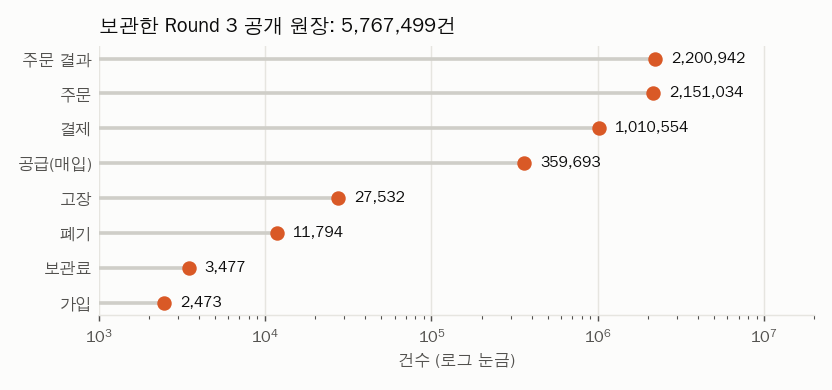

보관 DB에는 Round 3 공개 원장 577만 건이 종류별로 들어 있다. 이 보고서의 그래프 대부분(판매 건수, 장부 재계산, 매출 구성)이 여기서 나왔다.

부품마다 이 저장소에서 무엇을 어떤 크기로 읽는지는 6.2에 적었다.

## 9. 사건과 고친 것

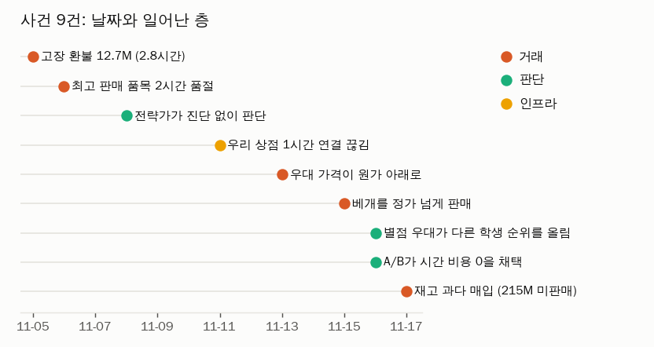

사건은 거래 코드에서 가장 많이 났다(9건 중 5건). 판단(전략가, A/B)에서 3건, 인프라에서 1건이었다.

| 날짜 | 사건 | 고친 것 |
|---|---|---|
| 11-05 | 고장 환불 12.7M을 2.8시간에 냄(C등급 고장률 15%) | 보증 끔. 11-08부터 72시간 보증 |
| 11-06 | 상한을 넘는 매입 줄을 통째로 빼서 최고 판매 품목 2시간 품절 | 들어가는 만큼만 매입 |
| 11-08 | 전략가가 원인 진단 없이 "매출 하락 → 보증 끔" | 진단 단계 강제, 예측 채점 |
| 11-11 | 우리 상점 약 1시간 연결 끊김(터널 주소 변경, 재가입 거부) | 터널 교체 감시 |
| 11-13 | 우대 가격이 원가 아래로(−7.4M) | 모든 가격에 원가 하한 |
| 11-15 | 7,900원 베개를 275,000원에 판매(메시지의 다른 숫자를 가격으로 읽음) | 정가 초과 금지 |
| 11-16 | 한 계정에 준 별점 우대가 그 학생의 구매자 순위를 우리 위로 올림 | 우대 중단, 상대 순위 가드 확대 |
| 11-16 | A/B가 "시간 비용 0"을 채택해 주문 수 30% 감소 | 시간 비용 복원 |
| 11-17 | 재고 확대로 412M 매입, 215M 미판매 | 품목별 상한 = 우리 판매 속도 × 3시간 |

## 10. 배운 것

1. 첫날 싼 물건으로 넓게 깔고, 현금이 모이자 비싼 물건으로 옮긴 순서가 맞았다. 비싼 물건만으로 시작했다면 500만 원으로는 몇 개밖에 못 샀다.
2. 점수 규칙이 바뀌면(이익 → 장부) 재고와 현금의 적정 비율도 바뀐다. 규칙 변경을 감시해 바로 파라미터에 반영한 것이 장부 1위의 출발점이었다.
3. 목표를 바꾸면 그 목표를 재는 지표와 그 지표를 쓰는 코드를 같이 바꿔야 한다. 장부 우선으로 바꾼 뒤에도 재입고와 종반 정리는 매출 기준으로 남아 있었다.
4. 에이전트끼리 직접 말하게 하는 것보다, 같은 사실을 보게 하는 편이 나았다. 큐레이터 하나가 측정하고 두 전략가가 그것을 읽으니 서로 다른 숫자로 싸우는 일이 없었다.
5. 한 항목을 위한 조치가 다른 항목을 움직인다. 조치 전에 모든 점수 항목과 상대 순위를 함께 확인해야 한다.

## 부록

### 재현

```bash
cd submissions/23530007/week-08
python -m venv .venv && .venv/bin/pip install -r requirements.txt
# 저장소 밖 설정(비공개): 모델 인증 정보, ntfy 토픽
tmux new-session -d -s market './run_market.sh run'   # kit(상점+구매자), 죽으면 30초 뒤 재시작
# cron 15분: ./watch_round.sh  (가드, A/B 판정, 에이전트 일정, 원장 보관)
.venv/bin/python ops/status.py      # 한 화면 상태
```

라운드가 끝난 11-18에 시스템을 멈췄다(tmux 세션 종료, crontab 두 줄 주석 처리).

### 문서

| 문서 | 내용 |
|---|---|
| [ENVIRONMENT.md](ENVIRONMENT.md) | 개장 전 환경 분석과 시나리오 |
| [SHOP_STOCK_STRATEGY.md](SHOP_STOCK_STRATEGY.md) | 재고 결정 방식 |
| [BUYER_STRATEGY.md](BUYER_STRATEGY.md) | 구매자 점수 전략 |
| [MEMORY_STRATEGY.md](MEMORY_STRATEGY.md) | 메모리와 에이전트 간 소통 |
| [RULES_THAT_SCORE.md](RULES_THAT_SCORE.md) | 점수에 영향을 주는 규칙 |
| [R4_PREP.md](R4_PREP.md) | 다음 라운드 준비 |
