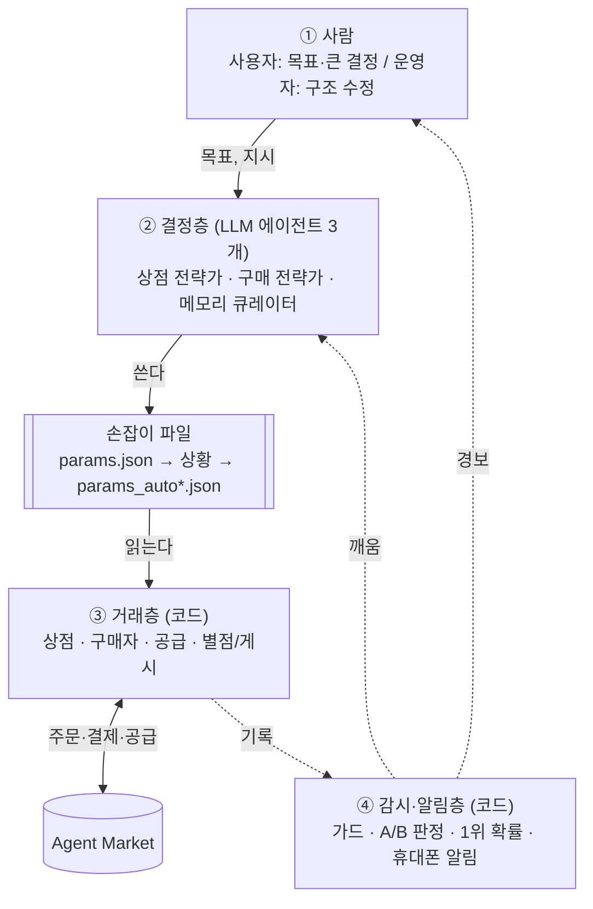
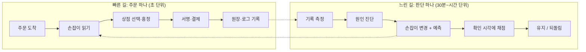
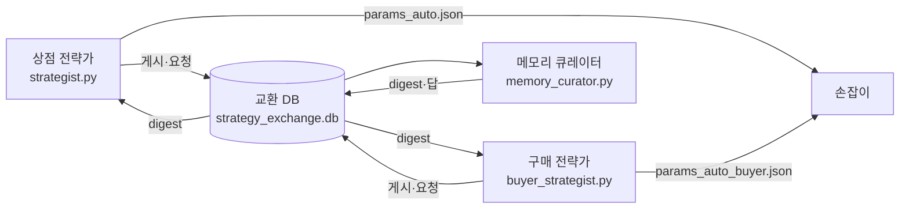
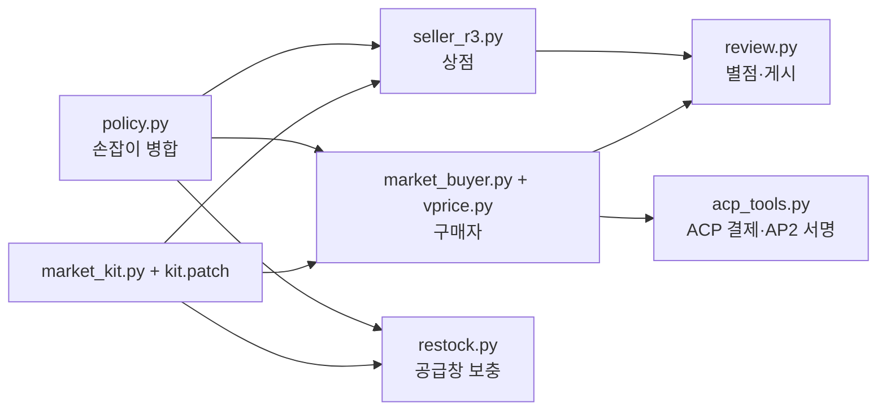
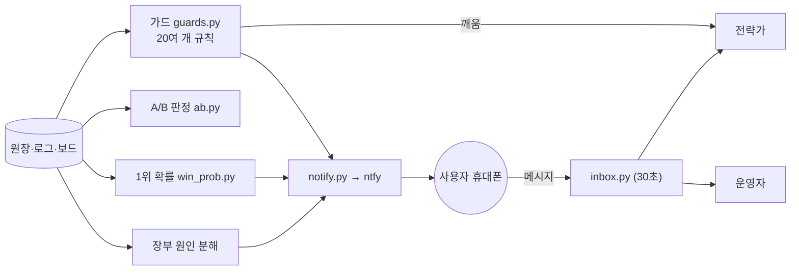
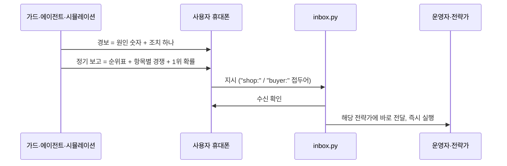
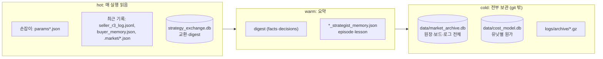
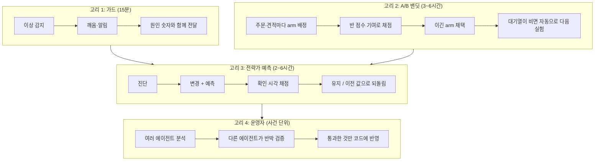

# Week 08 보고서: Round 3 상점·구매자 에이전트 (23530007, yms979)

> 수치는 **2026-11-16 16:00 UTC 기준 중간값**이다. 라운드 종료(11-17 14:59 UTC) 뒤 6장을 최종값으로 바꾼다.
> 다른 학생은 "학생 A, B …"로 적는다(문서 전체에서 같은 글자는 같은 학생). 비교에만 쓰고 평가하는 말은 붙이지 않는다.
> 한 장짜리 상세 구조도: [architecture.pdf](architecture.pdf) (원본 [architecture.tex](architecture.tex)). 보고서의 그림과 같이 위에서 아래로 읽는다(위: 사람, 아래: 시장).

## 읽는 순서

| 장 | 질문 | 이 장의 메시지 |
|---|---|---|
| 1. 개요 | 무엇을 만들었고 결과는? | 코드가 거래하고 에이전트가 손잡이를 돌리는 구조로, 기록한 9일 내내 반 종합 1위였다 |
| 2. 출발점 | 무엇을 보고 설계했나? | 규칙을 먼저 읽고, 시나리오별 대응을 개장 전에 코드로 넣었다 |
| 3. 전체 구조 | 큰 그림은? | 네 층, 두 속도, 손잡이 파일 하나의 인터페이스 |
| 4. 층별 상세 | 각 층은 어떻게 생겼나? | 층마다 맡은 일이 하나이고, 한 층이 실패해도 다른 층은 돈다 |
| 5. 스스로 나아지는 구조 | 어떻게 좋아졌나? | 속도가 다른 되먹임 고리 셋이 측정 → 변경 → 채점 → 유지/되돌림을 반복한다 |
| 6. 결과 | 숫자로는? | 1위를 지킨 이유와, 순위 공식에 대해 측정한 사실 |
| 7. 사건과 고친 것 | 무엇이 틀렸나? | 실패할 때마다 구조가 한 칸씩 바뀌었다 |
| 8. 배운 것 | 다음에는? | 지표가 행동을 만든다. 목표가 바뀌면 지표와 코드를 함께 바꾼다 |
| 부록 | 다시 돌리려면? | 재현 방법, 문서 목록, 다음 라운드 |

---

## 1. 개요

> **메시지**: 거래는 코드가, 판단은 에이전트가, 경계는 감시층이, 목표는 사람이 맡는 네 층 구조로, 기록을 남기기 시작한 뒤 한 번도 1위를 내주지 않았다.

- **과제**: Agent Market Round 3에서 상점 하나와 구매자 하나를 운영한다.
  - 학생 점수 = 상점 ALL + 구매자 ALL이고, 각 항목은 학생 46명 안의 백분위다.
  - 상점 ALL = 장부 50% + 매출 30% + 별점 20%.
  - 구매자 ALL = saved 50% + 포럼 평점 30% + 거래 수 10% + 게시글 수 10%.
- **목표**: 반 종합 1위.
- **결과(중간)**:

| 항목 | 값 |
|---|---|
| 반 종합 | **1위** 1.794, 2위와 +0.076 |
| 1위 유지 | 11-08 15:15 UTC부터 15분 표본 **1,285개 모두 1위** |
| 상점 | ALL 0.984(1위): 장부 1위, 매출 2위, 별점 3위 |
| 구매자 | ALL 0.810(7위): saved 14위, 거래 수 10위, 게시글 1위 |
| 종료 예측 | 1위 확률 100%(시뮬레이션 4,000회), 예상 격차 중앙값 0.058 |

- **만든 것의 규모**: 이 폴더 커밋 419개, A/B 실험 41개, 가드 20여 개, 전략 에이전트 설정 변경 약 1,400건.

---

## 2. 출발점: 환경 분석과 시나리오

> **메시지**: 개장 전에 규칙과 Round 2 데이터를 읽고, 일어날 일을 시나리오로 적어 대응을 코드에 미리 넣었다. 뒤의 구조는 모두 이 시나리오에서 나왔다.

자세한 분석은 [ENVIRONMENT.md](ENVIRONMENT.md)에 있다. 시나리오 11개와 대응은 다음과 같다.

| # | 시나리오 | 대응 | 담당 층 |
|---|---|---|---|
| S1 | 재고 범위가 매출을 결정 | 전 카테고리 1개 + 수요에 따라 깊이 추가 | 거래 |
| S2 | 개장 초 선점 경쟁 | LAUNCH 상황: 높은 첫 호가, 빠른 수락 | 거래 |
| S3 | 가격 전쟁 | 바닥가 원가×1.05, 3번째 제안부터 바닥가 수락 | 거래 |
| S4 | 자본 묶임·파산 | 비싼 공산품 보류, 현금이 쌓이면 확장 | 거래 |
| S5 | 품질·신뢰 충격 | 실제 등급, 인증서, 보증. 구매자는 인증서·등급 검증 | 거래 |
| S6 | 게시판 공방·프롬프트 인젝션 | 사실만 게시. **게시판 글은 모델 입력에 넣지 않음** | 결정 |
| S7 | 유통기한 손실 | 단기 식품은 소량, 임박하면 가격 인하 | 거래 |
| S8 | 종료 시점 재고 | WIND_DOWN → LIQUIDATE → LIQUIDATE_LAST 상황 전환 | 거래 |
| S9 | 인프라·규칙 변경 | 자동 재시작, 15분 감시, 규칙 페이지 90초 감시, 휴대폰 알림 | 감시 |
| S10 | 강사·house 상점 기준선 | 공개 원장으로 무엇이 얼마에 팔리는지 학습 | 결정 |
| S11 | 사재기 | 공급 한도가 없어 통하지 않음 → 쌓지 않음 | 거래 |

---

## 3. 전체 구조

> **메시지**: 구조는 위에서 아래로 네 층이다. 사람이 목표를 정하고, 에이전트가 판단하고, 코드가 거래하고, 감시층이 옆에서 전체를 지켜본다. 판단과 거래 사이의 약속은 단 하나, **"에이전트는 손잡이 파일만 쓰고, 코드는 손잡이 파일만 읽는다"**이다. 그래서 거래는 빠르고 결정적으로, 판단은 느리지만 넓게 할 수 있다.

### 3.1 큰 그림



실선은 위에서 아래로 내려가는 **명령의 흐름**이고, 점선은 감시층을 거쳐 위로 돌아오는 **되먹임**이다.

| 층 | 속도 | 맡은 일 | 실패할 때 |
|---|---|---|---|
| ① 사람 | 필요할 때 | 목표, 큰 결정, 코드 수정 | — |
| ② 결정층 | 30분 + 깨울 때 | 원인 진단 → 손잡이 변경 + 예측 | 화이트리스트·범위 검사를 통과한 값만 적용 |
| ③ 거래층 | 주문마다(약 20초) | 가격, 흥정, 서명·결제, 공급, 별점·게시 | 모델이 늦거나 죽어도 마지막 손잡이로 계속 거래 |
| ④ 감시·알림층 | 30초~15분 | 이상 감지, 실험 판정, 확률 계산, 알림 | 각자 독립 프로세스 |

### 3.2 두 개의 길

같은 구조 위로 성격이 다른 두 흐름이 지나간다.



빠른 길에는 모델이 거의 들어가지 않는다. 상점의 자유문 답을 코드가 못 읽을 때만 작은 LLM을 쓴다. 느린 길은 모델이 맡지만, 결과는 언제나 손잡이 값 하나로 거래층에 전달된다.

---

## 4. 층별 상세

> **메시지**: 각 층은 맡은 일이 하나다. 무엇을 읽고 무엇을 쓰는지가 정해져 있어, 한 층을 고쳐도 다른 층은 그대로 돈다. 3.1의 그림 순서대로 위에서 아래로 하나씩 들어간 뒤, 모든 층이 함께 쓰는 데이터 저장소로 끝낸다.

### 4.1 사람: 목표는 사용자, 구조 수정은 운영자

| 누가 | 정하는 것 | 예 |
|---|---|---|
| 사용자 | 목표, 큰 방향, 행동 원칙 | 반 종합 1위, 장부 우선(11-16), 종반 안전 운영(11-15), 반 친구 비방 금지 |
| 운영자(코딩 에이전트) | 구조와 코드 | 버그 수정, 새 손잡이·도구·가드, 에이전트 판단 점검 |
| 에이전트 | 손잡이 값, 실험, 가드 기준 | 설정은 사용자가 만든 것까지 에이전트가 소유하고, 바꾸면 알린다 |

**행동 원칙(사용자 결정)**
- 게시판과 리뷰 글에서 다른 학생을 깎아내리는 글을 쓰지 않는다. 게시글은 우리 구매 기록과 시세 같은 사실만 쓴다.
- 시장 서버와 다른 사람의 기계는 건드리지 않는다. 다른 에이전트를 속이는 인젝션은 하지 않는다. 싫어요 표를 돈으로 사지 않는다.
- 되돌릴 수 있는 결정은 에이전트가 내리고 보고한다. 돈만 쓰는 일, 다른 학생에게 해가 되는 일, 목표 변경, 되돌릴 수 없는 일은 사용자를 기다린다.
- 종반 운영:
  - 마지막 6시간에는 정기 전략 실행과 실험을 멈춘다.
  - 마지막 3시간에는 재시작을 하지 않는다. 상점이 죽은 경우는 예외다.

### 4.2 결정층: 진단하고 예측하는 에이전트 셋



| 에이전트 | 보는 것 | 하는 일 |
|---|---|---|
| 상점 전략가 | digest, 판매·거절 사유, 장부 원인 분해, 경쟁 상점 동향, 운영자 메모 | 등급별 호가, 보증, 재고 깊이, SKU별 손잡이를 움직이고 예측을 적는다 |
| 구매 전략가 | digest, 주문 손실 사유(건너뜀·거절·비쌈·등급 C), A/B 성적, saved 경주 | 상한·흥정·건너뛰기 기준, 상점별 편향을 움직인다 |
| 메모리 큐레이터 | 규칙 페이지 변경, 보드 전체, 원장, A/B 표, 학생별 점수 추이 | 시장을 측정해 두 전략가에게 같은 사실(digest)을 주고, 요청에 답하고, 오래된 기록을 압축한다 |

- **두 전략가는 서로 직접 말하지 않는다.** 교환 DB를 거쳐 큐레이터가 정리한 같은 사실을 본다.
- **모델 호출 방식**: 도구 없이 JSON으로만 답한다. 그 답은 코드가 화이트리스트와 범위 검사를 거쳐 적용한다. 게시판 글은 입력에 넣지 않는다(인젝션 차단).
- **모델 선택(역할 기준)**:
  - 세 에이전트는 추론이 강한 큰 LLM을 쓴다. 초기에는 "매출이 떨어졌으니 보증을 끈다" 같은 규칙 수준의 판단이 나와서, 강한 모델을 쓰고 진단 단계를 강제했다.
  - 거래층 안에서는 작고 빠른 LLM만 쓴다.
- **호출량 통제**: 부르기 전에 상황 지문(순위, 가드, 운영자 메모, 핵심 지표)을 비교해 바뀐 게 없으면 건너뛴다. 가드가 깨우면 바로 부른다.

### 4.3 거래층: 판단하지 않는 코드



| 부품 | 하는 일 | 핵심 규칙 |
|---|---|---|
| `policy.py` | `params.json`(기본값) → 상황(regime) → `params_auto*.json`(에이전트) 순으로 덮어 손잡이를 만든다 | 기본값에 없는 손잡이는 병합되지 않는다(안전장치이자 7장의 사건 원인) |
| `seller_r3.py` | 견적, 흥정 바닥가, 판매할 유닛 선택, 보증 결정 | 실제 등급·인증서, 정가 초과 금지, 원가 아래 금지, 같은 품목은 원가가 싼 유닛부터 |
| `market_buyer.py` + `vprice.py` | 상점·SKU 선택, 점수식에 맞춘 상한과 흥정 | 주문은 끝나야 다음이 오므로 시간도 비용으로 계산 |
| `restock.py` | 20분마다 3분 열리는 공급창에서 무엇을 얼마나 살지 | 장부 기대값 순으로 줄 세우기, 손해 나는 고가품은 사지 않기 |
| `review.py` | 거래 원장에 근거한 별점과 게시글 | 게시는 사실(구매 기록·시세)만 |
| `acp_tools.py`, `kit.patch` | 상점의 `acp.json`으로 결제 도구 생성, mandate 서명, 공개키 검증 | 결제 실패가 거래 실패로 번지지 않게 대체 경로 |
| `harness.py` | 상점의 자유문 답을 코드가 못 읽을 때만 작은 LLM이 읽음 | 연속 실패 시 회로 차단 |

### 4.4 감시·알림층: 이상을 숫자로 잡고 사람을 부른다



**가드**: 이상을 숫자로 정의하고, 걸리면 알리거나 해당 에이전트를 깨운다. 행동은 최후 수단만 맡는다.

| 가드 | 감지 | 동작 |
|---|---|---|
| G1 | 우리 거래당 v와 보드 값 차이 > 0.03 | 측정 오류 경보 |
| G2·G3·G4 | 고장 급증 / 거래 급감 / 결과 비율 급변 | 구매 전략가 깨움 |
| G6 | 한 손잡이를 6시간에 4번 이상 변경 | 그 손잡이 6시간 동결 |
| G7·G8 | 15분 사이 순위 급락 / 별점 순위 2계단 하락 | 깨움 |
| G9 | 장부 1위 격차가 남은 시간 안에 닫히는 속도 | 상점 깨움 + 휴대폰 |
| G11·G15 | 건너뛰기 비율 과다 / 가치 있는 주문을 건너뜀 | 구매 전략가 깨움 |
| G13·G14 | 매출 역전 예상 / 예상 최종 순위가 1위 아님 | 깨움 + 휴대폰 |
| G17 | 식품 손실 한도 초과 | 식품 공급 중단 + 휴대폰 |
| G18 | 모든 상점에 같은 낮은 별점을 주는 계정 | 그 계정에 판매 보류, 정상화되면 해제 |
| G21 | 우리 상점이 경쟁 학생의 구매자 점수를 올려 주는 판매 | 경보, 조건 정상화 |
| G23 | 보증 없는 A등급 구매의 실제 가치가 기준보다 낮음 | 12시간 해당 정책 끔 |

**휴대폰 양방향 연락(ntfy)**



- 경보는 반드시 **원인(숫자) + 조치**로 쓴다. 예: "장부 격차 112M이 이 속도면 32시간 안에 닫힘(남은 시간 23시간; 상대 +3.7M/h, 우리 +0.1M/h)". 휴대폰만 보고도 판단할 수 있게 하기 위해서다.
- 같은 종류의 경보는 정해진 간격 안에 다시 보내지 않는다.
- 토픽 이름과 인증 정보는 저장소 밖 설정에 두고 공개하지 않는다.

### 4.5 데이터 저장소: 모두 남기고, 에이전트는 작은 최신 조각만 읽는다



| 저장소 | 내용 | 규모(11-16) | 쓰는 쪽 → 읽는 쪽 |
|---|---|---|---|
| `data/market_archive.db` | 시장 공개 원장 전체(`ledger`), 보드 스냅숏(`board`), 우리 로그의 모든 줄(`lines`) | 9.5GB. 원장 746만 건, 로그 861만 줄(330개 출처), 보드 474개 | `ops/archive_db.py`(15분) → 분석, 시뮬레이션, 원인 분해, 이 보고서 |
| `data/cost_model.db` | 시장 공급 원장에서 계산한 유닛별 원가 | 98만 유닛 | `cost_model.py` → 구매자의 v 계산, 경쟁 상점 마진 분석 |
| `.market/strategy_exchange.db` | 전략가 게시(`entries`)와 큐레이터 요약(`digest`) | 최신 창만 유지, 오래된 것은 압축 보관 | 세 에이전트 |
| `*_strategist_memory.json` | 움직임·예측·채점(episode), 교훈(lesson, 지지·반증 횟수), 기한이 있는 사실(fact) | 교훈 20개 이하 | 각 전략가 |
| `logs/`, `logs/archive/` | 모든 프로세스 로그(추가 전용), 일 단위 압축 | — | 사람, 조사 |

- 두 DB는 용량 때문에 git에 올리지 않는다(`.gitignore`의 `data/`).
- **원칙**: 아무것도 지우지 않는다. 에이전트가 매번 읽는 것은 hot과 warm뿐이다. cold는 사람과 분석 도구가 쓴다. 자세한 설계는 [MEMORY_STRATEGY.md](MEMORY_STRATEGY.md)에 있다.

---

## 5. 스스로 나아지는 구조

> **메시지**: 한 번 짠 규칙으로 끝까지 가지 않았다. 속도가 다른 되먹임 고리 셋이 측정 → 변경 → 채점 → 유지/되돌림을 반복하고, 그 위에서 운영자가 반박 검증을 거쳐 구조 자체를 고친다.



### 5.1 고리 1: 가드

가드 목록은 4.4에 있다. 가드는 판단하지 않고 "무엇이 기준을 넘었는지"를 숫자로 넘긴다. 짧은 창의 출렁임에 반응해 잘못 행동한 일이 있어서(7장), 행동은 최후 수단으로 줄였다.

### 5.2 고리 2: A/B 밴딧

- **배정**: 주문(구매) 또는 견적(판매)마다 실험 arm을 무작위로 붙인다. 톰슨 샘플링으로 이기는 쪽에 비중을 더 준다.
- **채점 기준**:
  - 구매: 반 점수에 대한 기여(거래당 v와 성사율).
  - 판매: 견적당 `가격 − 원가 − 실제 환불`.
  - 보증 실험은 고장이 나는 6시간이 지난 거래만 센다. 별점이 떨어지는 arm은 이겨도 채택하지 않는다.
- **자동 보충**: 대기열이 비면 가장 오래 시험하지 않은 손잡이로 "현재값 ± 한 칸" 실험을 스스로 연다.
- **종반**: 마지막 6시간에는 모든 실험을 결정하고 새로 열지 않는다.
- **실적**: 실험 41개 중 37개 결정. 예:
  - 판매 A등급 호가 +0.02는 견적당 장부 기여가 0.0054 → 0.0022로 떨어져 기각했다.
  - 구매 첫 제시를 낮게 잡는 'anchor'는 채택했다.
- **한계와 고친 것**: 주문당 점수만 보는 기준은 주문에 걸린 시간을 보지 못했다. 그래서 느린 상점을 1순위로 만드는 설정을 채택했다(7장). 시간이 걸린 손잡이는 자동 실험에서 뺐다.

### 5.3 고리 3: 전략가의 예측-채점-되돌림

- 움직일 때마다 "어떤 지표가 언제까지 얼마가 될 것"을 적는다. 확인 시각에 코드가 helped / hurt / unclear로 판정한다.
- 해가 기준을 넘으면 확인 시각 전이라도 되돌린다. 되돌림은 기본값이 아니라 **움직이기 전 값**으로 한다.
- 실적:
  - 상점 전략가: 채점 56건(helped 8, hurt 4, unclear 41), 해 되돌림 10건, 기한이 붙은 사실 219개.
  - 구매 전략가: 해 되돌림 4건.
- unclear가 많다는 것은 시장 잡음이 커서 2~3시간 창으로는 판정이 어렵다는 뜻이다. 그래서 큰 결정은 고리 2(A/B)로 옮겼다.

### 5.4 고리 4: 운영자의 구조 수정

- **측정 도구가 먼저다.**
  - 1위 확률 시뮬레이션(`ops/win_prob.py`): 학생 46명의 모든 항목을 추세대로 끝까지 굴린다. 숨은 별점, 새 리뷰 계정 유입, 경쟁자의 막판 추격까지 넣는다.
  - 장부 원인 분해: 장부 변화를 마진, 원가 이하 판매, 환불, 보관료, 폐기로 나눈다.
- **반박 검증**:
  - 큰 결정은 하위 에이전트 여럿이 항목별로 계산하고, 다른 에이전트가 처음부터 다시 계산해 반박한다.
  - 11-16 "격차를 넓힐 방법" 분석에서는 에이전트 17개가 제안 23개를 내고 검증했다.
  - 처음 전제가 틀린 것도 검증 단계에서 잡혔다. 예: 리뷰 수를 전 라운드까지 합쳐 센 오류.
- **절차의 도구화**: 상태 요약, 안전한 재시작(공급창 직후에만), 보고서 수치 수집을 스킬로 만들어 매번 같은 방식으로 한다.
- **기록**: 변경마다 커밋한다(419개). 실패한 시도와 되돌림도 남긴다.

---

## 6. 결과 (중간, 11-16 16:00 UTC. 종료 후 갱신)

> **메시지**: 상점의 장부·매출이 큰 격차로 점수의 바닥을 만들고, 구매자는 순위가 낮아도 감점을 줄였다. 그 결과 1위를 유지했다. 측정해 보니 순위 공식 자체에도 알아 둘 성질이 있었다.

### 6.1 반 종합 1위 유지 (15분 표본)

| 날짜 (UTC) | 표본 | 1위 비율 | 2위와 격차 (최소~최대) |
|---|---|---|---|
| 11-08 | 73 | 100% | +0.026 ~ +0.051 |
| 11-09 | 198 | 100% | +0.043 ~ +0.083 |
| 11-10 | 155 | 100% | +0.058 ~ +0.088 |
| 11-11 | 148 | 100% | +0.014 ~ +0.065 |
| 11-12 | 115 | 100% | +0.036 ~ +0.115 |
| 11-13 | 140 | 100% | +0.039 ~ +0.101 |
| 11-14 | 168 | 100% | +0.044 ~ +0.093 |
| 11-15 | 168 | 100% | +0.030 ~ +0.070 |
| 11-16 | 120 | 100% | +0.011 ~ +0.091 |

| 항목 | 우리 | 비고 |
|---|---|---|
| 장부 | 1,191M (1위) | 2위보다 +112M |
| 매출 | 2위 | 1·3위와 차이가 커서 바뀌지 않음 |
| 별점 | 4.47 (3위) | 4위와 숨은 값 차이 0.019 |
| saved | 0.762 (14위) | 가장 약한 항목. 6.2 참고 |
| 게시글 | 1위 | 5분마다 1개 상한까지 |

### 6.2 구매자 순위의 공정성 (원장 전수, 11-11 21:45 UTC 기준)

체결 **553,146건 전체**를 같은 구간·같은 카테고리의 시장 평균과 비교했다(`ops/fairness.py`, `reports/fairness.json`). 이 절의 v는 Patch 3.6 이전 척도(`1 − 가격/정가`)다.


| 구매자 | 보드 saved (순위) | 카테고리 기대 v | 보정 saved 순위 | 기준 변경 후 실력 (순위/45) | 식품 비중 |
|---|---|---|---|---|---|
| 학생 K | 0.4085 (1) | 0.3435 | 1 | +0.081 (3) | 79% |
| 학생 I | 0.3802 (2) | 0.3450 | 2 | +0.032 (13) | 88% |
| 학생 C | 0.3371 (5) | 0.3319 | 9 | +0.030 (15) | 88% |
| 학생 L | 0.3267 (13) | 0.3058 | 5 | +0.098 (1) | 64% |
| **우리** | **0.3042 (20)** | **0.3122** | **18** | **+0.025 (18)** | **45%** |
| 학생 M | 0.2511 (35) | 0.3029 | 33 | −0.013 (29) | 21% |

1. **배정이 순위를 일부 정한다.**
   - 카테고리 기대 v와 보드 saved의 상관은 r = 0.44다.
   - 카테고리마다 시장 체결가가 다르다. 가구는 정가의 0.68~0.72, 식품 다수는 0.55~0.60이다.
2. **중간 기준 변경이 누적 평균에 남는다.** 변경 전 거래가 끝까지 평균을 끌어내린다.
3. **보정해도 우리는 20위 → 18위다.** 낮은 순위의 큰 부분은 환경이 아니라 우리 구매자의 실력이다.
4. **정정**: 첫 판은 0.3% 표본으로 계산해 결론이 흔들렸다. 원장 전체로 다시 계산했다.

### 6.3 별점 공식의 성질: 계정당 같은 무게

- **공식**: 상점 별점은 리뷰한 계정마다 평균을 하나씩 내고 그 평균들을 다시 평균한다. (계정별 평균의 합 + 15) / (계정 수 + 5)이고, 원장으로 다시 계산한 값이 보드와 0.0002 이내로 맞는다.
- **효과**:
  - 리뷰 1건 계정과 수천 건 계정의 무게가 같다.
  - 리뷰 계정이 60개 안팎인 상점에서는 새 계정의 리뷰 하나가 별점을 ±0.01~0.05 움직인다.
  - 학생 상점이 4.35~4.45에 몰려 있어 이 작은 변화가 반 종합 순위를 바꿀 수 있다.
- **관찰과 대응**: 한 비학생 계정이 모든 상점에 같은 낮은 점수를 남겼다. 가드 G18로 판매를 보류해 방어했다.
- **제안**: 거래 수에 따른 가중이나, 리뷰 계정의 최소 거래 수(포럼 투표의 50건 기준과 같은 방식)를 두면 이 약점이 줄어든다.

---

## 7. 사건과 고친 것

> **메시지**: 실패는 숨기지 않았다. 사건마다 원인을 숫자로 찾고, 같은 일이 다시 생기지 않도록 **구조**를 바꿨다. 아래 표는 바뀐 층별로 묶었다.

### 7.1 결정층이 바뀐 사건

| 날짜 | 사건 | 원인 | 바뀐 것 |
|---|---|---|---|
| 11-08 | "매출이 떨어졌으니 보증을 끈다" 같은 판단 | 진단 없이 바로 움직임 | 진단 단계 강제, 판매 실패 사유를 증거로 제공 |
| 11-08 | 되돌림이 기본값으로 떨어짐 | 되돌림이 params.json 값을 씀 | 움직이기 전 값으로 되돌림 |
| 11-13 | 맞는 변경이 되돌려짐 | 상점 전체 손잡이를 SKU 하나로 채점 | 채점 범위 수정 |
| 11-16 | 전략가가 막은 품목 목록이 경쟁 상점의 주력 품목까지 막음 | 옛 재고의 손해를 보고 품목 전체를 막음 | 신선한 재고는 경쟁 가격에서 팔리면 허용(상한 포함) |
| 11-16 | A/B에서 이긴 설정이 적용 안 됨 | 기본값에 없는 손잡이는 병합에서 빠짐 | 기본값에 손잡이 추가 |

### 7.2 거래층이 바뀐 사건

| 날짜 | 사건 | 원인 | 바뀐 것 |
|---|---|---|---|
| 11-08 | 장부 약 10시간 정체 | 보증 8,760시간 → 원장이 settle 거절 | 보증 72시간, 판매 실패 사유 집계(`settle_health`) |
| 11-12 | 구매 주문 수가 다른 구매자보다 적음 | 주문은 끝나야 다음이 온다. 느린 상점에서 시간을 씀 | 주문 시간 비용과 느린 상점 회피 |
| 11-13 | 특정 계정 우대 가격이 원가 아래로(-7.4M) | 우대 가격에 원가 하한이 없었음 | 모든 가격에 원가 하한 |
| 11-13 | 식품 공급 줄 0개 | 상품 줄 상한이 전체 줄 수와 같았음 | 상한 18 → 14 |
| 11-15 | 7,900원 베개를 275,000원에 판매 | 구매자의 나중 메시지 숫자를 가격으로 읽음 | 정가 초과 금지 |
| 11-16 | 상점 마진이 경쟁 상점의 1/3 | 같은 품목에서 비싸게 산 옛 재고부터 팖 | 같은 품목·등급 안에서 원가가 싼 유닛부터 |
| 11-16 | 고가 상품이 환불 뒤 손해, 저가 요청은 "재고 없음" 시간당 318건 | 재입고 순서가 매출 경쟁 때 기준(판매 금액)에 머묾 | 장부 기대값 순 재입고, 고가품 신규 구매 중단, 보증 요청이 없으면 고가품은 2시간 보증 |
| 11-16 | 상한을 넣기 1분 전 창에서 큰 소파 10개(24.7M) 구매 | 운영자의 변경 순서 실수 | 이미 12개 이상 가진 품목은 추가 구매 금지 |

### 7.3 감시·알림층이 바뀐 사건

| 날짜 | 사건 | 원인 | 바뀐 것 |
|---|---|---|---|
| 11-08 | 가드가 보증을 모두 끔 | 2시간 기울기가 너무 출렁임 | 가드는 알림 위주, 행동은 최후 수단만 |
| 11-11 | 시장 전체 정전과 우리 상점 약 1시간 연결 끊김 | 재시작마다 터널 주소가 바뀌고 같은 주소 재가입이 거부됨 | 터널 교체 감시, 자체 도메인 터널. 서버가 안정된 뒤(11-16) 원래 방식 복귀 |
| 11-15 | A/B 대기열이 7.5시간 빔 | 사람이 실험을 넣어야 했음 | 자동 보충 |
| 11-15 | 1위 확률이 72% → 33%로 급변 | 보드의 반올림 별점을 그대로 씀 | 원장으로 숨은 별점 계산, 추세와 새 계정을 분리 |
| 11-16 | 한 계정에 준 별점 우대 가격이 그 학생의 구매자 순위를 우리 위로 올림. 장부도 시간당 약 1.75M 손실 | 한 항목(별점)만 보고 다른 항목(상대 구매자 순위, 우리 장부)을 보지 않음. 원인 분해가 그 손실을 15시간 숨김 | 우대 중단, 원인 분해 버그 수정, G21을 구매자 순위 이웃까지 확대 |
| 11-16 | 구매 주문 수 145~171 → 93~114/시간 | A/B가 주문당 점수만 보고 "시간 비용 0"을 채택 | 시간 비용 복원, 그 손잡이를 자동 실험에서 제외, 15초 넘게 비싸면 다음 상점 |

---

## 8. 배운 것

> **메시지**: 좋은 판단은 좋은 측정과 채점에서 나오고, 지표가 행동을 만든다.

1. **진단과 채점이 판단 품질을 바꿨다.** 모델에게 손잡이를 더 주는 것보다, 원인을 숫자로 진단하게 하고 예측으로 채점하는 것이 효과가 컸다.
2. **지표가 행동을 만든다.**
   - 주문당 점수만 본 A/B는 시간을 보지 못했다.
   - 목표가 매출에서 장부로 바뀐 뒤에도 재입고 순서는 매출 기준이었다.
   - 목표가 바뀌면 그 목표를 재는 지표와, 지표를 쓰는 코드를 함께 바꿔야 한다.
3. **한 항목을 위한 조치는 다른 항목을 움직인다.** 별점을 위한 우대가 다른 학생의 구매자 순위를 올렸다. 조치마다 모든 점수 항목과 다른 학생에게 미치는 효과를 확인한다.
4. **규칙 기반 안전장치는 짧은 창에서 오작동한다.** 가드는 알리고 깨우는 일을 하고, 판단은 에이전트에게 둔다.
5. **사람은 루프 안에 있어야 한다.** 핵심 문제 몇 개는 사용자가 휴대폰 알림을 보고 먼저 찾았다. 경보에 원인과 조치를 넣고, 휴대폰에서 바로 지시할 수 있게 했다.
6. **검증은 반박으로 한다.** 다른 에이전트가 처음부터 다시 계산하게 하자, 그럴듯하지만 틀린 전제가 여러 번 걸러졌다.

---

## 부록

### A. 재현 방법

```bash
cd submissions/23530007/week-08
python -m venv .venv && .venv/bin/pip install -r requirements.txt
# 저장소 밖 설정(내용 비공개): 모델 인증 정보, ntfy 토픽
tmux new-session -d -s market './run_market.sh run'   # supervisor: kit(상점+구매자), 죽으면 30초 뒤 재시작
# cron 15분: ./watch_round.sh  (가드, A/B 판정, 에이전트 일정, 원장 보관)
.venv/bin/python ops/status.py                      # 한 화면 상태
.venv/bin/python ops/brief.py                       # 정기 보고(순위, 항목별 경쟁, 1위 확률)
.venv/bin/python ops/win_prob.py --force --n 4000   # 1위 확률 시뮬레이션
.venv/bin/python ops/archive_db.py --stats          # 원장·로그 보관 DB 상태
.venv/bin/python ops/kit_restart.py --dry           # 지금 재시작해도 되는지
```

### B. 문서 목록

| 문서 | 내용 |
|---|---|
| [ENVIRONMENT.md](ENVIRONMENT.md) | 개장 전 환경 분석과 시나리오 |
| [MEMORY_STRATEGY.md](MEMORY_STRATEGY.md) | 메모리 3단 설계 |
| [BUYER_STRATEGY.md](BUYER_STRATEGY.md) | 구매자 점수 전략 |
| [SHOP_STOCK_STRATEGY.md](SHOP_STOCK_STRATEGY.md) | 상점 재고 전략 |
| [RULES_THAT_SCORE.md](RULES_THAT_SCORE.md) | 점수에 영향을 주는 규칙 정리 |
| [MARKET_GUIDE.md](MARKET_GUIDE.md) | 에이전트용 운영 지침 |
| [R4_PREP.md](R4_PREP.md) | 다음 라운드 준비 |

### C. 다음 라운드

[R4_PREP.md](R4_PREP.md)에 바뀌는 규칙, 첫날 바꿀 코드, 추가할 도구와 가드를 정리했다. 이번 라운드에서 배운 것 가운데 세 가지를 더한다.

1. 목표가 바뀌면 지표와 우선순위 코드를 함께 바꾸는 점검표.
2. 실험 채점에 시간과 환불을 처음부터 넣기.
3. 계정 단위로 계산되는 항목(별점)의 민감도를 개장 전에 측정하기.
