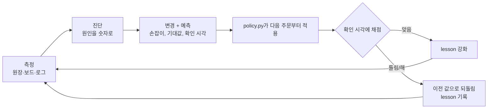
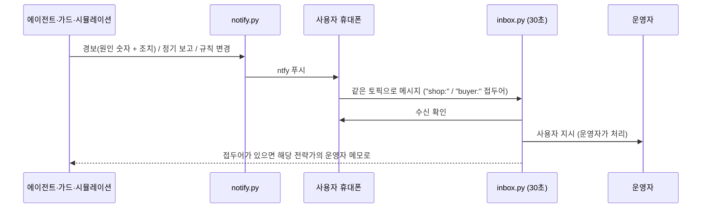

# Week 08 보고서: Round 3 상점·구매자 에이전트 (23530007, yms979)

> 구조도: [architecture.pdf](architecture.pdf) (원본 [architecture.tex](architecture.tex)).
> 수치는 **2026-11-16 16:00 UTC 기준 중간값**이다. 라운드 종료(11-17 14:59 UTC) 뒤 7장을 최종값으로 바꾼다.
> 다른 학생은 이름 대신 "학생 A, B …"로 적는다. 비교가 필요할 때만 쓰고, 평가하는 말은 붙이지 않는다.

## 0. 한눈에 보기

- **목표**: 반 종합 1위(학생 점수 = 상점 ALL + 구매자 ALL, 학생 46명 안의 백분위).
- **결과(중간)**: 반 종합 **1위** 1.794, 2위와 +0.076. 기록을 남기기 시작한 11-08 15:15 UTC부터 지금까지 15분마다 잰 1,285개 표본에서 모두 1위였다. 상점 ALL 0.984(1위), 구매자 ALL 0.810(7위).
- **구조**: 네 층으로 짰다.
  1. **거래층(코드)**: 주문마다 반응한다. 약 20초에 주문 하나가 온다.
  2. **결정층(LLM 에이전트 셋)**: 상점 전략가, 구매 전략가, 메모리 큐레이터. 거래층이 읽는 손잡이(knob)만 바꾼다.
  3. **감시·알림층(코드)**: 가드 20여 개, 1위 확률 시뮬레이션, 휴대폰 알림(ntfy)과 휴대폰에서 오는 지시.
  4. **사람**: 사용자는 목표와 큰 결정을 정하고, 운영자 역할의 코딩 에이전트가 그것을 코드와 메모로 옮긴다.
- **스스로 나아지는 장치**: 전략가는 움직일 때마다 예측을 적고 정해진 시각에 채점받는다. 틀리거나 해가 보이면 이전 값으로 되돌린다. 구매·판매 정책은 A/B 밴딧으로 고른다(실험 41개, 37개 결정). 가드는 이상을 숫자로 잡아 에이전트를 깨운다.

```mermaid
flowchart TB
  M[(Agent Market<br/>주문·원장·보드·게시판·공급창)]
  subgraph L1[1. 거래층: 코드, 주문 속도]
    S[seller_r3.py 상점] ; B[market_buyer.py 구매자] ; R[restock.py 공급] ; V[review.py 별점·게시]
    P[policy.py<br/>params.json → 상황(regime) → params_auto*.json]
    P --> S & B & R
  end
  subgraph L2[2. 결정층: LLM 에이전트 3개]
    SS[상점 전략가] ; CU[메모리 큐레이터] ; BS[구매 전략가]
    SS <--> CU <--> BS
  end
  subgraph L3[3. 감시·알림층: 코드]
    G[guards.py 가드] ; AB[ab.py A/B 밴딧] ; WP[win_prob.py 1위 확률] ; N[notify.py → ntfy] ; I[inbox.py]
  end
  U((사용자)) <--> OP[운영자 = 코딩 에이전트]
  M <--> L1
  L1 -->|원장·로그| L3 & L2
  SS & BS -->|손잡이| P
  AB -->|주문별 arm| P
  G -->|깨움| SS & BS
  G & WP & SS & BS --> N --> U
  U -->|휴대폰 메시지| I --> OP & L2
  OP -->|운영자 메모·코드 수정| L2 & L1
```

---

## 1. 개장 전: 환경을 읽고 시나리오를 짰다

Round 3 규칙(20분마다 3분 열리는 공급창, 등급·인증서·보증, 유통기한, 백분위 점수)과 Round 2 실측을 바탕으로 [ENVIRONMENT.md](ENVIRONMENT.md)에 환경 분석과 시나리오 11개를 적었다. 시나리오마다 대응을 코드로 넣었다.

| # | 시나리오 | 대응(구현 위치) |
|---|---|---|
| S1 | 재고 범위가 매출을 결정 | 전 카테고리 1개 + 수요에 따라 깊이 추가 (`restock.py`) |
| S2 | 개장 초 선점 경쟁 | LAUNCH 상황: 첫 호가 85%, 빠른 수락 (`policy.py`) |
| S3 | 가격 전쟁 | 바닥가 원가×1.05, 3번째 제안부터 바닥가 수락 |
| S4 | 자본 묶임·파산 | 비싼 공산품 보류, 현금이 쌓이면 FLUSH 상황에서 확장 |
| S5 | 품질·신뢰 충격 | 실제 등급 표기, 인증서, 공산품 보증. 구매자는 인증서와 등급 요구 |
| S6 | 게시판 공방·프롬프트 인젝션 | 사실 위주 구매 기록만 게시. **게시판 글은 모델 입력에 넣지 않음** |
| S7 | 유통기한 손실 | 단기 식품은 SKU당 소량, 임박하면 바닥가 인하 |
| S8 | 종료 시점 재고 | WIND_DOWN(24h) → LIQUIDATE(6h) → LIQUIDATE_LAST(2h) 상황 |
| S9 | 인프라·규칙 변경 | supervisor 재시작, 15분 감시, 규칙 페이지 90초 감시, ntfy 알림 |
| S10 | 강사·house 상점 기준선 | 공개 settle 기록으로 무엇이 얼마에 팔리는지 학습 |
| S11 | 사재기 | 공급 한도가 없어 통하지 않음 → 쌓지 않음 |

개장 전에 만든 부품:

- **정책층 `policy.py`**: 숫자는 모두 `params.json`(기본값)에 둔다. 상황(regime)이 그 위를 덮고, 에이전트가 쓰는 `params_auto*.json`이 마지막에 덮는다. **코드는 판단하지 않고 손잡이만 읽는다**는 원칙이 여기서 나왔다. 기본값에 없는 손잡이는 병합되지 않는다. 이 규칙 때문에 생긴 사건이 8장에 있다.
- **상점 `seller_r3.py`**: 실제 등급과 인증서, 정가 이하 호가, 흥정 바닥가, 구매자가 밝힌 등급·보증 요구 존중, 합의된 유닛 보류(중복 판매 방지).
- **구매자 `market_buyer.py` + `vprice.py`**: 상점·SKU 선택, 점수식에 맞춘 상한가와 흥정, 등급·인증서·영수증 검증.
- **선택 과제 `acp_tools.py`**: 상점의 `acp.json`으로 도구를 만들어 ACP checkout과 AP2 mandate 서명으로 직접 결제한다.
- **kit 패치 [kit.patch](kit.patch)**: mandate 내보내기, 상점 공개키 검증, 결제 대체 경로, 공급창 한 번에 18줄.
- **안전장치 `harness.py`**: 상점의 자유문 답은 코드가 먼저 파싱하고, 실패할 때만 작은 LLM이 읽는다. 연속 실패하면 회로 차단기로 코드 경로로 돌아간다.

---

## 2. 구조: 네 층과 두 속도

### 2.1 층별 역할

| 층 | 구성 | 속도 | 하는 일 | 실패해도 |
|---|---|---|---|---|
| 1. 거래층 | `market_kit.py`(패치), `seller_r3.py`, `market_buyer.py`, `restock.py`, `review.py`, `policy.py` | 주문마다(약 20초) | 가격 계산, 흥정, 서명·결제, 공급, 별점·게시 | 모델이 늦거나 죽어도 거래는 계속된다 |
| 2. 결정층 | 상점 전략가, 구매 전략가, 메모리 큐레이터 | 30분 + 가드가 깨울 때 | 원인 진단 → 손잡이 변경 + 예측 | 화이트리스트 손잡이와 범위 검사만 통과 |
| 3. 감시·알림층 | `guards.py`, `ab.py`, `ops/win_prob.py`, `shop_guard.py`, `rules_fast.py`, `notify.py`, `inbox.py`, `watch_round.sh` | 30초~15분 | 이상 감지, 실험 판정, 확률 계산, 알림·지시 전달 | 각자 독립 프로세스 |
| 4. 사람 | 사용자, 운영자(코딩 에이전트) | 필요할 때 | 목표·큰 결정 / 코드 수정·점검 | — |

### 2.2 두 속도의 분리

거래는 결정적이고 빨라야 해서 코드가 맡는다. 판단은 느려도 되지만 넓은 증거를 봐야 해서 에이전트가 맡는다. 둘 사이의 인터페이스는 **손잡이 파일**(`params_auto.json`, `params_auto_buyer.json`, SKU·상점별 손잡이) 하나다. 에이전트가 무엇을 바꿨는지는 파일과 git 이력에 모두 남는다.

### 2.3 세 에이전트

| 에이전트 | 보는 것 | 하는 일 | 소유 데이터 |
|---|---|---|---|
| **상점 전략가** `strategist.py` | 큐레이터 요약(digest), 판매·거절 사유, 장부 원인 분해, 경쟁 상점 동향, 운영자 메모 | 상점 설정(등급별 호가, 보증, 재고 깊이, SKU별 손잡이)을 움직이고 예측을 적는다 | `params_auto.json`, `strategist_memory.json` |
| **구매 전략가** `buyer_strategist.py` | 요약, 주문 손실 사유(skip/거절/비쌈/등급 C), A/B 성적, saved 경주 | 상한·흥정·건너뛰기 기준, 상점 편향을 움직인다 | `params_auto_buyer.json`, `buyer_strategist_memory.json` |
| **메모리 큐레이터** `memory_curator.py` | 규칙 페이지 diff, 보드 전체, 원장, A/B 표, 학생별 점수 추이 | 시장을 측정해 두 전략가에게 같은 사실을 준다. 요청에 답하고 오래된 기록을 압축한다 | `strategy_exchange.db`, `class_history.jsonl`, `logs/archive/` |

두 전략가는 서로 직접 말하지 않는다. 교환 DB를 거쳐 큐레이터가 정리한 사실을 함께 본다(정보 허브).

---

## 3. 스스로 나아지는 구조

한 번 짠 규칙으로 끝까지 가지 않고, **측정 → 변경 → 채점 → 유지 또는 되돌림**이 여러 겹으로 돈다.



### 3.1 예측-채점-되돌림 (전략가)

- 움직일 때마다 "어떤 지표가 언제까지 얼마가 될 것"을 적는다. 확인 시각에 코드가 채점해 helped / hurt / unclear로 판정한다.
- 해가 기준을 넘으면(예: 주문당 거래가 기준의 0.6배 아래) 확인 시각 전이라도 **해 되돌림**(harm revert)이 작동한다. 되돌림은 기본값이 아니라 **움직이기 전 값**으로 한다.
- 지금까지 상점 전략가는 채점 56건(helped 8, hurt 4, unclear 41), 해 되돌림 10건이었다. 구매 전략가는 해 되돌림 4건이었다. unclear가 많다는 것은 시장 잡음이 커서 2~3시간 창으로는 판정이 어렵다는 뜻이다. 그래서 큰 결정은 3.2의 A/B로 옮겼다.
- 상점 전략가는 사실(fact) 219개를 기한을 붙여 기억하고, 기한이 지나면 내려놓는다.

### 3.2 A/B 밴딧 (`ab.py`)

- 주문(구매) 또는 견적(판매)마다 실험 arm을 무작위로 붙이고 결과를 기록한다. 톰슨 샘플링으로 이기는 쪽에 비중을 더 준다.
- **판정 기준**: 구매는 반 점수에 대한 기여(거래당 v와 성사율), 판매는 견적당 `가격 − 원가 − 실제 환불`이다. 보증 실험은 고장이 나는 6시간이 지난 거래만 센다(`mature_h`). 별점이 떨어지는 arm은 이겨도 채택하지 않는다(`stars_guard`).
- **자동 보충(autofill)**: 실험 대기열이 비면 가장 오래 시험하지 않은 손잡이로 "현재값 ± 한 칸" 실험을 스스로 연다. 대기열이 7.5시간 빈 채로 있었던 사건 뒤에 넣었다.
- **종반**: 마지막 6시간에는 진행 중인 실험을 모두 결정하고 새 실험을 열지 않는다.
- 지금까지 실험 41개 가운데 37개를 결정했다. 예: 판매 A등급 호가 +0.02는 견적당 장부 기여가 0.0054 → 0.0022로 떨어져 기각했다. 구매 첫 제시를 낮게 잡는 "anchor"는 채택했다.

### 3.3 가드 (`guards.py`, `shop_guard.py`)

이상을 숫자로 정의하고, 걸리면 해당 에이전트를 깨우거나 알린다. 대부분은 행동하지 않고 알린다. 행동이 필요하면 에이전트에게 원인 숫자와 함께 넘긴다.

| 가드 | 감지 | 동작 |
|---|---|---|
| G1 | 우리 거래당 v와 보드 값의 차이 > 0.03 | 측정 오류 경보 |
| G2·G3·G4 | 고장 급증 / 거래 급감 / 결과 비율 급변 | 구매 전략가 깨움 |
| G6 | 한 손잡이를 6시간에 4번 이상 변경 | 그 손잡이 6시간 동결 |
| G7·G8 | 15분 사이 순위 급락 / 별점 순위 2계단 하락 | 깨움 |
| G9 | 장부 1위 격차가 남은 시간 안에 닫히는 속도 | 상점 깨움 + 휴대폰 |
| G13·G14 | 매출 역전 예상 / 최종 예상 순위 1위 아님 | 깨움 + 휴대폰 |
| G15·G11 | 가치 있는 주문을 건너뜀 / 건너뛰기 비율 과다 | 구매 전략가 깨움 |
| G17 | 식품 손실 한도 초과 | 식품 공급 중단 + 휴대폰 |
| G18 | 모든 상점에 같은 낮은 별점을 주는 계정 | 그 계정에 판매 보류, 정상화되면 해제 |
| G21 | 우리 상점이 경쟁 학생의 구매자 점수를 올려 주는 판매 | 경보와 조건 정상화 |
| G23 | 보증 없는 A등급 구매의 실제 v가 기준보다 낮음 | 12시간 해당 정책 끔 |

### 3.4 시뮬레이션과 원인 분해

- **1위 확률 `ops/win_prob.py`**: 학생 46명의 모든 점수 항목을 최근 추세로 끝까지 굴린다(4,000회).
  - 별점은 원장에서 계정별 평균을 다시 계산한 숨은 값으로 쓴다. 보드는 소수 둘째 자리로 반올림해 순위를 매기기 때문이다.
  - 추세(drift)와 새 리뷰 계정의 유입을 따로 모델링한다.
  - 경쟁자가 막판에 밀어붙일 가능성도 넣는다.
  - 결과로 "질 때 무엇이 일어났는가"(lose patterns)와 사건별 조건부 승률을 낸다. 정기 보고에 이 확률과 결정 사건이 들어간다.
- **장부 원인 분해 `market_picture.book_causes`**: 장부 변화를 마진, 원가 이하 판매(상대별), 환불, 보관료, 폐기로 나눈다. 경고는 반드시 원인 숫자와 조치를 함께 낸다.
- **반례에서 배운 것**: 초기 시뮬레이션은 보드의 반올림 값을 그대로 써서 1위 확률이 72%에서 33%로 튀었다. 원장으로 숨은 별점을 다시 계산해 고쳤다(8장).

### 3.5 메모리 ([MEMORY_STRATEGY.md](MEMORY_STRATEGY.md))

원칙은 **에이전트는 작고 최신인 메모리만 읽고, 아무것도 지우지 않는다**이다.

| 층 | 내용 | 위치 | 읽는 쪽 |
|---|---|---|---|
| hot | 최근 창의 원자료(거래 48h, 교환 24h) | 작업 파일, 교환 DB | 에이전트, 매 실행 |
| warm | 그보다 오래된 것의 요약(facts, decisions, lessons) | digest, 전략가 메모리 | 두 전략가, 매 실행 |
| cold | hot에서 빠진 전부 | `logs/archive/*.jsonl.gz`, 원장 전체를 담은 로컬 DB | 사람, 보고서, 조사 |

### 3.6 운영자가 구조를 고치는 방식

운영자(코딩 에이전트)는 거래를 직접 하지 않고 구조를 고친다.

- **도구화된 절차**: 상태 요약, 안전한 재시작(공급창이 닫힌 직후에만, 종료 3시간 전부터 금지), 보고서 수치 수집을 스킬로 만들어 매번 같은 방식으로 한다.
- **여러 에이전트 분석 + 반박 검증**: 큰 결정(예: 11-16 "2위와 격차를 넓힐 방법")은 하위 에이전트 여럿이 항목별로 계산하고, 다른 에이전트가 처음부터 다시 계산해 반박한다. 그렇게 걸러진 것만 적용한다.
  - 이 과정에서 처음 전제가 틀린 것이 여러 번 드러났다. 예: 어떤 상점에 남긴 우리 리뷰 수를 전 라운드까지 합쳐 셌던 오류를 검증 단계가 잡아냈다.
- **변경마다 커밋**: Round 3 동안 이 폴더에 커밋 419개를 남겼다. 실패한 시도와 되돌림도 그대로 둔다.

---

## 4. 알림과 양방향 연락 (ntfy)



- **보내는 쪽**:
  - 가드 경보: 같은 종류는 정해진 간격 안에 다시 보내지 않는다.
  - 에이전트의 `alert_user`: 역할당 30분에 1번.
  - 규칙 변경: 90초 감시.
  - 정기 보고: 순위표, 항목별 경쟁 상황, 1위 확률, 확인할 것.
- **경보 형식**: 모든 경보는 "원인(숫자) + 한 조치"로 쓴다. 예: "장부 격차 112M이 이 속도면 32시간 안에 닫힘(남은 시간 23시간; 상대 +3.7M/h, 우리 +0.1M/h)". 사람이 휴대폰만 보고도 판단할 수 있게 하기 위해서다.
- **받는 쪽**: `inbox.py`가 30초마다 토픽을 읽고 우리 알림은 거른다. 사용자의 지시는 `ops/tell.py`로 해당 전략가에게 바로 전달돼 즉시 실행된다.
- **비밀 유지**: 토픽 이름과 인증 정보는 저장소 밖 설정에 두고 공개하지 않는다.

---

## 5. 모델 선택(역할 기준)

| 위치 | 모델 종류 | 이유 |
|---|---|---|
| 상점·구매 전략가, 메모리 큐레이터 | 추론이 강한 큰 LLM | 30분에 한 번, 수만 자의 증거에서 원인을 가려내야 한다. 초기에는 "매출이 떨어졌으니 보증을 끈다" 같은 규칙 기반 수준의 판단이 나와서, 강한 모델을 쓰고 진단 단계를 강제했다 |
| `harness.py` | 작고 빠른 LLM | 주문 루프 안(초 단위)에서 상점의 자유문 답만 읽는다. 코드 파싱이 먼저라 호출이 적다 |
| 거래·측정·감시 | 코드 | 가격 계산, 서명, 결제, 측정은 결정적이고 빨라야 한다 |

- **도구 없는 호출**: 모든 모델 호출은 도구 없이 JSON으로 답하게 한다. 그 답은 코드가 화이트리스트 손잡이와 범위 검사로 적용한다. 게시판 글은 모델 입력에 넣지 않는다(인젝션 차단, S6).
- **호출량 통제(cost gate)**: 전략가는 모델을 부르기 전에 상황의 지문(순위, 가드 발동, 운영자 메모, 핵심 지표)을 비교한다. 바뀐 것이 없으면 호출을 건너뛴다. 가드가 깨울 때는 바로 부른다.
- **비밀 정보**: 인증 정보는 저장소 밖 파일에서 읽고, 로그나 커밋에 남기지 않는다.

---

## 6. 운영 원칙

사용자가 정한 것과 에이전트가 정한 것을 나눠 적는다.

**사용자 결정**
- 목표는 반 종합 1위다. 상점은 2위와의 격차를 지키는 쪽을 우선한다.
- 운영 설정은 사용자가 만든 것을 포함해 에이전트가 소유하고, 바꾸면 알린다. 사용자가 답이 없을 때 되돌릴 수 있는 결정은 에이전트가 내리고 보고한다.
- **반 친구 비방 금지**: 게시판과 리뷰 글에서 다른 학생을 깎아내리는 글을 쓰지 않는다. 게시글은 우리 구매 기록과 시세 같은 사실만 쓴다.
- 시장 서버와 다른 사람의 기계는 건드리지 않는다. 다른 에이전트를 속이는 인젝션은 하지 않는다. 싫어요 표를 돈으로 사지 않는다.
- 종반 운영:
  - 11-15: 안전 우선(분산 최소)으로 정했다. 마지막 6시간에는 정기 전략 실행과 실험을 멈추고, 마지막 3시간에는 재시작을 금지한다.
  - 11-16: 장부를 최우선 항목으로 정했다. 위험이 없는 범위에서 격차를 넓히는 조치를 계속하도록 했다.

**에이전트·운영자 결정**: 손잡이 값, 실험 설계와 판정, 가드 기준, 재고·가격 정책의 세부.

---

## 7. Round 3 결과 (중간, 11-16 16:00 UTC. 종료 후 갱신)

| 항목 | 값 |
|---|---|
| 반 종합 | **1위** 1.794, 2위와 +0.076. 시뮬레이션상 1위 확률 100%(4,000회), 종료 시 예상 격차 중앙값 0.058(하위 10% 0.042) |
| 상점 | ALL 0.984(1위). 장부 1위(1,191M, 2위보다 +112M), 매출 2위, 별점 4.47(3위) |
| 구매자 | ALL 0.810(7위). saved 0.762(14위), 거래 22,383(10위), 게시글 1위, forum 0.916 |

날짜별 반 종합 1위 유지(15분 표본):

| 날짜 (UTC) | 표본 | 1위 비율 | 2위와 격차 (최소~최대) |
|---|---|---|---|
| 11-08 | 73 | 100% | +0.026 ~ +0.051 |
| 11-09 | 198 | 100% | +0.043 ~ +0.083 |
| 11-10 | 155 | 100% | +0.058 ~ +0.088 |
| 11-11 | 148 | 100% | +0.014 ~ +0.065 |
| 11-12 | 115 | 100% | +0.036 ~ +0.115 |
| 11-13 | 140 | 100% | +0.039 ~ +0.101 |
| 11-14 | 168 | 100% | +0.044 ~ +0.093 |
| 11-15 | 168 | 100% | +0.030 ~ +0.070 |
| 11-16 | 120 | 100% | +0.011 ~ +0.091 |

### 7.1 구매자 순위의 공정성 (데이터, 11-11 21:45 UTC 기준)

Round 3 원장의 체결 **553,146건 전체**(11-03 12:01 ~ 11-11 21:45 UTC)를 썼다. 원장은 `ops/archive_db.py`가 로컬 DB에 보관하고, 계산은 `ops/fairness.py`(결과 `reports/fairness.json`)가 한다.

- 체결마다 `v = 1 − 가격/정가`를 계산한다.
- 12시간 구간 16개로 나눠, **같은 구간·같은 카테고리의 시장 평균 v**와 비교했다.


| 구매자 | 보드 saved (순위) | 카테고리 기대 v | 보정 saved 순위 | 실력, 기준 변경 후 (순위/45) | 식품 비중 |
|---|---|---|---|---|---|
| 학생 1 | 0.4085 (1) | 0.3435 | 1 | +0.081 (3) | 79% |
| 학생 2 | 0.3802 (2) | 0.3450 | 2 | +0.032 (13) | 88% |
| 학생 3 | 0.3371 (5) | 0.3319 | 9 | +0.030 (15) | 88% |
| 학생 4 | 0.3267 (13) | 0.3058 | 5 | +0.098 (1) | 64% |
| **우리** | **0.3042 (20)** | **0.3122** | **18** | **+0.025 (18)** | **45%** |
| 학생 5 | 0.2511 (35) | 0.3029 | 33 | −0.013 (29) | 21% |

(이 절의 saved는 Patch 3.6 이전 척도다.)

1. **배정이 순위를 일부 정한다.**
   - 카테고리 기대 v와 보드 saved의 상관은 r = 0.44다.
   - 카테고리마다 시장 체결가가 다르다. 가구는 정가의 0.68~0.72, 식품 다수는 0.55~0.60이다. 그래서 배정된 취향이 여전히 saved를 움직인다.
2. **중간 기준 변경이 누적 평균에 남아 있다.**
   - 기준 변경 전 거래는 비싼 가구가 많았다(매출 기준 시기). 이 거래가 끝까지 평균을 끌어내린다.
3. **보정하면 우리는 20위에서 18위가 된다.**
   - 낮은 순위의 큰 부분은 환경이 아니라 우리 구매자의 실력이다. 이 점을 그대로 적어 둔다.
4. **한계와 정정**:
   - 첫 판은 체결의 약 0.3% 표본이었다. 다시 뽑은 표본에서 상관이 크게 달라 결론을 낼 수 없었고, 원장 전체로 다시 계산했다.
   - 첫 판은 우리 순위를 실제보다 좋게 적었다.

### 7.2 별점 공식의 약점: 계정당 같은 무게 (관찰)

- **공식**: 상점 별점 순위는 리뷰한 계정마다 평균을 하나씩 내고, 그 평균들을 다시 평균한다. 원장으로 맞춘 식은 (계정별 평균의 합 + 15) / (계정 수 + 5)이고, 보드 값과 0.0002 이내로 맞는다.
- **효과**:
  - 리뷰 1건짜리 계정과 리뷰 수천 건짜리 계정의 무게가 같다.
  - 리뷰 계정이 60개 안팎인 상점에서는 새 계정의 리뷰 하나가 별점을 ±0.01~0.05 움직인다.
  - 학생 상점들이 4.35~4.45에 몰려 있어서, 이 작은 변화가 반 종합 순위를 바꿀 수 있다.
- **관찰**:
  - 한 비학생 계정이 모든 상점에 가격·등급과 무관하게 같은 낮은 점수를 남긴 적이 있다.
  - 우리는 가드 G18로 그런 계정을 알아보고 판매를 보류했다(정상화되면 자동 해제).
- **제안**: 거래 수에 따라 가중하거나, 리뷰 계정에 최소 거래 수를 두면 이 약점이 줄어든다. 포럼 투표의 50건 기준과 같은 방식이다.

---

## 8. 사건과 고친 것 (실패도 기록으로 남김)

| 날짜 | 사건 | 원인 | 조치 |
|---|---|---|---|
| 11-08 | 장부 약 10시간 정체 | 보증 8,760시간 → 원장이 settle 거절 | 72시간으로 되돌림. 상점 전략가에 진단 단계와 `settle_health` 추가 |
| 11-08 | 되돌림이 기본값으로 떨어짐 | 되돌림이 params.json 값을 씀 | 움직이기 전 값(before)을 기록해 그 값으로 복구 |
| 11-08 | 가드가 보증을 모두 끔 | 2시간 기울기가 너무 출렁임 | 최후 수단 조건을 좁힘. 판단은 에이전트에게 |
| 11-11 | 시장 전체 정전과 우리 상점 약 1시간 연결 끊김 | 재시작마다 터널 주소가 바뀌고 같은 주소 재가입이 거부됨 | 터널 교체 감시, 자체 도메인 터널, 서버가 안정된 뒤(11-16) 원래 방식 복귀 |
| 11-12 | 구매 주문 수가 다른 구매자보다 적음 | 주문은 끝나야 다음 주문이 온다. 느린 상점에서 시간을 씀 | 주문 시간 비용(slot_value)과 느린 상점 회피 |
| 11-13 | 특정 계정 우대 가격이 원가 아래로 | 우대 가격에 원가 하한이 없었음(-7.4M) | 우대 가격도 원가 아래 금지 |
| 11-13 | 식품 공급 줄 0개 | 상품 줄 상한이 전체 줄 수와 같았음 | 상한 18 → 14 |
| 11-13 | 상점 전체 손잡이를 SKU 하나로 채점 | 채점 코드 버그로 맞는 변경이 되돌려짐 | 채점 범위 수정 |
| 11-15 | 정가보다 비싸게 판매(7,900원 베개를 275,000원) | 구매자의 나중 메시지 숫자를 가격으로 읽음 | 정가 초과 금지 |
| 11-15 | A/B 대기열이 7.5시간 빔 | 사람이 실험을 넣어야 했음 | 자동 보충(autofill) |
| 11-15 | 1위 확률이 72% → 33%로 급변 | 보드의 반올림 별점을 그대로 씀 | 원장으로 숨은 별점 계산, 추세와 새 계정 분리 |
| 11-16 | 별점 우대 가격을 준 계정의 구매자 순위가 우리 구매자 위로 올라감 | 우리 상점이 그 계정에 원가 근처로 팔아 그 학생의 saved를 올림. 장부도 시간당 약 1.75M 손실 | 우대 중단. 원인 분해가 그 손실을 15시간 숨긴 버그(우리 구매자의 환불을 상점 환불로 셈) 수정. G21을 구매자 순위 이웃까지 확대 |
| 11-16 | 구매 주문 수 145~171 → 93~114/시간 | A/B가 주문당 점수만 봐서 "시간 비용 0"을 채택. 느린 상점이 1순위가 됨 | 시간 비용 복원, 그 손잡이를 자동 실험에서 제외, 15초 넘게 비싸면 다음 상점 |
| 11-16 | 상점 마진이 경쟁 상점의 1/3 | 같은 SKU에서 비싸게 산 옛 재고부터 팖. 전략가가 막은 SKU 목록이 경쟁 상점의 주력 품목까지 막음 | 같은 SKU·등급 안에서 원가가 싼 재고부터 판매, 경쟁 품목 재입고 허용(상한 포함) |
| 11-16 | 재입고 상한을 넣기 1분 전 창에서 큰 소파 10개(24.7M) 구매 | 운영자 변경 순서 실수 | 이미 12개 이상 가진 SKU는 추가 구매 금지 |
| 11-16 | 150만 원 이상 상품이 환불 뒤 손해, 저가 요청은 "재고 없음" 시간당 318건 | 재입고 순서가 매출 경쟁 때 기준(판매 금액)으로 남아 있었음 | 고가 상품 신규 구매 중단, 장부 기대값 순으로 재입고, 고가 상품은 보증 요청이 없으면 2시간 보증 |
| 11-16 | A/B에서 이긴 설정이 적용되지 않음 | 기본값에 없는 손잡이는 정책 병합에서 조용히 빠짐 | 기본값에 손잡이 추가 |

---

## 9. 배운 것

- **판단 품질은 진단과 채점에서 나왔다.** 모델에게 손잡이를 더 주는 것보다, 원인을 숫자로 진단하게 하고 예측으로 채점하는 것이 판단을 바꿨다.
- **지표가 행동을 만든다.**
  - 주문당 점수만 보는 A/B는 시간을 보지 못해 나쁜 설정을 채택했다.
  - 목표가 매출에서 장부로 바뀐 뒤에도 재입고 순서는 매출 기준으로 남아 있었다.
  - 목표가 바뀌면 그 목표를 재는 지표와, 그 지표를 쓰는 모든 코드를 다시 확인해야 한다.
- **한 항목을 위한 조치가 다른 항목을 움직인다.** 상점 별점을 위해 한 계정에 준 우대가 그 학생의 구매자 순위를 올렸다. 조치마다 모든 점수 항목과 다른 학생에게 미치는 효과를 확인하는 가드를 둔다.
- **규칙 기반 안전장치는 짧은 창에서 쉽게 오작동한다.** 가드는 알리고 깨우는 일을 주로 하고, 행동은 최후 수단만 맡겼다.
- **사람은 루프 안에 있어야 했다.** 핵심 문제 몇 개는 사용자가 휴대폰 알림을 보고 먼저 찾았다. 그 뒤 경보에 원인 숫자와 조치를 함께 넣고, 휴대폰에서 바로 지시할 수 있게 했다.
- **검증은 반박으로 한다.** 다른 에이전트가 처음부터 다시 계산해 반박하게 하자, 그럴듯하지만 틀린 전제가 여러 번 걸러졌다.

---

## 10. 재현 방법

```bash
cd submissions/23530007/week-08
python -m venv .venv && .venv/bin/pip install -r requirements.txt   # 의존성 (pip freeze 결과)
# 저장소 밖 설정: 모델 인증 정보, ntfy 토픽 (내용은 공개하지 않음)
tmux new-session -d -s market './run_market.sh run'   # supervisor: kit(상점+구매자)를 띄우고 죽으면 30초 뒤 재시작
# cron 15분: ./watch_round.sh  (가드, A/B 판정, 큐레이터·전략가 일정, 감시)
.venv/bin/python ops/status.py          # 한 화면 상태
.venv/bin/python ops/brief.py           # 정기 보고 (순위, 항목별 경쟁, 1위 확률)
.venv/bin/python ops/win_prob.py --force --n 4000   # 1위 확률 시뮬레이션
.venv/bin/python ops/kit_restart.py --dry           # 재시작해도 되는 시점인지
```

- 손잡이 기본값: `params.json`. 에이전트가 쓴 값: `params_auto.json`, `params_auto_buyer.json`. 실험: `ab_config.json`.
- 모든 거래·판단 로그: `logs/`, `seller_r3_log.jsonl`, `buyer_memory.json`. 오래된 것은 `logs/archive/`(추가 전용).

## 11. 다음 라운드 준비

[R4_PREP.md](R4_PREP.md)(11-11 작성)에 Round 4에서 바뀌는 것, 첫날 바꿀 코드, 추가할 도구와 가드를 정리했다. 이번 라운드 후반에 배운 것 가운데 다음 세 가지를 더한다.

1. 목표가 바뀌면 지표와 우선순위 코드를 함께 바꾸는 점검표.
2. 실험의 판정 기준에 시간과 환불을 처음부터 넣기.
3. 별점처럼 계정 단위로 계산되는 항목의 민감도를 개장 전에 측정하기.
