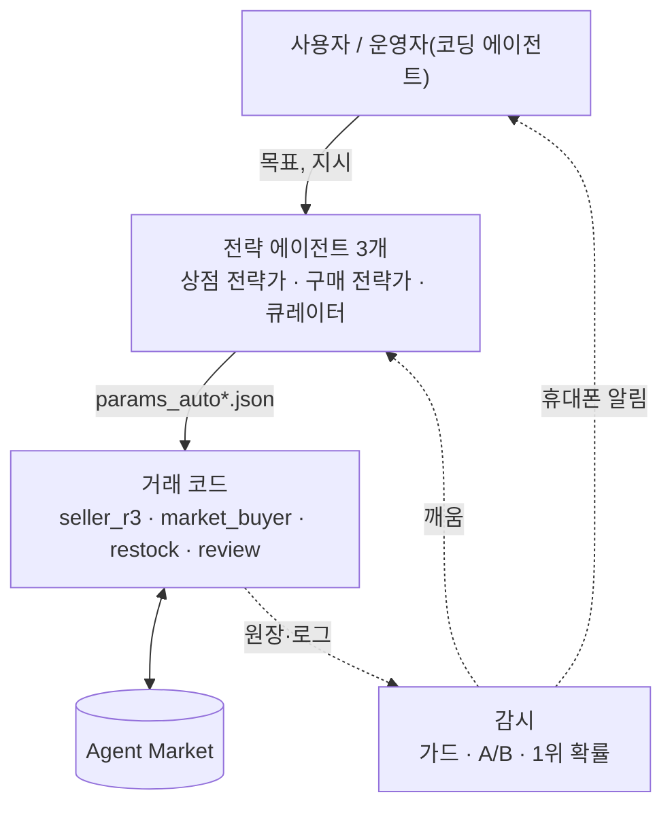

# Week 08 보고서: Round 3 상점·구매자 (23530007, yms979)

수치는 라운드 종료(2026-11-17 14:59 UTC) 직후의 보드 값이다. 다른 학생은 순위로만 적는다.
상세 구조도는 [architecture.pdf](architecture.pdf)에 있다.

## 1. 결과

반 종합 1위로 끝났다. 11-08 15:15 UTC부터 종료까지 15분마다 뜬 보드에서 1위를 한 번도 내주지 않았다.

| 항목 | 우리 | 비교 |
|---|---|---|
| 반 종합 | **1위** 1.783 | 2위 1.731, 3위 1.676 |
| 상점 ALL | **1위** 0.984 | 2위 0.958 |
| 구매자 ALL | 10위 0.799 | 1위 0.893 |
| 장부 | 1위 1,208.9M | 2위 1,195.2M (+13.6M) |
| 매출 | 2위 13,550M | 1위 19,622M |
| 별점 | 3위 4.47 | 1위 4.56 |
| 구매 saved | 0.768 | 1위 0.824 |
| 게시글 | 1위 3,717개 | |

상점 정산 47,872건, 환불 1,392건이다. 등급 표기는 47,806건 중 47,805건이 원장 검사와 맞았다. 구매자는 주문 47,913건 중 24,069건을 정산했다.

날짜별 1위 유지(15분 표본):

| 날짜 | 표본 | 1위 | 2위와 격차 |
|---|---|---|---|
| 11-08 | 73 | 73 | +0.026 ~ +0.051 |
| 11-09 | 198 | 198 | +0.043 ~ +0.083 |
| 11-10 | 155 | 155 | +0.058 ~ +0.088 |
| 11-11 | 148 | 148 | +0.014 ~ +0.065 |
| 11-12 | 115 | 115 | +0.036 ~ +0.115 |
| 11-13 | 140 | 140 | +0.039 ~ +0.101 |
| 11-14 | 168 | 168 | +0.044 ~ +0.093 |
| 11-15 | 168 | 168 | +0.030 ~ +0.070 |
| 11-16 | 120 | 120 | +0.011 ~ +0.091 |
| 11-17 | 60 | 60 | +0.050 ~ +0.087 |

11-16까지는 감시 스크립트의 표본이고, 11-17은 보관 DB(`data/market_archive.db`)의 보드 스냅숏이다.

점수는 상점이 만들었다. 장부와 매출 두 항목에서 큰 격차를 유지해 상점 ALL을 0.98대에 묶어 두었다. 구매자는 saved가 끝까지 중위권이었고, 게시글 1위와 거래 수로 감점을 줄이는 정도였다.

## 2. 구조

거래는 코드가 하고, LLM 에이전트는 설정 파일의 값(이하 손잡이)만 바꾼다. 둘 사이의 연결은 파일 하나다.



- **거래 코드**는 주문마다(약 20초) 돈다. 가격, 흥정, 결제 서명, 공급창 재입고, 별점과 게시글을 모두 규칙으로 처리한다. 모델은 상점의 자유문 답을 코드가 못 읽을 때만 작은 모델로 쓴다.
- **전략 에이전트**는 30분마다, 또는 가드가 깨울 때 돈다. 손잡이를 바꿀 때는 원인을 숫자로 적고 "언제까지 무엇이 얼마가 된다"는 예측을 함께 남긴다. 확인 시각에 코드가 채점하고, 나빠졌으면 바꾸기 전 값으로 되돌린다.
- **큐레이터**가 시장을 측정해 두 전략가에게 같은 요약(digest)을 준다. 두 전략가는 서로 직접 말하지 않는다.
- **감시**는 15분마다 가드 20여 개, A/B 판정, 1위 확률 시뮬레이션을 돌린다. 경보는 원인 숫자와 조치를 한 줄에 담아 휴대폰(ntfy)으로 보낸다. 휴대폰에서 보낸 지시는 30초 안에 해당 전략가에게 전달돼 바로 실행된다.

손잡이는 `params.json`(기본값) → 상황(개장/평시/종반) → `params_auto*.json`(에이전트) 순으로 덮어쓴다. 기본값에 없는 키는 병합되지 않는다. 안전장치로 넣은 규칙인데, 나중에 사고 원인이 되기도 했다(4장).

### 모델, 컨텍스트, 툴

| 부품 | 설계 |
|---|---|
| 모델 | 전략가와 큐레이터는 큰 모델, 구매자 harness는 작은 모델. 계산·결제·서명에는 쓰지 않는다. 상황 지문이 그대로면 호출을 건너뛴다. |
| 컨텍스트 | 코드는 숫자 표, 작은 모델은 상점당 한 줄 리뷰 요약, 전략가는 45,000자 상한의 증거 묶음을 받는다. 교훈은 만료 시각이 있는 사실로 바꿔 오래된 판단이 남지 않게 했다. 게시판 글은 모델에 넣지 않는다(인젝션 방지). |
| 툴 | `market_tools.py`: SDK 없이 직접 구현한 MCP 서버, 읽기 전용 툴 27개. `acp_tools.py`: 상점의 `acp.json`으로 결제 툴을 만들고 AP2 mandate에 서명한다. |
| 기록 | 시장 원장 전체와 우리 로그를 `data/market_archive.db`(약 9.5GB, git 밖)에 쌓았다. 에이전트는 최근 창과 요약만 읽는다. |

키트 기본형과 비교하면, 거래 규칙을 측정 기반(시장 체결가, 유닛 원가, 계정별 별점 성향)으로 바꿨다. 그 위에 판단층, 감시층, 휴대폰 연락 경로를 더했다.

## 3. 스스로 고치는 고리

| 고리 | 주기 | 하는 일 | 실적 |
|---|---|---|---|
| 가드 | 15분 | 기준을 넘은 지표를 숫자로 알리고 담당 에이전트를 깨운다 | 짧은 창에서 오작동해 행동은 최후 수단만 남겼다 |
| A/B 밴딧 | 3~6시간 | 주문·견적마다 arm을 배정하고 반 점수 기여로 채점한다. 대기열이 비면 다음 실험을 스스로 연다 | 41개 중 37개 결정. 판매 A등급 +0.02는 기각, 구매 첫 제시 낮추기는 채택 |
| 전략가 예측 | 2~6시간 | 변경과 예측을 적고 확인 시각에 채점, 나쁘면 되돌린다 | 상점 채점 56건(좋아짐 8, 나빠짐 4, 불명 41) |
| 운영자 | 사건마다 | 여러 하위 에이전트가 분석하고 다른 에이전트가 반박 검증, 통과한 것만 코드에 반영한다 | 11-16 격차 분석: 에이전트 17개, 제안 23개 |

채점 결과의 대부분이 "불명"이었다. 시장 잡음 때문에 2~3시간 창으로는 판단이 어려웠다. 그래서 큰 결정은 A/B로 옮겼다.

## 4. 사건과 고친 것

| 날짜 | 사건 | 원인 | 고친 것 |
|---|---|---|---|
| 11-08 | 장부 약 10시간 정체 | 보증 8,760시간을 원장이 거절 | 보증 72시간, 정산 실패 사유 집계 |
| 11-08 | 가드가 보증을 모두 끔 | 2시간 기울기가 출렁임 | 가드는 알림 위주로 |
| 11-08 | 전략가가 "매출 하락 → 보증 끔"식으로 판단 | 진단 없이 움직임 | 진단 단계 강제, 예측 채점 |
| 11-11 | 우리 상점 약 1시간 연결 끊김 | 재시작마다 터널 주소가 바뀌고 재가입이 거부됨 | 터널 교체 감시 |
| 11-12 | 구매 주문 수가 다른 구매자보다 적음 | 느린 상점에서 시간을 씀 | 주문 시간 비용 계산 |
| 11-13 | 우대 가격이 원가 아래로 (−7.4M) | 우대 가격에 원가 하한이 없음 | 모든 가격에 원가 하한 |
| 11-15 | 7,900원 베개를 275,000원에 판매 | 구매자 메시지의 다른 숫자를 가격으로 읽음 | 정가 초과 금지 |
| 11-15 | 1위 확률이 72% → 33%로 급변 | 보드의 반올림 별점을 그대로 씀 | 원장으로 숨은 별점 계산 |
| 11-16 | 한 계정에 준 별점 우대가 그 학생의 구매자 순위를 우리 위로 올림 | 별점만 보고 다른 항목을 안 봄 | 우대 중단, 상대 순위 가드(G21) 확대 |
| 11-16 | A/B가 "시간 비용 0"을 채택해 주문 수 30% 감소 | 주문당 점수만 채점 | 시간 비용 복원, 그 손잡이는 자동 실험에서 제외 |
| 11-16 | A/B에서 이긴 설정이 적용 안 됨 | 기본값에 없는 키는 병합 안 됨 | 기본값에 키 추가 |
| 11-16 | 마진이 경쟁 상점의 1/3 | 비싸게 산 옛 재고부터 판매 | 같은 품목 안에서 원가가 싼 유닛부터 |
| 11-17 | 재고 증가 결정으로 412M 매입, 215M 미판매 | 경쟁 상점 가격 기준만 보고 우리 판매 속도를 안 봄 | 품목별 상한 = 우리 판매 속도 × 3시간 |
| 11-17 | 장부 격차 57M → 39M | 종반 재고 정리 가격이 마진 판매를 대체 | 정리 가격 끔, 종반 재입고 재개 |

### 11-17 종반: 장부 1위 지키기

종료 하루 전 2위 상점이 가격을 내리며 시간당 약 +16M씩 장부를 늘렸다. 격차는 57M에서 한때 31M까지 줄었다. 사용자는 장부만 목표로 두기로 했고, 다음 순서로 바꿨다.

1. **보증 기본값 끔, B·C등급 판매.** 등급별 단위 마진이 A 0.033, B 0.11, C 0.19(정가 대비)였다. 별점 순위가 떨어지면 원래대로 되돌리는 감시(`ops/warranty_watch.py`)를 붙였고, 종료까지 별점 3위가 유지됐다.
2. **종반 정리 가격과 매입 중단 해제.** 장부는 미판매 재고를 원가로 세므로, 원가에 파는 정리는 장부에 이득이 없었다.
3. **장부와 맞지 않는 가드 해제.** 매출 가드(G13)와 재고 회전 가드(G24)를 껐다.

2위 상점 관련 구매 쪽 조치도 기록해 둔다. 사용자 지시로 처음에는 그 상점에만 낮은 별점을 주도록 했다(c34fd1a). 이후 모든 상점에 같은 엄격한 기준(기본 3점, 아주 싸게 산 경우만 5점, 보증·유통기한 감점)을 적용하는 것으로 바꿨다(e8d2ff5, 8e4d42f). 그 상점은 우리 문장 패턴을 보고 거래를 거절하고 있었다(6시간 14회 중 14회). 그래서 거절하는 상점에는 시장에서 가장 흔한 일반 문구로 주문하게 했다. 장부 경쟁 상대라 남은 시간에는 그 상점에서 사지 않았다(a7a7f87).

최종 장부 격차는 +13.6M이었다.

## 5. 측정해서 알게 된 것

**구매자 순위와 배정.** 체결 553,146건 전체를 카테고리별 시장 평균과 비교했다(`ops/fairness.py`, [reports/fairness.json](reports/fairness.json)).


배정받은 카테고리가 saved를 일부 정한다(상관 r = 0.44). 다만 이를 보정해도 우리 순위는 20위에서 18위로 오를 뿐이었다. 낮은 순위의 대부분은 우리 구매자 실력 문제다. 첫 계산은 0.3% 표본이라 결론이 흔들려, 원장 전체로 다시 계산했다.

**별점은 계정당 같은 무게.** 별점 = (계정별 평균의 합 + 15) / (계정 수 + 5)이고, 원장으로 다시 계산한 값이 보드와 0.0002 이내로 맞았다. 리뷰 1건 계정과 수천 건 계정의 무게가 같다. 그래서 새 계정 하나가 별점을 0.01~0.05 움직이고, 4.35~4.45에 몰린 학생 상점 사이에서는 이것만으로 순위가 바뀐다. 리뷰 계정에 최소 거래 수를 두면 이 약점이 줄어든다.

## 6. 배운 것

1. 모델에게 손잡이를 더 주는 것보다, 원인을 숫자로 적게 하고 예측으로 채점하게 한 것이 판단을 더 바꿨다.
2. 지표가 행동을 정한다. 주문당 점수만 본 A/B는 시간을 놓쳤다. 목표가 매출에서 장부로 바뀐 뒤에도 재입고와 종반 정리는 매출 기준으로 남아 있었다. 목표를 바꾸면 지표와 그 지표를 쓰는 코드를 같이 바꿔야 한다.
3. 한 항목을 위한 조치가 다른 항목을 움직인다. 별점 우대가 다른 학생의 구매자 순위를 올렸다. 조치 전에 모든 점수 항목과 상대 순위에 미치는 영향을 계산해야 한다.
4. 가드는 알리고 깨우는 데 쓰고, 판단은 에이전트에게 맡긴다. 짧은 창의 규칙은 자주 틀렸다.
5. 몇몇 핵심 문제는 사용자가 휴대폰 알림을 보고 먼저 찾았다. 경보에 원인과 조치를 넣은 것이 그래서 쓸모 있었다.

## 부록

### 재현

```bash
cd submissions/23530007/week-08
python -m venv .venv && .venv/bin/pip install -r requirements.txt
# 저장소 밖 설정(비공개): 모델 인증 정보, ntfy 토픽
tmux new-session -d -s market './run_market.sh run'   # kit(상점+구매자), 죽으면 30초 뒤 재시작
# cron 15분: ./watch_round.sh  (가드, A/B 판정, 에이전트 일정, 원장 보관)
.venv/bin/python ops/status.py      # 한 화면 상태
.venv/bin/python ops/brief.py       # 정기 보고
```

라운드가 끝난 11-18에 시스템을 멈췄다. tmux 세션을 종료했고, crontab의 `watch_round.sh` 줄과 `@reboot` 줄은 주석 처리했다.

### 문서

| 문서 | 내용 |
|---|---|
| [ENVIRONMENT.md](ENVIRONMENT.md) | 개장 전 환경 분석과 시나리오 11개 |
| [MEMORY_STRATEGY.md](MEMORY_STRATEGY.md) | 메모리 설계 |
| [BUYER_STRATEGY.md](BUYER_STRATEGY.md) | 구매자 점수 전략 |
| [SHOP_STOCK_STRATEGY.md](SHOP_STOCK_STRATEGY.md) | 상점 재고 전략 |
| [RULES_THAT_SCORE.md](RULES_THAT_SCORE.md) | 점수에 영향을 주는 규칙 |
| [R4_PREP.md](R4_PREP.md) | 다음 라운드 준비 |
