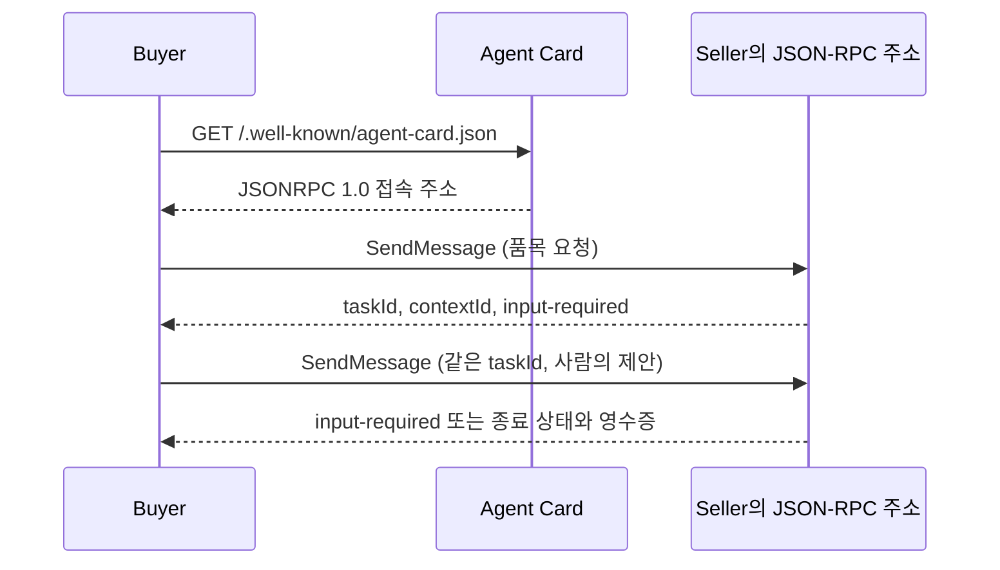

# STEP 6 — buyer의 A2A 통신 구현

이 문서는 STEP 6 당시의 기록이다. 현재는 STEP 7에서 자율 모드를 추가했으며,
아래의 `--manual` 실습도 그대로 사용할 수 있다. 자율 실행은 `STEP7.md`를 따른다.

## 완료한 범위

`buyer.py`의 `BuyerTransport`가 Agent Card 조회, JSON-RPC 1.0 요청,
taskId·contextId 유지, 완료·거절·취소 처리와 예산 검사를 담당한다.
현재 CLI는 `--manual`을 필수로 받아 사람이 입력한 제안을 전송한다.
하네스가 가격이나 철수를 결정하는 코드는 STEP 7에서 연결한다.
이번 단계에서 규칙 기반 구매 전략을 만든 것은 아니다.



모든 요청에는 `A2A-Version: 1.0` 헤더를 붙인다. 카드의 주소를 사용하므로
JSON-RPC 경로를 `/`로 고정하지 않는다. 메시지마다 고유 messageId를 만들고,
같은 거래의 taskId와 contextId는 유지한다.

## 실제 확인 결과

공식 검사 코드가 제공하는 **규칙 기반 가게**를 임시 포트에 띄워 실제
buyer CLI를 별도 프로세스로 실행했다. 모델 호출은 전혀 없었다.

| 시나리오 | 결과 |
|---|---|
| lamp, 예산 120, 수동 제안 80 → 110 | 같은 task에서 completed, 110짜리 영수증 |
| 완료 후 추가 제안 115 | 추가 메시지를 전송하지 않고 종료 |
| lamp, 예산 120, 수동 제안 121 | 제안 전송 차단, 의도한 종료 코드 1 |
| bookshelf, 예산 230, 수동 제안 230 후 취소 | canceled, 영수증 없음 |
| chair, 예산 120, 수동 제안 100을 5회 | rejected, 추가 구매 없음 |

서버 기록에서도 전체 거래는 lamp 한 건(110)뿐이었고,
버전 헤더가 빠진 POST는 0건이었다. 후속 SendMessage 8건을 기존 task로
계속 보냈고 취소 1건을 확인했다. `121`은 가게가 받은 제안 목록에 없었다.
결과는 네 가지 CLI 실행 시나리오로 검증했다. 표의 첫 두 행은 같은 실행이다.

실제 요청·응답은 `logs/buyer/`, CLI 출력과 가게 기록은
`logs/step6/20261016T052331879201Z-transport/`에 원본으로 보존했다.
검증용 서버는 종료했으며 기존 사용자의 실습 서버는 건드리지 않았다.

## 직접 실습 — 모델 사용량 없이 확인

두 터미널 모두 과제 폴더로 이동한다.

```powershell
cd C:\Submissions\ai_agent_engineering\submissions\24522014\week-06
```

터미널 1: 공식 코드의 규칙 기반 가게를 실습용 11099번 포트에서 실행한다.

```powershell
.\a2a-lab\.venv\Scripts\python.exe verify_step6.py --serve --port 11099
```

터미널 2: 사람이 지정한 80, 110을 차례로 제안한다.

```powershell
.\a2a-lab\.venv\Scripts\python.exe buyer.py --manual --url http://127.0.0.1:11099 --item lamp --budget 120 --offer 80 --offer 110
```

확인할 것:

1. 응답 세 개의 id가 같은가? buyer가 보관하므로 Task ID를 직접 붙여넣지 않는다.
2. 상태가 input-required → input-required → completed로 바뀌는가?
3. 마지막 artifact의 item은 lamp, price는 110인가?
4. 로그의 후속 요청에 같은 taskId, contextId가 있고 모든 요청에 버전 헤더가 있는가?

취소를 확인하려면 같은 터미널 2에서:

```powershell
.\a2a-lab\.venv\Scripts\python.exe buyer.py --manual --url http://127.0.0.1:11099 --item bookshelf --budget 230 --offer 230 --cancel
```

예산 초과 차단을 확인하려면:

```powershell
.\a2a-lab\.venv\Scripts\python.exe buyer.py --manual --url http://127.0.0.1:11099 --item lamp --budget 120 --offer 121
```

마지막 명령은 첫 품목 요청 후 `Offer must be a positive integer within budget`
오류로 끝나는 것이 정상이다. 121을 전송하지 않는다. 실습이 끝나면 터미널 1에서
Ctrl+C로 가게를 종료한다. 현재 CLI는 실행마다 새 거래를 시작한다.

기존 하네스 seller로 같은 명령을 실행할 수도 있지만, 그 seller는 요청마다
실제 모델을 호출한다. 위 안내의 규칙 기반 가게에는 API 키나 로그인이 필요 없다.

## 코드에서 읽을 부분

- `discover()`: 카드 형식과 JSON-RPC 1.0 인터페이스를 확인한다.
- `_request()`: UTF-8 JSON 요청과 원본 HTTP 응답, 오류를 별도 파일에 기록한다.
- `_rpc()`: JSON-RPC 응답 ID와 오류, taskId·contextId 일치를 검사한다.
- `open()`: 품목 요청으로 새 task를 만든다.
- `offer()`: 예산과 task 상태를 확인하고 같은 task에 숫자 제안을 보낸다.
- `get_task()`, `cancel()`: 조회·취소를 수행한다.
- 완료된 응답은 숫자 영수증 가격과 예산, 품목을 검사한다. 잘못된 영수증은
  성공으로 출력하지 않는다. 이는 잘못된 서버 응답을 감지하는 검사이며,
  서버가 이미 완료한 거래를 취소하거나 되돌리는 기능은 아니다.

세션 전체 시간 제한은 기본 290초, HTTP 요청 하나는 남은 시간 안에서
최대 100초다. STEP 7의 모델 판단도 같은 전체 시간 제한 안에 넣을 예정이다.
이번 단계에는 자동 재시도나 고정 가격 전략을 넣지 않았다.
입력 제안 없이 실행하면 첫 가격만 받아 로그를 남기고 종료하며 task는 열린 채로
가게에 남는다. `--cancel`은 사용자가 명시적으로 요청한 거래 취소다.

## 실패와 수정, 검사 결과

첫 로컬 검사에서 카드의 `supportedInterfaces`가 `null` 또는 숫자일 때
다음처럼 예상하지 않은 TypeError가 발생했다.

```text
TypeError: 'NoneType' object is not iterable
TypeError: 'int' object is not iterable
FAILED (errors=2)
```

목록 형식 검사를 추가해 `BuyerError`로 처리했다. 실패 콘솔은
`logs/step6-tests-20261016-142104.stderr.txt`에 보존했다.
수정 후 로컬 검사 10개가 통과했다. 예산·종료 상태·접속 주소·버전 헤더,
task와 context의 변경, JSON-RPC 오류·응답 ID, HTTP·JSON 오류·원본 보존,
유효하지 않은 카드·영수증과 전체 시간 제한을 확인했다.

```powershell
# 모델 호출 없는 로컬 검사
.\a2a-lab\.venv\Scripts\python.exe -m unittest test_buyer_transport -v
# 규칙 기반 가게를 자동으로 띄워 네 가지 실제 HTTP 시나리오 검사 후 종료
.\a2a-lab\.venv\Scripts\python.exe verify_step6.py
```

로컬 테스트 자료는 `logs/step6-tests/`에 따로 보존했다. 실제 HTTP 검증 종료 시
SDK의 `Dispatcher task is not running` 진단이 있었으나 시나리오 검사와 종료
코드는 성공이었다. 원본 로그는 편집하지 않았다.

현재 buyer는 자율 구매 프로그램이 아니므로 전체 trade test는 아직 실행하지
않았다. 다음 STEP 7에서 두 하네스의 제안·철수 판단을 연결한다.
