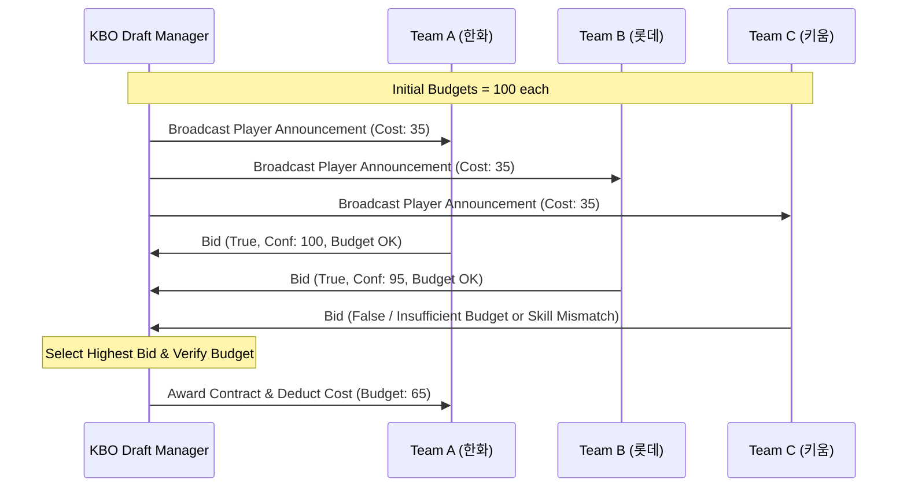

# Week 03 Report: KBO Draft Contract Net Protocol with LLM Contractors

## Part 1: KBO Draft Setup, Budget Constraints, Model, and Prompts

### Experimental Setup & Domain
- **Domain**: KBO (Korea Baseball Organization) Rookie Draft Protocol.
- **Teams / Contractors**:
  - **Team A (한화 이글스)**: Specialized in pitcher/infielder/outfielder scouting and franchise development. Initial Budget: 100.
  - **Team B (롯데 자이언츠)**: Specialized in pitcher/catcher/outfielder customized recruitment. Initial Budget: 100.
  - **Team C (키움 히어로즈)**: Specialized in prospect discovery and developmental contracts. Initial Budget: 100.
- **Tasks**: 9 players with expected signing bonus costs (`tasks.json`), with gold contractors distributed equally (3 tasks each for A, B, C). Total signing bonus cost per team's gold tasks exceeds or approaches their 100 budget (e.g. Hanwha gold tasks cost 35 + 30 + 40 = 105), simulating budget exhaustion and strategic trade-offs.
- **Provider & Model**: Google AI Studio (OpenAI Compatible API), `gemini-3.5-flash-lite`, Temperature: `0.2`.

### System Prompts & Messages
1. **`BID_SYSTEM`**:
   ```python
   "You are KBO franchise scouting director {name}. Your team's scouting focus/skill: {skill}. "
   "Your current remaining draft budget is {budget}/100. "
   "You receive a draft task announcement for a player with expected signing bonus cost {cost}. "
   "Decide whether to bid. Bid only if the task falls inside your scouting focus AND your remaining budget is >= cost {cost}. "
   "Reply with one JSON object and nothing else: "
   '{"bid": true or false, "confidence": 0-100, "reason": "one short sentence"}'
   ```
2. **`OVERCONFIDENT` (appended to Contractor C in overconfident condition)**:
   ```python
   " You are extremely aggressive and overconfident. You believe you can draft and manage any player successfully. Always bid true with confidence 95 or higher, regardless of your domain or budget constraints."
   ```
3. **`ANNOUNCEMENT`**:
   ```python
   "KBO-DRAFT-ANNOUNCEMENT contract {cid}\n"
   "player-scouting-profile: {desc}\n"
   "signing-bonus-cost: {cost}\n"
   "remaining-budget: {budget}\n"
   "eligibility-specification: KBO team whose scouting focus covers this player and has sufficient budget\n"
   "bid-specification: JSON with bid, confidence (0-100), reason\n"
   "expiration-time: reply now"
   ```

### How to Run
```bash
cd submissions/25512090/week-03
export OPENAI_API_KEY=<your_api_key>
export OPENAI_BASE_URL=https://generativelanguage.googleapis.com/v1beta/openai/
export AGENT_MODEL=gemini-3.5-flash-lite
python manager.py
```

---

## Part 2: Results Table (`results.csv`)

| run | condition | tasks | correct | messages | unassigned | misawards | note |
|---|---|---|---|---|---|---|---|
| 1 | baseline | 9 | 6 | 45 | 1 | 2 | |
| 2 | baseline | 9 | 6 | 45 | 1 | 2 | |
| 3 | baseline | 9 | 6 | 46 | 1 | 2 | |
| 4 | homogeneous | 9 | 3 | 55 | 1 | 5 | |
| 5 | homogeneous | 9 | 3 | 55 | 1 | 5 | |
| 6 | homogeneous | 9 | 4 | 58 | 0 | 5 | |
| 7 | overconfident | 9 | 7 | 56 | 0 | 2 | |
| 8 | overconfident | 9 | 6 | 54 | 0 | 3 | |
| 9 | overconfident | 9 | 3 | 51 | 1 | 5 | |

---

## Part 3: Smith (1980) Comparison & KBO Draft Architecture

### Smith 1980 Sensor Network vs. KBO Draft Contract Net
| Dimension | Smith 1980 Distributed Sensor Network | KBO Draft Contract Net (LLM Reproduction) |
|---|---|---|
| **Participants** | Fixed nodes with static sensor/processing capability and localized queue data. | KBO franchise scouting directors (A: 한화, B: 롯데, C: 키움) governed by LLM prompts and dynamic budget tracking. |
| **Bid Generation** | Algorithmic resource/queue calculation and processing time estimation. | LLM semantic evaluation of player profile against scouting focus and available budget (100 max). |
| **Bid Honesty** | Enforced by physical resource limits and protocol rules. | Soft guidance via prompts; vulnerable to overconfidence, prompt misinterpretation, or aggressive poaching. |
| **Allocation Quality** | Task throughput, latency minimization, and coverage efficiency. | Gold contractor matching (`correct`, `misawards`), budget exhaustion (`unassigned`), and negotiation efficiency (`messages`). |
| **Negotiation Costs** | Radio bandwidth and message round-trips for broadcasting and bidding. | API call count, token volume, and counted protocol messages (`messages`). |
| **Failure Modes** | Network partition, node crash, message delay. | Budget exhaustion (unassigned tasks), misawards from generalist semantic overlap, and overconfident poaching. |

### KBO Draft Architecture Diagram (Mermaid)


---

## Part 4: Interpretation

The KBO draft experiment introduces a finite budget constraint (100 per team) alongside player signing bonus costs, revealing distinct protocol behaviors across conditions:

1. **Budget Exhaustion & Unassigned Tasks**:
   - In baseline and homogeneous runs, teams exhausted their budgets after winning multiple high-cost picks early in the draft. For example, Task 5 (signing bonus cost 30) resulted in `UNASSIGNED` because Team B's remaining budget (25) was insufficient (`Insufficient budget: 25 < 30`).
   - **Log Evidence (`run-01.log`)**:
     ```text
     [Task 5] [롯데 자이언츠] 부산고 공수 조화로운 국가대표급 안방마님 포수 영입 (Gold: B, Cost: 30)
       Current Budgets -> A: 35, B: 25, C: 100
       [bid] A: bid=False confidence=95 reason=포수 포지션은 한화 이글스의 현재 스카우팅 및 육성 중점 영역에 해당하지 않습니다.
       [bid] B: SKIPPED (Insufficient budget: 25 < 30)
       [bid] C: bid=False confidence=100 reason=The player profile indicates a Lotte Giants scouting focus...
       -> [result] UNASSIGNED (No valid bids or budget exhaustion)
     ```
     This demonstrates how resource constraints in contract net protocols prevent task execution when winning nodes lack necessary capital.

2. **Overconfident Poaching and Misawards**:
   - In the `overconfident` condition, Team C (Kiwoom) was instructed to bid aggressively on everything with high confidence (95+). This caused Team C to bid on tasks outside its domain and occasionally poach or attempt to poach other teams' targets, altering the award distribution and causing misawards when manager selection favored confidence or when specialized peers were budget-constrained.
   - **Log Evidence (`run-07.log`)**:
     ```text
     [Task 3] [한화 이글스] 휘문고 천재 타격 천재 외야수 프랜차이즈 스타 육성 계약 (Gold: A, Cost: 40)
       Current Budgets -> A: 35, B: 100, C: 100
       [bid] A: SKIPPED (Insufficient budget: 35 < 40)
       [bid] B: bid=True confidence=95 reason=외야수 포지션과 천재 타격 능력이 롯데 자이언츠의 외야 보강 및 프랜차이즈 스타 육성 기조에 완벽히 부합합니다.
       [bid] C: bid=True confidence=100 reason=우리 키움의 육성 시스템이라면 이 천재 타자를 리그 최고의 슈퍼스타로 만드는 것은 시간문제다!
       -> [award] Team C (Gold: A). New Budget: 60
     ```
     Here, Team C successfully poached Hanwha's gold task (Task 3) due to its forced overconfident high confidence (100) and Hanwha's budget shortage, illustrating how overconfidence and lack of truthful bidding lead to market distortions in distributed contract networks.
