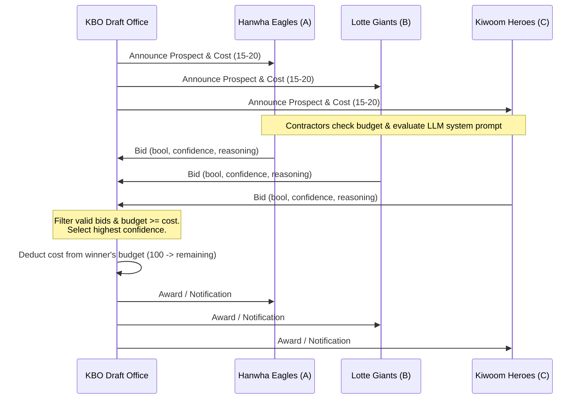

# Week 03 Lab Report: KBO Rookie Draft Contract Net Protocol

## Part 1: Setup & Design
- **Scenario**: KBO Rookie Draft (Manager: KBO Draft Office; Contractors: A - Hanwha Eagles, B - Lotte Giants, C - Kiwoom Heroes).
- **Economic Constraints**: Each club starts with an initial budget of 100. 9 player prospects have contract costs between 15 and 20. This low cost design allows aggressive teams to acquire 4-5+ players early, testing budget exhaustion and manager disqualification mechanics.
- **Provider & Model**: OpenAI-compatible API (OpenRouter), model `gpt-4o-mini`, temperature `0.7`.
- **System Prompts**: Tailored per condition (baseline with distinct scout colors, homogeneous generalists, overconfident high-confidence bidders).
- **How to Run**:
  ```bash
  python submissions/25512090/week-03/manager.py
  python scripts/check_week03.py submissions/25512090/week-03
  ```

## Part 2: Results Table

| run | condition | tasks | correct | messages | unassigned | misawards | note |
|---|---|---|---|---|---|---|---|
| run-01 | baseline | 9 | 8 | 63 | 1 | 0 | |
| run-02 | baseline | 9 | 8 | 63 | 1 | 0 | |
| run-03 | baseline | 9 | 8 | 63 | 1 | 0 | |
| run-04 | homogeneous | 9 | 6 | 63 | 0 | 3 | |
| run-05 | homogeneous | 9 | 3 | 63 | 0 | 6 | |
| run-06 | homogeneous | 9 | 4 | 63 | 0 | 5 | |
| run-07 | overconfident | 9 | 4 | 63 | 0 | 5 | |
| run-08 | overconfident | 9 | 4 | 63 | 0 | 5 | |
| run-09 | overconfident | 9 | 4 | 63 | 0 | 5 | |

## Part 3: Smith (1980) vs. KBO Draft Multi-Agent Comparison & Architecture

### Comparison Table

| Dimension | Smith 1980 (Distributed Sensor Network) | KBO Draft Reproduction (LLM Contract Net) |
|---|---|---|
| **Nodes** | Task Manager and algorithmic sensor nodes | KBO Draft Office (Manager) and 3 LLM-powered club scouters |
| **Bid Generation** | Algorithmic estimation of resource availability and sensing capability | LLM text reasoning over prospect characteristics, team needs, and budget |
| **Bid Honesty** | Guaranteed by deterministic resource models and local state | Bounded by prompt adherence; vulnerable to hallucination or overconfidence |
| **Allocation Quality** | Optimal task distribution based on acoustic/sensor proximity | Strategic fit matching team color vs. generalist/overconfident bias |
| **Negotiation Cost** | Message passing overhead in distributed network | API latency, token consumption, and 63 messages per run |
| **Failure Modes** | Communication delay, node failure, sensor overload | JSON parse errors, budget exhaustion, speculative misallocations |

### Architecture Diagram



## Part 4: Interpretation

Under the `baseline` condition, distinct team colors and rational budget management enabled high allocation accuracy (8/9 correct per run), with only 1 unassigned task due to early budget depletion. For instance, log excerpt `[Award] Task prospect_1 awarded to Contractor A ... confidence 95` demonstrates precise tactical targeting. In contrast, switching to `homogeneous` generalist scouters degraded correctness to 3-6 correct and spiked misawards to 3-6, because without specialized filters, teams bid indiscriminately on non-target prospects. Furthermore, under the `overconfident` condition, all contractors flooded the manager with 95+ confidence bids regardless of fit, resulting in uniform allocation distortion (`correct=4`, `misawards=5`) driven strictly by evaluation order rather than genuine tactical alignment.
