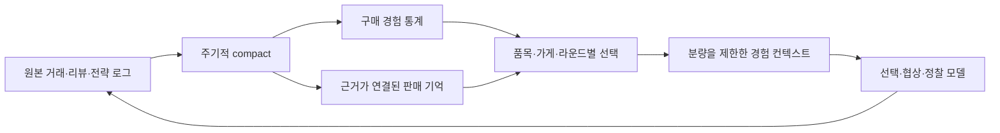

# 경험 메모리와 컨텍스트 관리

기존 labpc 에이전트의 거래·정찰 기능을 유지하면서, 과거 기록을 compact하고
현재 결정에 관련된 기억을 선택하는 계층을 추가한다. Mem0를 사용하는 구현은 아니다.
운영 코드는 labpc의 기존 `submissions/25520013/week-07/`에서 실행하며,
이 폴더는 중간평가 검토를 위한 코드와 검증 기록이다. PR과 push는 하지 않았다.

## 처리 흐름



원본 JSONL과 리뷰는 보존한다. compact 결과는 `.market/memory/buyer.json`,
`seller.json`에 원자적으로 저장하고, 처리 이력은 `logs/memory_compact.jsonl`에 남긴다.
실패한 모델 호출이나 잘못된 근거 참조는 기존 판매 메모리를 교체하지 않는다.

## 컴포넌트

- **구매 compact:** 구매 정찰 주기(10분)에 거래 기록을 가게·품목·라운드별로 집계한다.
  전체·24시간·1시간의 시도 수, 협상 성사, 오류, 영수증 문제, 평균 가격과 분모를 보존한다.
  예산 부족 주문은 구매 가능한 주문의 분모에서 제외하고, 예산 미상은 별도 집계한다.
  기존 기록에 라운드가 없으면 추정하지 않고 `null`로 남긴다.
- **판매 compact:** 최초 실행, 새로운 리뷰 근거 10개, 새로운 전략 실험, 또는 6시간 경과 시
  정찰 스레드에서 Terra medium을 호출한다. 거래 응답 경로에서는 compact 모델을 호출하지 않는다.
  관찰·해석·조건·예외·불확실성·지지 근거·반대 근거를 최대 16개 기억으로 통합한다.
  후속 compact에는 기존 통합 기억과 그 근거, 새 근거를 전달한다.
- **선택:** 구매는 품목·가게·현재 목록과 라운드/최근 활동을 사용하고,
  판매는 품목·라운드·근거/반대 근거를 사용한다. 구매 정찰에서는 품목을 번갈아 선택해
  한 품목의 많은 기록이 다른 품목을 밀어내지 않게 한다. 의미 임베딩 검색은 사용하지 않는다.
- **컨텍스트 구성:** 선택된 기억만 기본 6,500자 이내로 전달한다. 기억 중간을 잘라 넣지 않으며,
  선택·생략 건수와 snapshot 경과 시간을 표시한다. 이 제한은 **추가 경험 컨텍스트**의 문자 수이며,
  전체 프롬프트나 토큰 수 제한은 아니다.
- **연결 지점:** 구매 가게 선택·구매 협상·구매 정찰·판매 협상 프롬프트·판매 전략 정찰.
  판매 협상 모델은 기존 설정상 호출되지 않고 코드가 응답한다. 프롬프트 연결은 준비되어 있지만
  메모리를 넣기 위해 협상 모델 호출을 새로 활성화하지 않는다.

## 근거의 의미와 한계

구매 기록의 `deal`은 협상과 영수증에 관한 관찰이다. 구매 프로세스가 종료된 뒤
키트가 정산하므로, 이것만으로 Round 3 정산 성공을 주장하지 않는다.
새 기록에는 라운드와 `settlement_status: unknown`을 저장한다.

판매 compact의 근거 ID는 코드로 검증하지만, 요약 문장의 의미적 정확성까지 증명하는 것은 아니다.
따라서 상태는 `model_synthesis_unverified`다. 리뷰는 구매자의 주장으로, 전략 전후 성과는
관찰 결과로 취급한다. 별점만으로 불만 원인을 추정하지 않으며, 하한가·예산·영수증 규칙이
어떤 기억보다 우선한다. 원본 근거 참조는 상태 파일에 남는다.

Round 3 공개 장부에서 예산이 숨겨질 때 기존 시장 통계/가게 선택 로직을 어떻게 바꿀지는
별도 확인이 필요하다. 이번 변경은 그 통계 로직이나 정산 프로토콜을 교체하지 않는다.

## 검증

```bash
uv run python -m unittest discover -s . -p 'test_memory_context.py' -v
```

오프라인 테스트는 분모·시간창·라운드 분리, 오래된 관련 경험 선택, 무관한 품목 배제,
분량 제한, 근거/반대 근거 보존, 존재하지 않는 근거 거부, compact 실패 시 이전 파일 보존,
반복 모델 호출 억제, 증분 입력, 원본 보존을 확인한다.

이 검증은 컨텍스트 구성의 계약을 확인한다. LongMemEval-V2 공식 평가나 모델 판단 품질,
거래 성과 개선을 입증한 결과가 아니다. Round 3 성과는 개시 이후 정산 로그로 평가해야 한다.

참고: [LongMemEval-V2](https://github.com/xiaowu0162/LongMemEval-V2)는 평가 벤치마크이며,
[Mem0](https://github.com/mem0ai/mem0)는 별도의 메모리 구현 시스템이다.
