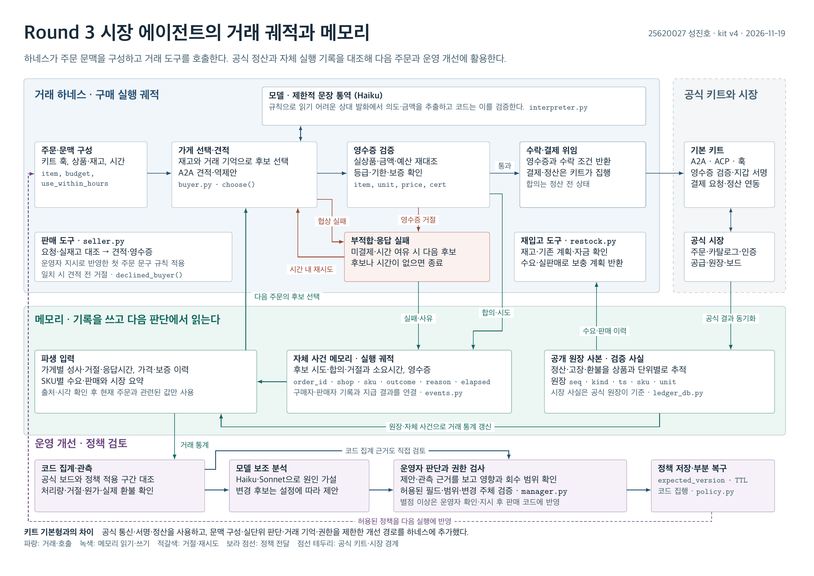

# Round 3 아키텍처 해설

25620027 · R3 운영 구조의 설명 · 2026-11-19

[한 페이지 PDF](architecture.pdf) · [LaTeX 원본](architecture.tex) · [보고서 본문](REPORT.md)

## 1. 그림의 범위와 읽는 순서

이 그림은 **거래 기억을 활용하는 규칙 우선 하이브리드 에이전트**를 보여 준다. 위쪽은 한 주문을 처리하는 하네스, 가운데는 출처별 기록과 메모리의 읽기·쓰기, 아래쪽은 정책을 검토하는 경로다. 오른쪽에는 공식 키트와 시장의 책임을 표시했다. 상자는 코드를 나눠 읽기 위한 논리 단위다. 운영 중 모델 역할과 정책 권한은 바뀌었고, 후기에는 모델의 정책 집행 권한을 제한했다.

파란 실선은 거래·호출, 녹색 실선은 메모리 읽기·쓰기, 적갈색 실선은 거절·재시도, 보라색 점선은 허용 정책 전달을 뜻한다. 공식 키트와 시장은 점선 테두리로 묶었다. 영수증 검증 상자는 `valid_receipt()`와 `check_receipt_value()`에 나뉜 책임을 한곳에 표시한다.

## 2. 구성 요소와 상태의 소유자

| 그림의 상자 | 입력 | 책임과 출력 | 상태의 기준·구현 |
|---|---|---|---|
| 공식 시장 | 참가·주문·서명된 결제 요청 | 공식 주문·재고·인증·공개 원장·보드 | 공식 시장이 권위값 소유 |
| 주문·문맥 구성과 모델 통역 | 키트 훅의 주문, 현재 정책, 필요한 카탈로그·기억, 상대 발화 | 현재 주문의 사실 문맥, 어려운 발화의 구조화된 해석 | `harness_app.py`, `r3/buyer.py`, `r3/interpreter.py` |
| 가게 선택·견적과 영수증 검증 | 후보 재고, 거래 기억, 현재 조건, 견적·영수증 | 다음 후보·거절 사유 또는 키트가 검사할 영수증과 수락 조건 | `r3/buyer.py`의 `choose()`, `valid_receipt()`, `check_receipt_value()` |
| 판매·재입고 도구 | 판매 요청과 실재고, 공급 훅의 수요·실판매·자금 | 판매 견적과 영수증, 보충 계획 | `r3/seller.py`, `r3/restock.py` |
| 공식 키트 | 훅 입력과 응답, 지갑 서명이 필요한 요청 | A2A·ACP 연결, 결제 요청과 공식 결과 수신 | `agent.json`의 훅 계약과 공식 키트 |
| 자체 사건 메모리 | 주문, 시도·실패·영수증, 지급 관측 | 다음 구매에 쓸 사유·응답시간·성사 이력 | `r3/events.py`의 `record_attempt()`, `shop_outcomes()`, `time_yield()` |
| 공개 원장 사본 | 시장이 발행한 원장 행 | 실정산·상품별 수요·고장·환불을 대사할 근거 | `r3/ledger_db.py` |
| 파생 입력과 코드 집계 | 원장·사건·재고·보드·비용 | 후보 선정 및 재입고 입력, 운영 검토용 숫자 | `r3/picture.py`, `r3/standing.py`, `r3/analyst.py` |
| 운영자·정책 관리 | 코드 집계, 선택적 모델 제안, 최신 정책 버전 | 허용 범위 검사, 조건부 저장, 만료와 부분 복구 | `r3/manager.py`, `r3/policy.py` |

공개 원장의 정산이 자기 로그의 합의보다 우선한다. 자기 사건 장부는 관측한 실패 원인을 보완하지만 공식 원장을 대신하지 않는다. 요약 JSON과 모델 메모는 파생 입력이므로 원자료 시각과 유효성을 확인한다.

## 3. 주요 메시지와 연결

필드 이름은 주문·결과 종류에 따라 다르다. 아래는 연결을 이해하는 데 필요한 실제 계약의 핵심 필드다. 키 값과 인증 비밀은 포함하지 않는다.

| 메시지·자료 | 핵심 필드 | 처리할 때의 주의점 |
|---|---|---|
| 구매 주문 | `item`, `budget`, `use_within_hours`, 기한 정보 | 현재 요청의 허용 범위와 전체 주문 시간 |
| 재고 단위 | `unit`, `sku`, 등급·원가·만료 정보 | SKU 평균과 실단위 조건을 구분 |
| 영수증 | `shop`, `item`, `price`, `task`, `unit`, `claim`, `cert`, `warranty_hours`, 서명 | 요청과 영수증, 실제 단위의 연결을 재검사 |
| 공개 원장 행 | `kind`, `seq`, `ts`, `buyer`, `shop`, 상품·단위·금액 | 합의·정산·고장·환불·최종 결과의 시점 구분 |
| 자체 시도 기록 | `order_id`, `shop`, `sku`, `outcome`, `reason`, `elapsed` | 실패도 저장하며 지급 관측을 수신하면 해당 시도와 대사 |
| 정책 저장 | 최신 `history.base`, `expected_version`, 변경할 자기 필드 | 다른 주체의 변경을 덮지 않는 조건부 저장 |

`budget`은 구매 집행에 필요한 내부 입력이다. 외부 상대나 공개 후기·게시글에 공개할 문맥으로 취급하지 않는다. 인증서가 참이라는 사실도 가격·효용·정산 성공을 모두 증명하지는 않는다.

## 4. 정상 구매 경로

1. `agent.json`의 `market_buyer` 훅이 `run_harness.sh`와 `harness_app.py market-buyer`를 연결한다.
2. 구매 경로가 현재 상품·후보 가게·사용 조건·관련 기억을 읽는다. 제한된 문장 해석은 모델이 보조할 수 있다.
3. 후보를 선택하고 견적을 교환한다. 거래 기억을 활용하되 표본이 부족한 세부 통계를 확정값으로 보지 않는다.
4. 합의가 나면 영수증의 실상품·가격·품질·사용 조건을 다시 확인한다. 견적과 영수증의 정보가 다를 수 있기 때문이다.
5. 허용된 경우 키트 결제 경로로 넘긴다. 최종 성사는 `paid`와 원장 정산으로 확인한다.
6. 후속 고장·환불·최종 결과는 같은 거래에 연결한다. 기대기여를 성숙 결과로 바꾸어 쓰지 않는다.

## 5. 정상 판매·보충 경로

판매 훅은 요청을 실제 보유 단위에 연결하고 견적·영수증을 만든다. 영수증 발급은 결제 완료가 아니다. 키트의 정산 결과와 원장을 보고 실제 판매를 센다.

재입고 훅은 거래를 기다리지 않고 누적 수요·판매·품절·보유량·기존 계획·자금 상태를 읽어 계획을 반환한다. 계획 수량과 실제 공급·실지출은 다르다. 공급 이후의 단위 원가와 정산을 다시 연결해야 매입의 효과를 평가할 수 있다.

## 6. 실패와 상태 전이

제출 로그에서 11/17 22:44:57 KST에 선택한 공산품 후보는 첫 영수증의 품질·기여 검사에서 거절됐다. 남은 시간에 다른 가게를 다시 조회했고, 가격 상한 초과와 협상 결렬을 거쳐 22:45:13에 미성사로 종료했다. 이 실행 궤적에서는 어떤 후보를 골랐고 어느 검사에서 막혔는지, 재시도 뒤 어떻게 끝났는지를 시간 순서대로 읽을 수 있다. [선택 95행](logs/market-kit.log#L95) · [영수증 거절과 재시도 141행](logs/market-kit.log#L141) · [종료 233행](logs/market-kit.log#L233)

| 상태·실패 | 허용되는 다음 행동 | 피해야 할 해석·행동 |
|---|---|---|
| 견적 부적합 또는 영수증 검사 실패 | 사유 기록, 남은 시간과 결제 상태가 허용하면 다음 후보 | 합의했으니 무조건 결제하거나 기준 우회 |
| 첫 판매 요청이 운영자가 반영한 제한 규칙과 일치 | 견적 전 작업을 거절하고 로그에 `declined_buyer` 기록 | 주문 문구 일치를 계정 인증으로 해석 |
| 결제 진행·정산 대사 중 | 기존 결과를 확인하고 중복 결제 방지 | 결과가 늦다는 이유만으로 다른 가게에 재결제 |
| 주문 기한 소진 | 미성사 종료를 기록 | 실패 주문을 Saved의 정산 분모·손실 거래로 채우기 |
| 정책 버전 충돌 | 최신 상태와 자기 필드의 소유를 다시 확인 | 과거 전체 정책으로 덮기 |
| 한시 정책 만료 | 이력·원래 만료·다른 주체의 변경을 보존해 부분 처리 | 만료된 권한이나 옛 TTL을 다시 살리기 |
| 통계 입력이 오래되거나 미상 | 가용 근거를 표시하고 보수적 기본 경로 사용 | 오래된 파일을 신선한 시장 사실로 사용 |
| 시장 종료 | 마감 이후 거절을 종료 사건으로 기록 | 정상 종료 거절을 거래 코드 결함으로 분류 |

## 7. 모델과 개선 루프를 분리한 이유

초기의 관리 모델은 요약과 정책 후보를 함께 만들었다. 모델 정책 변경을 제한한 뒤 필수 보충 통계까지 갱신되지 않는 문제가 드러났다. 이를 통해 **자료 생성·관측·경보는 모델 호출과 독립적으로 유지**해야 한다는 점을 배웠다.

그림 아래쪽은 코드 집계와 선택적 모델 분석을 나누어 보여 준다. 코드에서 집계한 거래 이력은 구매·보충 도구가 다음 판단에 직접 쓴다. 운영 검토에서는 같은 기록을 정책 적용 구간별로 읽고, 정산·환불과 비용이 바뀌었는지 확인한다. 모델이 만든 원인 설명과 제안은 운영 검토에 들어가며, 저장할 때에는 해당 필드의 권한과 버전 조건을 거친다.

### 운영자 지시에 따른 판매 제한

별점이 급변했을 때에는 원장의 검증 평가를 계정·가게·시각별로 살피고, 첫 주문 로그를 정산·출고 단위와 대조해 반복되는 문구를 확인했다. 운영자가 지시한 판매 제한은 [판매 코드](r3/seller.py)에 반영했다. 새 요청에서 `declined_buyer()`가 문구를 대조하고, 일치하면 `TaskUpdater.reject()`로 협상을 열기 전에 종료한다. 거절은 [키트 로그](logs/market-kit.log#L249)에 남는다. 이 경로는 판매 코드 변경을 거치므로 도면 하단의 버전 조건부 거래 정책 저장과 별개다.

판매 훅의 입력은 요청 문구와 거래 문맥이다. 같은 문구를 공유하면 함께 제한될 수 있고, 새 문구는 기존 규칙을 벗어날 수 있다. 그래서 문구를 식별 근거로 쓸 때는 정산과 대조한 표본과 다른 구매자에게 미칠 범위를 확인했다.

## 8. 구현·도면 대조와 한계

공식 키트 위에 추가한 실행 흐름과 메모리의 읽기·쓰기, 정책 제어를 한 페이지로 표현했다. 위 표는 도면의 책임을 실제 모듈에 연결한다. 현재 주문의 사용 조건과 이전 거래 결과가 다음 판단에 함께 들어가는 흐름은 [보고서 §3](REPORT.html#architecture-overview)에서 읽을 수 있다. 가격 계수와 정책값은 변경 가능한 설정이므로 구조를 설명하는 화살표에 고정하지 않았다.

그림은 목표한 검사 경계를 설명한다. 운영 중 발견된 실상품 판정 오류나 불완전한 원장 연결이 없었다는 보증은 아니다. 실제 교정 범위와 미검증 자료는 [REPORT.md의 실패 복기·한계](REPORT.md#4-4-실패를-통해-고친-구조)에 별도로 적었다. 이후 라운드의 준비 코드나 제안은 이 R3 운영 구조의 성과로 세지 않는다.
