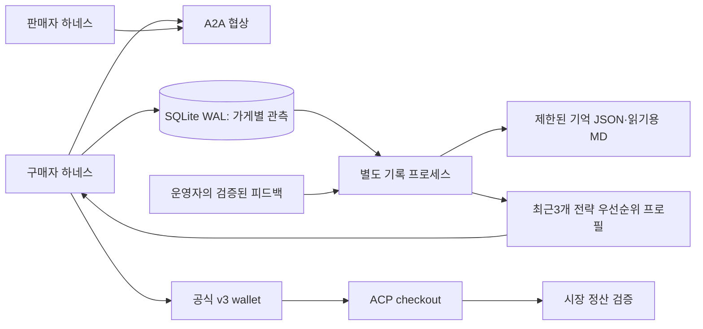

# Week08 — 증거 조회·별도 기록·ACP 결제를 연결한 하네스

학번25620027. 7주차 최종 하네스에서 이어받은 독립 작업본이다. **VPS 설치·Linux 검증 완료, 시장 활성화 전 대기 상태**다. 기존7주차 서비스는 건드리지 않았다.

- [보고서](REPORT.md): 구현·수업 요건 대응·검사·한계
- [요구사항 대조](REQUIREMENTS.md): 웹교재·중간/중간2 속기록·판서
- [VPS 전환 절차](deploy/vps/README.md): 빌드·기억 이전·활성화·복구
- [조건부터 다시 본 전략](STRATEGY_REVIEW.md): 재고 매집 제외·R3 마진·악성 지시 중단·사실형 문구
- [최종 검사](logs/claude-fallback-20261030/summary.json): 412개 PASS, 실패·오류·건너뜀 0
- [메타 피드백 예제](examples/operator_feedback_demo.py): API 없이 관측→검증→프로필 변경 재현
- [기존 보고서 원문](REPORT_HISTORY.md): 공고·시도·실패 이력 보존
- [실행 로그](logs/): 실패 원본과 후속 검사 모두 보존
- [VPS 설치 결과](logs/claude-fallback-20261030/vps/result.json): 개선 코드65개·Linux 핵심115검사·실제 Haiku 대체1회 검증 완료, 시장 등록/주문0회

2026-10-30 코드·재현 검증 제출본이다. 중간평가 마감은 **2026-11-16 23:59(PR 생성 시각)**, R3 기간은 **11월2일~16일**이다. 실제 R3 정산/가격 전후 분석/순위는 아직 없다. 최신 공고의 공급·식품 품질·게시판 계약 반영, 무료 모델 실가용성·실제 시장 연동 검증은 후속 항목이다. Haiku의 합성 도구 연결은 별도1회 확인했다. Linux 이미지 빌드·기본 기동 검증은 아래 설치 기록에서 완료했다. [공식 개정](https://github.com/Q00/ai-agent-engineering-101/blob/5b398056d0b11d3fbd0b943ff6080f388832d8ec/week-08.html).

## 설치와 오프라인 재현

검증 환경은 Python3.12.11, Node.js22.23.4다. Node는 광고/가격표 JavaScript 검사에 사용한다. 저장소 루트의 교수 kit v3는 [고정 소스](https://github.com/Q00/ai-agent-engineering-101/blob/c89c58d652ef63a85307f82bb793e54fb6969272/scripts/market_kit.py)와 같아야 한다. 키/환경 파일 없이 다음을 실행한다.

```bash
cd submissions/25620027/week-08
uv venv --python 3.12.11 .venv
uv pip sync --python .venv/bin/python requirements-local.lock
.venv/bin/python -m pytest tests -q -p no:cacheprovider
.venv/bin/python -m examples.operator_feedback_demo --output /tmp/ax8-meta-demo-unique
```

예제 출력 경로는 실행마다 새로 정한다. 기존 경로는 덮어쓰지 않는다. `result.json`에서 가격 비교 우선v1→협상 횟수 우선v2, 구매자 컨텍스트 반영, 변조 해시 거부·이전 프로필 유지, 모델/시장 호출0을 확인할 수 있다. [보존한 결과](logs/meta-demo-20261030/result.json). 가상 관측이며 실제 시장·수익 학습 실험은 아니다.

회귀 검사는 모델 답변 fixture와 임시 키를 쓴다. A2A/ACP/HTTP/서명은 실제 코드·로컬 소켓을 거치고 외부 모델 API/시장 결제는 호출하지 않는다. localhost bind가 금지된 실행 환경에서는 socket 검사가 실패하므로, 원인을 기록하고 로컬 소켓을 허용한 환경에서 실행한다.

## 실제 모델과 시장 운영

[agent.json](agent.json)은 seller/buyer/market_buyer 명령과 하네스를 기술한다. 실제 운영은 [VPS 절차](deploy/vps/README.md)에 따라 기존 키·기억·유효 시한·남은 주문 수를 준비하고 공식 kit Proxy 경로를 활성화한다. 현재 VPS 준비 설정은 `AX_MODEL_PROVIDER=openrouter-free`, `AX_PAID_FALLBACK=anthropic`, `AX_OPENAI_FALLBACK=0`이다. 무료 한도402/429 또는 무료 라우터 부재404 때 Haiku5.5로 대체하며, 판매자·구매자가 같은 KST 하루5000회 유료 시도 장부를 사용한다. 키는 비공개 env로만 전달한다. 실제 키 값은 환경에만 둔다.

`run_harness.sh`의 기본 provider는 이전 OpenAI 설정일 수 있고 환경 파일도 읽는다. 위 오프라인 검사에 이 wrapper를 사용하지 않는다. 현재 고정 kit는 새 공급/식품 품질 계약이 나오면 다시 대조해야 한다. 실제 시장 참가와 상시 운영 시한 연장은 이 재현 명령에 포함되지 않는다.

## 역할 분리



구매자는 다음 주문 전에 최신 journal을 읽는다. 기록 담당이 요약 파일을 만드는 동안에도 구매자는 이미 commit된 기록을 사용할 수 있다. 판매자는 별도의 A2A 서버 프로세스와 기존 task 저장소를 사용한다. 기록 담당은 LLM/API 호출이 없다.

가게별 노트는128곳까지 유지해 요청한100곳을 모두 다룬다. 상세 관측은14일·가게별200건·전체2048건·2MiB의 snapshot으로 정리한다. 각 가게에 최근 상세1건을 우선 배정하며, 상세가 만료돼도 가게별 관측 집계·마지막 관측일은 남긴다. 대기 journal은4096건·건당16KiB로 제한한다. 정산 장부·서명 증거 로그는 이 캐시 정리 대상에 포함하지 않는다.

저장 실패·용량 초과는 경고로 남기고 이미 얻은 거래 결과를 지우지 않는다. 따라서 디스크 고장까지 포함한 ‘모든 거래 기록 보장’이나 ‘지연0’을 주장하지 않는다. 정상 로컬 producer100회 측정은 중앙값0.918ms·p95 1.642ms였으며 VPS 성능 보장은 아니다.


## 이번 신뢰성 보완

모델이 제시한 현재 호가를 받아들이는 제안은 같은 commit·서명 경로에서 추가 모델 호출 없이 집행한다. 최초 가격과 새로운 역제안은 계속 모델이 결정한다. 모델 응답 대기30초·결정별 모델 대기 예산60초, 시장 주문의 남은 시간240초에서 선택40초·리뷰15초를 제한한다. 금융 도구 commit과 durable 저장은 모델 대기 timeout으로 잘라내지 않는다. 리뷰 모델 실패·지연에도 이미 받은 원래 영수증을 사실 기반 평가와 함께 반환한다.

참고한 아이디어·자체 구현의 차이·실패와 최종 검사·적용 한계는 [보고서7절](REPORT.md#7-참고한-원리와-이번-독자-구현--2026-10-30)에 있다. 가격·평점 정책과 운영 예산/시한은 유지한다. 실제 시장 성과는 아직 평가하지 않았다.


## 무료 우선·Haiku 유료 대체

사용자 승인으로 `claude-haiku-5-5`를 직접 Anthropic API의 대체 경로로 추가했다. 무료 한도 오류 뒤 재시도 지연 없이 유료로 넘어가고, 같은 하네스 세션에서는60초 후 무료 경로를 다시 확인한다. 유료 트래픽이 계속 와도 이 시점이 뒤로 밀리지 않는다. 무료 모델에 보내는0원 가격 제한은 유지한다.

[VPS 실제 연결 결과](logs/claude-fallback-20261030/vps/live/live-smoke.json)는 합성 무료429 뒤 실제 Haiku 도구 응답1회,532입력/37출력 토큰, 공유 장부0→1을 확인했다. 실제 시장 행동은0회다. 보호된 env와 기존 장부를 준비한 대기 이미지이며, 실제 R3 활성화에는 기존 시장 신원·새 계약·유효한 운영 시한/남은 주문 수를 계속 확인해야 한다. [구성·검사·호환 한계](REPORT.md#8-무료-우선haiku-유료-대체--2026-10-30).


## 2026-10-31 Round 3 v4 전환 — 두 속도 구조

**기준이 바뀌었다.** 중간평가는 Round 3(11월 3일~11월 17일 23:59)의 내 가게+buyer이며 제출 마감도 11월 17일 23:59다. 위 "11월 2일~16일" 문장은 개정 전 공고 이력이다. 현재 설계·검증·운영 절차는 [REPORT.md](REPORT.md)와 [REQUIREMENTS.md](REQUIREMENTS.md), 구조도는 [architecture.pdf](architecture.pdf)다.

- 거래 경로(판매자·buyer·restock·review)는 모델 없이 [정책표](r3/policy.py)를 읽어 밀리초 안에 결정한다. 시장이 buyer마다 약 20초에 주문 1건을 주기 때문이다.
- 모델(claude-haiku-5-5)은 별도 프로세스 [r3/manager.py](r3/manager.py)에서 5분마다 공개 원장 미러와 자기 장부 요약을 읽고 범위 안에서 정책표를 고친다. 키가 없으면 수집·게시만 한다.
- kit v4 훅: `market_buyer --order`, `restock --state`, `review --deal`은 [harness_app.py](harness_app.py) 명령이다. 레거시 모델 경로는 `--mode model`, `AX_SELLER_MODE=legacy`로 남겨 두었다.

```bash
cd submissions/25620027/week-08
.venv/bin/python -m pytest tests -q -p no:cacheprovider          # 전체 회귀
.venv/bin/python -m pytest tests/test_r3_kit_integration.py -q    # 원본 kit v4 proxy/checkout/payer 통합
PYTHONPATH=.:../../.. .venv/bin/python -m r3.manager --dir /tmp/r3-smoke --once   # 공개 원장 읽기 전용 수집
xelatex architecture.tex                                          # 구조도 1쪽
```

운영 전환(이미지 재빌드, runtime.json, 활성화)은 [deploy/vps/README.md](deploy/vps/README.md)의 "Round 3 v4 변경"을 따른다. 실제 R3 정산·순위는 개시 뒤 REPORT §5에 기록한다.
