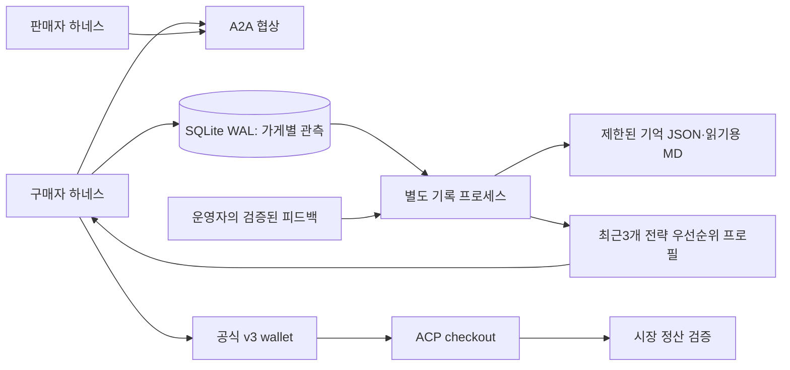

# Week08 — R3 로컬 준비

학번25620027. 7주차 최종 하네스에서 이어받은 독립 작업본이다. **VPS 배포·실제 시장 참가 전 상태**이며 기존7주차 서비스는 건드리지 않았다.

- [보고서](REPORT.md): 구현·수업 요건 대응·검사·한계
- [요구사항 대조](REQUIREMENTS.md): 웹교재·중간/중간2 속기록·판서
- [VPS 전환 절차](deploy/vps/README.md): 빌드·기억 이전·활성화·복구
- [조건부터 다시 본 전략](STRATEGY_REVIEW.md): 재고 매집 제외·R3 마진·악성 지시 중단·사실형 문구
- [실행 로그](logs/): 실패 원본과 후속 검사 모두 보존

## 설치와 로컬 검사

저장소 루트에 교수의 pinned `scripts/market_kit.py`가 있어야 한다. Python3.12.11 기준이다.

```bash
uv venv --python 3.12.11 .venv
uv pip sync --python .venv/bin/python requirements-local.lock
.venv/bin/python -m pytest tests -q
```

실제 LLM 호출을 대신한 fixture와 임시 Ed25519 키를 사용한다. A2A/ACP/HTTP/서명은 실제 코드와 로컬 소켓을 거친다. 외부 모델 API와 실제 시장의 결제는 호출하지 않는다.

## 역할 분리



구매자는 다음 주문 전에 최신 journal을 읽는다. 기록 담당이 요약 파일을 만드는 동안에도 구매자는 이미 commit된 기록을 사용할 수 있다. 판매자는 별도의 A2A 서버 프로세스와 기존 task 저장소를 사용한다. 기록 담당은 LLM/API 호출이 없다.

가게별 노트는128곳까지 유지해 요청한100곳을 모두 다룬다. 상세 관측은14일·가게별200건·전체2048건·2MiB의 snapshot으로 정리한다. 각 가게에 최근 상세1건을 우선 배정하며, 상세가 만료돼도 가게별 관측 집계·마지막 관측일은 남긴다. 대기 journal은4096건·건당16KiB로 제한한다. 정산 장부·서명 증거 로그는 이 캐시 정리 대상에 포함하지 않는다.

저장 실패·용량 초과는 경고로 남기고 이미 얻은 거래 결과를 지우지 않는다. 따라서 디스크 고장까지 포함한 ‘모든 거래 기록 보장’이나 ‘지연0’을 주장하지 않는다. 정상 로컬 producer100회 측정은 중앙값0.918ms·p95 1.642ms였으며 VPS 성능 보장은 아니다.
