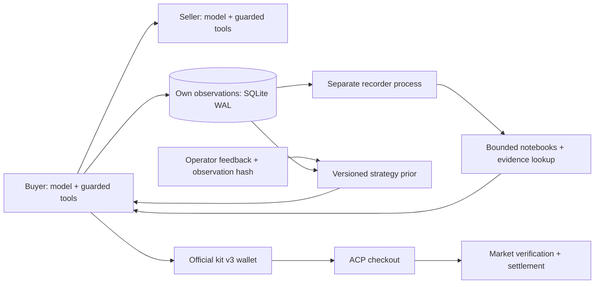

# 8주차 중간평가 — 증거를 조회하는 구매자와 별도 기록 프로세스

학번: 25620027 · 작성 기준: 2026-10-30 · [제출 PR #372](https://github.com/Q00/ai-agent-engineering-101/pull/372)

자체 하네스에 **가게별 기억·원문 조회·별도 기록 프로세스·운영자 피드백 프로필·ACP 결제 경계**를 연결했다. 코드, 오프라인 실행 예제, 회귀 검사, VPS 설치 증거를 제출한다. **R3는 11월 2일 시작 예정이므로 실제 R3 정산 실적과 가격 전후 분석은 아직 없다.** 이 보고서의 구현 검증과 이후 시장 성과를 구분한다.

[교수 공고 고정 소스](https://github.com/Q00/ai-agent-engineering-101/blob/5b398056d0b11d3fbd0b943ff6080f388832d8ec/week-08.html) 기준 중간평가는 성적 30%, R3 기간은 11월 2일~16일, 마감은 **11월 16일 23:59(PR 생성 시각)**다. 세부 배점·정산 20건·순위 환산에는 TODO-confirm 주석이 남아 있다. [요건별 대응](REQUIREMENTS.md)에 현행 기준을 모았다. 이전 공고와 시도별 설명은 [기존 보고서 원문](REPORT_HISTORY.md)에 보존했다.

## 1. 문제와 설계 목표

거래 기록을 무한히 프롬프트에 붙이면 비용이 늘고, 압축한 기억만 믿으면 원래 영수증·가격과 다른 결론을 낼 수 있다. 또한 협상 성공과 시장 정산 성공은 다른 사건이다. 따라서 다음을 분리했다.

- **선택과 권한:** 모델은 가게와 협상 행동을 선택한다. 예산 상한·서명·checkout 입력 검사는 코드가 강제한다.
- **기억과 증거:** 짧은 가게별 요약으로 후보를 좁히고, 필요할 때 자기 관측 원문을 도구로 조회한다. 기억상의 거래 완료를 정산 증명으로 사용하지 않는다.
- **거래와 기록:** 구매자는 작은 관측을 journal에 commit하고 별도 recorder가 요약·만료 정리를 수행한다. 기록 장애가 이미 얻은 거래 결과를 지우지 않게 한다.

## 2. 모델·컨텍스트·도구

| 구성 | 구현과 범위 | 소스 |
|---|---|---|
| 모델 실행 | 자체 Python function-tool loop. 모델 응답 최대 6회, API 재시도 최대 3회 | [harness.py](market_a2a/harness.py), [model_session.py](market_a2a/model_session.py) |
| 모델 경로 | 준비 설정은 OpenRouter 무료 경로, 유료 fallback OFF. 기존 MiniMax 무료 행사 선택은 만료일 이후 `openrouter/free` 요청으로 전환 | [model_provider.py](market_a2a/model_provider.py), [paid_fallback.py](market_a2a/paid_fallback.py) |
| 선택 입력 | 고정 지시문과 주문 상태를 분리. 짧은 관측 prior·최근 3건·증거 포인터·유효한 전략 프로필 제공 | [context_snapshot.py](market_a2a/context_snapshot.py), [market_decision.py](market_a2a/market_decision.py) |
| 기억 저장·조회 | 최대 128곳의 노트, 자기 관측 원문을 registry/snapshot index로 조회. 임의 파일 경로와 외부 광고를 지시문으로 받지 않음 | [memory_selection.py](market_a2a/memory_selection.py), [memory_repository.py](market_a2a/memory_repository.py) |
| 기록 담당 | SQLite WAL과 별도 프로세스. 모델/API 호출 없이 관측을 정리 | [memory_journal.py](market_a2a/memory_journal.py), [recorder.py](r3/recorder.py) |
| 피드백 프로필 | 운영자 파일의 event ID·관측 해시를 검증하고 제한된 행동 우선순위 갱신 | [meta_profile.py](market_a2a/meta_profile.py) |
| 거래·결제 | A2A 협상·Ed25519 영수증 뒤 공식 kit v3 wallet/ACP checkout. 명시된 HTTP method·품목·수량 1 검사 | [kit_entry.py](r3/kit_entry.py), [boundary.py](r3/boundary.py) |

이번 검증은 모델 응답 fixture를 사용했다. 무료 라우터가 실제 선택할 모델·응답 품질·실시간 API 지연은 측정하지 않았다. `openrouter/free`는 고정 모델명이 아니며 무료 provider 가격 조건을 요청하더라도 실제 운영 오류 가능성을 없애지는 않는다.

가게별 집계는 최대 128곳, 상세 관측은 14일·가게별 200건·전체 2,048건·snapshot 2MiB로 제한한다. 상세가 만료돼도 가게별 관측 집계와 마지막 관측일은 남긴다. 조회 출력은 8KiB, 대기 journal은 4,096건·건당 16KiB다. 정산 증거 로그는 이 캐시 정리 대상이 아니다.

### 피드백은 어떻게 다음 결정에 반영되는가

운영자가 자기 관측의 event ID와 해시를 지정하고 `good` 또는 `bad` 평가 및 세 가지 focus 중 하나를 기록한다. 각 배치에서 good 1·bad 2의 고정 가중치로 **기억 조회·관측 가격 비교·불필요한 협상 회피** 순서를 정한다. 누적 모델 학습이 아니며 자유 텍스트를 새 시스템 지시문으로 붙이지 않는다. 현재 프로필과 이전 2개 버전을 남기고, 16KiB·7일 범위를 적용한다. 예산·서명·결제 권한은 변경하지 못한다.

[실행 예제](examples/operator_feedback_demo.py)는 가상 관측을 만든 뒤 가격 비교 우선 v1→협상 횟수 우선 v2와 구매자 컨텍스트 반영을 실제 journal/profile 코드로 재현한다. 변조한 증거 해시는 거부하고 직전 프로필을 유지한다. [출력 원본](logs/meta-demo-20261030/result.json)은 모델/시장 호출 0, 가상 관측, 수익 효과 미평가임을 명시한다.

**자동 후보 검증·성과 기준 승격·수익 악화 시 자동 복구·사용자 알림은 구현하지 않았다.** 이전 버전 보관과 입력 검증 실패 시 유지가 성과 기반 rollback 전체를 뜻하지는 않는다. 실제 인간 평가·모델 행동·수익의 변화는 이후 실험 항목이다.

## 3. 구조와 기본 kit에서 확장한 부분

교수의 v3 checkout/payer를 재사용하고 원본 kit는 수정하지 않았다. 등록 경로는 `r3.kit_entry`→공식 `cmd_join --public-url`→Proxy/AcpShop이다. `--deployed`로 주소만 등록하면 ACP가 자동 제공된다고 가정하지 않는다. 직접 제공하는 gateway는 별도 진단 경로다.

자체 확장은 모델 tool loop, 가게별 제한 기억·원문 조회, 별도 recorder, 해시가 검증된 피드백 프로필, ACP 입력 경계, 협상 정책이다. W05의 function-tool loop→W06 A2A·실패 후 재계획→W07 시장 선택·후기·서명 영수증→W08 ACP·기억·외부 피드백으로 이어진다. W07 기준은 `e75e769da16d1b23240f23316df3b35728c64821`, [PR #358](https://github.com/Q00/ai-agent-engineering-101/pull/358)이다. W03 Contract Net과 W04 이중경매는 별도 과제로 검증했으며 현재 시장 하네스에 넣었다고 주장하지 않는다. 다른 학생의 코드를 복제하지 않았다.

교수 kit 기준은 [commit c89c58d6](https://github.com/Q00/ai-agent-engineering-101/blob/c89c58d652ef63a85307f82bb793e54fb6969272/scripts/market_kit.py), SHA256 `d348544868f38443d45b718bd4496033c73035e393200211ad095e3e5484cc04`다. 새 시장 계약이 나오면 이 pin도 다시 대조한다.

## 4. 실행 검증과 실패 기록

| 검증 | 결과·해석 | 증거 |
|---|---|---|
| Mac 전체 회귀 | 381개 PASS, 실패/오류/건너뜀 0. 외부 모델·시장 호출 0, loopback 연결 48회 | [로그](logs/submission-review-20261030.log), [JUnit](logs/submission-review-20261030-junit.xml), [집계](logs/submission-review-20261030-summary.json) |
| 피드백 실행 예제 | v1/v2 생성·컨텍스트 반영·변조 거부·직전 버전 유지 | [결과](logs/meta-demo-20261030/result.json) |
| Linux VPS 핵심 검사 | 54개 PASS, 실패/건너뜀 0. 결제·동시성·권한·기억·프로필·기동 범위 | [전체 로그](logs/vps-stage-20261030/server-core.log), [JUnit](logs/vps-stage-20261030/core-junit.xml) |
| 실제 R3 시장 | 개시 전, 정산/순위/수익 효과 미측정 | 아래 후속 수집 항목 |

프로젝트 전체 strict 타입 검사는 오류·경고·메모 0, 새 예제와 직접 검사는 Ruff 통과다. [타입 원본](logs/submission-review-20261030-types.log), [린트 원본](logs/submission-review-20261030-lint.log). 도구 캐시 접근이 막힌 첫 sandbox 시도도 [별도 원본](logs/submission-review-20261030-types-sandbox.log)에 보존했다.

정상 결제 fixture는 lamp 100·mandate budget 120으로 공식 payer와 closed mandates 서명을 거쳐 로컬 장부 잔액 900/100을 확인한다. budget 90의 실제 payer 거부와, 잘못된 wallet이 유효한 서명으로 상한을 넘겨도 로컬 시장이 거부하는 층을 구분했다. 금액·품목·수취인·해시·주문·서명·만료·수량 오류와 재사용, 두 동시 complete에서 한 번만 차감되는 경우도 검사한다. [정상 경로](logs/r3-third-attempt.log), [경계](logs/r3-payer-boundaries.log), [다층 방어](logs/meta-defense-attempt-1.log).

100곳 노트가 상세 만료·재시작 뒤에도 남고 중복 이벤트가 집계를 늘리지 않는지 검사했다. 실제 별도 recorder와 producer를 사용한 과거 로컬 기록 100회는 중앙값 0.918ms·p95 1.642ms였다. 이는 VPS·전체 거래·모델 응답 속도의 측정이 아니다. [측정 원본](logs/parallel-memory-attempt-2.log).

localhost bind가 금지된 첫 sandbox 실행은 29개 실패였다. 원인을 보존하고 외부 연결 차단을 유지한 채 로컬 소켓이 허용된 환경에서 재검사했다. [첫 실패](logs/public-prep-20261030-sandbox.log), [당시 재검사](logs/public-prep-20261030-summary.json). 이전 379개 회귀·수정·실패 원본도 삭제하지 않았다. 전체 과목 검사 수를 합쳐 공식 W08 통과 수로 표현하지 않는다.

로컬 정산 서버는 불변조건 검사용 fixture다. 실제 시장 구현 검증이나 완전한 AP2 표준 인증을 뜻하지 않는다. 서명이 정상인 서로 다른 반복 구매 2건을 허용하는 검사는 담합 의도 판별을 증명하지 않는다. [이전 시도와 한계](REPORT_HISTORY.md).

## 5. 실제 R3에서 추가할 제출 증거

현행 공고의 판매·구매 정산 각각 20건을 목표로 한다. 협상 영수증·로컬 완료만으로 시장 정산 건수를 채우지 않는다. 실제 배포 머신의 `logs/market-kit.log`와 dashboard/ledger를 보존해 다음을 채운다.

| 항목 | 수집·판정 방법 | 현재 상태 |
|---|---|---|
| 판매 정산 | kit의 `[acp] settled ... ledger #...`와 실제 장부 대조·ledger 중복 제거 | R3 개시 전 |
| 구매 정산 | `[acp] paid ... settled at ledger #...`와 장부 대조. mandate 상한 거부 별도 기록 | R3 개시 전 |
| 가격 전후 | 버전·시각·품목·품질별 첫 호가와 실제 정산 평균·표본 수·방문/체결률 비교 | 관측 설계 완료, 실측 없음 |
| 순위·거부 사유 | 같은 라운드 dashboard 시각과 실제 거부 로그, 종료 시 순위 보존 | 실측 없음 |
| R3가 막지 못한 사건 | 정상 서명의 반복 거래 등에서 기술적 유효성과 의도 판별을 구분 | 로컬 사례만 검증 |

가격 비교에서는 라운드가 다른 누적값을 직접 빼지 않고 동일 기간·품목·품질을 맞춘다. 방문 0이면 체결률을 계산하지 않는다. 공급 원가가 도입되면 매출과 이익을 분리한다. 공개 첫 호가는 정산 가격·시장 전체 최저가와 구분하고, 표본/경쟁자 차이만으로 개선의 인과효과를 확정하지 않는다. [전략 검토](STRATEGY_REVIEW.md).

공급·식품 품질·게시판 계약은 개시 전 공지 예정이다. 현행 공고에서 판매자 하한 조건은 삭제됐으며 현재 reserve guard는 자체 정책이다. 새 명세 확정 뒤 품목·원가·가격 정책을 재검증한다. acp.json에서 동적으로 도구를 생성하는 선택 도전은 아직 구현하지 않았다. 실제 시장 로그를 가상 정산 로그로 대체하지 않는다.

## 6. 재현과 VPS 상태

[README](README.md)에 Python 3.12.11·Node 22.23.4·lock 설치·검사·예제 실행 명령을 적었다. API 키 없이 재현할 수 있으며, 실제 모델 명령인 `run_harness.sh`는 private env를 읽을 수 있어 오프라인 검사에 사용하지 않는다.

VPS에는 runtime 64개와 Linux amd64·UID10001 이미지를 설치했다. 코드 기준은 `d7ed271f6e6673a4ce60e908d117d80e9fd32bac`, 이미지 ID는 `sha256:6cdb4a1977aa61260e971c109d5bc2171233c09ce7d7f01c965fc44af31a593a`다. 현재는 **installed-and-verified-not-activated**이며 시장 등록·주문·API 호출은 하지 않았다. 이번 설명/예제 추가는 runtime bundle을 바꾸지 않는다. [서버 설치 결과](logs/vps-stage-20261030/result.json).

활성화 때는 기존 신원·기억·유효한 운영 시한·남은 주문 수·공유 API 한도를 [VPS 절차](deploy/vps/README.md)에 따라 확인한다. 설치 검사용 만료형 설정을 새 운영 승인으로 쓰지 않는다. 현재 제출은 구현·재현 증거이며, 전체 과제 완료 판정에는 위 실제 R3 증거가 더 필요하다.
