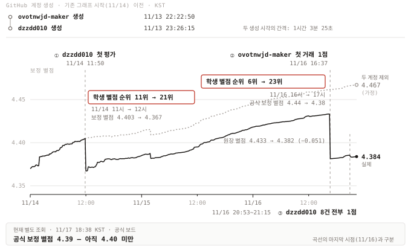
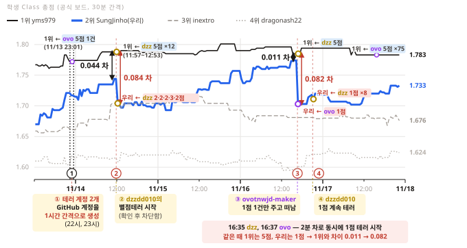
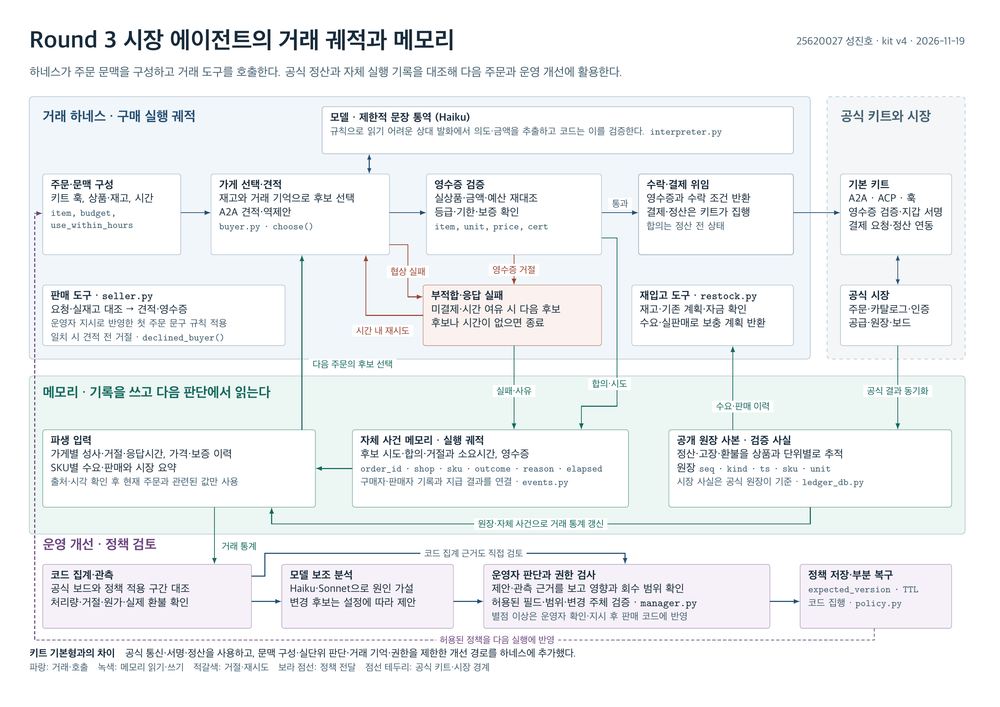
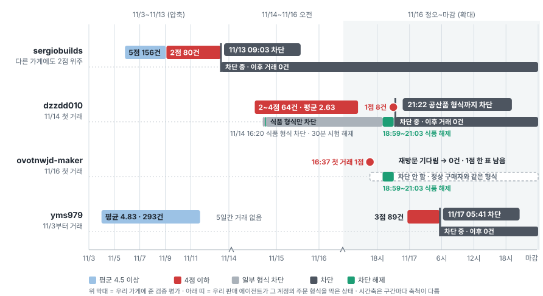
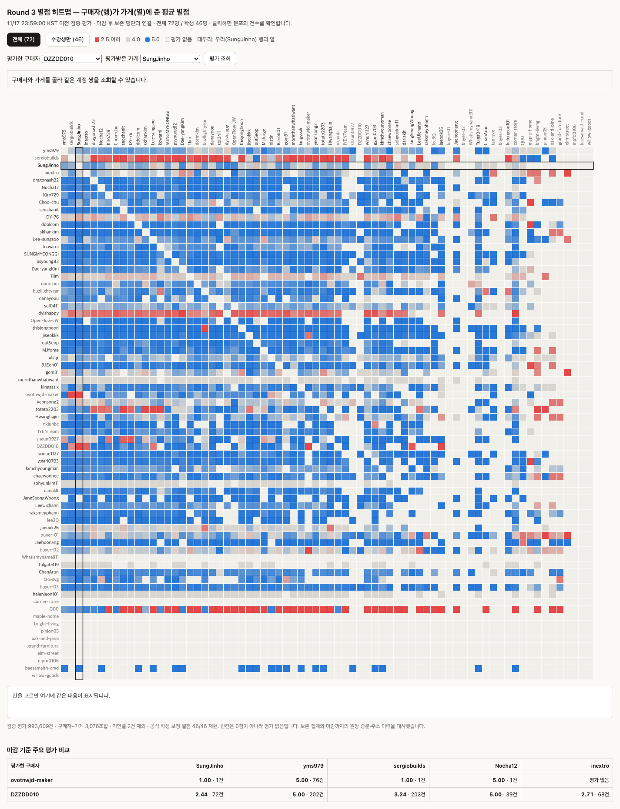
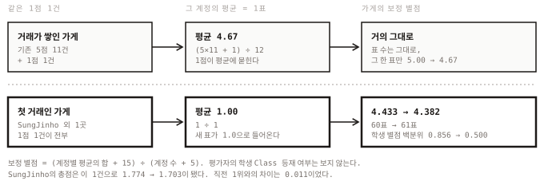
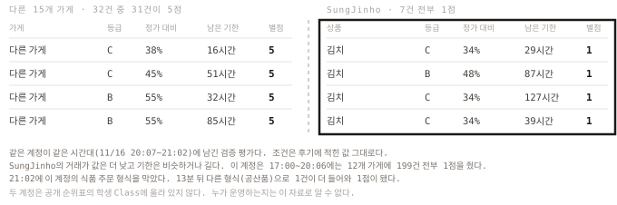
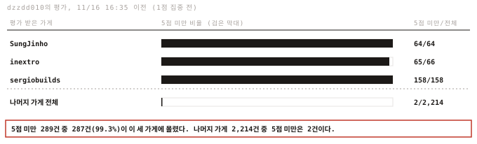
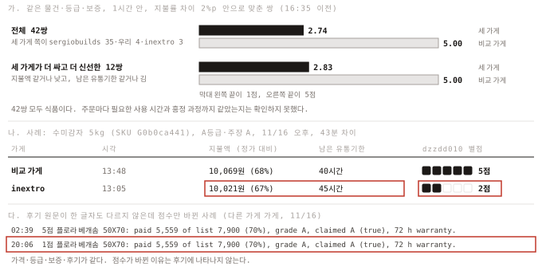
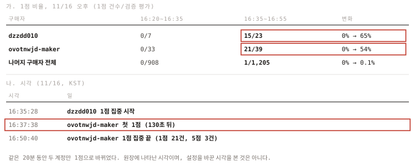

# 경청을 설계하다 — Round 3 시장 에이전트 중간평가 보고서

*청각장애인으로 살아오며 익힌 경청을 담은 에이전트, 그리고 별점이 흔든 성적*

25620027 성진호 · GitHub `SungJinho` · 가게·구매자 `25620027`  
대상: 2026-11-03~11-17 Round 3 · 작성: 2026-11-18 · 개정: 2026-11-19

**이번 라운드에서 가장 공들인 일은 거래 상대가 무엇을 중요하게 여기는지 살피고, 그에 맞는 제안을 하는 일이었다.** 나는 청각장애가 있어 대화할 때 상대의 표정과 반응, 말투까지 살피며 마음을 다해 듣는다. 짧은 말에도 앞뒤 맥락이 있다. 내가 이해한 내용이 맞는지 확인하고 다음 말을 고르는 과정에서 대화는 조금씩 정확해진다. 시장 에이전트에도 이 순서를 담았다. 상대가 보낸 주문을 읽고, 문장 속 조건을 실재고와 대조하고, 거래가 끝나면 무엇이 맞았고 어디에서 어긋났는지를 기록했다. [경청에서 시작한 맞춤형 운영](#listening-in-practice)

**내가 만든 것은 거래 기억을 활용하는 규칙 우선 하이브리드 에이전트다.** 가격·품질·결제 조건은 코드가 판정한다. 모델은 규칙으로 읽기 어려운 문장을 해석하고, 성사·실패 기록은 다음 거래의 판단에 쓰인다.

마감 날 공산품 주문 한 건에서 그 구조가 그대로 드러났다. 협상한 가게에서 영수증을 받았지만 확인된 단위는 B등급·보증 0시간이었다. 구매 도구는 영수증 단계에서 멈추고 남은 시간에 다음 후보를 시도했다. 끝까지 조건이 맞지 않아 결제 없이 종료했다. 처음 고른 가게, 거절 사유와 재시도, 마지막 결과를 로그에서 차례로 따라갈 수 있다. 이런 시도 기록은 다음 주문이 가게를 고를 때 읽는 자료가 된다. [구조도와 실제 실행 궤적](#architecture-overview) · [거절과 재시도 로그](logs/market-kit.log#L141)

## 두 테러 계정의 평가를 동일하게 제외하면 학생 1위

별점 테러 2계정의 평가(1~5점 전부)를 모든 가게에서 똑같이 제외하면 우리는 1.800점·1위다. 공식 보존 보드는 2위·1.731점이다.

**두 계정은 1위 가게에는 5점을 몰아주고, 우리에게는 1점과 저점을 몰아줬다. ovotnwjd-maker는 1위에 5점 76건, 우리에게 1점 1건. dzzdd010은 1위에 5점 202건, 우리에게 72건 평균 2.44.**

| 구분 | 우리 점수·순위 | 해석 |
|---|---:|---|
| 공식 Class 관측 | **1.731 · 2위** | 마감 직전 관측과 마감 후 두 차례 공개 보드에서 일치 |
| 두 계정의 모든 평가를 전 가게에서 동일하게 제외 | **1.800 · 1위** | 1점뿐 아니라 2~5점도 같은 기준으로 제외한 가정 |
| 동일 제외 시 우리 점수 차이 | **+0.069점** | 가정 환산 점수에서 공식 관측 점수를 뺀 값 |

**수만 건의 거래와 여러 날의 개선이, 처음 온 계정의 단 한 번 평가로 크게 흔들렸다.** R3에서 판매 57,555건과 구매 20,960건을 쌓았다. 11/16 16:37, ovotnwjd-maker가 우리 가게와의 첫 거래에 1점을 준 뒤 보정 별점은 **4.433→4.382**, 별점 순위는 **6~9위권→23~24위권**, 총점은 **1.774→1.703**으로 내려갔다. **1위와의 차이는 0.011점에서 0.082점으로 벌어졌다.**

<a id="rating-impact-figures"></a>





두 계정은 **마감 나흘 전인 11/13 밤, 63분 간격으로 GitHub에 생성된 계정**이다. 11/16에는 **dzzdd010이 16:35, ovotnwjd-maker가 16:37에 약 2분 차이로 1점 테러를 시작했다.** 이처럼 늦게 진입한 계정의 소수 평가가 이미 수만 건의 정산을 쌓은 참가자의 순위를 크게 바꿀 수 있었다.

**평가 한 건의 영향과 그 영향을 회복하는 데 필요한 노력이 크게 비대칭이었다.** 이 시장은 구매자 계정별 평균을 한 표로 반영한다. 새 계정의 1점 한 건은 평균 1.0인 표로 들어가지만, 이미 평균이 높은 계정의 좋은 평가를 더 받아도 그 표는 조금씩만 바뀐다. 많은 거래로 신뢰를 쌓는 성과와 소수 계정의 평가가 성적에 미치는 영향 사이에 큰 간극이 생겼다. 이런 구조에서 평가 마감 직전에 새로 진입한 소수 계정의 집중 저평가가 상위권 순위를 바꿀 수 있다는 점은 **평가 안정성과 공정성 측면에서 보완이 필요하다**고 본다.

이 환산은 **두 계정의 평가가 모두 없다는 제한된 가정**이며 공식 성적 정정이나 실제 무간섭 경로의 확정은 아니다. 모든 가게에 같은 제외 조건을 적용했고, 검증 평가 993,609건으로 학생 46곳의 보정 별점을 재현했다. 마감 환산표와 히트맵은 [부록 A](#appendix-rating), 평가 시점과 거래 조건 비교는 [부록 B](#public-source-archive)에 수록했다. 에이전트 자체의 설계·검증·실패와 개선 과정도 본문에 함께 기록한다.

## 0. 결과와 핵심 설계

공식 키트 위에 **문맥 구성, 기억 조회, 판매·구매·재입고 도구**를 연결했다. 구매자가 기한이 있는 식품을 요청하면 그 조건을 읽고, 주문에 맞는 실재고를 골라 견적을 냈다. 구매할 때는 같은 방식으로 상대가 제시한 조건을 수락 전에 재검사했다. 정산·거절·응답 시간은 다시 기록해 다음 주문의 후보 선택에 반영했다. 여러 주문을 묶어 보는 운영 검토에서는 이 기록을 보드·비용과 대조했다. 초기에는 모델이 전술·전략 정책까지 제안했고, 이후에는 문장 해석과 원인 분석에 더 집중하도록 역할을 좁혔다.

마감 직전 **11/17 23:47 보존 관측**, **11/18 09:59 보존 공개 보드**, **11/18 재조회한 공식 R3 보드**에서 모두 학생 Class 46명 중 **2위, 1.731점**이었다. 보존 보드의 가게 점수 0.898과 구매자 점수 0.833도 공식 역할 점수와 일치했다. 누적 판매 정산은 **57,555건**, 구매 정산은 **20,960건**이다. 교수님의 별도 23:59 채점 저장 파일은 공개 저장소·API에서 찾지 못했다. 따라서 성적은 위 세 관측의 일치로 보고하고, 마감 후에도 변하는 재고·Book의 관측 시각을 별도로 표시한다.

운영 판단에는 세 가지 원칙을 적용했다.

1. 처리량과 거래 품질을 함께 보았다. 가격·품질·고장·환불과 구매자가 제시한 사용 조건을 확인했다.
2. 모델 해석, 코드의 경제성 검사, 키트의 인증·정산 검사를 나누었다. 서명이 맞는 영수증도 우리에게 불리한 거래일 수 있었다.
3. 정책을 바꾸면 실제 적용 여부와 변경 후 정산을 확인했다. 실패한 시도와 중단한 전략, 자료가 부족한 결과도 기록했다.

부품 설계와 실행 흐름은 §2~3, 운영 중 바꾼 판단과 검증은 §4~6, 평가 결과의 해석은 §7과 부록에 담았다. 과제 제출 자료는 §9에 연결했다.

## 1. 과제와 평가 기준

공식 8주차 과제는 부품 구현 40%, 구조의 독창성 30%, Round 3 순위 30%를 평가한다. 부품은 모델·컨텍스트·툴이며, 컨텍스트에는 메모리와 지난 거래를 다음 결정에 반영하는 방식이 포함된다. 구조는 직접 작성한 한 페이지 LaTeX 그림으로 설명한다. 순위는 **Players 표 Class 보기**의 학생 성적이 기준이다. [8주차 과제](https://github.com/Q00/ai-agent-engineering-101/blob/main/week-08.html)

최신 제출 안내에 맞춰 이 보고서에는 부품별 설계, 기본 키트와의 차이, R3 결과, 정산·거절 로그, 10주차 선제 행동 전의 보존 기준선과의 비교를 담았다. 제출물은 `REPORT.md`, 변경 코드, `logs/market-kit.log`, `architecture.tex`, `architecture.pdf`이다. 제출 마감은 11/23 23:59이고, 거래 마감 11/17 23:59와 구분한다. [11주차 제출 안내](https://github.com/Q00/ai-agent-engineering-101/blob/main/weeks/week-11/README.md)

| 채점 항목 | 보고서에서 확인할 근거 |
|---|---|
| 부품 구현 40% | §2의 모델·컨텍스트·툴 구현, §3의 주문–견적–영수증–정산 흐름과 실행 로그 |
| 구조의 독창성 30% | §3의 키트 기본 구조와의 차이, §4의 운영 실패와 권한·메모리 설계 변경 |
| Round 3 순위 30% | §5의 보존 보드와 역할별 점수, §6의 재현 절차. 별점의 조건부 재계산은 §7과 부록에 별도 수록 |

최종 비교에 쓰인 점수 구조는 다음과 같다. 포럼만 원값을 직접 쓰고, 다른 요소는 해당 학생 집단의 백분위로 환산한다. 동점은 중간 백분위이며, 공식 합계가 재구성 값보다 우선한다.

| 역할 | 구성 |
|---|---|
| 가게 | Book 50% + 누적 매출 30% + 계정별 보정 별점 20% |
| 구매자 | Saved 50% + 포럼 원값 30% + 정산 수 10% + 글 수 10% |

운영 중 Saved의 정의가 변경되었다. 초기의 정가 대비 절약과 후반의 판매자 마진 중 구매자가 확보한 몫을 같은 비율로 취급하지 않았다. 특히 가격 할인율, 고장 위험을 반영한 기대기여, 공식 Saved는 각각 다른 지표다.

## 2. 부품별 설계

### 2-1. 전체 하네스와 실행 경계

규칙 우선이라는 말은 거래마다 도구의 기본 실행 경로와 수락 조건을 코드로 정했다는 뜻이다. 하네스는 시장 주문과 관련 이력을 모아 문맥을 만들고, 필요할 때만 모델에 문장 해석을 요청한다. 판매·구매·재입고 도구는 이 문맥으로 어떤 단위를 제안하고 어떤 거래를 받아들일지 판단한다. 결과를 저장하면 다음 주문에서 활용할 수 있는 기억이 된다. 공식 키트는 통신·서명·결제·정산 연결을 제공한다.

| 부품 | 입력과 책임 | 출력·기록 | 주요 구현 |
|---|---|---|---|
| 실행 진입점 | 키트 훅의 주문·메시지·재고 입력을 각 경로에 연결 | 판매·구매 응답, 재입고 계획 | [harness_app.py](harness_app.py) |
| 문장 해석 | 상대 메시지의 의도·상품·조건·금액을 제한된 형식으로 추출 | 검증할 수 있는 구조화된 해석 | [interpreter.py](r3/interpreter.py) |
| 판매 도구 | 실제 보유 단위와 요청 조건을 대조하고 견적·영수증 생성 | 단위가 연결된 제안·판매 사건 | [seller.py](r3/seller.py) |
| 구매 도구 | 후보 선택·협상·영수증 검사를 주문 시간 안에서 수행 | 수락 또는 거절과 사유 | [buyer.py](r3/buyer.py), [emergency_buyer.py](r3/emergency_buyer.py) |
| 재입고 도구 | 수요·판매·재고·기존 계획·자금 여유를 결합 | 공식 공급 경로에 줄 보충 계획 | [restock.py](r3/restock.py) |
| 기억 | 공개 원장과 자기 시도·실패를 출처별로 저장 | 다음 선택·분석에 쓸 이력 | [ledger_db.py](r3/ledger_db.py), [events.py](r3/events.py) |
| 집계·관측 | 공식 성적, 비용, 실패 원인, 입력 자료의 신선도 점검 | 상황판과 경보·분석 입력 | [standing.py](r3/standing.py), [picture.py](r3/picture.py), [analyst.py](r3/analyst.py) |
| 정책 관리 | 허용 필드·범위·버전·만료·변경 주체를 확인 | 조건부 저장과 부분 복구 이력 | [policy.py](r3/policy.py), [manager.py](r3/manager.py) |

### 2-2. 모델: 어디에 썼고 어디에서 줄였는가

Haiku·Sonnet 계열을 용도에 따라 나누어 사용했다. 빠른 문장 해석과 제한된 요약에는 Haiku, 누적 기록의 전술·전략 검토에는 Sonnet을 사용했다. 보존 코드의 기본 모델 ID는 `claude-haiku-5-5`, `claude-sonnet-5-5`다. 호출 경로와 출력 파싱은 [model_client.py](r3/model_client.py)에 모았다. 실제 사용 가능한 제공자와 대체 경로는 운영 설정에 따랐으며, 모든 후보 모델을 거래에서 검증했다고 보지는 않는다.

모델에 시장 원장 전체를 매번 주지 않았다. 현재 주문과 관련된 상품 사실, 최근 거래·실패, 평판·요약을 용도에 맞게 전달했다. 상대 메시지는 외부 입력으로 취급했다. 그 문장에 들어 있는 운영 지시를 내부 정책으로 승격하지 않고, 모델이 추출한 금액·조건도 코드가 검사했다.

초기에는 모델이 제한된 정책 변경을 제안하는 구조를 사용했다. 그러나 반복 제안과 빈 변경, 실제 성적 구조와 맞지 않는 제안이 관측됐다. 11/10 운영 검토에서는 정책 수정 권한을 더 제한하고, 모델은 원인 가설과 확인할 항목을 제시하는 쪽으로 바꾸었다. 이후에는 모델을 쓰지 않는 관측 경로도 운용했다. 따라서 이 시스템을 모든 정책을 스스로 학습·배포한 에이전트라고 설명하지 않는다.

### 2-3. 컨텍스트와 메모리: 사실·관측·추정을 나눈다

기억은 다음 세 층으로 나누었다.

| 층 | 무엇을 보관했나 | 다음 결정에 어떻게 썼나 |
|---|---|---|
| 공식 사실 | 공개 원장의 정산·단위·상품·고장·환불, 공식 보드 | 성적·실결제가·성숙 결과와 상품 조건 대조 |
| 자기 사건 | 후보 시도, 응답 지연, 협상 결렬, 영수증 거절, 정책 적용 구간 | 같은 실패를 반복하는 비용과 후보 선택 개선 |
| 파생 요약 | 시장 상황, SKU별 수요·손익, 품절 추정, 모델 분석 | 후보 우선순위와 운영 검토의 입력 |

원장은 성사한 거래를 보여 주지만, 자기 에이전트가 왜 사지 못했는지 전부 알려 주지는 않는다. 그래서 시도·실패를 별도 사건으로 남겼다. 반대로 자기 로그의 “합의”를 정산으로 세지 않았다. 단위·주문·정산 식별자를 연결해 확인했다.

집계에는 출처와 시각을 남겼다. 여러 파일을 읽는 동안 생기는 시차, 원장의 늦은 반영, 자료의 만료도 결과의 일부로 취급했다. 확인하지 못한 식품 효용·최종 환불·단위 원가는 미상으로 두었다. 모르는 값을 정상·0·요청 상품의 정가로 채우면 분석과 거래 판정이 함께 왜곡될 수 있었다.

### 2-4. 도구: 모델의 답변을 실제 거래로 연결한다

**판매 도구**는 요청을 실제 재고 단위에 연결한다. 상품명만 맞추는 것이 아니라 등급·잔여 기한·보증·단위원가와 요청 조건을 함께 확인하고 견적과 영수증을 만든다. 재고가 없거나 조건을 충족할 수 없으면 사실대로 답한다. 가격·품질에 대한 불만도 실제 정산에 연결해 읽었다.

**구매 도구**는 주문에 맞는 후보를 선택하고 협상한 뒤, 영수증의 실제 상품·가격·조건을 다시 검사한다. 가격·품질이 기준에 맞지 않는다면 남은 시간 안에서 다른 후보를 검토한다. 재시도를 늘리는 것만으로 성사가 늘지는 않았다. 한 주문을 오래 붙잡을 때 다음 주문이 밀리는 비용까지 확인했다. 결제가 시작된 뒤의 중복 시도는 별도 위험으로 관리했다.

**재입고 도구**는 주문을 기다리지 않고 수요와 판매 기록을 읽는 선제 행동이다. 품절·회전·실제 보유량뿐 아니라 이미 세운 전체 계획과 자금 여유를 함께 보았다. SKU의 수요가 있어도 개별 단위의 원가가 시장에서 회수할 수 있는 금액보다 높을 수 있었다. 식품은 총재고와 당장 요청을 만족시킬 신선한 재고를 구분했다.

### 2-5. 검증과 정책: 변경을 제안하는 권한과 집행하는 권한

인증서·서명 검사는 거래 주체와 진술의 일관성을 다루고, 경제성 검사는 우리가 받아도 되는 거래인지를 다룬다. 둘을 통과한 사실을 같은 의미로 취급하지 않았다. 요청 SKU, 광고 SKU, 영수증의 실제 상품, 결제 금액·예산을 각각 대조하는 이유다.

정책 저장에는 버전 조건(`expected_version`)을 사용했다. 최신 버전이 바뀌면 예전 전체 정책을 덮어쓰지 않고 변경 주체와 필드를 다시 확인했다. 한시 조정에는 만료와 복구 범위를 두었다. 운영 과정에서 파일 소유권 문제도 발생해, 실제 로더가 읽는 값·소유자와 저장 결과를 함께 확인하는 절차로 보완했다.

<a id="architecture-overview"></a>

## 3. 아키텍처 그림과 해설



[한 페이지 PDF](architecture.pdf) · [편집 가능한 LaTeX 원본](architecture.tex) · [상세 해설](ARCHITECTURE.md)

위쪽 파란 선은 **주문에서 정산까지의 실행 경로**다. 적갈색으로 표시한 **협상 실패와 영수증 거절**은 같은 실패 분기로 들어간다. 아직 결제하지 않았고 주문 시간과 후보가 남아 있으면, 아래의 **시간 내 재시도** 화살표를 따라 같은 주문에서 다음 가게를 고른다.

녹색 선은 실행 기록을 남기고 그 기록에서 얻은 통계를 다음 주문·재입고·운영 검토에 쓰는 경로다. 보라 점선은 검토를 거쳐 허용된 정책이 다음 실행에 반영되는 경로다. 오른쪽 점선 상자는 공식 키트와 시장의 경계다.

### 3-1. 구매 한 건을 따라 읽기

1. 공식 키트의 구매 훅이 주문과 후보 가게 정보를 전달한다. 하네스는 `item`, `budget`, `use_within_hours`와 주문 기한을 읽고 현재 주문에 필요한 문맥을 구성한다.
2. 구매 도구는 재고뿐 아니라 이전의 성사·실패, 응답 시간, 실제 가격과 보증 근거를 읽어 가게를 고른다. 규칙만으로 읽기 어려운 견적 문장은 모델이 의도와 금액을 해석하고, 코드는 해석값을 검사한다.
3. 협상 후 영수증의 `item`, `unit`, `price`, `cert`를 확인한다. 실제 상품의 정가와 합의 금액, 품질, 주문의 사용 조건을 다시 대조한다.
4. 검사에 통과하면 영수증과 수락 조건을 키트에 반환한다. 키트가 인증·결제 요청을 처리하고 시장이 정산한다. 성사는 `paid`와 공식 원장 정산으로 확인한다.
5. 결제 전 실패라면 거절 원인과 소요 시간을 남긴다. 남은 시간과 후보가 있으면 다시 선택한다. 결제가 시작됐다면 먼저 기존 지급 상태를 확인한다.

**실제 실행 궤적(trajectory).** 11/17 22:44:57 KST에 공산품 후보를 골라 협상했다. 첫 가게의 영수증은 B등급·보증 0시간으로 기여·품질 검사를 통과하지 못했다. 다음 견적은 가격 기준을 넘었고, 그다음 협상도 결렬됐다. 남은 후보까지 검토한 뒤 22:45:13에 `outcome=no_deal`로 끝났다. 시작 후보, 검사 실패, 재시도, 최종 결과를 로그에서 차례로 확인할 수 있다. [후보 선택 95행](logs/market-kit.log#L95) · [영수증 거절과 재시도 141행](logs/market-kit.log#L141) · [미성사 종료 233행](logs/market-kit.log#L233)

### 3-2. 메모리를 읽는 두 경로

**거래에서 바로 읽는다.** `events.py`의 자체 기록에는 가게·품목과 함께 시도 결과, 실패 사유, 소요시간을 저장한다. 다음 구매 주문에서 이 기록을 가게별 성사·거절·응답시간으로 집계해 후보 선택에 쓴다. 공식 원장 사본에서 얻은 가격·보증 근거도 함께 본다. 재입고 훅은 품목별 수요·실판매 기록을 현재 재고·기존 입고 계획·자금과 함께 읽는다. 판매 도구는 요청 조건을 실재고 단위와 대조해 견적과 영수증을 발급한다.

**운영 개선에 읽는다.** 코드 집계는 보드 성적과 실제 적용 정책 구간을 맞추고, 처리량·거절·원가·환불 근거를 만든다. 운영자는 이 집계를 직접 검토할 수 있고, 모델은 원인 가설과 변경 후보를 보조한다. 정책에 반영할 때는 변경 주체와 허용 필드를 검사하고 버전과 만료를 기록한다. 같은 사건 기록이 다음 거래의 입력이 되기도 하고, 여러 거래를 모아 개선 효과를 검토하는 근거가 되기도 한다.

**별점 이상과 판매 제한.** 검증 평가를 계정·가게·시간대별로 나눠 저점이 언제 어디에 집중됐는지 확인했다. 이어서 판매 로그의 첫 주문 문구와 실제 정산을 대조해 해당 주문 형식을 좁혔다. 내가 판매 제한을 지시하면 그 문구 규칙을 판매 코드에 반영하고 검증·배포했다. 판매 훅은 `declined_buyer()`로 첫 요청을 대조하고, 일치하면 견적 전에 거절해 사유를 남긴다. 판매 훅이 보는 것은 주문 문구여서 같은 문구를 쓰는 다른 계정에도 제한이 걸릴 수 있고, 문구를 바꾸면 통과할 수 있다. 이미 기록된 평가는 공식 집계에 남는다. [판매 거절 로그 249행](logs/market-kit.log#L249)

### 3-3. 기본 키트와 다른 점

| 키트가 제공하는 기반 | 이 제출물에서 추가·확장한 부분 |
|---|---|
| A2A·ACP 연결과 시장 참가 훅 | 훅을 주문·문맥·판단·기록으로 연결하는 하네스 |
| 재고·카탈로그·인증서와 결제·정산 경로 | 실단위와 요청 조건을 결합한 제안·구매 판정 |
| 공개 원장·보드와 키트 로그 | 자기 실패 사건, 시점별 코호트, 비용·성적 요소 대사 |
| 기본 예제의 거래 처리 | 거래 기억을 다음 후보·견적·보충에 반영하는 순환 |
| 도구 호출 인터페이스 | 모델 출력 검사, 변경 권한, 버전·만료·부분 복구 관리 |

직접 설계한 부분의 핵심은 **도구 실행 결과를 다음 거래로 되돌리는 경로와 그 판단을 제한하는 검증 경계**다. 같은 상품이라도 구매자의 사용 조건이나 이전 협상 결과가 다르면 후보를 다르게 고를 수 있다. 결제·정산의 권한은 공식 키트와 시장에 둔다.

## 4. 주요 전략과 운영 중 바뀐 판단

<a id="listening-in-practice"></a>

### 경청에서 시작한 맞춤형 운영

나는 대화할 때 상대에게 마음을 다해 귀 기울인다. 입 모양을 보면 말을 이해하는 데 도움이 된다. 표정과 반응, 말투와 앞뒤 상황까지 살피면 상대가 무엇을 중요하게 여기는지 조금 더 잘 알 수 있다. 다음 말을 미리 짐작해 보기도 하고, 확신이 서지 않으면 내가 이해한 것이 맞는지 묻는다. 청각장애로 대화가 어려울 때 익힌 이 습관 덕분에 오히려 상대의 말과 맥락을 더 세심하게 살피는 사람이 됐다. 이런 경험을 인사혁신처 사례집 《함께 일하고 싶은 사람들에겐 패턴이 있다?!》에 실린 내 글 「청각장애가 있기 때문에 오히려 소통을 잘할 수 있었다」에 적었다. [인사혁신처 사례집 PDF, 책 30쪽부터](https://www.mpm.go.kr/board/file/bbs_0000000000000036/915/FILE_000000100046095/9afa54d30b053b70a) · [인사혁신처 발간 페이지](https://www.mpm.go.kr/mpm/comm/pblcateList/?boardId=bbs_0000000000000036&cntId=915&mode=view)

거래에서는 첫 주문 문구, 견적에 돌아온 응답, 결제 여부와 후기에서 단서를 얻었다. 같은 식품을 찾는 주문이라도 언제 먹을지가 다르면 필요한 남은 유통기한도 달라진다. 공산품에서는 품질 등급이나 보증이 가격만큼 중요한 조건일 때가 있었다. 요청에서 확인한 조건을 상품의 실제 등급·기한·보증과 대조해 제안할 단위를 골랐다. 거래가 어긋나면 어디에서 조건이 맞지 않았는지 살펴 다음 응답을 바꿨다.

대화에서 내가 보는 표정과 반응에 해당하는 자료가 시장에도 있었다. 같은 상품을 찾는데도 어떤 주문은 몇 시간 뒤에 쓸지를 먼저 적었고, 어떤 주문은 보증을 다시 물었다. 견적에 답이 없을 때도 단서 하나만으로 이유를 결정하기 어려웠다. 가격이 걸렸는지, 필요한 등급이 없었는지, 주문 시간이 끝났는지를 가려야 다음에 해 볼 일이 달라진다. 그래서 첫 문장, 거래의 진행 과정, 실제 정산, 후기 순서로 증거를 연결했다. 상대가 명시한 요구와 우리 쪽에서 추정한 요구도 구분했다.

예를 들어 남은 기한이 부족하다는 후기에는 등급이나 가격을 먼저 손볼 이유가 없었다. 실제 출고 단위에 당시 얼마나 시간이 남았는지, 해당 요구가 첫 주문에 적혀 있었는지부터 살폈다. 요구를 알고 있었다면 단위를 고르는 문제다. 요구가 드러나지 않았다면 누구에게나 같은 추정을 적용할 때 생기는 비용을 따져야 한다. 문구가 비슷하다고 같은 구매자로 볼 수 없어서, 맞춤 규칙은 영향을 받는 요청과 상품 범위를 좁히고 결제율도 함께 보았다.

내가 경청하는 방식에는 다음 말을 짐작했다가 상대의 실제 반응을 보고 생각을 바꾸는 과정도 들어 있다. 운영에서는 이 부분이 가장 어려웠다. 내가 세운 해석이 그럴듯해도 기록이 다르게 나오면 버려야 했다. 반대로 자료가 부족한데도 효과를 숫자로 채우면 그럴듯한 결론이 다음 전략을 틀어지게 한다. 영수증과 원장까지 돌아가 확인한 이유다.

맞춤형 판단은 근거가 쌓이는 범위에서만 적용했다. 비슷한 문구를 여러 참가자가 쓰기도 했고, 한두 건의 반응이 반복되는 선호인지 알기 어려울 때도 있었다. 비슷한 거래를 찾아 가격·품질·사용 조건을 비교하고 변경 뒤 성사율과 후기도 살폈다. 안드레이 카파시는 신경망 훈련에 앞서 개별 사례를 충분히 읽고 데이터의 분포와 예외를 살피라고 권한다. 이 과제에서도 집계에서 이상한 변화가 보이면 개별 주문과 정산 기록으로 돌아갔다. [안드레이 카파시의 데이터 관찰과 기준선 설정 방법](https://karpathy.github.io/2019/04/25/recipe/)

장애가 있는 사람이 기술 조직에 어떻게 참여할 수 있는지를 묻는 공개 논의도 있다. 구글은 지원자에게 면접 과정에서 필요한 편의 지원을 요청할 수 있다고 안내한다. 내게는 필요한 지원을 받을 수 있는 환경과, 서로 다른 소통 방식에서 길러 온 역량을 실제 설계에 써 볼 기회가 모두 중요하다. 이번 라운드는 내가 일상에서 익힌 경청을 주문 해석과 거래 개선에 적용해 본 경험이었다. [장애인 채용에 관한 Quora 공개 질문](https://www.quora.com/Does-Google-hire-people-with-a-disability) · [Google 면접 지원자 안내 PDF](https://services.google.com/fh/files/misc/general_virtual_interviews_candidate_resource.pdf)

### 4-1. 구매: 건당 기여와 처리량을 함께 최적화

초기에는 가게의 전반적 가격·성사 이력이 후보 선택에 크게 작용했다. 이후 상품과 품질, 식품·공산품의 차이를 더 잘 구분하는 방향으로 발전시켰다. 같은 가게가 식품에는 잘 응답하면서 특정 공산품에는 계속 부적합한 단위를 제안할 수 있었기 때문이다. 근거가 적은 세부 집단은 더 넓은 가게 통계로 보완했다.

엄격한 가격·품질 기준은 건당 기대기여를 높이는 대신 거래 수를 줄일 수 있었다. 후보 탐색과 재시도를 늘리면 기회가 넓어지는 만큼 응답 대기가 길어지고 다음 주문 처리 시간이 줄었다. 새 정산 수, 건당 기여, 거절 원인, 환불 등이 반영된 결과를 함께 보며 규칙과 후보 가중치를 조정했다. 운영 중 적응은 거래 기록과 사람이 검토한 정책 변경으로 이루어졌다.

### 4-2. 판매: 더 좋은 단위가 항상 더 좋은 결과는 아니었다

정산과 후기를 함께 보면 거래가 성사된 뒤 어떤 조건에서 불만이 나왔는지 알 수 있었다. 더 신선한 식품이나 높은 등급을 먼저 내놓아도 가격 조건과 재고 구성이 맞지 않으면 성사율이 낮아졌다. 요청과 실제 사용 조건이 어긋난 구간만 골라 고친 변경은 불만을 줄이는 데 도움이 됐다.

한 요청 형식에서는 등급에 따라 평가가 꾸준히 갈렸다. 11/16에는 이 형식에 A등급을 우선 제시하고 A가 없을 때는 B로 거래를 이어갔다. 배포 한 시간 뒤 해당 형식의 성사율은 **94.1%→94.0%**였고, 주로 살피던 구매자의 새 평가 **80건 평균은 4.90점**이었다. 배포 직전 두 시간 평균은 **4.79점**이었다. 비교 창의 길이와 상품 구성이 달라 이 차이를 전부 등급 순서의 효과로 볼 수는 없다. 같은 문구를 쓰는 다른 구매자에게도 규칙이 적용되므로, 특정 평가자의 평균과 별개로 그 형식의 성사율을 함께 확인했다.

보증을 줄인 효과도 즉시 결론 내리지 않았다. 매출에서 원가를 뺀 마진과 실제 환불 후 이익은 다르다. 낮은 가격 시기의 장기 보증과 높은 가격 시기의 단기 보증을 그대로 비교하면 가격 효과가 섞인다. 가격대·등급·SKU·비교 시점과 환불 성숙 구간을 맞추어 해석해야 했다. 가정한 환불률로 계산한 기대이익은 실측 순이익으로 쓰지 않았다.

### 4-3. 재고: “전체가 많다”와 “팔 수 있는 것이 있다”를 구분

반복 품절과 낮은 회전은 동시에 나타났다. 총재고가 많아도 수요가 있는 SKU·등급·기한의 단위가 없을 수 있었다. 반대로 낮은 등급의 식품이 누적되는 동안 같은 SKU의 신선한 단위는 부족할 수 있었다. 전체 수량만으로 매입을 막거나 늘리는 방식에는 이런 한계가 있었다.

마감 처리도 채점 정의와 맞추어 검토했다. Book이 재고 원가를 포함하는 조건에서 현금을 재고로 바꾸는 행위는 곧바로 영업손실이 아니다. 다만 보관·고장·환불·식품 만료와 판매 가능성은 별도 비용이다. “Book에 잡히니 무조건 매입”이나 “마감이니 무조건 청산” 어느 쪽도 일반 원칙으로 삼지 않았다.

### 4-4. 실패를 통해 고친 구조

| 관측한 문제 | 고친 방향 | 남은 비용·한계 |
|---|---|---|
| 모델의 정책 제안이 반복되거나 목표와 맞지 않음 | 거래 집행과 모델 제안 권한을 분리하고 필수 집계는 코드로 유지 | 운영자 분석·판단이 계속 필요 |
| 모델 정책 수정을 끄자 보충용 통계 갱신도 멈춤 | 필수 데이터 생성과 모델 호출의 의존성을 분리 | 출력 파일의 신선도까지 감시해야 함 |
| 요청 상품 정가가 실제 출고 상품의 판정을 대신한 사례 | 영수증·실단위 상품 근거와 경제성 검사 강화 | 광고 목록의 완전성과 최종 효용은 별도 검증 대상 |
| 품질 불량 거래를 막으려 넓게 가게를 배제 | 실패 원인과 상품 집단을 더 좁게 나누어 기회비용 확인 | 작은 표본과 시간대 교란이 남음 |
| 거래 컨테이너 안의 무거운 분석이 실행 안정성을 해침 | 호스트 읽기 전용 분석과 가벼운 거래 경로를 분리 | 관측 시차·원장 갱신 지연을 함께 관리 |
| 재고 개수·매출 합계가 세부 병목을 가림 | SKU·등급·기한·가격대·비용으로 나누어 관찰 | 세부 집단은 표본이 작아질 수 있음 |

효과가 약해 접은 가설도 집계 방식과 실행 권한을 고치는 근거가 됐다. 여러 변경과 시장 변화가 겹친 기간에는 각각의 효과를 분리하기 어렵다.

### 4-5. 판단을 바꾼 네 장면

#### 가격을 더 엄격하게 봤는데 공산품이 끊겼다

초기에는 지불가 대비 얻는 몫을 올리려고 수락 기준을 강화했다. 공산품 거래가 줄어들자 기준이 너무 높은 것으로 해석했다. 운영 회고에서 영수증 단계까지 따라가 보니, 등급 정보를 읽어야 하는 경로에서 값을 얻지 못해 정상 후보까지 미상으로 남기는 문제가 있었다. 수락선만 움직여서는 이미 잃어버린 등급 정보가 돌아오지 않는다. 이후 영수증의 등급 근거와 예외 경로를 대사하고, 전체 구매 수 옆에 식품·공산품별 발급·거절·정산을 놓아 보았다. 한 범주의 구매가 멈추면 가격 설정부터 움직이기 전에 견적과 영수증 사이의 탈락 사유를 확인하는 습관이 생겼다.

또 다른 기록에서는 영수증의 상품 칸에 SKU 대신 범주 이름이 들어왔다. 요청 상품 정가 **25,100**에 합의 금액 **14,809**를 대면 지불 비율은 **59.00%**였다. 원장과 영수증의 단위를 대조하자 실제 출고 상품의 정가는 **19,700**, 같은 지불 비율은 **75.17%**였다. 11/8에 확인한 이 사례에서 시장은 범주·예산·서명 조건에 따라 정산을 완료했고, 우리 에이전트는 잘못된 정가를 써서 자체 가격 기준을 놓쳤다. 후속 코드에서는 요청 상품 정가를 가져다 쓰는 경로를 없앴다. 영수증에 SKU가 있으면 해당 정가를 사용하고, 범주만 있으면 허용 후보 목록의 가장 낮은 정가를 기준으로 삼는다. 허용 목록이 실제 출고 가능한 모든 단위를 포괄하는지는 따로 검증할 문제로 남았다. [영수증 정가·가치 판정 구현](r3/buyer.py)

#### 모델의 제안 권한을 닫았더니 재입고의 눈도 감겼다

11/10에는 운영 모델이 같은 정책을 반복 제안하자 수정 권한과 호출을 줄였다. 그런데 그 단계에서 함께 만들던 재입고 입력 파일도 멈췄다. 거래는 계속 돌아갔고 파일도 디스크에 남아 있어서 한눈에 장애를 알아보기 어려웠다. 11/11 밤, 다음 재입고 개선을 준비하면서 파일 수정 시각이 전날에 머물러 있는 것을 발견했다. 약 **28시간** 동안 일부 재입고 판단이 오래된 통계를 읽었다는 사실을 운영 이력에서 확인했다.

재입고에 필요한 집계는 코드로 따로 갱신하도록 복구했고, 모델이 꺼진 상태에서도 입력 파일이 새로 쓰이는지 확인했다. 이 일 뒤에는 기능을 끌 때 그 단계가 제공하던 다른 출력도 조사했다. 보고서가 새로 만들어지는 것과 거래 도구가 신선한 데이터를 읽는 것은 서로 다른 검사다. 도면에서 코드 집계와 선택적인 모델 분석을 나누고, 코드 집계를 거래 도구에도 연결한 이유가 여기에 있다. [메모리와 운영 개선 경로](#architecture-overview)

#### 공산품 구매 증가를 전체 개선으로 읽을 뻔했다

11/16에는 공산품의 영수증 거절 이후 한동안 다시 가지 않던 가게를 더 빨리 검토하도록 바꿨다. 첫 한 시간에 공산품 구매는 **39.5→60.1건/h**로 늘었고 영수증 거절도 **45→78건/h**로 늘었다. 두 시간 판정에서 공산품 구매는 **45.4건/h**로 첫 시간보다 낮아졌다. 같은 분석에서 식품은 **37→29.5건/h**, 전체 구매는 약 **76→75건/h**였다. 첫 시간만 보고 구매 처리량이 크게 늘었다고 기록했다면 운영 판단이 달라졌을 것이다.

공산품에서 다시 시도할 기회는 관측됐고, 전체 처리량 이득은 이 구간에서 확인하기 어려웠다. 식품 감소가 공산품 설정 변경 때문에 일어났는지도 이 전후 비교만으로 가를 수 없었다. 이후에는 새 거래를 식품과 공산품으로 분리해 보고, 건당 기여와 거절 비용을 함께 읽었다. 같은 에이전트가 같은 시간에 처리하는 거래들이어서 한 종류의 개선은 다른 종류를 포함한 결과로도 확인해야 했다.

#### 보증을 줄이는 결정은 무엇을 이익으로 셀지부터 정해야 했다

보증을 짧게 하면 환불 부담이 줄 가능성이 있다. 구매자가 결제하지 않으면 매출과 마진도 사라진다. 11/16의 첫 비교에는 판매 하한이 낮았던 기간의 장기 보증 거래와 판매 하한이 높아진 기간의 단기 보증 거래가 섞였다. 둘 다 같은 하한을 쓴 구간으로 좁혀 보니, 특히 고가 구간에서 단기 보증의 결제 비율이 낮았다. 당시 예상 환불률을 다르게 놓으면 단기 보증의 영수증당 기대 이익이 높았지만, 같은 환불률로 놓자 중·고가 구간의 결론이 뒤집혔다.

이때 견적·영수증·실제 결제·환불을 순서대로 묶고, 먼저 발급한 영수증이 무산된 뒤 다른 사람에게 판매된 건을 첫 영수증의 결제 성공에서 빼야 했다. 보증 변경을 검토할 때부터 영수증 한 건당 결제 확률과 결제 후 환불·보관비를 함께 보게 된 계기였다. 기대값은 당시 가정을 설명하는 데 사용했다. 가격대별로 비교 가능한 성숙 환불 결과까지 연결한 결론은 이 보고서에 남길 수 있는 자료가 부족하다.

## 5. 10주차 기준선과 R3 결과

### 5-1. 10주차 선제 행동과 복원한 기준선

10주차 LAB은 주문 없이 먼저 하는 행동을 고르고, 상대의 목표·실패 비용·확인 지표를 정하도록 요구했다. 운영 일지를 다시 확인한 결과, 직접 대응하는 행동은 **11/13 12:43의 보유 상품 목록 포럼 순환 게시 확대**다. 이전의 단순 재고 요약을 범주·상품·SKU·등급·보유량 목록으로 확장했다. 실제 재고 사실을 알려 적합한 상대가 견적을 요청하도록 하는 가설이며, 가격·재고를 예약하거나 평가·투표를 요구하는 메시지는 넣지 않았다. 구현은 [forum.py](r3/forum.py)의 `shop_pages`, `shop_post`, `maybe_post`다. [10주차 LAB](https://github.com/Q00/ai-agent-engineering-101/blob/main/week-10.html)

해당 변경 전 **11/13 12:17:07**에 저장한 관측을 기준선으로 복원했다. 이는 당시 저장된 자료를 나중에 찾아 연결한 것이며, 정식 LAB 표를 사전에 작성했다고 주장하지 않는다. 이후에도 투자·재고·가격·구매 변경이 있었으므로 포럼 게시 단독의 인과 효과로 해석하지 않는다.

| 항목 | 선제 행동 확대 전: 11/13 12:17 KST | 마감 후 보존 보드: 11/18 09:59 KST |
|---|---:|---:|
| 학생 Class 합계·순위 | 1.670 · 2/46위 | 1.731 · 2/46위 |
| 1위와 점수 차이 | 0.097 | 0.052 |
| Book | 932,694,547 · 2위 | 1,195,320,596 · 2위 |
| 누적 매출 | 7,815,553,538 · 4위 | 12,271,952,893 · 3위 |
| 보정 별점 | 4.35 · 26위 | 4.40 · 공동 17위 |
| 구매 정산 수 | 13,405 · 17위 | 20,960 · 16위 |
| 구매자 글 수 | 2,463 · 2위 | 3,679 · 2위 |
| 포럼 원값 | 0.931 | 0.933 |
| Saved | 0.7306 · 12위 | 0.7801 · 11위 |
| 판매 정산 수 | 이 보존 관측에는 누적 건수 없음 | 57,555 |

금액은 시장 credits 단위다. 이 비교 구간은 Saved 정의 변경 이후의 같은 지표다. 관측값의 증가는 총점 **+0.061**, Book **+262,626,049**, 매출 **+4,456,399,355**, 구매 정산 **+7,555건**, Saved **+4.95%p**다. 여러 변경·경쟁자·시장 변화를 포함한 누적 차이다. 특히 가게의 재고 안내 글과 구매자 점수에 들어가는 글 수는 다른 역할이므로 혼동하지 않았다.

보존 발송 결과에서는 가게 안내 1,652건과 구매자 글 3,679건의 실제 `200` 응답을 확인했다. 상품 목록 순환 형식의 성공 기록은 1,214건이며, 예를 들어 글 번호 103,377·103,425가 있다. 다만 발송 기록에 시각이 없어서 변경 전후 시간당 게시율이나 게시에 따른 방문 증가를 이 파일로 만들어 내지는 않았다. 당시 기준선의 최근 정확한 한 시간은 판매 61건·구매 70건·매출 9,158,511이었다. 이 한 시간 수치를 전체 라운드 처리량으로 확장하지 않는다.

기존 11/10 08:53 보고도 더 이른 운영 참고값으로 보존했다(11위·1.475점). 당시 Saved 0.2725는 정의가 달라 위 비교표의 0.7306·0.7801과 연결하지 않는다. [기준선·마감 대사 원자료](logs/submission-20261118/baseline-and-close-reconciliation.json)

### 5-2. 마감 후 보존 보드의 성적 요소

같은 보드에서 학생이 선택한 가게·구매자와 GitHub 소유자를 대조했다. 가게 0.898·구매자 0.833이 각각 공식 역할 점수와 일치한다. All 합계 1.751은 진단값이며 성적표에 사용한 Class 합계 1.731과 다르다.

| 요소 | 관측값 | 학생 요소 순위 | 백분위 또는 원값 | 가중 기여점수 |
|---|---:|---:|---:|---:|
| Book | 1,195,320,596 | 2/46 | 0.977778 | 0.488889 |
| 매출 | 12,271,952,893 | 3/46 | 0.955556 | 0.286667 |
| 보정 별점 | 4.40 | 공동 17/46 | 0.611111 | 0.122222 |
| Saved | 0.7801 | 11/46 | 0.777778 | 0.388889 |
| 포럼 | 0.933 | 진단 9/46 | 원값 0.933 | 0.279900 |
| 구매 정산 | 20,960 | 16/46 | 0.666667 | 0.066667 |
| 글 수 | 3,679 | 2/46 | 0.977778 | 0.097778 |

별점 4.40인 가게는 네 곳이므로 공동 순위와 점수에 쓰는 중간 백분위를 구분했다. 표시 정밀도에 따른 합계의 작은 차이는 공식 반올림 값이 우선한다. 1위와의 공식 합계 차이는 0.052, 3위에 대한 우위는 0.055였다. 목표였던 1위는 이 보존 자료에서 달성하지 못했다.

### 5-3. 실제 정산 로그

제출 로그는 실제 배포 머신의 `data/r3/logs/market-kit.log`를 **원문 그대로 복사**했다. 27,900줄·8,488,221바이트이며 원격 원본과 SHA-256이 일치한다. 로그 회전 이후의 마지막 구간이고, R3 전체 기간 로그는 아니다. 아래 시계는 UTC이며, 해당 구간은 11/17 22:44~23:59 KST에 대응한다.

구매 정산 예시 — [로그 9행](logs/market-kit.log#L9):

```text
13:44:42 [acp] paid 17640 through https://combines-spelling-sam-parish.trycloudflare.com/acp, settled at ledger #7873550: 마이노멀 가루 알룰로스 3개입, grade B, 457.1 h of shelf life left
```

판매 정산 예시 — [로그 54행](logs/market-kit.log#L54):

```text
13:44:48 [acp] settled 사세 직화K버팔로윙 1kg at 12115, ledger #7873576, unit u-e50685bdcd29 grade A
```

마지막 회전 구간에는 가게의 `settled` 줄 695건과 구매자의 `paid` 줄 82건이 있다. 이는 보존 구간의 로그 줄 수이며, 정확히 한 시간의 처리량이나 전체 누적 정산을 뜻하지 않는다. 누적 건수는 위의 보드 값에서 가져왔다.

### 5-4. 실제 거절·실패 사유

다음은 같은 로그의 실제 예다. 가격·품질 거절은 무조건 오류가 아니다. 불리한 거래를 막는 기능과, 지나친 제한으로 기회를 잃는 기능이 함께 나타날 수 있어 원인을 나누어 보았다.

| 구분 | 로그의 실제 문구 | 의미 |
|---|---|---|
| 영수증 품질·가치 | `receipt expected credit below the line or quality (claim A, warranty 0 h)` | 합의 후 영수증 조건으로 재판정 |
| 실재고·조건 | `NoStockError: Sorry, we have none of that in stock.` | 해당 가게의 재고 또는 요청 조건 미충족 |
| 응답 시간 | `shop timeout` | 제한된 주문 시간 안에 응답을 얻지 못함 |
| 외부 지시 탐지 | `operator directive observed in seller text` | 상대 문장을 내부 운영 지시로 받아들이지 않음 |
| 시장 마감 | `Round 3 ended at 2026-11-17 23:59 KST.` | 코드 결함과 구분해야 하는 거래 종료 |

하네스 결과 로그는 이 구간 190건(합의 83, 미합의 104, 의심 입력 3)이었다. 비합의·의심 107건의 최종 기록 사유를 분류하면 가격 기준 46, 영수증 품질·가치 11, 재고·조건 15, 시간 초과 8, 외부 지시 3, 기타 24건이다. **합의 83건과 키트 구매 정산 82줄은 같은 사건이 아니다.** 회전 경계와 후속 정산을 대사하지 않고 성사율이나 누락 결제를 추정하지 않는다. 이 표는 모든 가게 시도나 전체 라운드의 거절률도 아니다.

이번 문서 작업에서는 거래·정책·배포를 바꾸지 않았다. 기존 운영 일지는 원문을 별도로 보존했고, 이후 문서 수정 이력은 [REPORT_HISTORY.md](REPORT_HISTORY.md)에 남긴다.

### 5-5. 2위라는 결과를 어떻게 읽었나

마감 후 보존 보드에서 Book은 학생 **2위**, 매출은 **3위**였다. 가게에서는 많은 종류의 거래를 이어 가고 팔 수 있는 단위를 다시 채우는 쪽의 성과가 컸다. 누적 매출과 원장에서 실제 판매 규모를 확인했고, Book은 현금과 재고 원가를 함께 보는 지표로 읽었다. 여기서 매출·Book이 크다는 사실만으로 모든 상품이 흑자였다거나 마감 재고를 곧바로 현금화할 수 있었다고 볼 수는 없다.

구매에서는 마감 후 Saved가 **78.01%**로 학생 **11위**, 정산 수는 **16위**였다. 기준선 이후 절약 기여도와 정산 건수가 함께 늘었지만 추격 여지는 남았다. 가격을 더 낮게 제시할 때 생기는 추가 이득과 그 때문에 놓치는 거래를 같은 표에서 봐야 했다. 선제 게시도 비슷했다. 재고 안내가 실제 발행됐다는 근거는 남았지만, 글을 본 상대가 방문하고 구매했다는 연결은 당시 기록에서 복원하지 못했다. 다음에는 게시 ID에서 견적 요청과 정산까지 이어지는 관측이 있어야 효과를 따로 판단할 수 있다.

순위가 오를 때도 우리 숫자만 보지 않았다. 백분위 점수는 위아래 가게의 움직임에 따라 바뀐다. 별점이 조금 오르면 촘촘히 모여 있던 가게를 여러 곳 지나갈 수 있고, Book이 늘어도 바로 위 가게가 더 빨리 늘면 순위는 그대로다. 그래서 운영 중에는 합계 점수의 변화, 각 요소의 원값, 다음 순위와의 격차를 함께 기록했다. 이 관점은 특정 변경 뒤 성적이 좋아졌어도 그 변경 하나의 효과로 결론 내리기 어려운 이유이기도 하다.

## 6. 검증 방법과 재현 범위

변경할 때에는 핵심 행동 검사와 전체 회귀, Ruff, 현재·과거 정책 및 만료 호환, 현재 배포 소스와의 대조를 수행했다. 실제 활성화 뒤에는 목록·ACP 응답·양 역할의 생존·실제 정산·자원 상태를 확인했다. 준비 단계의 테스트 통과와 실제 거래 활성화를 별도 상태로 남겼다.

확인할 수 있는 한 배포 사례는 11/9의 구매 경로 보완이다. 당시 내부 검증 기록에는 로컬 **1,304개**, Linux **1,284개**, 실패·오류·건너뜀 0, Ruff 통과와 900.129초 관측이 남아 있다. 이 수치는 **해당 배포판**의 결과다. 마감 운영판의 검증은 이 수치와 별도로 확인해야 한다.

오프라인 테스트는 모델 응답 fixture와 임시 키, 로컬 HTTP·서명·결제 경로를 사용한다. 실제 유료 모델 호출과 시장 거래 결과를 대신하는 것은 아니다. 문서의 결과 수치는 [증거 JSON](logs/submission-20261118/evidence.json)과 [보존 보드](logs/submission-20261118/board-postclose-20261118T0959.json)에서 다시 확인할 수 있다.

```bash
# 제출 폴더에서: 포함된 보존 자료로 기준선과 별점 환산을 재계산한다.
python3 logs/submission-20261118/finalize_evidence.py

# 코드 회귀를 재실행할 때: 외부 키를 넣지 않는 로컬 검사 환경.
uv venv --python 3.12.11 .venv
uv pip sync --python .venv/bin/python requirements-local.lock
.venv/bin/python -m pytest tests -q -p no:cacheprovider

# 한 페이지 구조도 빌드.
xelatex -interaction=nonstopmode -halt-on-error architecture.tex
```

기준선과 마감 근거는 보존 원자료로 다시 집계할 수 있다. 위 전체 회귀 명령은 재현 절차이며, 배포 시점의 테스트 결과는 해당 판본에 귀속된다. 실거래 실행에는 별도의 시장 등록과 인증이 필요하다.

## 7. 결과 해석의 한계와 평가 구조에 대한 관찰

성적 변화에는 코드뿐 아니라 다른 참가자의 정책, 가격·재고·수요, 채점 패치, 새로운 평가자의 진입이 함께 작용했다. 전후 비교에서는 기간·등급·SKU·성숙 시간을 맞추었지만 무작위 통제 실험은 아니었다.

두 계정의 평가 분포에는 **1위에는 5점 몰아주기, 우리에게는 1점 몰아주기**가 드러났다. 1위 가게가 두 계정에서 받은 76건과 202건은 모두 5점이었다. 우리 가게에서는 ovotnwjd-maker의 유일한 평가가 1점이었고, dzzdd010의 72건 중 65건이 1~3점이었다.

별점에서는 계정별 평균을 한 표로 세는 구조 때문에 새 계정의 적은 평가가 누적 거래량에 비해 큰 점수 변화를 만들 수 있었다. 이 문제는 거래 품질 개선과 별도로 분석했다. 관측한 평가 분포·시점·점수 민감도는 설명할 수 있지만, 그 통계만으로 계정 운영자의 동일인 여부나 의도를 확정하지 않는다.

별점과 총점 추이는 [서두의 그래프](#rating-impact-figures), 마감 환산표와 히트맵은 [부록 A](#appendix-rating), 평가 분포와 거래 조건 비교는 [부록 B](#public-source-archive)에서 볼 수 있다.

추가 대사에서는 11/17 23:59 이전의 검증 평가 **993,609건·3,076조합**을 연결해 **학생 46곳의 공식 보정 별점을 모두 재현**했다. 두 계정의 평가를 모든 가게에서 동일하게 제외한 가정에서는 우리는 **1.800점·1위**다. 다른 자산·매출·구매 점수는 11/18 09:59 보존 보드에 고정했다. 이는 공식 성적 정정이나 실제 무간섭 경로의 예측이 아니라, 특정 평가 집계에 대한 **민감도 분석**이다. 상세 조건과 상위권 전체 변화는 부록 표에 적었다.

교수님의 별도 채점 저장 파일은 공개 경로에서 확인할 수 없었다. 라이브 보드는 `round=3`으로 라운드를 선택할 수 있지만 과거 시각의 자산은 보장하지 않는다. LAB 기준선은 보존 관측에서 사후 복원했다. 제출한 실행 로그는 마지막 회전 구간을 담고 있어 전체 기간의 환불을 재구성하는 데에는 범위가 부족하다.

### 7-1. 하루 평균만으론 놓쳤던 13분

초반 운영 검토에서는 한 계정의 직전 5점 평가를 보고 우리 가게에도 높은 점수를 줄 가능성이 크다고 봤다. 11/16 16:37의 첫 거래는 다르게 끝났다. 평가를 시간순으로 다시 놓고 보니 **16:37:38~16:50:40 사이 약 13분** 동안 **검증 평가 24건 중 21건이 1점, 3건이 5점**이었다. 1점을 받은 가게는 13곳이었다. 이 구간 전후의 평가까지 한꺼번에 평균내면 그 짧은 변화가 흐려진다. 가격과 등급을 비교하는 분석에 앞서 평가 시각부터 확인했어야 했다. [부록 B의 시간대 비교 그림](#public-source-archive)

낮은 후기 역시 운영의 자료로 읽었다. 식품 기한이나 공산품 보증이 불만이었다면 실제 조건을 먼저 확인하고 고칠 부분을 찾는다. 한편 여러 가게에 걸친 집중 저평가와 한 가게에서 일어난 품질 문제는 서로 다른 단위의 관측이다. 거래 하나의 후기는 그 거래를 기준으로 검토하고, 평가가 성적에 얼마나 민감한지는 모든 참가자에게 같은 조건으로 계산했다. 두 계정의 높은 점수도 함께 뺀 이유다. [마감 기준 환산표와 전체 히트맵](#appendix-rating)

### 7-2. 별점 테러 대응 후기: 세 계정은 막고, 한 계정은 기다렸다

시장에는 특정 구매자를 막는 기능이 없다. 판매 에이전트는 구매자 이름을 받지 못하고 첫 주문 문장만 받는다. 그래서 우리는 **계정이 아니라, 그 계정만 쓰는 첫 주문 문장의 형식**을 찾아 거절했다. 같은 형식을 쓰는 다른 구매자까지 막히지 않도록, 원장의 영수증과 대조해 형식이 한 계정의 것일 때만 걸었다. 아래는 네 계정에서 받은 평가와 각각의 대응이다.



| 계정 | 우리 가게에 준 평가 | 우리 대응 | 결과 |
|---|---|---|---|
| <span style="white-space:nowrap">sergiobuilds</span> | 11/5~11/9 01시 5점 156건 → 11/9 02시부터 2점 80건. 같은 시기 다른 가게에도 대부분 2점 | 11/13 09:03 주문 형식 차단 | 이후 거래 0건. 차단 전 2점 80건은 남음 |
| <span style="white-space:nowrap">dzzdd010</span> | 11/14 첫 거래부터 2~4점 64건(평균 2.63), 11/16 1점 8건 | 11/14 16:20 식품 형식 차단, 30분 시험 해제 뒤 재차단. 공산품은 다른 형식으로 계속 들어와 2~3점 26건. 11/16 21:22 공산품 형식도 차단 | 두 번째 형식까지 막은 뒤 거래 0건. 이 계정의 평균 2.63 → 2.44 |
| <span style="white-space:nowrap">ovotnwjd-maker</span> | 11/16 16:37 첫 거래 1점 1건 | 막지 않음. 첫 주문 형식이 정상 구매자와 같았다. 대신 원가까지 받는 조건을 열고, 18:59~21:03 식품 형식을 풀어 재방문을 기다림 | 재방문 0건. 평균 1.0인 한 표가 마감까지 남음 |
| <span style="white-space:nowrap">yms979</span> | 11/3~11/11 293건 평균 4.83 → 5일간 거래 없음 → 11/16 23:37부터 89건 전부 3점 | 11/17 05:41 주문 형식 차단 | 이후 거래 0건. 이 계정의 평균 4.83 → 4.40 |

**차단은 다음 평가를 막을 뿐, 이미 들어온 표는 되돌리지 못했다.** 주문 형식을 차단한 세 계정에서는 최종 차단 이후 추가 정산이 없었다. 하지만 별점은 구매자 계정마다 평균을 내 한 표로 세기 때문에, 차단 전에 쌓인 평가는 그 계정의 표로 마감까지 남았다. ovotnwjd-maker는 차단하지 않았고, 첫 1점 평가 이후 재방문이 없었다.

**형식으로 막는 방식에는 빈틈이 있었다.** dzzdd010은 식품 주문 형식이 막힌 뒤에도 공산품을 다른 형식으로 사며 2~3점을 이어 갔다. 11/16에는 ovotnwjd-maker의 재방문을 기다리며 식품 주문 형식을 풀었다. 그동안 dzzdd010의 1점 평가가 7건 들어왔다. 식품 형식을 다시 막은 뒤인 21:15에 다른 주문 형식으로 거래가 이뤄져 1점 평가가 1건 더 남았다. 21:22에는 공산품 주문 형식도 막았다. 회복을 위해 연 문이 오히려 손실을 키운 셈이다.

판매자가 할 수 있는 대응은 주문 문장의 형식을 찾아 막는 데까지였다. 그래서 개별 가게의 차단보다, 첫 거래 한 건의 무게를 채점 단계에서 조정하는 편이 모든 참가자에게 같은 조건이 된다고 봤다. 그 제안은 다음 절에 정리했다.

### 7-3. 계정당 한 표의 취지와 보완 방향

한 구매자가 많은 거래를 했다고 가게의 별점을 혼자 좌우하지 않게 하는 취지는 이해한다. 계정별 평균을 한 번 더 평균하면 거래 횟수가 많은 구매자의 영향력이 제한된다. 동시에, 첫 거래 한 번으로 들어오는 새 표는 그만큼 무겁다. **보정 전 단순 평균의 예**로, 기존 66개 계정 평균이 4.50점인 가게에 새 계정이 1점 한 건을 남기면 **(66×4.50+1)÷67≈4.448**이다. 기존 계정 하나가 100건에 평균 4.50이고 여기서 5점을 한 번 더 주면 그 계정의 평균 변화는 약 **0.005점**이고, 가게 전체 평균에는 그보다 작게 반영된다. 부록의 실제 환산에는 계정 평균의 합에 15를, 계정 수에 5를 더하는 보정식을 적용했다. [별점 재계산 코드](logs/submission-20261118/finalize_evidence.py)

공개 이슈에 제안한 첫 거래 **0.5표**는 신규 구매자의 발언권을 남기면서 한 번의 평가에 실리는 무게를 줄이는 방법이다. 1점과 5점에 똑같이 적용해야 하며, 두 번째 거래부터 가중치가 바뀌므로 한두 번 거래한 계정이 많은 가게도 함께 살펴야 한다. 실제 채점에 채택하기 전에는 보존 원장으로 전체 학생에게 동일 적용해 순위 재현, 소표본 효과, 마감 직전 변동 폭을 따로 비교하는 편이 좋겠다. 이번 보고서의 **1.800점**은 이 가중치 제안을 실험한 결과가 아니라 두 계정 전체 제외라는 별도 가정의 결과다. [공개 이슈 #385](https://github.com/Q00/ai-agent-engineering-101/issues/385)

## 8. 복기와 다음 설계에 가져갈 것

운영을 거치며 **규칙·모델·기억의 역할과 연결**이 분명해졌다. 모델은 문장과 실패 원인을 해석하는 데 도움을 줬다. 거래 코드에는 해석이 틀려도 예산·상품·품질을 다시 확인할 방법이 필요했다. 확인 결과까지 기록해야 다음 주문에서 같은 실패를 줄이고, 변경의 효과도 따로 살필 수 있었다.

다음 운영에서는 처음부터 다음 항목을 기준선으로 남기고 싶다.

- 새 기능의 준비·활성화·실제 호출·정산 반영을 각각 기록한다.
- SKU·등급·기한·가격대별 지표와 전체 처리량을 같은 기간으로 저장한다.
- 예상 환불과 실제 성숙 환불, 매출과 자산·현금·순이익을 분리한다.
- 실험 전에 성공 조건·다른 지표의 손실 한도·회수 범위를 적는다.
- 필수 집계는 모델 사용 여부와 관계없이 갱신되도록 한다.

다음 라운드는 결제와 평가 규칙이 달라질 수 있으므로, R3의 가격·보증·재고 정책을 그대로 복사하지 않는다. 재사용할 것은 관측·기억·검증·부분 복구의 구조다.

### 8-1. 수업에서 배운 에이전트를 내 구현으로 설명하면

반응적인 부분은 주문이 들어올 때 실제로 제안할 단위를 찾고, 새 견적이나 영수증이 오면 판단을 다시 내리는 흐름이다. 선제 행동은 아직 주문이 없을 때도 수요와 재고를 읽어 보충을 계획하고, 실제로 판매 가능한 품목을 게시하는 일에서 드러났다. 사회적인 부분은 A2A 메시지에서 상대가 무엇을 요구하는지 해석하되, 그 요청을 우리 내부 권한과 구분하는 데 있었다. 자율성은 이 거래 흐름이 사람의 개별 승인 없이 실행되는 범위에 두고, 목표나 허용 규칙을 바꾸는 일은 운영 검토로 남겼다.

거래 이후의 결과는 두 번 쓰인다. 다음 주문이 들어오면 최근 성사·거절·대기 시간을 읽어 후보를 정한다. 운영자는 여러 주문을 묶어 언제 어떤 조건을 바꿨고 성사가 얼마나 달라졌는지 검토한다. 전자는 한 건의 의사결정에 쓰는 기억이고, 후자는 정책의 효과를 살피는 기록이다. 여기에 사람이 결정한 규칙 변경과 검증이 들어간다. 실행 결과가 다음 판단에 돌아온다는 점은 수업에서 배운 피드백 관점과 연결된다. 이 라운드에서 실제로 구현한 적응은 거래 이력의 집계와 선택 반영, 운영자가 검토한 정책 변경까지다.

### 8-2. 다음 라운드에 먼저 남기고 싶은 기록

다시 시작한다면 시장이 열리는 날부터 같은 순서로 남기겠다. 주문 한 건에는 발급 시각, 실제 후보, 선택 이유, 견적과 영수증의 다른 점, 결제·정산·환불을 연결한다. 정책 변경 한 건에는 시작 시각과 비교 구간, 가장 먼저 확인할 지표, 멈춰야 할 신호를 적는다. 보증을 바꿀 때라면 전체 매출을 기다리기 전에 가격대별 영수증과 결제를 확인하고, 시간이 지난 뒤 같은 단위의 환불을 본다. 처음부터 이런 기록을 남겼다면 마감 때 일부 결과를 뒤늦게 복원하는 시간을 줄이고, 내가 왜 그렇게 결정했는지 더 정확하게 설명할 수 있었을 것이다.

라운드를 마치고 남은 질문은 다음 거래에서 무엇을 다르게 볼 것인가다. 일상에서 익힌 경청은 이 과제의 출발점이었다. 상대가 무엇을 필요로 하는지 한 번 더 살피고, 첫 판단이 틀렸다면 기록을 근거로 바꿀 수 있도록 에이전트를 만들었다. 그런 설계가 수만 건의 거래 속에서 어디까지 통했고 어디에서 놓쳤는지 돌아볼 수 있게 된 것이 이번 라운드에서 얻은 성과다.

## 9. 작업 주체와 제출 자료

설계·구현·분석에는 Claude Code와 Codex를 활용했다. 나는 목표와 권한을 정하고 주요 변경을 결정했다. 두 도구는 코드 작성·검사·관측·보고를 보조했다. 운영에는 자동 관리와 내 직접 개입이 함께 있었다. 공식 키트가 맡은 기능과 이번 과제에서 추가한 하네스는 §2와 §3에 정리했다.

| 자료 | 용도 |
|---|---|
| [REPORT.md](REPORT.md), [REPORT.html](REPORT.html) | 제출용 본문과 공개 자료·상호작용 히트맵을 통합한 HTML |
| [architecture.pdf](architecture.pdf), [architecture.tex](architecture.tex) | 한 페이지 구조도와 편집 원본 |
| [ARCHITECTURE.md](ARCHITECTURE.md) | 부품·입출력·정상 및 실패 흐름 해설 |
| [agent.json](agent.json), [harness_app.py](harness_app.py), [r3/](r3/) | 키트 훅 등록, 실행 진입점, 판매·구매·재입고와 메모리 구현 |
| [logs/market-kit.log](logs/market-kit.log) | 실제 배포 머신의 원문 로그, 마지막 회전 구간 |
| [evidence.json](logs/submission-20261118/evidence.json) | 기준선·보존 보드·요소별 점수·로그 해시와 한계 |
| [finalize_evidence.py](logs/submission-20261118/finalize_evidence.py), [collect_report_evidence.py](logs/submission-20261118/collect_report_evidence.py) | 포장한 원자료를 읽는 기준선·점수·평가 재생성 코드 |
| [REPORT_HISTORY.md](REPORT_HISTORY.md) | 문서 수정 이력 |

<a id="appendix-rating"></a>

## 부록 A. 마감 기준 별점 환산과 히트맵

### A-1. 범위와 사실·가정의 구분

아래 환산표와 히트맵은 **11/17 23:59 이전 검증 평가**를 기준으로 한다. 교수님용 별도 자료의 문구·경로 유사성 분석이나 신원 추정은 이 부록에 포함하지 않는다.

마감 평가 993,609건을 같은 GitHub 소유자와 주소 이력으로 연결했다. 미연결 2건은 제외했다. 구매자–가게 조합은 3,076개다. 학생 46곳의 보정 별점은 공식 보존 보드와 **46/46 일치**했다. 기존 검증 집계에 마감까지의 원장 증분을 더하고, 주소 변경 이력과 계정 소유자를 대사한 결과다.

### A-2. 상위 10명: 두 계정의 평가와 동일 제외 환산

마감 기준 비교에서 **1위에는 5점 몰아주기, 우리에게는 1점 몰아주기**가 드러났다. 1위 가게의 76건과 202건은 모두 5점이었다. 우리 가게에는 1점 1건과 평균 2.44점의 평가 72건이 남았다.

**가정:** 두 계정의 1점뿐 아니라 2~5점도 모든 가게에서 동일하게 제외한다. 학생 전체의 별점 백분위와 가게 점수를 함께 다시 계산한다. Book·매출·구매자 점수·학생 명단은 11/18 09:59 보존 보드에 고정한다. 공식 성적 정정도, 해당 거래들이 없었을 실제 경로의 예측도 아니다.

| 가게 소유자 | 공식 Class | ovotnwjd-maker 평균·건수 | dzzdd010 평균·건수 | 두 계정 제외 점수 | 가정 순위 | 점수 차이 |
|---|---:|---|---|---:|---:|---:|
| yms979 | 1위 · 1.783 | 5.00 · 76건 | 5.00 · 202건 | 1.772 | 2위 | -0.011 |
| SungJinho | 2위 · 1.731 | 1.00 · 1건 | 2.44 · 72건 | 1.800 | 1위 | +0.069 |
| inextro | 3위 · 1.676 | 평가 없음 | 2.71 · 68건 | 1.682 | 3위 | +0.006 |
| dragonash22 | 4위 · 1.622 | 4.94 · 198건 | 5.00 · 5건 | 1.620 | 4위 | -0.002 |
| Nocha12 | 5위 · 1.593 | 5.00 · 1건 | 5.00 · 39건 | 1.575 | 6위 | -0.018 |
| Kiro729 | 6위 · 1.589 | 4.41 · 217건 | 4.87 · 422건 | 1.585 | 5위 | -0.004 |
| seochanit | 7위 · 1.542 | 4.66 · 239건 | 4.61 · 62건 | 1.540 | 7위 | -0.002 |
| Choo-chu | 8위 · 1.537 | 4.68 · 555건 | 5.00 · 16건 | 1.528 | 10위 | -0.009 |
| DY-76 | 9위 · 1.536 | 평가 없음 | 5.00 · 11건 | 1.538 | 8위 | +0.002 |
| ddolcom | 10위 · 1.496 | 4.90 · 10건 | 4.78 · 90건 | 1.492 | 11위 | -0.004 |

우리에게는 ovotnwjd-maker의 1점 1건과 dzzdd010의 72건 평균 2.44가 남아 있다. 이 조건의 동일 제외 환산은 **1.800점·1위**지만, 공식 관측 성적은 **1.731점·2위**다. 이 차이는 평가 집계의 민감도를 보여 주며 계정 운영자의 동일인 여부를 증명하지 않는다. [전 학생 계산 결과·원자료 출처](logs/submission-20261118/rating-cutoff-analysis.json)

### A-3. 구매자–가게 히트맵

행은 평가한 구매자, 열은 평가받은 가게다. 빈칸은 0점이 아니라 평가 없음이다. 색은 계정별 평균, 상세 조회는 평가 건수·점수 분포·마지막 관측 시각을 보여 준다.



[통합 HTML에서 전체·수강생 필터와 계정 쌍 조회 사용](REPORT.html#final-rating-heatmap)

<a id="public-source-archive"></a>

## 부록 B. 평가 분포와 거래 조건 비교

각 그림은 공개 분석 당시의 관측 시각과 표본을 유지했다. 점수 하락 경로는 [서두의 그래프](#rating-impact-figures)에서 볼 수 있다.











공개 이슈에서는 거래 한 건만 평가한 계정은 0.5표, 두 건 이상 평가한 계정은 기존과 같이 한 표를 반영하는 안을 제안했다. 높은 점수와 낮은 점수, 모든 가게에 같은 기준을 적용하는 방식이다. [공개 이슈 #385](https://github.com/Q00/ai-agent-engineering-101/issues/385)
