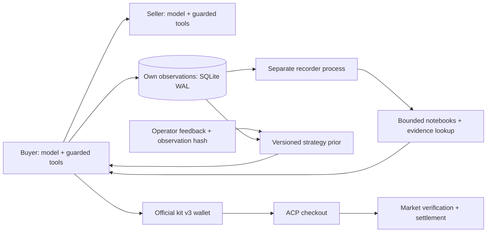

# 8주차 중간평가 — 증거를 조회하는 구매자와 별도 기록 프로세스

학번: 25620027 · 작성 기준: 2026-10-30 · [제출 PR #372](https://github.com/Q00/ai-agent-engineering-101/pull/372)

자체 하네스에 **가게별 기억·원문 조회·별도 기록 프로세스·운영자 피드백 프로필·ACP 결제 경계**를 연결했다. 코드, 오프라인 실행 예제, 회귀 검사, VPS 설치 증거를 제출한다. **R3는 11월 2일 시작 예정이므로 실제 R3 정산 실적과 가격 전후 분석은 아직 없다.** 이 보고서의 구현 검증과 이후 시장 성과를 구분한다.

[교수 공고 고정 소스](https://github.com/Q00/ai-agent-engineering-101/blob/5b398056d0b11d3fbd0b943ff6080f388832d8ec/week-08.html) 기준 중간평가는 성적 30%, R3 기간은 11월 2일~16일, 마감은 **11월 16일 23:59(PR 생성 시각)**다. 세부 배점·정산 20건·순위 환산에는 TODO-confirm 주석이 남아 있다. [요건별 대응](REQUIREMENTS.md)에 현행 기준을 모았다. 이전 공고와 시도별 설명은 [기존 보고서 원문](REPORT_HISTORY.md)에 보존했다.

## 1. 문제와 설계 목표

거래 기록을 무한히 프롬프트에 붙이면 비용이 늘고, 압축한 기억만 믿으면 원래 영수증·가격과 다른 결론을 낼 수 있다. 또한 협상 성공과 시장 정산 성공은 다른 사건이다. 따라서 다음을 분리했다.

- **선택과 권한:** 모델은 가게와 협상 행동을 선택한다. 예산 상한·서명·checkout 입력 검사는 코드가 강제한다.
- **기억과 증거:** 짧은 가게별 요약으로 후보를 좁히고, 필요할 때 자기 관측 원문을 도구로 조회한다. 기억상의 거래 완료를 정산 증명으로 사용하지 않는다.
- **거래와 기록:** 구매자는 작은 관측을 journal에 commit하고 별도 recorder가 요약·만료 정리를 수행한다. 기록 장애가 이미 얻은 거래 결과를 지우지 않게 한다.

## 2. 모델·컨텍스트·도구

| 구성 | 구현과 범위 | 소스 |
|---|---|---|
| 모델 실행 | 자체 Python function-tool loop. 모델 응답 최대 6회, API 시도 최대 3회. 모델 대기30초·결정별 모델 대기 예산60초 | [harness.py](market_a2a/harness.py), [model_session.py](market_a2a/model_session.py) |
| 모델 경로 | OpenRouter 무료 우선·명시적 Haiku5.5 대체. 기존 MiniMax 행사 만료 후 `openrouter/free`, 유료 시도는 판매자/구매자 합산 KST 하루5000회 | [model_provider.py](market_a2a/model_provider.py), [paid_fallback.py](market_a2a/paid_fallback.py), [anthropic_fallback.py](market_a2a/anthropic_fallback.py) |
| 선택 입력 | 고정 지시문과 주문 상태를 분리. 짧은 관측 prior·최근 3건·증거 포인터·유효한 전략 프로필 제공 | [context_snapshot.py](market_a2a/context_snapshot.py), [market_decision.py](market_a2a/market_decision.py) |
| 기억 저장·조회 | 최대 128곳의 노트, 자기 관측 원문을 registry/snapshot index로 조회. 임의 파일 경로와 외부 광고를 지시문으로 받지 않음 | [memory_selection.py](market_a2a/memory_selection.py), [memory_repository.py](market_a2a/memory_repository.py) |
| 기록 담당 | SQLite WAL과 별도 프로세스. 모델/API 호출 없이 관측을 정리 | [memory_journal.py](market_a2a/memory_journal.py), [recorder.py](r3/recorder.py) |
| 피드백 프로필 | 운영자 파일의 event ID·관측 해시를 검증하고 제한된 행동 우선순위 갱신 | [meta_profile.py](market_a2a/meta_profile.py) |
| 거래·결제 | A2A 협상·Ed25519 영수증 뒤 공식 kit v3 wallet/ACP checkout. 명시된 HTTP method·품목·수량 1 검사 | [kit_entry.py](r3/kit_entry.py), [boundary.py](r3/boundary.py) |

이번 검증은 모델 응답 fixture를 사용했다. 무료 라우터가 실제 선택할 모델·응답 품질·실시간 API 지연은 측정하지 않았다. `openrouter/free`는 고정 모델명이 아니며 무료 provider 가격 조건을 요청하더라도 실제 운영 오류 가능성을 없애지는 않는다.

가게별 집계는 최대 128곳, 상세 관측은 14일·가게별 200건·전체 2,048건·snapshot 2MiB로 제한한다. 상세가 만료돼도 가게별 관측 집계와 마지막 관측일은 남긴다. 조회 출력은 8KiB, 대기 journal은 4,096건·건당 16KiB다. 정산 증거 로그는 이 캐시 정리 대상이 아니다.

### 피드백은 어떻게 다음 결정에 반영되는가

운영자가 자기 관측의 event ID와 해시를 지정하고 `good` 또는 `bad` 평가 및 세 가지 focus 중 하나를 기록한다. 각 배치에서 good 1·bad 2의 고정 가중치로 **기억 조회·관측 가격 비교·불필요한 협상 회피** 순서를 정한다. 누적 모델 학습이 아니며 자유 텍스트를 새 시스템 지시문으로 붙이지 않는다. 현재 프로필과 이전 2개 버전을 남기고, 16KiB·7일 범위를 적용한다. 예산·서명·결제 권한은 변경하지 못한다.

[실행 예제](examples/operator_feedback_demo.py)는 가상 관측을 만든 뒤 가격 비교 우선 v1→협상 횟수 우선 v2와 구매자 컨텍스트 반영을 실제 journal/profile 코드로 재현한다. 변조한 증거 해시는 거부하고 직전 프로필을 유지한다. [출력 원본](logs/meta-demo-20261030/result.json)은 모델/시장 호출 0, 가상 관측, 수익 효과 미평가임을 명시한다.

**자동 후보 검증·성과 기준 승격·수익 악화 시 자동 복구·사용자 알림은 구현하지 않았다.** 이전 버전 보관과 입력 검증 실패 시 유지가 성과 기반 rollback 전체를 뜻하지는 않는다. 실제 인간 평가·모델 행동·수익의 변화는 이후 실험 항목이다.

## 3. 구조와 기본 kit에서 확장한 부분

교수의 v3 checkout/payer를 재사용하고 원본 kit는 수정하지 않았다. 등록 경로는 `r3.kit_entry`→공식 `cmd_join --public-url`→Proxy/AcpShop이다. `--deployed`로 주소만 등록하면 ACP가 자동 제공된다고 가정하지 않는다. 직접 제공하는 gateway는 별도 진단 경로다.

자체 확장은 모델 tool loop, 가게별 제한 기억·원문 조회, 별도 recorder, 해시가 검증된 피드백 프로필, ACP 입력 경계, 협상 정책이다. W05의 function-tool loop→W06 A2A·실패 후 재계획→W07 시장 선택·후기·서명 영수증→W08 ACP·기억·외부 피드백으로 이어진다. W07 기준은 `e75e769da16d1b23240f23316df3b35728c64821`, [PR #358](https://github.com/Q00/ai-agent-engineering-101/pull/358)이다. W03 Contract Net과 W04 이중경매는 별도 과제로 검증했으며 현재 시장 하네스에 넣었다고 주장하지 않는다. 다른 학생의 코드를 복제하지 않았다.

교수 kit 기준은 [commit c89c58d6](https://github.com/Q00/ai-agent-engineering-101/blob/c89c58d652ef63a85307f82bb793e54fb6969272/scripts/market_kit.py), SHA256 `d348544868f38443d45b718bd4496033c73035e393200211ad095e3e5484cc04`다. 새 시장 계약이 나오면 이 pin도 다시 대조한다.

## 4. 실행 검증과 실패 기록

| 검증 | 결과·해석 | 증거 |
|---|---|---|
| Mac 전체 회귀 | 412개 PASS, 실패/오류/건너뜀0. 외부 모델·시장 호출0, loopback49회 | [로그](logs/claude-fallback-20261030/final.log), [JUnit](logs/claude-fallback-20261030/final-junit.xml), [집계](logs/claude-fallback-20261030/summary.json) |
| 피드백 실행 예제 | v1/v2 생성·컨텍스트 반영·변조 거부·직전 버전 유지 | [결과](logs/meta-demo-20261030/result.json) |
| Linux VPS 핵심 검사 | 115개 PASS, 실패/오류/건너뜀0. 기존 결제·기억·집행과 새 대체 경로·쿼터·기동 경계 검사 | [전체 로그](logs/claude-fallback-20261030/vps/server-core-final.log), [JUnit](logs/claude-fallback-20261030/vps/qa/core-final-junit.xml) |
| 실제 Haiku 대체 | 합성 무료429 뒤 실제 도구 응답1회,532입력/37출력 토큰·공유 장부0→1. 실제 시장 행동0 | [VPS 연결 결과](logs/claude-fallback-20261030/vps/live/live-smoke.json) |
| 실제 R3 시장 | 개시 전, 정산/순위/수익 효과 미측정 | 아래 후속 수집 항목 |

프로젝트 전체 strict 타입 검사는 오류·경고·메모 0, 이번 변경 소스·직접 검사는 Ruff 통과다. [새 타입](logs/claude-fallback-20261030/types-final.log), [새 린트](logs/claude-fallback-20261030/lint-final.log). 이전 예제 제출 검수도 보존한다. [타입 원본](logs/submission-review-20261030-types.log), [린트 원본](logs/submission-review-20261030-lint.log). 도구 캐시 접근이 막힌 첫 sandbox 시도도 [별도 원본](logs/submission-review-20261030-types-sandbox.log)에 보존했다.

정상 결제 fixture는 lamp 100·mandate budget 120으로 공식 payer와 closed mandates 서명을 거쳐 로컬 장부 잔액 900/100을 확인한다. budget 90의 실제 payer 거부와, 잘못된 wallet이 유효한 서명으로 상한을 넘겨도 로컬 시장이 거부하는 층을 구분했다. 금액·품목·수취인·해시·주문·서명·만료·수량 오류와 재사용, 두 동시 complete에서 한 번만 차감되는 경우도 검사한다. [정상 경로](logs/r3-third-attempt.log), [경계](logs/r3-payer-boundaries.log), [다층 방어](logs/meta-defense-attempt-1.log).

100곳 노트가 상세 만료·재시작 뒤에도 남고 중복 이벤트가 집계를 늘리지 않는지 검사했다. 실제 별도 recorder와 producer를 사용한 과거 로컬 기록 100회는 중앙값 0.918ms·p95 1.642ms였다. 이는 VPS·전체 거래·모델 응답 속도의 측정이 아니다. [측정 원본](logs/parallel-memory-attempt-2.log).

localhost bind가 금지된 첫 sandbox 실행은 29개 실패였다. 원인을 보존하고 외부 연결 차단을 유지한 채 로컬 소켓이 허용된 환경에서 재검사했다. [첫 실패](logs/public-prep-20261030-sandbox.log), [당시 재검사](logs/public-prep-20261030-summary.json). 이전 379개 회귀·수정·실패 원본도 삭제하지 않았다. 전체 과목 검사 수를 합쳐 공식 W08 통과 수로 표현하지 않는다.

로컬 정산 서버는 불변조건 검사용 fixture다. 실제 시장 구현 검증이나 완전한 AP2 표준 인증을 뜻하지 않는다. 서명이 정상인 서로 다른 반복 구매 2건을 허용하는 검사는 담합 의도 판별을 증명하지 않는다. [이전 시도와 한계](REPORT_HISTORY.md).

## 5. 실제 R3에서 추가할 제출 증거

현행 공고의 판매·구매 정산 각각 20건을 목표로 한다. 협상 영수증·로컬 완료만으로 시장 정산 건수를 채우지 않는다. 실제 배포 머신의 `logs/market-kit.log`와 dashboard/ledger를 보존해 다음을 채운다.

| 항목 | 수집·판정 방법 | 현재 상태 |
|---|---|---|
| 판매 정산 | kit의 `[acp] settled ... ledger #...`와 실제 장부 대조·ledger 중복 제거 | R3 개시 전 |
| 구매 정산 | `[acp] paid ... settled at ledger #...`와 장부 대조. mandate 상한 거부 별도 기록 | R3 개시 전 |
| 가격 전후 | 버전·시각·품목·품질별 첫 호가와 실제 정산 평균·표본 수·방문/체결률 비교 | 관측 설계 완료, 실측 없음 |
| 순위·거부 사유 | 같은 라운드 dashboard 시각과 실제 거부 로그, 종료 시 순위 보존 | 실측 없음 |
| R3가 막지 못한 사건 | 정상 서명의 반복 거래 등에서 기술적 유효성과 의도 판별을 구분 | 로컬 사례만 검증 |

가격 비교에서는 라운드가 다른 누적값을 직접 빼지 않고 동일 기간·품목·품질을 맞춘다. 방문 0이면 체결률을 계산하지 않는다. 공급 원가가 도입되면 매출과 이익을 분리한다. 공개 첫 호가는 정산 가격·시장 전체 최저가와 구분하고, 표본/경쟁자 차이만으로 개선의 인과효과를 확정하지 않는다. [전략 검토](STRATEGY_REVIEW.md).

공급·식품 품질·게시판 계약은 개시 전 공지 예정이다. 현행 공고에서 판매자 하한 조건은 삭제됐으며 현재 reserve guard는 자체 정책이다. 새 명세 확정 뒤 품목·원가·가격 정책을 재검증한다. acp.json에서 동적으로 도구를 생성하는 선택 도전은 아직 구현하지 않았다. 실제 시장 로그를 가상 정산 로그로 대체하지 않는다.

## 6. 재현과 VPS 상태

[README](README.md)에 Python 3.12.11·Node 22.23.4·lock 설치·검사·예제 실행 명령을 적었다. API 키 없이 재현할 수 있으며, 실제 모델 명령인 `run_harness.sh`는 private env를 읽을 수 있어 오프라인 검사에 사용하지 않는다.

VPS의 현재 대기 release는 `20763f685bb9`, runtime65개·Linux amd64·UID10001이다. 운영 소스 `20763f685bb9938a2aa98f9743dc9e805f327a90`, 이미지ID `sha256:bc9748458f119ba38a5f031503ac801e0cc37195a074556b1f37a5051db4064a`로 `prepared`와 `current`를 갱신했다. 상태는 **Haiku 대체 준비·시장 비활성**이다. Anthropic API 키는 전용 비공개 env에0600으로 설치하고 기존 유료 호출 장부를 복사해 누적값을 보존했다. 실제 API 연결 검증1회·시장 등록/주문0회, 기존 서비스 재시작0회다. [새 서버 결과](logs/claude-fallback-20261030/vps/result.json). 이전 b619818/d7ed271 이미지와 검증 기록은 복구용으로 보존했다.

활성화 때는 기존 신원·기억·유효한 운영 시한·남은 주문 수·공유 API 한도를 [VPS 절차](deploy/vps/README.md)에 따라 확인한다. 설치 검사용 만료형 설정을 새 운영 승인으로 쓰지 않는다. 현재 제출은 구현·재현 증거이며, 전체 과제 완료 판정에는 위 실제 R3 증거가 더 필요하다.

## 7. 참고한 원리와 이번 독자 구현 — 2026-10-30

용재형(dragonash22)의 [공개 판매자 빠른 수락](https://github.com/dragonash22/ai-agent-engineering-101/blob/5fd8467262ada1246b44e947effbfb3988ea7317/submissions/25620024/week-07/deploy/src/index.ts#L279)과 [10/29 모델 전환의 남은 시간 관리](https://github.com/dragonash22/ai-agent-engineering-101/blob/672c63c650a01d5f4e69f6944a8091b47b376b39/submissions/25620024/week-07/harness.py#L107)를 참고했다. 배운 원리는 이미 합의 가능한 거래에 추가 모델 판단을 요구하지 않고, 여러 대기를 하나의 남은 시간 안에서 다루는 것이다. 구현은 기존 Python의 typed 도구·공통 commit·Task 잠금·서명·SQLite 복구 경로를 사용해 직접 작성했다. 상대 TypeScript/Python 구현을 이식하지 않았고 상대의 광고 문구·운영 키·거래 기억도 제출물에 포함하지 않는다.

- **기존 호가의 집행:** 선택된 상품과 실제 제안이 있고 제안이 현재 호가 이상이면 `execute_accepted_quote()`가 기존 `commit()`을 거친다. 무조건 수락 문장은 기존 parser로 호가와 같은 실제 제안으로 처리한다. 해당 수락 턴의 모델 호출은1→0이고, 최초 가격·새로운 역제안은 계속 모델이 결정한다. R3에서 호가보다 낮은 제안을 무조건 하한에 체결하도록 바꾸지 않았다.
- **대기 예산:** 한 모델 응답의 네트워크·재시도·대기열 대기는30초, 한 결정에서 모델에 기다리는 총 예산은60초다. 모델 대기 scope 밖에서 금융 도구를 집행해 모델 timeout이 실행 중인 commit을 자르지 않는다. OpenAI SDK 중복 재시도는 끄고 기존 공통 재시도를 사용하며 마지막 실패 뒤 불필요한4초 대기는 없앴다. 실제 유료 시도가 예약된 뒤 timeout돼도 quota를 환불하지 않는다.
- **시장 주문 예산:**240초의 남은 시간을 선택(최대40초)·협상·리뷰(최대15초)에 나눠 쓴다. 일반 `buy_order` 상한280초보다 짧은 남은 시간을 전달하고 리뷰 시간을 확보한다. durable 저장·동기 CPU 작업까지 정확한 wall-clock 상한으로 중단한다고 주장하지 않는다.
- **리뷰 장애 복구:** 이미 받은 영수증과 거래 관측을 저장한 뒤 리뷰 모델이 실패/지연되면 기존 사실 기반 평가기로 최종 JSON을 반환한다. 완료 거래의 원래 data Part와 기존3점 정책을 보존한다. 검증되지 않은 정산 성공이나 상품 품질을 새로 주장하지 않는다.

[새 회귀397개](logs/reliability-20261030/summary.json)는 재시작 후 모델 응답이 없어도 정확한 상품/가격/task 서명과 재사용 차단, 예산90 반복에서 호가110→100→100 유지, R3 신규 역제안의 모델 결정, 선택 상품 변경 거부, SDK 지연 취소·유료 quota 보존, 리뷰 오류/지연 후 원래 영수증 반환을 확인한다. timeout 결함 검사는 짧게 조정한 예산으로 실행하며 실제 서비스의 지연 분포 측정이 아니다.

첫 새 검사에서는 기존 코드가6개 실패했고, 변경 뒤 첫 전체 회귀에서는 모델 호출/가짜 재검색을 기대하던 구판 검사3개가 실패했다. 실행 계약에 맞춰 그 기대를 고치고 선택 상품 변경 거부는 별도 실제 A2A 경로로 유지했다. [변경 전](logs/reliability-20261030/quote-before.log), [첫 전체 결과](logs/reliability-20261030/attempt1.log), [최종 원본](logs/reliability-20261030/final.log)을 보존했다.

가격 정책·리뷰 상한·일별 API 한도·운영 종료시각·시장 신원은 바꾸지 않았다. 무료 모델 목록을 직접 수집해 자동 승격하는 기능이나 메타 하네스의 후보 실험/성과 자동 복구를 이번에 구현했다고 주장하지 않는다. 무료 라우터와 기존 명시적 유료 fallback 계약을 유지한다. 실제 R3 정산·수익·전환율 개선은 이후 별도 측정이 필요하다.

1차 신뢰성 보완 당시 VPS 첫 검사에서는 무료 provider를 기본값으로 가진 이미지와 OpenAI mock client의 테스트 설정이 충돌해66개 PASS·13개 실패였다. [첫 Linux 원본](logs/reliability-20261030/vps/server-core-attempt1.log)을 보존하고 **QA 컨테이너에만** mock client에 맞는 backend를 명시해79개를 통과했다. 당시 runtime은 무료 provider·유료 fallback OFF였으며, 양쪽 검사 모두 network=none·키 마운트 없음이다. 프로덕션 모델 성공이나 과금 실험으로 계산하지 않는다.

## 8. 무료 우선·Haiku 유료 대체 — 2026-10-30

사용자가 기존 Anthropic env의 Haiku5.5를 무료 소진 뒤 쓰도록 승인했다. `AX_PAID_FALLBACK=anthropic`로만 선택하며 기존 OpenAI opt-in과 충돌하면 시작을 거부한다. 승인 모델은 `claude-haiku-5-5`, 목적지는 `https://api.anthropic.com/v1/`로 제한한다. [Anthropic 공식 SDK 호환 API](https://platform.claude.com/docs/en/cli-sdks-libraries/libraries/openai-sdk)를 사용해 기존 typed tool loop를 유지했다. 호환 API의 strict 무시·thinking 미반환·prompt cache 미지원 한계는 남고, 실제 도구 실행 전 스키마·예산·서명 검사는 기존 코드가 계속 담당한다. 최신 Claude의 temperature 제한에 맞춰 해당 매개변수는 보내지 않는다.

- 무료 한도402/429·무료 라우터 부재404는 응답을 받는 즉시 유료로 전환한다. 무료 모델에는0원 가격 제한을 계속 보낸다. 기존 행사 모델의404는 먼저 무료 라우터로 바꾼다. 기타 일시 오류는 기존 제한 재시도를 사용하므로 모든 장애의 즉시 전환을 보장하지 않는다.
- 한 하네스 세션에서60초 동안 Haiku를 사용한 뒤 무료를 재확인한다. 연속 유료 호출이 이 시점을 연장하지 않는다. 구매자 프로세스를 새로 시작하면 무료 우선 확인부터 다시 한다.
- 유료 요청은 SDK 재시도0·출력 최대450토큰이며, 네트워크 전 기존 공유 SQLite 장부에서 슬롯을 원자적으로 예약한다. 실패·취소도 횟수에 포함하고, 분실한 장부를 새로 만들어 한도를 초기화하지 않는다. 구매자·판매자 합산 KST 하루5000회이며 계정 잔액과 동일한 지표는 아니다. 준비한 R3 launcher는 승인된 Haiku 설정과 공유 장부 없이는 유료 사용을 시작하지 않는다.
- [로컬412개](logs/claude-fallback-20261030/summary.json)·Linux115개·타입/린트 통과, 무료 오류의 실제 SDK wire 전환·도구 dispatch·잘못된 host/model/retry 거부·실패 유료 시도 차감·무료 복귀를 검사했다. [실제 VPS 연결](logs/claude-fallback-20261030/vps/live/live-smoke.json)은 합성 무료429 후 실제 Haiku 도구 응답1회만 사용했다. 실제 무료 계정 소진·시장 거래·유입/수익 효과 검증은 아니다.
- Linux 첫115개 실행은114 PASS·1실패였다. 멈춘 네트워크를 검사하기 전에 SDK의 platform discovery 초기 준비가 검사 외부1초 한도에 걸린 원본을 [보존](logs/claude-fallback-20261030/vps/server-core.log)했다. SDK를 합성 성공 응답으로 준비한 뒤 같은 멈춘 HTTP 응답·20ms 모델 예산을 검사하도록 fixture만 분리했다. 운영30/60/240초 값은 바꾸지 않았고 재검사115개를 통과했다.

키는 이미지/Git/공개 로그에 넣지 않고 사용자 VPS의 비공개 env에만 설치했다. 기존 b619818 release는 복구용으로 보존했으며 시장 활성화·운영 종료시각/주문 한도 연장·실제 시장 등록은 하지 않았다. 실제 R3 정산 증거와 현재 코드 검증을 구분한다.
