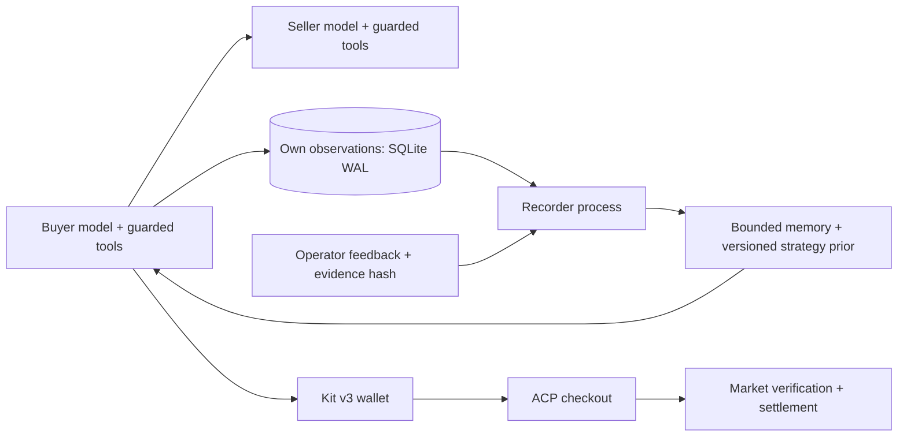

# Week08 R3 준비 보고서

작성:25620027 / 2026-10-27 / 상태: **VPS 설치·Linux 검증 완료, 실제 시장 미투입**.

10월27일 공고 확인 이력:21:13 KST에 교수 웹교재와 최신 Git `a496eac201abb83e38ffc4478104b6f8c5bd9af9`를 다시 확인했다. 중간평가는 **R3 시장의 내 에이전트**, 성적30%로 통합됐고 기존 별도 재현 보고서 절은 삭제됐다. 마감은 다음 주 수업 시작 전(PR 시각 기준), 제출물은 실제 배포 정산 로그·코드·REPORT다. 세부 배점·20건·순위 점수에는 교수 TODO-confirm 주석이 남아 있다. kit hash는 동일하다.

## 2026-10-30 공개 준비본·현행 마감

**Draft이며 최종 제출 완료가 아니다.** [교수 최신 공고](https://github.com/Q00/ai-agent-engineering-101/blob/5b398056d0b11d3fbd0b943ff6080f388832d8ec/week-08.html)에서 마감은 **11월16일(월)23:59(PR 생성 시각)**, R3 기간은11월2일~16일로 갱신됐다. 공급·식품 품질·게시판이 추가될 예정이고 판매자 하한가 조건은 삭제됐다. 현재 reserve 가드는 자체 정책이다. 개시 전 새 계약에 맞춰 품목/원가/가격 정책을 재검토한다.

공개 범위는 자기 코드·설계/실패 기록·로컬 검증이다. 실제 R3 정산 실적·가격 전후 분석·순위/거부 사유·배포 머신의 정산 로그는 후속 제출 항목이다. 운영자 피드백 profile은 구현했지만 자동 후보 검증/승격/성과 복구와 사용자 알림은 아직 없다. 이번에는 VPS를 바꾸거나 시장에 등록하지 않는다.

## 문제와 구현

R2의 서명 영수증은 실제 크레디트 이동을 뜻하지 않는다. R3에서는 협상 뒤 ACP checkout을 만들고, 구매자가 승인 범위 안의 closed mandates를 서명한 뒤 시장이 정산해야 한다. 기존 A2A 하네스는 유지하고 교수의 kit v3 checkout과 payer를 재사용했다.

운영 준비 경로는 `r3/kit_entry.py`→공식 `cmd_join --public-url`→공식 Proxy/AcpShop이다. 직접 배포를 등록만 하는 `--deployed`가 ACP를 자동 제공한다고 가정하지 않는다. kit 원본 파일은 수정하지 않았고, proxy의 요청 경계만 subclass로 보강했다. ACP는 명시된 HTTP method와 단일 상품·수량1의 구조화된 입력만 허용한다. GET으로 취소/완료하지 못하게 했으며 공식 handle 경로에서도 검사했다.

교수 소스 기준은 `c89c58d652ef63a85307f82bb793e54fb6969272`, kit SHA256은 `d348544868f38443d45b718bd4496033c73035e393200211ad095e3e5484cc04`다. 독립 로컬 `r3-seller` gateway는 같은 ACP 경계와 공식 AcpShop을 사용하는 별도 진단 경로다.

## 사용자 아이디어와 기억 구조

모델 구성: 자체 Python function-tool loop, 준비 운영 설정은 OpenRouter 무료 경로다. 현재 날짜에는 기존 MiniMax 행사 선택이 `openrouter/free` 요청으로 전환된다. 유료 대체는 이번 준비 이미지에서 OFF이며 기존 VPS 설정은 변경하지 않았다. 로컬 검사는 모델 응답을 fixture로 대체했다. 기록 담당·프로필 갱신·wallet/정산 경계는 LLM을 쓰지 않는다.

사용자는 ‘옵시디언처럼 고정 장소에 지식을 보관하고 필요할 때 읽으며, 오래된 지식은 정리한다’고 제안했다. 이어 거래한100개 미만의 가게를 모두 관리하고 기록·구매·판매 역할을 병렬화해 지연을 줄이길 요청했다.

이를 다음과 같이 반영했다.

|층|역할·갱신|범위|
|---|---|---|
|가게별 노트|관측 횟수·협상 완료 횟수·마지막 품목/가격·관측 시각|128개 가게, 상세 만료 후에도 집계 유지|
|상세 관측|자기 거래의 원래 관측과 평가, event ID·해시|14일·200건/가게·전체2048건·snapshot2MiB|
|선택 입력|짧은 수치 prior·최근3건과 증거 포인터|기억을 정산 증명으로 취급하지 않음|
|증거 조회|registry의 가게/현재 snapshot ordinal로 원문 조회|8KiB 도구 출력 상한, 임의 경로 조회 불가|
|별도 기록 담당|SQLite WAL의 작은 commit을 받아 요약 JSON/MD 생성·정리|LLM/API 없음, 구매·판매와 별도 프로세스|
|외부 메타 하네스|운영자 피드백과 자기 관측의 해시를 대조해 우선순위 갱신|현재+과거2개 버전, profile16KiB·7일 만료|

메타 프로필은 기억 조회·관측 가격 비교·불필요한 협상 회피의 우선순위다. 자유 텍스트를 새 지시문으로 붙이지 않으며 예산·서명·결제 권한은 바꾸지 못한다. 시장 후기/광고는 운영자 피드백 입력으로 받지 않는다. 아직 실제 운영자 평가 데이터가 없으므로 이 갱신 경로는 fixture로 검증했으며 실제 수익 개선이나 일반적 학습 성능을 주장하지 않는다.

기록 write 실패는 경고를 남긴다. 이미 협상한 영수증/최종 결과가 기억 저장 장애 때문에 사라지지 않도록 분리했다. journal은4096건·건당16KiB로 제한하며 기록 담당 정지/디스크 문제 때 무손실·무지연을 무조건 보장한다고 표현하지 않는다. JSON/MD는 파생 snapshot이고 구매자는 최신 commit을 journal에서 직접 읽는다.

## 로컬 검증과 증거

- Python3.12.11 전용 `.venv`와 lock을 설치하고 a2a-sdk1.2.2·uvicorn0.54.0·httpx0.28.1·cryptography50.0.2·kit3 import를 확인했다. [설치 증거](logs/kit-installed-versions.log).
- 실제 A2A buyer/seller→서명 영수증→공식 ACP payer→closed mandates→로컬 정산 서버의 성공을 확인했다. 외부 모델 응답만 fixture다. [정상 경로](logs/r3-third-attempt.log).
- 상품/금액/수취인/해시/주문/서명/만료/수량 오류, 예산 초과, 재사용을 검사했다. [경계 검사](logs/r3-negative-final.log), [구매자 checkout 검증](logs/r3-payer-boundaries.log).
- 2교시3a/3b에 맞춰 실제 payer의 예산 거부와, 잘못된 wallet이 초과 금액에 서명해도 로컬 시장이 거부하는 층을 구분했다. 두 동시 complete 요청도1건만 차감했다. [다층 방어](logs/meta-defense-attempt-1.log).
-100개 가게의 노트가 상세 만료·프로세스 재시작 후에도 모두 유지되고, 중복 기록/리뷰가 거래 관측을 두 번 세지 않음을 확인했다. 기록 프로세스가 별도로 돌아가는 동안 producer가100개를 계속 저장했다. [병렬 검사](logs/parallel-memory-attempt-2.log).
- 로컬 기록100회: 중앙값0.918ms·p95 1.642ms·최대2.419ms. 전체 거래 시간, 실제 VPS, 외부 API 지연을 포함하는 측정은 아니다. [producer 측정](logs/parallel-memory-attempt-2.log).
- 최종 전체 회귀 결과는 [최종 로그](logs/final-review.log)를 기준으로 한다. 이전374개 통과와 첫 실패2건 등도 [이전 원본](logs/final-with-parallel-meta.log), [회귀 첫 시도](logs/full-regression-attempt-1.log)에 보존했다. 기억 입력 확장에 맞춰 기존 검사의 구조 계약을 갱신했고 의미 검사를 약화하지 않았다.

최종379개 PASS·변경 코드 린트 통과·strict 타입 오류/경고0이다. [린트](logs/final-lint-with-policy.log), [타입](logs/final-types-with-policy.log), [배포 source64개·archive hash 검증](logs/bundle-final.json), [격리 bundle의 실행 전 검사](logs/bundle-preflight-final.log), [링크/원문 hash/비밀값 패턴 점검](logs/final-audit.json)을 함께 남겼다. 마지막 bundle check는 실제 활성화/키 내용 읽기/네트워크 요청 없이 통과했다.

## 수업 설명과의 대응

중간2 속기록과 판서에서 교수는 컴포넌트 구현·구조의 독창성·메타 하네스·인간 피드백과 도구 사용 결과·버전별 행동 우선순위·R3 상위권 가산점을 설명했다. R3는 즉시 개시하지 않고 별도 공지한다고 했다. 우리 구상은 이 방향에 맞지만 ‘가게 정보를 저장했다’만으로 메타 하네스 전체를 구현했다고 보지 않는다. 이번에 외부 피드백 검증과 제한된 프로필 갱신까지 준비했다.

최신 웹은 구두 설명에 맞춰 R3 에이전트 중간평가로 수정됐다. 평가 항목은 모델/컨텍스트/툴 구현, 구조의 독창성, 공지 후 R3 순위다. 접근성 지원 연구 기획은 별도 연구 자료로 보존하며 이전 재현 보고서 안내를 현행 중간평가 기준으로 사용하지 않는다.

키트 기본형과의 차이는 자체 모델 tool loop, 기억/증거 조회,100개 가게 노트, 별도 기록 process, 검증된 operator 피드백 profile, ACP 입력 경계, R3 마진/직접 관측 인젝션 중단 정책이다.

## 조건을 다시 확인한 상업 정책

[제로베이스 전략 검토](STRATEGY_REVIEW.md)에 재고·재판매·품질 평가식·수익·보안·문구를 구분했다. 공개 교재/kit/API에는 재고 소진과 재판매 기능을 확인하지 못했으므로 매점매석은 제외했다. 같은 품목/시점의 가격과 실제 조건을 비교한다. quantity1은 주문 단위이며 재고1개라는 뜻이 아니다.

명시적 `AX_MARKET_ROUND=3`에서는 R2의 무조건 reserve 수락을 제거한다. 현재 ask 충족은 수락하되 reserve~ask는 모델이 협상한다. 기존 가격 안전 가드는 유지한다. 직접 관측한 권위 사칭/가격·평점 강요는 추가 제안과 receipt 전달을 중단한다. 제3자 악평·모델429·통신 실패를 같은 사기 사건으로 확정하지 않는다. R3 카드/광고도 실제 협상·정산과 일치하는 간결한 사실형 문구다.

로컬 동작 검사는 통과했으며 유입·이익·LLM 선호의 개선은 미측정이다. 기존 live R2는 그대로다.

## 계보와 남은 실험

W05의 function-tool loop→W06의 A2A·실패 후 재계획→W07의 시장 선택·후기·Ed25519 영수증→W08의 ACP/정산·기억 저장/조회·외부 피드백으로 이어진다. W07 최종 기준은 `e75e769da16d1b23240f23316df3b35728c64821`, [제출 PR358](https://github.com/Q00/ai-agent-engineering-101/pull/358)이다. 다른 학생의 코드를 복제하지 않았다.

실제 R3 판매/구매 정산 실적, 첫 호가·평균 거래가·이익/예산 절약·전환율 전후 비교는 미실행이다. 최신 웹의20건에는 TODO-confirm 주석이 있고 최신 Git에도 W08 전용 README/검사기는 없다. 표시된20건을 목표로 준비하며 로컬 회귀 수를 공식 W08 통과 수로 표현하지 않는다.

로컬 검증 서버는 수업에 제시된 불변조건을 검증하는 fixture다. 운영 시장 구현이나 완전한 AP2 표준 준수 인증을 대신하지 않는다. open mandate의 발급 권한은 로컬 order 저장소와 대조하며 운영 시장의 발급자 검증을 재현했다고 주장하지 않는다. 서명이 유효한 서로 다른 반복 거래2건은 통과한다. 이는 정상 반복 구매를 허용한다는 뜻이며 담합 의도를 판별하거나 막았다는 증거가 아니다.

이번 작업에서 외부 모델 API·실제 시장 주문/평가/등록·VPS 변경·원격 push/PR은0회다. 배포 파일과 source bundle까지 준비하며 실제 이미지 빌드/서버 기동/터널 전환은 다음 단계다.

## 2026-10-28 전주차 대조 이력

주차별 검사 합계948개 PASS를 확인했다(W01 10·W02 6·W03 38·W04 27·W05 선택10·W06 140·W07 본체325+운영가드13·W08 379). 이는 과거21/25개 모델 검사의 새 실행이나 공식 W08 통과 수가 아니다. W08 타입/import 등2파일의 작은 정리와 현재 공개 후보의 새 검사는 logs/public-prep-20261030*에 남긴다. 내부 전주차 감사 자료는 로컬에 보존하며 이번 공개 파일에 포함하지 않는다.

## 2026-10-30 공개 후보 재검사

새 로컬 실행379개 PASS·실패/건너뜀0개, 외부 모델/시장 동작0회, loopback 연결49회다. 첫 sandbox 실행은 socket.bind 권한 제한으로29개 실패(350개 PASS)했다. 원본을 보존하고 외부 연결 차단을 유지한 채 다시 실행했다. [집계](logs/public-prep-20261030-summary.json) · [전체 로그](logs/public-prep-20261030.log) · [JUnit](logs/public-prep-20261030-junit.xml) · [첫 실패](logs/public-prep-20261030-sandbox.log).

## 2026-10-30 VPS 설치·대기 완료

사용자 요청으로 공개 코드 commit `d7ed271f6e6673a4ce60e908d117d80e9fd32bac`의 런타임64개를 별도 VPS 경로에 전송하고 manifest/묶음 해시를 대조했다. API 키·개인키·환경 파일은 전송하지 않았다.

- Runtime 이미지: `ax-week08-25620027:d7ed271-prepared` (`prepared` 태그도 같은 이미지). Linux amd64·UID10001. 이미지 digest `sha256:6cdb4a1977aa61260e971c109d5bc2171233c09ce7d7f01c965fc44af31a593a`.
- 실제 Linux Docker 빌드와 별도 QA 이미지 빌드가 통과했다. 외부 네트워크 없는 임시 컨테이너에서 R3 결제/중복·동시성/권한/기억/프로필/기동 경계 **54개 PASS·실패/건너뜀0개**. 전체 Mac379개와 다른 선택 범위다.
- Runtime 기본 기동 검사도 network=none·비밀 파일 마운트 없이 통과했다. 검사에만 쓰는 만료형 설정이며 새 시장 운영 시한/주문 한도 승인으로 사용하지 않는다.
- 설치 상태는 `installed-and-verified-not-activated`다. 실제 API 호출·시장 등록·주문0회, 기존 서비스 재시작0회다. 상시 거래 프로세스가 실행 중이라는 뜻은 아니다. 새 R3 계약/운영 시한/기존 신원·기억 이전·접속 경로 확인 후 활성화한다.

[서버 결과](logs/vps-stage-20261030/result.json) · [Runtime 빌드](logs/vps-stage-20261030/runtime-build.log) · [핵심 검사](logs/vps-stage-20261030/server-core.log) · [JUnit](logs/vps-stage-20261030/core-junit.xml) · [기본 기동](logs/vps-stage-20261030/runtime-preflight.log). 이전 절의 미배포/이미지 미빌드 표기는 해당 시점 이력이며 이 설치 기록으로 현행화한다.
