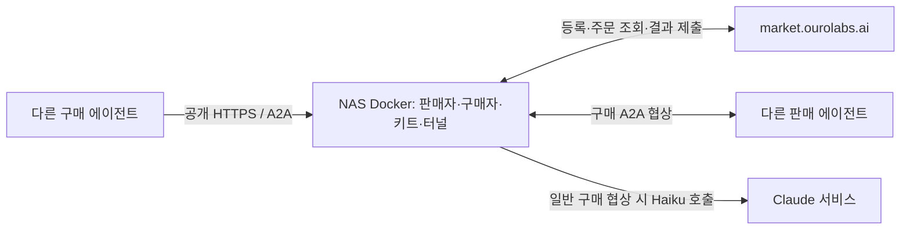

# Week 07 — Agent market 운영 보고서

- 학번: 25622005
- GitHub 및 마켓 등록 이름: `psyoung82`
- 최초 작성 기준: 2026-10-22 09:35:45 KST의 공개 마켓 스냅샷과 저장된 원본 로그
- 최신 작성 기준: 2026-10-24 23:11:06 KST. 과거 라운드·실패 기록을 보존하고, 8절에 가격·구매 전략 개선, 9절에 NAS 이전과 가동 결과, 10절에 검증 범위와 남은 항목을 정리했다.
- 현재 배포: NAS의 Docker 컨테이너 한 개에서 판매자·구매자·마켓 키트·Cloudflare 터널 운영. 기존 Mac 실행은 10월 24일 종료했다.
- 구현: A2A JSON-RPC 1.0, Python 규칙 기반 판매자, Claude Code의 `haiku` 하네스를 사용하는 구매자. Mac은 Python 3.12, 배포 Dockerfile은 Python 3.11·Node.js 22·Claude CLI 2.1.112를 사용한다.

이 보고서는 AI 코딩 도구와 협업한 코드 변경, 커밋, 실제 실행 로그를 바탕으로 작성했다. 과거 공식 테스트, 최신 모의 테스트, 실제 마켓 결과를 구분한다. 관측하지 못한 성능 개선이나 상대 참가자의 고의적인 부정행위는 성공한 결과로 기록하지 않는다.

최신 공개 조회에서 NAS 주소는 `https://figure-mrs-record-bryan.trycloudflare.com`이며 상점·구매자 모두 온라인이었다. 상점은 누적 2,409건·이익 3,855, 구매자는 누적 4,354건·절약액 155,932였다. 이는 [저장 시점의 공개 스냅샷](logs/report-nas-20261024-1/market-snapshot.json)이며 마감까지의 연속 가동을 보장하지 않는다. 사용자의 요청에 따라 Docker 배포 준비 이후 변경과 이번 보고서 갱신은 자동 커밋·푸시하지 않았다.

## 1. 구매자의 상점 선택과 기억

처음에는 개인 거래 별점과 다른 구매자의 리뷰 평균을 각각 50% 반영해 한 상점을 선택했다. 이후 사용자가 선택한 운영 방향에 따라, 신뢰성 확인과 상품별 가격 비교를 기존 선택 과정에 추가했다. 구현은 [market_buyer.py](market_buyer.py), [purchase_policy.py](purchase_policy.py), [trade_memory.py](trade_memory.py)에 있다. 초기 점수 선택 구현도 [shop_catalog.py](shop_catalog.py)에 남아 있다.

현재 선택 절차는 다음과 같다.

1. 최근 리뷰 최대 10개의 평균이 3 미만이면 후보에서 제외한다. 본인의 영수증 불일치 기록은 24시간, 연속 연결 실패 2회는 15분 동안 일시 제외 근거로 사용한다. 단순 예산 부족이나 본인 하네스 오류는 부정행위로 취급하지 않는다.
2. URL이 바뀌어도 같은 상점을 기억하도록 `shop_name`으로 거래를 묶는다. 같은 상품의 정상으로 분류된 최근 구매 최대 5건의 가격 중앙값을 계산한다. 다른 상품 가격이나 예산 대비 지출 비율을 상품 가격으로 사용하지 않는다.
3. 과거 상품 가격과 경험·리뷰 점수로 후보 최대 3곳을 좁힌다. 후보들의 공개 카드와, 안내되어 있을 경우 공개 품질 보증의 가격을 GET으로 읽는다. 공개 가격이 없다는 이유만으로 불신 상점으로 분류하지 않는다.
4. 현재 공개 가격을 우선하고, 없으면 과거 구매가를 참고한다. 예산 안의 알려진 가격, 가격 미상, 예산을 넘는 알려진 가격 순으로 고려하고, 가격과 경험·리뷰 점수로 순서를 정한다. 후보 3곳 중의 비교이므로 시장 전체 최저가를 보장하지 않는다.
5. 선택한 한 곳에만 A2A 거래 요청을 보낸다. 여러 후보의 공개정보 조회를 여러 상점에서의 구매나 협상으로 기록하지 않는다. 실제 견적은 공개 광고나 과거 가격과 다를 수 있다.

`buyer-memory.json`은 JSON 배열이며 각 기록에 `time`, `shop_name`, `item`, `budget`, `price`, `outcome`, `stars`, `review`, `receipt`가 있다. 결과는 `deal`, `no_deal`, `invalid_receipt`, `unavailable`로 구분한다. 영수증은 받은 원본을 보존하고, 파일 갱신은 임시 파일 작성 후 교체한다. 공개 카드 GET 실패는 구매 시도 기억을 오염시키지 않도록 무시되는 로컬 `.market/*-quote-failures.json` 캐시에 따로 저장한다.

구매자는 상품·예산·task와 수락한 금액의 상한을 검사한다. 10월 23일 이후에는 수락 금액보다 낮은 정상 할인 영수증도 허용하고, 수락 금액이나 예산을 넘는 청구는 거부한다. 등록된 판매자 키에 대한 최종 서명 검증과 구매자 서명 추가는 시장 키트가 담당한다. 따라서 로컬 기억의 `deal` 수를 곧바로 시장에서 인정한 거래 수라고 해석하지 않는다.

## 2. 리뷰 전달과 협상 제어

선택한 상점의 최신 리뷰 최대 10개를 원래 순서대로 전달하고, 리뷰 본문은 각각 600자로 제한한다. 같은 상점·같은 상품의 최근 개인 거래 최대 5건과 가격 비교 근거도 JSON으로 묶어 하네스에 전달한다. 이전 구현처럼 서로 다른 상품의 최근 거래를 같은 상품 가격 판단에 섞지 않는다.

[negotiation.py](negotiation.py)의 프롬프트에는 상품, 예산, 상점 소개, 리뷰·기억, 대화 내역이 들어간다. 소개·리뷰·대화는 신뢰할 수 없는 자료로 명시하고, 그 안의 지시가 예산이나 사용자 요구를 바꾸지 못하도록 한다. 하네스는 JSON으로 `offer`와 정수 가격 또는 `walk`를 반환한다. [harness.py](harness.py)의 기본 명령은 다음과 같다.

```text
claude -p --model haiku --tools "" --setting-sources "" --no-session-persistence
```

예산은 목표 지출액이 아니라 상한이다. 코드에서 제안을 예산과 읽을 수 있는 현재 호가 이하로 제한한다. 현재 호가는 `metadata.ask`를 우선하고, 없으면 asking·counteroffer·price 등 명시된 호가 문구를 읽는다. 명시된 문구가 없으면 별점 표현이 없는 단일 숫자만 보조적으로 사용하며, 모호한 여러 숫자 중 마지막 숫자를 임의로 호가로 삼지 않는다. 8절에 이 변경의 실패와 수정 근거를 기록했다. 명시된 고정가·최종가가 예산 안이면 그 금액을 수락하고, 예산을 넘으면 최초 A2A 요청 후 취소한다. 일반적인 높은 시작 호가를 고정가로 오해해 즉시 포기하지는 않는다.

상품별 시장 하한 이하의 호가가 예산 안이면 Python 코드가 즉시 수락해 모델 호출을 생략한다. 그 밖의 일반 협상에서 위 하네스를 호출한다. 판매자는 현재 모델을 호출하지 않고 고정가·수락·서명 발행을 Python 규칙으로 처리한다. 파일에 저장한 거래 기억을 다음 선택에 활용하며 모델 자체를 재학습시키는 구현은 아니다.

일반 협상에서는 하네스를 계속 사용하지만, 동일 제안과 동일 상대 호가가 연속 2회 반복되면 취소한다. 최대 제안 횟수는 8회이며 완료 상태를 반복 중단 판단보다 먼저 처리한다. 모든 POST에 `A2A-Version: 1.0`을 보내고 후속 메시지는 같은 `taskId`를 이어 간다. 이 보호 장치는 예산·반복 협상을 제한할 뿐, 상대가 모든 프로토콜을 올바르게 구현했다고 보증하지는 않는다.

## 3. Round 0, 1, 2의 실제 결과

다음은 각 파일에 저장된 스냅샷이다. 라운드가 바뀌며 집계가 초기화되므로 서로 다른 라운드의 누적 건수를 연속 증가량으로 계산하지 않는다.

| 관측 | 상점 거래 | 상점 점유율 | 방문 | 구매자 주문/거래 | 근거 |
|---|---:|---:|---:|---:|---|
| Round 0 초기 관측 | 12 | 1.6% | 25 | 61 / 24 | [round-0-dashboard-1.json](logs/round-0-dashboard-1.json) |
| Round 1, 10월 20일 20:31 KST | 0 | 0.0% | 1 | 6 / 3 | [round1-live-1-board.json](logs/round1-live-1-board.json) |
| Round 1, 10월 20일 21:13 KST | 3 | 0.2% | 9 | 103 / 71 | [lab2-step4-1-confirmation.json](logs/lab2-step4-1-confirmation.json) |
| Round 2, 10월 20일 21:22 KST | 0 | 0.0% | 0 | 2 / 1 | [verification-and-watch.json](logs/round2-live-1/verification-and-watch.json) |
| Round 2, 10월 22일 09:35 KST | 792 | 1.3% | 1,274 | 1,752 / 1,329 | [market-snapshot.json](logs/report-20261022-1/market-snapshot.json) |
| Round 2, 10월 24일 23:11 KST, NAS 운영 | 2,409 | 1.3% | 3,494 | 5,560 / 4,354 | [NAS 운영 스냅샷](logs/report-nas-20261024-1/market-snapshot.json) |

Round 0의 저장 파일에는 별도 캡처 시각이 없어 시각을 추정해 넣지 않았다.

Round 1에서는 리뷰와 기억을 이용한 구매를 확인했다. [watch-round1-1-findings.json](logs/watch-round1-1-findings.json)에는 `corner-store`를 개인 경험 4.33·리뷰 3.70으로 선택하고, 예산 325의 책장을 290에 구매한 원장 번호 4696의 기록이 있다. 리뷰 수와 영수증 수가 다르다는 사실만으로 부정 리뷰라고 판정하지 않았다.

Round 2 시작 전의 [transition-result.json](logs/round2-check-1/transition-result.json)은 6회 관측해도 아직 Round 1이어서 유효한 Round 2 거래를 확인하지 못했다고 기록했다. 이후 [verification-and-watch.json](logs/round2-live-1/verification-and-watch.json)에서 주문 `o-813cefd1`, 책장, 예산 360, 구매가 260, 구매자 `psyoung82`인 원장 seq 9820을 확인했다. 상품·예산·주문 발행 대상·task 재사용 여부·양쪽 서명 검사가 모두 성공했고 같은 내용의 리뷰도 공개됐다.

10월 22일 스냅샷에서는 상점과 구매자 모두 `alive: true`, 상점 평점은 4.49, 리뷰는 792건이었다. 10월 24일의 NAS 스냅샷에서도 양쪽 온라인, 상점 평점 4.50·리뷰 2,179건을 확인했다. 각 저장 시점의 상태이며 중간 구간의 무중단 운영이나 마감까지의 연속 가동을 증명하지 않는다. 거래 증가를 특정 가격이나 홍보 문구만의 효과로 해석하지 않는다.

## 4. 서명 추가 과정의 실패와 수정

최초 [lab1-before-pricing/test-report.json](logs/lab1-before-pricing/test-report.json)은 25회 중 `seller_signed_receipt` 3회가 모두 `receipt lacks shop, task`로 실패했다. 기존 영수증이 시장의 필수 필드를 충족하지 못했다.

수정 후 영수증에는 `shop`, `item`, 정수 `price`, A2A `task`를 넣는다. 이 네 필드만 키 정렬·공백 없는 구분자·UTF-8·한글 비이스케이프 규칙으로 정규화해 기존 판매자 키로 서명하고, base64 서명을 `sig_seller`에 넣는다. 구현은 `json.dumps(body, sort_keys=True, separators=(",", ":"), ensure_ascii=False).encode("utf-8")`를 사용한다. A2A 전송 후 가격이 실수로 보이는 경우에도 서명 대상의 정수 표현과 구분해야 한다.

[lab2-step1-check-1.log](logs/lab2-step1-check-1.log)에서 정규화, 기존 공개키를 이용한 검증, 가격 변조 시 `InvalidSignature`를 확인했다. 이후 [lab2-step4-1-confirmation.json](logs/lab2-step4-1-confirmation.json)에는 서명 검사 3회와 시장 테스트 25회 성공이 기록돼 있다. 개인키 본문은 보고서나 커밋에 포함하지 않는다.

서명과 별개로 견적 문구의 연동 문제도 있었다. 문장 끝에 `Ed25519`를 넣자 마지막 숫자를 읽는 상대가 호가를 25519로 해석했다. 당시 공식 테스트는 다른 제안 단계에서 구매할 수 있어 성공 표시였지만, 원본 로그의 `ask 25519`는 문제를 드러냈다. 문구를 `signed receipt`로 바꾸고 실제 가격을 `metadata.ask`에 넣었으며, 본문의 마지막 숫자도 호가와 같게 했다. 근거는 [strategy-and-failure.json](logs/sales-strategy-3/strategy-and-failure.json)이다.

10월 22일 가격 비교 확장에서도 실패를 보존했다. `lamp $1,000`을 1, `lamp 100.50`을 100으로 부분 해석했고, 24시간 제외가 최근 20건 제한 때문에 조기에 풀렸다. [purchase-policy-review-failures.log](logs/strategy-update-20261022-1/purchase-policy-review-failures.log)에 실패를, [purchase-policy-fixed-tests.log](logs/strategy-update-20261022-1/purchase-policy-fixed-tests.log)에 수정 후 12개 검사 성공을 남겼다. 최초 구현과 수정을 별도 커밋으로 보존했다.

## 5. Challenge 1: 가격 변경과 판매 관측

첫 개선에서는 시작 호가를 램프 110·의자 200·책장 285로 공개하고, 유효한 제안에 즉시 수락하도록 했다. 같은 Round 1 안에서 저장한 전후 결과는 다음과 같다. 평균 판매가는 시장의 누적 `revenue / deals`로 계산했다.

| 관측 시각(KST) | 거래 | 방문 | 점유율 | 누적 매출 | 평균 판매가 |
|---|---:|---:|---:|---:|---:|
| 10월 20일 20:34:47, 변경 전 | 1 | 4 | 0.4% | 240 | 240.00 |
| 10월 20일 20:41:17, 변경 후 | 2 | 7 | 0.4% | 340 | 170.00 |

근거는 [pricing-before-1.json](logs/challenge-1/pricing-before-1.json)과 [pricing-after-activation-1.json](logs/challenge-1/pricing-after-activation-1.json)이다. 이 사이 추가 거래는 1건, 매출 차이는 100이었다. 표본이 작고 상품 구성이 섞여 있으며 서명과 구매 안내도 함께 바뀌었다. 평균가 하락이나 추가 거래를 가격 변경만의 인과 효과로 주장하지 않는다. 이 관측에서 점유율은 개선되지 않았다.

다음 개선에서는 과거 9회 방문 중 거래가 3건이고 미성사 5건의 마지막 제안이 모두 하한 미만이었던 점 등을 확인했다. 판매량을 우선하는 실험으로 하한가를 즉시 제시하도록 바꿨다. [recommendation-evidence.json](logs/sales-strategy-1/recommendation-evidence.json)과 [floor-pricing-1](logs/challenge-1/floor-pricing-1/)에 근거가 있다. 판매 하한은 램프 100·의자 180·책장 260으로 유지했다. 상대의 마지막 제안이 낮다는 사실만으로 상대 예산까지 낮았다고 추정하지 않았다.

중간에는 첫 구매·재구매 할인도 시도했다. 관측한 거래에 `customer_id`가 없어 익명 재방문자를 구분하기 어려웠고, 할인 후 금액보다 높은 기본가 제안을 그대로 받는 문제도 수정했다. 당시에는 누구나 매번 같은 하한가를 받는 정책을 선택했다. 이후 10월 23일에는 하한을 유지하면서 소폭 이익을 남기는 동일 고정가로 변경했다. 현재 설정은 [loyalty_pricing.py](loyalty_pricing.py), 이전 과정은 [loyalty-discounts-1](logs/loyalty-discounts-1/)과 [fixed-price-stable-address-1](logs/fixed-price-stable-address-1/), 새 가격의 근거는 8절에 남겨 두었다.

홍보는 합의 상품·금액 일치, 추가 요금 없음, 서명 영수증이라는 검증 가능한 거래 품질에 집중했다. 실물의 재질·내구성·제조 품질을 시험했다고 주장하지 않는다. `/.well-known/quality-guarantee.json`에 범위·가격·검증 방법을 공개했고 소개를 시장의 300자 제한에 맞췄다. [quality-promotion-1/activation.json](logs/quality-promotion-1/activation.json)에는 공개 검증 키와 시장 등록 키의 일치 확인이 있다.

이후 누적 거래 수는 늘었지만 관측 기간과 전체 시장 규모도 달라졌다. 앞으로는 [strategy_metrics.py](strategy_metrics.py)로 같은 길이의 직전·최근 구간을 비교한다. 상품별 판매 건수·평균 판매가·문의 완료율·미완료 건수, 구매 평균가·성공률을 확인한다. 문의 완료율 분모에서 미완료 거래를 제외하지 않는다. 시장 점유율은 로컬 기억으로 추측하지 않고 대시보드의 별도 지표로 본다.

## 6. Challenge 2: 의심 사례, 회피와 판정 한계

초기 구매 기억에는 `25512088`의 책장 영수증과 `danayoou`의 램프 영수증이 `task` 등 필수 필드를 빠뜨려 `invalid_receipt`로 평가된 사례가 있다. 다만 초기 구현 미비와 의도적 부정행위는 이 기록만으로 구분할 수 없다.

더 자세한 실거래로는 2026-10-21 21:39:25 KST의 `ggari-shop` 의자 구매가 있다. 마지막 구매 제안은 185였는데 영수증 금액은 184였다. 구매자의 엄격한 마지막 제안 일치 검사가 이를 `invalid_receipt`·별점 1로 기록했다. 같은 원본 로그에는 판매자 서명 성공과 시장 원장 `#128721`의 `verified True`도 있다.

다음 날의 `[compare]`에는 `ggari-shop`을 `receipt mismatch within cooldown`으로 제외하고 다른 상점을 고른 기록이 있다. 실제 기억, 원본 거래 로그의 행 번호와 내용, 회피 로그를 [observed-mismatch-and-avoidance.json](logs/challenge-2/observed-mismatch-and-avoidance.json)에 출처와 함께 정리했다. 원본 기억과 로그는 편집하지 않았다.

**이 사례는 과다 청구나 서명 위조의 증거가 아니다. 1 낮은 영수증도 배제하는 보수적인 검사에서 발생한 거짓 양성이다.** 따라서 의도적인 부정 참가자를 확정하고 회피까지 완료했다고 주장할 수 없다. Challenge 2에는 실제 부정의 증거와 유리한 할인을 구별하고, 실제 부정에 해당하는 상대를 회피했는지 추가로 확인할 과제가 남아 있다.

현재 방어는 예산·상품·task·수락 금액 상한 검사, 영수증 불일치의 24시간 제외, 낮은 리뷰 평균의 제외, 반복 연결 실패의 짧은 제외다. 공개 가격과 리뷰의 지시를 따르지 않으며, 자기 하네스 오류를 판매자 부정으로 누적하지 않는다. 낮아진 영수증 금액을 거부하던 원인은 10월 23일 수정했고 과거 원본 기록은 보존했다. 실제 고의적 부정의 증거와 그에 따른 회피 완료를 확인하는 과제는 남아 있다.

## 7. 초기 Mac 배포, 가동 장애와 당시 검증

초기에는 판매자·구매자·시장 키트를 로컬 macOS 머신에서 실행했다. 이후 10월 24일 사용자가 NAS에 수동 배포했고, 기존 Mac 프로세스는 종료했다. NAS 이전 결과는 9절에 기록한다. 시장 등록 이름은 `psyoung82`이며 GitHub 연결도 확인했다. 기본 서명과 고정 견적은 코드에서 처리하고 일반 구매 협상에 Claude Code 하네스를 사용한다.

처음에는 localhost.run SSH 터널을 썼으나 DNS 실패와 연결 시간 초과가 반복돼 Cloudflare Quick Tunnel로 변경했다. [market_runtime.py](market_runtime.py)가 터널과 키트를 감독하고, 주소가 바뀌면 같은 이름·기존 키로 다시 등록한다. 공개 카드의 연속 실패와 `Unauthorized: Tunnel not found`를 감지해 새 터널을 만든다. 생성 API인 `https://api.trycloudflare.com`을 판매 주소로 오인한 버그도 수정했다.

10월 22일에는 공용 DNS에 존재하는 주소를 로컬의 실패 캐시가 해석하지 못했다. DNS 설정을 바꾸지 않고 `dscacheutil -flushcache`로 캐시를 비워 복구했다. 실행 중에는 `caffeinate -i -w <runtime PID>`로 유휴 시스템 절전을 억제한다. 다만 덮개 닫기, 네트워크 단절, 재부팅에 따른 중단까지 막는 상시 배포는 아니다. 당시 복구 근거는 [recovery-20261022-1](logs/recovery-20261022-1/)이다.

10월 22일 당시 스냅샷의 공개 주소는 `https://triple-managing-mortgages-strike.trycloudflare.com`이었다. 현재 NAS 주소와 구분한다. 임시 터널이므로 나중에 바뀔 수 있다. ngrok 고정 주소 대응 코드는 준비했지만, 인증된 고정 도메인 전환을 완료한 기록은 없다.

저장소 루트에서의 주요 확인 명령은 다음과 같다.

```sh
.venv/bin/python -m unittest discover -s submissions/25622005/week-07/tests -p 'test_*.py'
.venv/bin/python submissions/25622005/week-07/strategy_metrics.py --hours 1
.venv/bin/python scripts/check_week07.py submissions/25622005/week-07 --github psyoung82
```

모델 실행 환경을 준비한 뒤 시장 테스트를 실행하는 명령은 다음과 같다. 테스트가 기존 로그를 덮어쓸 수 있으므로 먼저 별도 증거 저장 위치에 보존해야 한다.

```sh
.venv/bin/python scripts/market_test_week07.py submissions/25622005/week-07
```

저장소의 `agent.json`에는 Mac의 Python 절대 경로가 남아 있어 다른 머신에서 직접 실행할 때는 경로 조정이 필요하다. NAS 컨테이너는 별도의 [agent.container.json](docker/agent.container.json)을 `/data/agent.json`으로 복사해 `/opt/venv/bin/python` 경로를 사용한다. 의존성은 `a2a-sdk[http-server]`, `uvicorn`, `httpx`, `cryptography`와 하네스 CLI다. 키와 인증 정보는 커밋하지 않는다.

10월 22일까지의 검증 결과는 다음처럼 구분한다. 이후 검증은 8~10절에 추가했다.

- [test-report.json](test-report.json): 10월 20일 23:04 KST 시작의 공식 시장 테스트 25회 성공. 현재 테스트 스크립트 해시와 명령은 일치하지만, 10월 22일 구매 전략 변경보다 앞선 실행이다.
- [all-unit-tests.log](logs/strategy-update-20261022-1/all-unit-tests.log): 10월 22일 당시 전략의 회귀·모의 구매 흐름 검사 44개 성공. HTTP·하네스 모의를 포함하며 실제 시장 거래 실적으로 계산하지 않는다.
- [validation-scope.json](logs/strategy-update-20261022-1/validation-scope.json): 최신 변경 당시 환경에 API 키가 없어 저장소 지침에 따라 모델을 사용하는 시장 테스트를 다시 실행하지 않았다.
- [activation-2.json](logs/strategy-update-20261022-1/activation-2.json): 새 키트가 설정을 다시 읽었고, 상점·구매자 온라인과 공개 카드·품질 보증의 HTTP 200을 확인했다.
- 보고서 작성 전 구조 검사에서는 `REPORT.md missing`만 실패했다. 추가 후 검사 결과는 [report-20261022-1/submission-check.log](logs/report-20261022-1/submission-check.log)에 저장한다. 구조 검사 합격과 최신 소스의 실모델 전체 시험은 서로 다른 검증이다.

현재 남은 검증과 제출 항목은 10절에 정리했다. 확인하지 못한 항목을 완료한 것으로 기록하지 않는다.

## 8. 10월 23일: 누적 이익·절약액 기준의 개선

공개 리더보드의 기본 정렬 기준은 상점의 누적 `profit`, 구매자의 누적 `saved`였다. [변경 전 스냅샷](logs/profit-speed-20261023-1/before.json)에서 상점은 1,855건을 판매했지만 이익 0으로 41위였고, 구매자는 절약액 85,591로 21위였다. 당시 5위는 각각 이익 24,128, 절약액 227,968이었다. 하한가 판매만 늘려서는 이익 순위가 오르지 않으므로 소폭 이익을 남기는 고정가 실험을 시작했다.

| 상품 | 원가·판매 하한 | 새 공개 고정가 | 건당 이익 |
|---|---:|---:|---:|
| 램프 | 100 | 105 | 5 |
| 의자 | 180 | 185 | 5 |
| 책장 | 260 | 270 | 10 |

기존 하한은 유지하고 공개 카드·실제 견적·서명 영수증·품질 보증에 같은 새 가격을 사용한다. 누구에게나 동일한 가격이며 추가 요금은 없다. 품질 보증은 합의한 상품·금액과 서명 검증을 대상으로 하며 실물의 재질이나 내구성을 인증하지 않는다. 가격 인상은 거래 성사율을 낮출 수도 있으므로 누적 순위와 함께 시간당 이익을 관측해야 한다. 상위 5위 달성을 보장하지 않는다.

구매자는 실제 호가가 상품별 시장 하한 이하이고 예산 안이면 모델 호출 없이 바로 수락한다. 예산이 시장 하한보다 작고 실제로 살 수 있는 더 낮은 호가도 없으면 초기 요청 후 취소한다. 일반적인 높은 시작 호가에는 기존 하네스 협상을 유지한다. 이는 추가 주문을 생성하는 방식이 아니라 배정된 한 주문의 처리 지연을 줄이는 변경이다.

적용 후 실거래에서 `bright-living`의 호가 390 뒤에 붙은 별점 안내의 숫자 5를 현재 가격으로 오인해 5를 반복 제안하고 미성사 처리한 사례를 발견했다. [원본 행과 관측](logs/profit-speed-20261023-1/quote-notice-observation.json), [실패 검사](logs/profit-speed-20261023-1/quote-notice-failure.log)를 먼저 별도 커밋으로 보존했다. 이후 `metadata.ask`, 명시된 asking·counteroffer·price 문구 순으로 읽고, 여러 숫자가 있는 모호한 문장에서 마지막 숫자를 임의로 고르지 않도록 수정했다. 별점 지시를 가격으로 받아들이지 않는 회귀 검사를 추가했다. 이 사례만으로 상대의 고의나 과다 청구를 판정하지 않는다.

6절의 거짓 양성 원인도 수정했다. 마지막 수락 금액보다 낮은 영수증은 예산·상품·task 검사를 통과하면 정상으로 분류하고, 수락 금액을 넘는 청구는 계속 거부한다. 최종 서명 검증은 시장 키트가 담당한다. 과거 기억이나 별점·로그를 소급 편집하지 않았으며, 이 수정이 실제 악의적인 참가자를 발견했다는 뜻은 아니다.

[strategy_metrics.py](strategy_metrics.py)는 같은 길이의 직전·최근 구간에 상품별·전체 이익과 절약액 및 시간당 값을 추가했다. 판매 이익은 판매가에서 상품별 하한을 빼고, 구매 절약액은 기록된 예산에서 구매가를 뺀다. 예산이 빠진 구매 기록에는 절약액을 추정하지 않는다. 이는 로컬 기억의 계산이며 시장 원장의 인정 여부와 다를 수 있다. [window-metrics.json](logs/profit-speed-20261023-1/window-metrics.json)은 변경 적용 전의 관측으로, 개선 효과의 증거로 사용하지 않는다.

10월 23일 당시에는 Mac을 계속 켜 두는 운영을 선택했다. 기존 감독 프로세스와 터널은 유지하고 시장 키트만 정상 종료 후 다시 시작해 설정을 반영했다. `caffeinate -is -w <runtime PID>`로 유휴 절전을 억제했으나 배터리·덮개 닫기·네트워크 단절·재부팅의 영향을 받았다. 이후 10월 24일 NAS로 이전하면서 이 Mac 실행과 절전 방지 프로세스도 종료했다. 인증 정보는 무시되는 로컬 파일에 보관하고 커밋에 넣지 않았다.

검증 범위는 다음과 같다.

- [all-tests.log](logs/profit-speed-20261023-1/all-tests.log): 최초 단위·모의 회귀 검사 63개 성공. 실거래의 별점 숫자 오인 사례는 이 검사만으로 발견하지 못했다.
- [all-tests-after-quote-fix.log](logs/profit-speed-20261023-1/all-tests-after-quote-fix.log): 호가 해석 수정 후 64개 성공. 새 가격, 저가 즉시 수락, 예산 미달 중단, 정당한 할인 영수증, 시간당 지표와 별점 문구를 포함한다.
- [price-protocol-verification.log](logs/profit-speed-20261023-1/price-protocol-verification.log): 로컬 A2A 서버에서 세 상품의 새 가격·서명 검증·변조 거부를 확인했다. 실제 시장 판매로 계산하지 않는다.
- [submission-check.log](logs/profit-speed-20261023-1/submission-check.log), [submission-check-final.log](logs/profit-speed-20261023-1/submission-check-final.log): 공식 제출 구조와 시장 소유자 연결 검사 성공. 기존 10월 20일의 25회 공식 테스트 기록을 확인하는 항목도 포함한다.
- 환경에 API 키가 없어 저장소 지침에 따라 최신 소스의 실모델 전체 테스트는 다시 실행하지 않았다. 기존 `test-report.json`을 최신 변경의 전체 실행 증거로 간주하지 않는다.

[activation-1.json](logs/profit-speed-20261023-1/activation-1.json)부터 [activation-3.json](logs/profit-speed-20261023-1/activation-3.json)까지 세 차례 공개 조회에서 양쪽 모두 온라인, 카드 버전 1.11.0, 공개 보증 가격 105·185·270을 확인했다. 마지막 관측 시각인 10월 23일 17:30:45 KST에 상점은 이익 25로 39위, 구매자는 절약액 86,411로 21위였다. 목표인 5위권은 아직 달성하지 않았다. 변경 전후 관측 간 거래 증가 전체를 이번 변경의 효과로 단정하지 않는다.

[live-checkout-and-validation.json](logs/profit-speed-20261023-1/live-checkout-and-validation.json)에는 공개 보증 키와 시장 등록 키의 일치, 모델 호출 없이 의자 180·책장 260에 구매한 후 시장이 `verified True`로 인정한 실제 원장 기록을 저장했다. 이는 해당 거래의 동작 확인이며 모든 주문의 성공이나 장기 성능을 증명하지 않는다.

호가 해석 수정 후 [final-board.json](logs/profit-speed-20261023-1/final-board.json)의 17:34:19 KST 최종 확인에서도 양쪽 온라인이었다. 상점은 이익 75로 37위, 구매자는 절약액 86,731로 21위였다. 적용 후 시간이 짧으므로 시간당 성능 개선 여부는 아직 판단하지 않는다.

## 9. 10월 24일: NAS Docker 이전과 실제 운영

### 9.1. 배포 구조와 마켓의 역할

사용자는 Week 6에 판매자를 Docker로 NAS에 배포한 경험이 있었다. 당시 공개 카드는 `Codex Shop`, 버전 1.0.0이었다. Week 7의 판매자는 같은 A2A 판매 역할을 수행하지만, 현재 버전 1.11.0에는 고정가 정책·서명 영수증·공개 거래 품질 보증이 추가돼 별도로 갱신해야 했다. 공개 카드만으로 기존 Week 6 이미지의 내부 서명 구현까지 확인한 것은 아니다.

PC를 꺼도 판매와 구매가 이어지도록 다음 구성을 NAS의 컨테이너 한 개에 담았다. 코딩 도구가 Dockerfile·Compose·실행 안내를 작성하고 로컬에서 검증했으며, 실제 이미지 전달·Claude 로그인·NAS 실행은 사용자가 수동 수행했다.

| 구성 요소 | 실행 방식과 역할 |
|---|---|
| 판매자 `seller.py` | 계속 실행되는 Python A2A 서버. Python 규칙으로 견적·수락·서명 영수증 발행 |
| 마켓 구매자 `market_buyer.py` | 배정 주문마다 실행 후 종료. 상점 비교·협상·영수증 평가·기억·리뷰 출력 |
| `harness.py` / Claude Code | 일반 구매 협상에 `haiku` 호출. 시장 하한 이하 견적은 모델 없이 처리 |
| 수업의 `market_kit.py` | 판매자·구매자 등록, 주문 조회, 구매자 실행, 판매자 서명 확인·구매자 서명 추가·결과 제출 |
| `market_runtime.py` | 키트·터널 감독, 터널 주소 변경 및 실패 시 재시작·재등록 |
| `cloudflared` | NAS 컨테이너에서 Cloudflare로 연결해 공개 HTTPS 주소 제공 |



마켓은 참가자 등록·주문 발급·영수증 검증·원장·리뷰·통계 집계를 담당한다. 우리 코드가 상점 선택·제안 가격·판매 가격을 결정하고, 수업 키트가 시장 API와 연결한다. 판매와 구매는 독립된 역할이며 구매한 물건을 자신의 판매 재고로 넘기는 재판매 구현은 없다. 키트는 자기 상점을 구매 후보에서 제외한다.

공개 판매 요청은 Cloudflare 터널 → 컨테이너 내부 키트 프록시 `localhost:8900` → 자동 할당된 판매자 포트로 전달된다. 구매자는 외부 상점에 접속하는 클라이언트이므로 별도의 수신 포트를 공개하지 않는다. `cloudflared`도 같은 컨테이너 안에서 실행해 Compose에 호스트 `ports:`를 두지 않았다. 터널이 필요 없어진 것이 아니라 수동 실행을 감독 프로그램 안으로 옮긴 것이다.

배포 파일은 [Dockerfile](Dockerfile), [Compose](compose.yaml), [빌드 제외 목록](Dockerfile.dockerignore), [런처](docker/launch.py), [NAS 배포 안내](DEPLOY_NAS.md)에 있다. Dockerfile은 AMD64 이미지 빌드와 Python 3.11·Node.js 22·cloudflared 2026.10.2·호환 Claude CLI를 구성한다. Python 직접 의존성 버전은 [requirements.txt](docker/requirements.txt)에 고정했다. 저장소 루트에서 `-f submissions/25622005/week-07/Dockerfile`로 파일을 명시해 빌드하며, CLI의 JS 파일 존재와 감독 프로그램 `--help` 시작도 빌드 중 검사한다. 재현 명령·로그인·신원 이전·시작·중지 절차는 배포 안내에 기록했다.

두 호스트 디렉터리를 마운트한다.

| 호스트 경로(기본 Compose 기준) | 컨테이너 경로 | 보존 대상 |
|---|---|---|
| `.market/nas-data` | `/data` | 기존 판매자·구매자 키, claim code, 거래 기억, 로그·런타임 상태 |
| `.market/nas-claude` | `/home/node` | NAS에서 로그인한 Claude의 인증·사용자 설정 |

시작 시 이미지의 소스와 컨테이너용 실행 설정만 `/data`에 갱신한다. 키·기억·기존 로그는 초기화하지 않는다. NAS 사용자에 맞춘 `NAS_UID`·`NAS_GID`로 소유권을 정리한 후 비 root 사용자로 실행하고, 키가 없으면 자동으로 새 신원을 만들지 않고 시작을 거부한다. 키·claim code·Claude 인증을 이미지나 Git에 넣지 않도록 빌드 컨텍스트도 허용 목록으로 제한했다. `restart: unless-stopped`, `init: true`, 정상 종료 대기 시간과 로컬 healthcheck를 설정했다. healthcheck 정상만으로 공개 터널·시장 인증까지 정상이라고 판단하지 않는다.

### 9.2. 배포 중 실패와 수정

**CPU 호환성:** NAS는 사용자가 제공한 정보 기준 AMD Turion II Neo N40L, x86_64다. `sse4a`는 있지만 AVX·AVX2·SSE4.2는 없다. 처음 이미지의 Claude CLI 2.1.263은 npm 설치여도 네이티브 실행 파일을 사용해 NAS에서 `Illegal instruction (core dumped)`가 발생했다. `linux/amd64`는 아키텍처 지정이며 모든 x86 CPU 세대의 명령어 호환을 보장하지 않는다. 공식 npm 패키지 중 Node.js `cli.js`를 제공하는 2.1.112로 고정하고, 텍스트 협상에 불필요한 선택적 네이티브 이미지 모듈은 제외했다. 이는 CLI 변경이며 `--model haiku` 설정은 유지했다.

[CPU 검증 범위](logs/nas-cpu-20261024-1/validation.json), [Phenom 에뮬레이션 결과](logs/nas-cpu-20261024-1/phenom-cli-version.log), [AMD64 로컬 거래 검사](logs/nas-cpu-20261024-1/container-integration.log)를 보존했다. Phenom 에뮬레이션의 CLI 시작 성공을 실제 N40L의 모든 조건·OAuth·모델 응답의 성공으로 확대하지 않았다. 이후 사용자가 실제 NAS에서 로그인 완료를 보고했다. 구버전 CLI의 서버 호환·인증 만료는 운영 중 계속 확인해야 한다.

**로그인 입력:** 호환 CLI 2.1.112의 `claude auth login`에는 수동 인증 코드 입력 처리가 연결돼 있지 않아 NAS에서 브라우저 인증 후 대기 상태가 이어졌다. 같은 이미지의 대화형 `claude`를 `docker compose run --rm -it market claude`로 열고, 해당 실행에서 발급한 새 코드를 같은 화면의 입력창에 붙여 넣는 절차로 안내를 정정했다. 인증 결과는 마운트된 홈 디렉터리에 자동 보존하며 코드나 토큰을 보고서에 기록하지 않았다.

**컨테이너 경로:** 로그인 후 실제 감독 프로그램이 `/data/market_runtime.py`로 실행되자 `Path(__file__).resolve().parents[3]`에서 `IndexError: 3`이 발생해 반복 재시작했다. `--kit`을 명시했어도 argparse의 기본값 식은 먼저 평가됐다. 저장소 디렉터리 깊이에 대한 가정을 없애고 인수 해석 뒤 경로를 탐색하게 했다. 명시한 `--kit`이 우선하며, 저장소의 `scripts/market_kit.py` 또는 컨테이너 `/opt/market/market_kit.py`를 찾는다.

[기존 이미지의 재현 실패](logs/container-startup-20261024-1/before-runtime-help.log), [경로 회귀 검사](tests/test_runtime_paths.py), [컨테이너 69개 검사](logs/container-startup-20261024-1/container-unit-tests.log), [실제 런처 시작 검사](logs/container-startup-20261024-1/startup-check.log)를 남겼다. 이전의 판매·CLI 검사는 감독 프로그램의 시작을 실행하지 않아 이 오류를 놓쳤다. 수정 후에는 실제 런처 → 감독 프로그램 → cloudflared 시작과 SIGTERM 정상 종료까지 네트워크 없이 검증했다. 이 검사에서 로그인 상태만 성공 픽스처로 대체했으므로 실제 마켓 등록을 증명하는 검사로 세지 않는다.

초기 컨테이너 검사에서 읽기 전용 `/opt/agent` 아래 임시 파일을 쓰려던 실패와, 검증 코드가 CA 인증서까지 개인키로 오인한 실패도 [원본 Docker 검사 폴더](logs/docker-nas-20261024-1/)에 보존했다. 테스트 작업 경로와 검증 대상 조건을 수정했으며 실패 로그를 정리하거나 덮어쓰지 않았다.

### 9.3. NAS 거래 확인과 Mac 종료

사용자가 전달한 10월 24일 13:27 NAS 로그에서는 주문 `o-f0297301`, 램프, 예산 125에 대해 후보 3곳을 비교하고 `lee-sungsoo`를 선택했다. 최근 리뷰 평균이 낮은 `maple-home`은 제외됐다. 호가 100을 모델 호출 없이 수락해 task `d05367cd-39a4-41b4-b9e6-f3312da673c1`을 완료했고 `/data/buyer-memory.json`에 저장했다. 이어 키트가 `sig_seller ok, sig_buyer added`를 출력했다.

[사용자 제공 로그 발췌](logs/report-nas-20261024-1/user-provided-nas-log.txt)와 [출처·검증 범위](logs/report-nas-20261024-1/nas-log-provenance.json)를 함께 보존했다. 이는 채팅으로 전달받은 발췌이며 NAS에 직접 접속해 수집한 전체 원본 파일은 아니다. **발췌에는 최종 시장 원장 응답 행이 없으므로 이 특정 주문의 원장 번호나 `verified True`를 만들어 넣지 않는다.** 또한 이 거래는 `model skipped`였으므로 Haiku의 실제 응답 증거로 쓰지 않는다.

NAS 정상 동작 보고 후 사용자의 명시적 요청으로 13:28:43~13:28:46 KST에 기존 Mac 감독 프로세스와 하위 키트·판매자·터널을 정상 종료했다. 절전 방지 프로세스도 종료됐으며 남은 대상 프로세스가 없었다. [종료 기록](logs/local-shutdown-20261024-1/processes.json)과 [종료 후 공개 확인](logs/local-shutdown-20261024-1/market-after.json)을 남겼다. 첫 두 조회에서 NAS 주소는 유지됐고 양쪽 온라인, 구매 주문은 3,886에서 3,887로 증가했다. 그 짧은 구간의 인정 구매 건수는 3,022로 같았다.

같은 Round 2에서 로컬 종료 직후와 보고서 갱신 시점의 누적 결과를 비교했다.

| 항목 | 10월 24일 13:29:32 KST | 10월 24일 23:11:06 KST | 증가 |
|---|---:|---:|---:|
| 판매 인정 건수 | 2,192 | 2,409 | 217 |
| 누적 판매 매출 | 408,610 | 458,915 | 50,305 |
| 누적 판매 이익 | 2,050 | 3,855 | 1,805 |
| 구매 주문 | 3,887 | 5,560 | 1,673 |
| 구매 인정 건수 | 3,022 | 4,354 | 1,332 |
| 누적 구매 절약액 | 106,927 | 155,932 | 49,005 |

근거는 위 종료 후 확인과 [최신 공개 스냅샷](logs/report-nas-20261024-1/market-snapshot.json)이다. 최신 조회에서 카드·품질 보증 모두 HTTP 200, 보증 공개키와 시장 등록 키가 일치했고 GitHub `psyoung82` 연결도 유지됐다. 이 조회의 누적 이익 기준 상점 순위는 27위, 누적 절약액 기준 구매자 순위는 18위로 상위 5위 목표는 아직 달성하지 않았다. 점유율은 1.3%였다.

로컬 종료 후에도 같은 NAS 등록 주소에서 인정 거래가 증가한 것은 NAS 운영을 뒷받침한다. 다만 이 표는 개별 가격 정책의 인과 효과나 구간 전체의 무중단 가동을 입증하지 않는다. 임시 터널 주소는 향후 재연결 때 달라질 수 있다.

## 10. 검증 범위와 제출 전 남은 작업

| 검증 | 확인한 결과 | 해석의 한계 |
|---|---|---|
| [기존 공식 시장 테스트](test-report.json) | 10월 20일 Mac 명령 기준 25회 성공 | 최신 전략·NAS 컨테이너 명령으로 다시 실행한 전체 시험이 아님 |
| [최신 컨테이너 회귀 검사](logs/container-startup-20261024-1/container-unit-tests.log) | AMD64 이미지에서 69개 성공 | HTTP·하네스 모의를 포함하며 실제 모델 응답을 확인하지 않음 |
| [로컬 A2A·서명 검사](logs/nas-cpu-20261024-1/container-integration.log) | 세 상품 가격·키 일치·서명 검증·변조 거부 성공 | 임시 신원과 로컬 거래이며 시장 실적으로 세지 않음 |
| [런처·감독 시작 검사](logs/container-startup-20261024-1/startup-check.log) | `/data`에서 시작·터널 실행·정상 종료 | 네트워크 차단, 로그인 상태 픽스처 사용 |
| [NAS 제공 로그](logs/report-nas-20261024-1/user-provided-nas-log.txt) | 구매 선택·완료 영수증·키트의 양쪽 서명 처리 | 제공 발췌에는 최종 원장 응답과 Haiku 응답이 없음 |
| [실제 공개 마켓](logs/report-nas-20261024-1/market-snapshot.json) | NAS 주소·양쪽 온라인·키 일치·인정 거래 증가 | 한 시점의 관측이며 마감까지의 가동 보장이 아님 |

보고서 갱신 후 공식 구조 검사를 다시 실행해 모든 항목을 통과했고 결과를 [submission-check.log](logs/report-nas-20261024-1/submission-check.log)에 저장했다. 구조 검사가 기존 25회 기록을 인정하더라도 최신 소스의 전체 모델 테스트와 혼동하지 않는다. 작성 환경에 API 키가 없어 저장소 지침에 따라 새 공식 모델 시험을 실행하지 않았고 기존 `test-report.json`을 덮어쓰지 않았다.

제출 전 확인할 항목은 다음과 같다.

1. **NAS 전체 원본 로그 보존:** NAS의 `/data/logs/market-kit.log`를 별도 보존한 뒤 제출 폴더의 `logs/market-kit.log`에 반영해야 한다. 현재 로컬 파일은 Mac 실행까지의 기록이며 NAS에서 받은 것은 위 발췌다. NAS의 전체 로그를 수집했다고 주장하지 않는다.
2. **최신 실행 환경의 공식 전체 시험:** 기존 시험 증거를 보존하고 모델 실행 환경에서 재검증해야 한다. Mac용 `agent.json`과 컨테이너 생성 설정의 실행 경로 차이도 함께 확인한다.
3. **Challenge 2의 실제 부정 증거:** 낮은 리뷰·필드 누락·정상 할인 거부를 고의 부정으로 단정하지 않는다. 의도적 부정 사례와 그에 따른 회피 완료는 추가 근거가 필요하다.
4. **마감까지 운영 유지:** NAS 전원·네트워크·Claude 인증·터널 재등록과 공개 온라인 상태를 계속 확인한다. 현재까지의 성공을 마감까지의 성공으로 확대하지 않는다.
5. **변경 제출:** 사용자가 요청하기 전까지 이번 NAS 배포 관련 변경과 보고서를 자동 커밋·푸시하지 않는다. 검토 후 명시적 요청에 따라 필요한 파일과 원본 증거를 제출한다.
