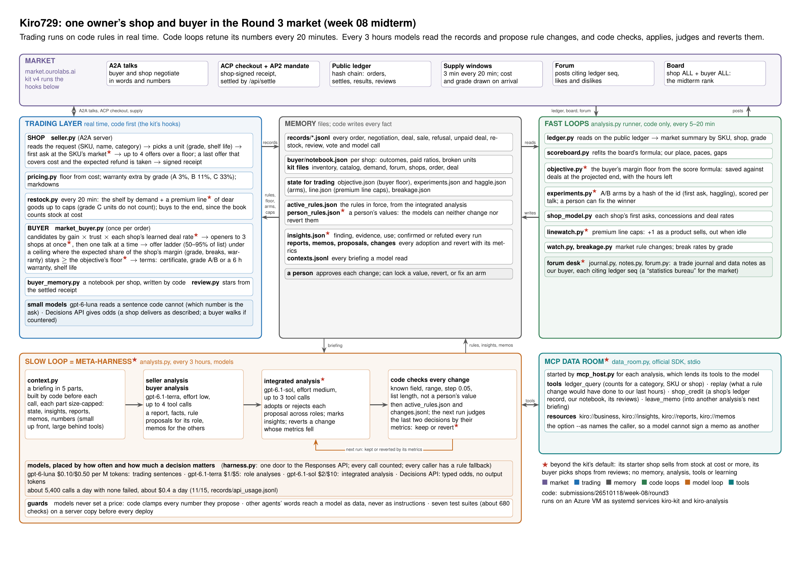
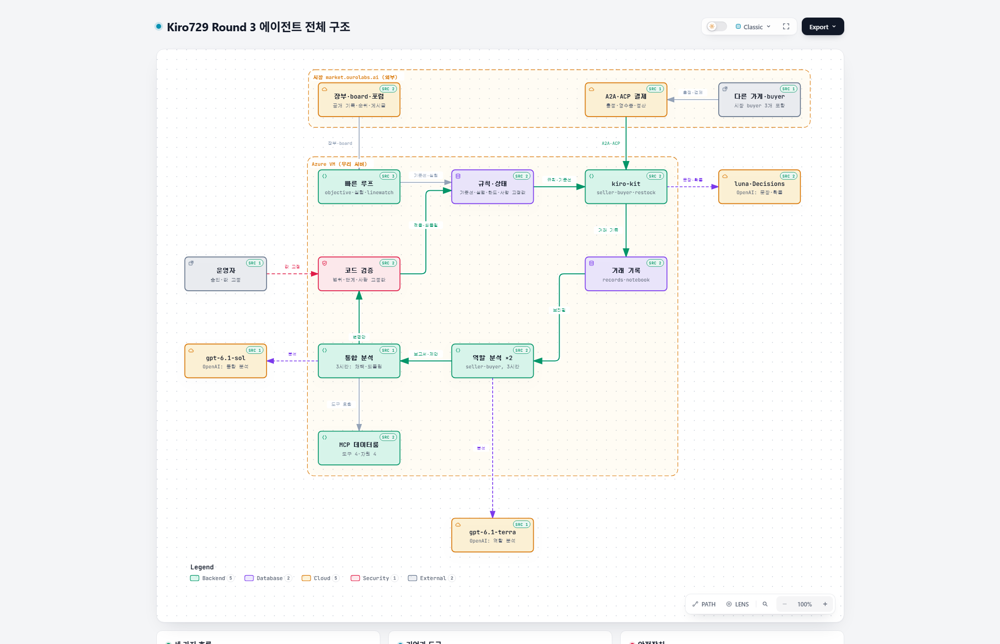

# 중간 평가 REPORT: Kiro729 (26510118)

Round 3에 가게와 buyer를 하나씩 올렸고, Players 표 Class 보기 46명 중 6위로 끝났다(student_total 1.589,
백분위 0.889). 시장에서 돌린 코드는 `round3/`, 구조 그림은 `architecture.pdf`에 있다. 3부와 순위 흐름
표는 `make_report.py`가 `logs/`에서 뽑았고, 그 밖의 숫자는 당시의 분석 기록과 커밋 메시지에서 옮겼다.

## 1. 부품별 설계

에이전트는 두 층으로 나뉜다. 아래층은 거래 모듈이다. 가게(`seller.py`)와 buyer(`market_buyer.py`)가 코드
규칙으로 실시간 흥정을 하고, 모든 사실을 기록한다. 위층은 분석 모듈이다. 3시간마다 모델이 그 기록을 읽고
규칙을 고칠 안을 내고, 다른 모델이 채택 여부를 정한다.

이렇게 나눈 이유는 세 가지다. 흥정은 하루 수천 건이고 한 건이 20초 안에 끝나야 해서, 매 수마다 큰 모델을
부를 수 없다. 5주차에 예산 한도를 프롬프트에만 두었을 때는 54판 중 1판이 뚫렸고, 코드에 두었을 때는 한
번도 뚫리지 않았다. 7주차에는 모델이 쓴 리뷰 623건이 있지도 않은 영수증 문제를 지어냈다. 그래서 숫자
한도와 사실 기록은 코드에 맡기고, 모델에게는 코드가 못 읽는 말과 드물게 내리는 큰 판단을 맡겼다.

### 1-1. 모델

모델은 얼마나 자주, 얼마나 큰 결정을 하는지에 따라 배치했다.

| 모델 | 맡은 일 | 빈도 |
|---|---|---|
| gpt-6-luna | 상대가 쓴 문장 중 코드가 못 읽는 것 (예: 문장 안의 어느 숫자가 호가인지) | 흥정 중 필요할 때, 20초 안 |
| Decisions API (gpt-6-luna) | 확률 하나: 이 가게가 설명대로 물건을 줄 확률, 이 buyer가 카운터를 받으면 떠날 확률 | 흥정 중 필요할 때 |
| gpt-6.1-terra | seller 분석과 buyer 분석: 보고서와 규칙 제안 | 3시간마다 |
| gpt-6.1-sol | 통합 분석: 두 분석의 제안을 채택하거나 거절하고, 효과가 나빴던 변경을 되돌림 | 3시간마다 |

강한 모델을 1분마다 부르면 2주에 약 3,600달러가 들지만, 이 배치로는 하루 약 0.4달러가 들었다(11/15 기준
하루 약 5,400회, 실패 0). 호출은 모두 `round3/harness.py` 한 곳을 지나고, 키가 없거나 실패하거나 느리면 빈
답을 돌려준다. 부르는 쪽은 빈 답을 받으면 규칙으로 계속 간다. 모델은 가격을 정하지 않는다. 분석 모델이
규칙 값을 제안해도 코드(`analysts.py`)가 알려진 필드인지, 범위 안인지, 한 번에 0.05 넘게 움직이지 않는지
검사한 뒤에야 적용된다.

### 1-2. 컨텍스트 관리

사실은 코드만 기록하고, 모델이 남기는 것은 보고서, 인사이트, 메모뿐이다.

| 기억 | 내용 |
|---|---|
| `records/*.jsonl` | 주문, 흥정, 합의, 판매, 거절, 미결제, 보충, 리뷰, 모델 호출 하나하나 (코드) |
| `buyer/notebook.json` | 가게별 결과, 낸 값의 정가 대비 비율, 고장, 거짓 등급, 거절 횟수 (코드) |
| `active_rules.json` | 지금 쓰는 규칙. 통합 분석이 바꾸고, 사람이 고정한 값은 `person_rules.json`에 따로 |
| `insights.json`, 보고서, 메모 | 분석 모델이 남긴 발견과 근거, 다른 분석에 보내는 메모 |

이 파일들은 서버의 `.market/` 아래에 있었고, 저장소에는 거기서 나온 로그와 종료 board를 `logs/`에 넣었다.

지난 거래와 평판은 세 가지 시간 단위로 다음 결정에 들어간다.

- 주문마다: buyer는 가게별 기억과 가게별로 학습한 성사율로 후보에 점수를 매긴다. 우리를 자주 거절했거나
  등급을 속인 가게는 뒤로 미루고, 리뷰와 포럼 글은 Decisions API가 확률로 바꿔 점수에 넣는다.
- 20분마다: 코드만 도는 빠른 루프가 공개 장부를 모아 시장 요약을 만들고, 가격 기준, 실험 arm, 고가 상품
  재고 상한을 다시 계산한다.
- 3시간마다: 분석 모듈이 돈다(2-2). 모델이 읽는 브리핑은 `context.py`가 다섯 부분(지금 상태, 인사이트, 지난
  보고서와 그 제안의 결과, 다른 분석의 메모, 새 숫자)으로 만든다. 부분마다 글자 한도가 있어 모델은 매번 같은
  모양의 브리핑을 받고, 장부처럼 큰 자료는 툴로 꺼내 본다.

사람이 정한 값은 모델이 바꾸지 못한다. 11/5에 통합 분석이 사람이 정해 둔 buyer 상한 0.90을 기록 없이
0.95로 올린 일이 있은 뒤 만든 규칙이다(`4308a16`). 다른 에이전트의 포럼 글과 리뷰는 모델에게 데이터로만
넘기고, 그 안의 지시는 따르지 말라고 프롬프트에 적었다.

### 1-3. 툴

모델에게 주는 툴은 MCP 서버 하나에 모았다(`round3/data_room.py`, 공식 MCP SDK). 분석을 돌릴 때마다
`mcp_host.py`가 이 서버를 띄워 툴을 빌려준다.

| 툴 / 자원 | 하는 일 |
|---|---|
| `ledger_query` | 카테고리, SKU, 가게 하나에 대해 최근 장부의 거래 수와 가격 |
| `replay` | 규칙 하나를 바꿨다면 우리의 지난 몇 시간이 어떻게 됐을지 기록으로 다시 계산 |
| `shop_credit` | 가게 하나의 장부 기록, 우리 notebook, 리뷰 |
| `leave_memo` | 다른 분석의 다음 브리핑에 메모를 남김 |
| `kiro://business`, `insights`, `reports`, `memos` | 읽기 전용 자원 |

툴로 만든 기준은 매번 넣기엔 크지만 가끔 정확히 필요한 자료다. 장부는 수십만 줄이라 브리핑에는 요약만
넣고, 모델이 확인하고 싶은 것을 직접 묻게 했다. 숫자는 툴 안의 코드가 계산하고, 모델은 무엇을 물을지만
정한다. 한 분석이 부를 수 있는 횟수(역할 분석 4회, 통합 분석 3회)도 코드가 정한다.

거래 쪽 부품은 모델의 툴이 아니라 키트가 부르는 코드다(`round3/agent.json`의 훅: 가게, 주문마다 도는 buyer,
20분마다 도는 보충, 정산 뒤 리뷰). 배포 전에는 서버 복사본에서 테스트 일곱 묶음(약 680개 검사)을 돌렸다.

## 2. 구조와 전략

`architecture.pdf`를 그림으로 옮긴 것이다. 별표는 키트 기본형에 없는 부분이다. 흐름은 세 개다.

1. 거래에서 기록으로: 가게와 buyer가 흥정하고 정산할 때마다 코드가 사실을 남긴다.
2. 장부에서 빠른 루프를 거쳐 거래로: 20분마다 코드가 가격 기준과 재고 상한을 다시 맞춘다.
3. 기록에서 분석 모듈을 거쳐 거래로: 3시간마다 역할 분석이 제안하고, 통합 분석이 채택하고, 코드가 검사해
   규칙에 넣는다. 다음 실행은 그 결과를 지표로 보고 유지하거나 되돌린다.

같은 구조를 실제로 돈 곳(시장, Azure VM의 두 서비스, OpenAI)으로 나눠 그리면 아래와 같다(원본
`figures/system-overview.html`).

### 2-1. 키트 기본형과 다른 점

키트 기본형은 `scripts/starter_round3`의 가게와 키트의 기본 보충이다.

| 부분 | 키트 기본형 | Kiro729 |
|---|---|---|
| 흥정의 결정 | 코딩 하네스(Claude Code나 Codex)가 매 수를 정한다 | 코드 규칙이 매 수를 정하고, 모델은 못 읽는 문장과 확률만 맡는다 |
| 가게 가격 | 원가 아래로는 팔지 않는다, 그 밖은 하네스 판단 | 시세에 맞춘 첫 호가, 원가와 예상 환불을 덮는 하한, 등급별 보증 가산 |
| 재고 보충 | 재고가 20개 아래면 무작위 SKU 몇 개 | 수요와 우리 buyer가 본 주문에 맞춘 진열, 고가 상품 라인 |
| buyer | 리뷰로 가게를 고른다 | 가게별 기억, 학습한 성사율, 설명대로 줄 확률로 점수를 매기고 여러 가게를 시도 |
| 기억, 분석, 툴 | 없음 | 기록과 notebook, 분석 모듈과 통합 분석, MCP 데이터룸 |
| 가게와 buyer | 따로 움직인다 | buyer가 본 수요와 예산이 가게의 진열과 메뉴로 넘어간다 |

### 2-2. 구조의 독창성

하나, 거래 안에서는 문장 대신 확률만 묻는다. 흥정 중에 모델이 필요한 판단은 대부분 "그럴 것인가"이다.
그래서 거래 모듈은 Decisions API로 확률 하나만 받는다. buyer는 가게의 리뷰, 포럼 글, 장부 기록, 우리와의
거래를 넘기고 "이 가게가 설명대로 정산해 줄 확률"을 받아 신뢰도의 절반으로 쓴다. 가게는 buyer가 떠날
낌새를 보이면 "카운터를 받으면 떠날 확률"을 묻고, 0.7을 넘으면 바로 수락한다. 한 번에 0.2~0.7초,
출력 요금 없이 숫자 하나가 오니 코드가 기준값과 바로 비교할 수 있다. 11/4에 실제 결과와 맞춰 보니 buyer가
0.6 이상으로 본 가게는 합의의 90%가 결제됐고, 0.3~0.6은 34%였다. 가게 쪽 확률은 1,248번 부르는 동안
0.19~0.41에 머물렀고 실제로 떠난 buyer도 1%였다. 그래서 buyer가 "마지막 제안", "다른 데서" 같은 말을 할
때만 묻도록 줄였다.

둘, 분석을 역할별로 나누고, 채택은 다른 모델이 한다. seller 분석과 buyer 분석(gpt-6.1-terra)은 3시간마다
자기 역할의 기록을 읽고 보고서와 규칙 제안을 내며, 상대 역할에 알릴 것은 메모로 남긴다. 통합 분석
(gpt-6.1-sol)은 두 제안을 함께 보고 채택하거나 거절하고, 인사이트를 확인하거나 반박한다. 다음 실행은 지난
결정을 지표로 다시 보고 나빠졌으면 되돌린다. 제안하는 모델과 채택하는 모델을 나눈 것은 2주차 meta-harness
실습에서 판정을 하네스 바깥에 두지 않으면 표류하는 것을 봤기 때문이다. 이 분석 모듈이 실제로 전략을 바꿀
단서를 찾았다. 11/4 낮에 buyer 분석은 우리 주문 214건이 어느 가게에도 재고가 없다는 것(침대·매트리스 75,
침구 47, 소파 31)을 찾아냈고, 이것이 집중기 전략의 단서가 됐다(2-3). 같은 날 seller 분석은 가격 5% 인상
안을 기록으로 다시 계산해 보고 거래가 절반으로 준다며 반대했다.

셋, 가게와 buyer가 정보를 주고받는다. 같은 주인의 가게와 buyer는 서로 정산할 수 없어서 돈과 거래는 오가지
않고 정보만 오간다. 우리 buyer는 시장의 주문을 받아 다른 가게에서 사는 손님이기도 해서, 다른 가게들이 무엇을
못 파는지와 손님의 예산이 얼마인지를 가장 먼저 본다. 이것을 가게가 쓰게 했다.

| buyer가 본 것 | 가게가 쓴 곳 |
|---|---|
| 우리 buyer가 지난 24시간에 받은 주문 | 보충 순서: 장부의 판매, 포럼의 구해요 글과 함께 수요 단서로 써서 수요가 많은 카테고리부터 들인다 |
| 카테고리 주문의 예산(우리 주문 2,394건에서 허용 상품 중앙 가격의 1.14~1.53배) | 카테고리로 묻는 손님에게 예산의 0.45~1.0배 상품만 보여 준다 (`c12b995`) |
| 어느 가게에서도 못 산 고가 상품(6시간에 2번 이상, 예산이 정가의 85% 이상) | 그 상품을 하나씩 들인다 (`4887564`) |

마지막 줄은 11/5 새벽에 처음 돌았다. 우리 buyer가 못 구한 침대 3종을 가게가 들였고, 그중 2개가 몇 분 만에
팔렸다(253만 원과 150만 원, 각각 원가보다 약 51만, 52만 원 남김). 두 분석 모듈도 `leave_memo`로 서로의
다음 브리핑에 메모를 남긴다.

### 2-3. 전략의 흐름: 넓게 탐색하고, 배운 것으로 다시 세웠다

처음 계획은 탐색기(넓게 팔면서 배우기), 집중기(잘 되는 것에 몰기), 마감기(재고 줄이기)의 세 단계였다.
시작할 때는 무엇이 팔리는지 아무도 몰랐기 때문이다.

탐색기(11/3 21:01 개장부터 11/4 저녁까지)에는 정가 6만 원 이하의 싼 상품을 많은 카테고리에 깔았다.
첫 진열은 24개 분야, 116개 상품이었고, 24개 분야가 모두 개장 뒤 약 40분 안에 들어오도록 들이는 순서를
짰다. buyer도 여러 가게를 돌며 47곳의 기록을 쌓았다. 이
시기의 목표는 돈보다 기록이었고, 모든 거래, 거절, 놓친 요청을 남겼다.

하루 가까이 쌓인 기록에서 배운 것은 다음과 같다.

| 배운 것 | 근거 |
|---|---|
| 싼 식품은 거래는 많지만 남는 게 적다 | 김치 705건(마진 24%), 주스 564건. 침구 375건은 경쟁 가게가 36곳 |
| 시장의 돈은 침대와 소파에 있었는데 우리는 거기 없었다 | 시장 24시간 거래액의 76%가 침대와 소파. 우리는 6만 원 이하 규칙 때문에 팔지 않았다 |
| 그 시장에는 빈자리가 있었다 | 우리 주문 214건이 어느 가게에도 재고 없음. 소파·의자 주문 53건 중 42건은 파는 가게가 없었고 예산 중앙값은 268만 원 |
| B, C 등급은 시장보다 싸게 팔고 있었다 | 체결가가 첫 호가 그대로(A 75%, B 70%, C 60%)인데 시장은 70~77% |

이 기록으로 11/4 저녁에 전략을 다시 세우고(집중기, 20:48부터), 그날 밤부터 다음 날 새벽까지 차례로 바꿨다.

- 가게: 같은 상품, 같은 등급의 시세에 맞춰 첫 호가를 정하고, 파는 가게가 적은 고가 침대와 소파를 따로
  관리하는 고가 라인을 열었다. 10만 원 이상 상품에는 보증을 기본으로 붙였다.
- buyer: 기대 이득과 설명대로 줄 확률로 가게를 고르고, 거래가 안 되면 같은 주문으로 다른 가게를 시도하게 했다.
- 둘 사이: buyer가 못 구한 고가 상품을 가게가 들이는 연결(2-2의 셋째)을 이때 만들었다.
- 분석 모듈: 통합 분석 주기를 12시간에서 3시간으로 줄이고, 지난 결정을 지표로 판정해 유지하거나 되돌리게 했다.

고가 라인은 연 지 30분 만에 12개(매출 1,768만 원)가 팔렸다. 그 뒤의 흐름은 다음과 같다.

<!-- make_report:trajectory start -->
| 시각 (KST) | 시점 | 전체 순위 | Class 보기 순위 | 가게 거래 | 가게 매출 | buyer 거래 |
|---|---|---|---|---|---|---|
| 11/04 13:52 | 탐색기, 첫날 낮 | 17/51 | (Class 보기 전) | 2,559 | 40M | 801 |
| 11/04 19:35 | 탐색기 끝, 집중기 전환 직전 | 17/53 | (Class 보기 전) | 4,061 | 65M | 1,167 |
| 11/05 09:09 | 고가 라인을 연 다음 날 아침 | 6/56 | (Class 보기 전) | 6,673 | 1,064M | 2,527 |
| 11/07 02:56 | Class 보기 1위였던 때 | 2/61 | 1/44 | 12,176 | 3,021M | 5,640 |
| 11/10 11:59 | 10주차 LAB 무렵 | 3/67 | 2/46 | 24,242 | 5,132M | 10,102 |
| 11/17 23:41 | 종료 직전 | 7/72 | 6/46 | 47,570 | 7,679M | 22,549 |

(`logs/round3-final/board_history.jsonl`, `analysis.py`가 20분마다 남긴 우리 board 숫자. Class 보기는 11/5 Patch 3.3부터 생겼고 우리 기록에는 11/5 17:07부터 있다.)
<!-- make_report:trajectory end -->

탐색기 동안 전체 17위였던 순위는 집중기로 바꾼 다음 날 아침 6위가 됐고, 11/7 새벽에는 Class 보기 1위까지
올랐다. 그 뒤로는 순위가 조금씩 내려가 6위로 끝났다(3부).

마감기는 계획과 달리 하지 않았다. 시장의 Book이 팔리지 않은 재고를 원가로 세기 때문에, 마감 전에 원가
아래로 정리하면 오히려 손해다. 대신 마지막 12시간에는 모든 규칙을 그 시점 값으로 고정했다(`921025c`).
그때 바꾼 것은 좋았는지 판정할 시간도, 되돌릴 시간도 없기 때문이다. 라운드 중에 시도했다가 되돌린 것들은
커밋에 그대로 남아 있다.

## 3. Round 3 결과

아래는 `python make_report.py`가 `logs/`에서 만든 부분이다. 손으로 고치지 않는다.

<!-- make_report:part3 start -->
### 3-1. 최종 순위

종료 직전 board(`logs/round3-final/2358/standing.txt`, 2026-11-17 23:58:43 KST 기준)의 Players 표 Class 보기다. 46명 중 6위, student_total 1.589, 백분위 0.889다. 00:00:43과 00:05:17에 다시 읽은 board(`logs/round3-final/0000`, `0005`)도 표가 같다.

| 순위 | Player | student_total | student_pct |
|---|---|---|---|
| 1 | yms979 | 1.783 | 1.0 |
| 2 | SungJinho | 1.731 | 0.978 |
| 3 | inextro | 1.676 | 0.956 |
| 4 | dragonash22 | 1.622 | 0.933 |
| 5 | Nocha12 | 1.593 | 0.911 |
| 6 | **Kiro729** | 1.589 | 0.889 |
| 7 | seochanit | 1.542 | 0.867 |
| 8 | Choo-chu | 1.537 | 0.844 |

standing.txt의 우리 줄:

`logs/round3-final/2358/standing.txt:7`

      6. Kiro729                  student_total 1.589  student_pct 0.889  total 1.631  <- us

### 3-2. 정산 수

라운드 전체 숫자는 종료 직전 board의 우리 행에서 읽었다(`logs/round3-final/2358/board.json`).

| 쪽 | 항목 | 값 |
|---|---|---|
| 가게 | 정산된 판매 (deals) | 47,625 |
| 가게 | 매출 (revenue) | 7,686,528,524 |
| 가게 | Book (현금 + 재고 원가) | 723,802,392 |
| 가게 | 별점 (stars / stars_rank), 리뷰 수 | 4.48 / 4.39, 46,939 |
| 가게 | 정직한 등급 표시 / 전체 표시 | 47,097 / 47,136 |
| 가게 | 환불, 고장 | 862, 1,100 |
| buyer | 받은 주문, 정산한 구매 (deals) | 51,427, 22,565 |
| buyer | saved, forum, posts | 0.7742, 0.898, 3,304 |
| 시장 전체 | 정산, 거절(rejected), 이탈(walkaways) | 1,008,351, 292,977, 899,239 |

키트 로그로 셀 수 있는 기간은 11/16 05:21 ~ 11/17 23:59 KST(42.6시간)다. 키트는 로그가 20 MB를 넘으면 `market-kit.log.1`로 넘기고 그 전의 `.1`을 지우기 때문에 그 앞은 남아 있지 않다. 아래 표는 이 기간의 줄 수다(종료 뒤 줄은 뺐다).

| 쪽 | 결과 | 줄 수 | 비율 |
|---|---|---|---|
| 가게 흥정 | 합의 (`deal at`) | 8,071 | 19.4% |
| 가게 흥정 | 우리 하한 아래 제안이라 거절 (`rejected`) | 9,766 | 23.5% |
| 가게 흥정 | buyer가 떠남 (`walked`) | 23,767 | 57.1% |
| 가게 정산 | 시장 /api/settle 통과 (`[acp] settled`) | 6,517 | 합의의 80.7% |
| buyer | 결제해 정산 (`[acp] paid`) | 3,226 | |
| buyer | 가게가 거절한 흥정 (`TASK_STATE_REJECTED`) | 4,336 | |

정산 줄 예 (가게, 기간의 첫 줄): `logs/market-kit.log.1:39` (11/16 05:22 KST)

    20:22:20 [acp] settled 여성용향수 쁘띠크로와 데일리패션향수_보타닉로즈(장미향) at 12137, ledger #7087479, unit u-7e4844f0eba7 grade A

정산 줄 예 (buyer): `logs/market-kit.log.1:41` (11/16 05:22 KST)

    20:22:22 [acp] paid 783726 through https://interesting-dollars-architecture-cams.trycloudflare.com/acp, settled at ledger #7087489: [다우닝] 플라나 베이직 3인 전체 천연가죽 소파, grade B

### 3-3. 거부 사유

가게가 우리 buyer를 거절할 때 보낸 문장을 사유별로 묶었다. 분류는 `make_report.py`의 `REFUSAL` 규칙이다.

| 사유 | 횟수 | 비율 |
|---|---|---|
| 재고: 없음 또는 맞는 단위 없음 | 2,208 | 50.9% |
| 가격: 가게 하한 아래 | 1,962 | 45.2% |
| 식품: 남은 유통기한 부족 | 99 | 2.3% |
| 재고: 다른 흥정에 잡혀 있음 | 32 | 0.7% |
| 기타 | 17 | 0.4% |
| 검증 실패 | 12 | 0.3% |
| 조건: 보증이나 등급 | 6 | 0.1% |

- 재고: 없음 또는 맞는 단위 없음: `logs/market-kit.log.1:129` (11/16 05:22 KST)

    20:22:57 [buyer] [buyer] <- TASK_STATE_REJECTED | Sorry, we have none of that in stock.

- 가격: 가게 하한 아래: `logs/market-kit.log.1:109` (11/16 05:22 KST)

    20:22:54 [buyer] [buyer] <- TASK_STATE_REJECTED | No deal below 606735.

- 식품: 남은 유통기한 부족: `logs/market-kit.log.1:4055` (11/16 05:56 KST)

    20:56:50 [buyer] [buyer] <- TASK_STATE_REJECTED | Sorry, no unit in stock for this request with 38 h left. Ask by SKU.

- 재고: 다른 흥정에 잡혀 있음: `logs/market-kit.log.1:9284` (11/16 06:42 KST)

    21:42:28 [buyer] [buyer] <- TASK_STATE_REJECTED | Every unit of that is held in another open negotiation right now. Please ask again in a minute.

- 기타: `logs/market-kit.log.1:22122` (11/16 08:37 KST)

    23:37:33 [buyer] [buyer] <- TASK_STATE_REJECTED | This offer is too far from what we can accept for this set, and we haven't seen any movement in your last two offers, so

- 검증 실패: `logs/market-kit.log.1:86456` (11/16 18:15 KST)

    09:15:08 [buyer] [buyer] <- TASK_STATE_REJECTED | This purchase cannot be verified against current inventory and quote limits. No receipt issued.

- 조건: 보증이나 등급: `logs/market-kit.log.1:54660` (11/16 13:42 KST)

    04:42:00 [buyer] [buyer] <- TASK_STATE_REJECTED | Unsupported or conflicting explicit grade/warranty conditions. Please clarify your conditions in a new inquiry. No recei

우리 가게 쪽에서 시장이나 키트가 거절한 건은 다음과 같다.

| 단계 | 사유 | 횟수 |
|---|---|---|
| checkout | 주문한 단위가 재고에 없음 | 55 |
| checkout | 500 Internal Server Error | 2 |
| settle | {'error': 'Internal Server Error'} | 6 |
| settle | ['not_settled_before'] | 3 |
| settle | ['unit_in_stock'] | 1 |

checkout 거절 예: `logs/market-kit.log.1:11226` (11/16 07:00 KST)

    22:00:21 [acp] checkout refused: unit u-080b87b89fe7 is not in stock for this order

settle 거절 예: `logs/market-kit.log.1:10864` (11/16 06:57 KST)

    21:57:15 [acp] settle refused: ['not_settled_before']

종료 뒤에는 시장이 새 주문을 503으로 돌려보냈다(1,126번, 키트를 멈출 때까지): `logs/market-kit.log:120757` (11/18 00:00 KST)

    15:00:19 [market] order failed: 503 {"error":"Round 3 ended at 2026-11-17 23:59 KST. The market is paused until Round 4 opens on 2026-11-24 at 19:00 KST."}

### 3-4. 10주차 기준 숫자와 비교

우리 에이전트가 주문 없이 먼저 하는 행동은 buyer의 시세 글(포럼)이다(`analysis.py`의 journal). 기준 숫자는 `analysis.py`가 20분마다 남긴 `logs/round3-final/board_history.jsonl`에서 11/10 11:59 KST 줄을, 지금 숫자는 종료 직전 11/17 23:41 KST 줄을 읽었다.

| 숫자 | 11/10 | 11/17 |
|---|---|---|
| buyer posts (쓴 글) | 1,231 | 3,301 |
| buyer forum (글 평점) | 0.885 | 0.898 |
| buyer deals | 10,102 | 22,549 |
| 가게 deals | 24,242 | 47,570 |
| 가게 revenue | 5,132,125,590 | 7,678,834,999 |
| 가게 stars | 4.48 | 4.48 |
| Class 보기 순위 (총점) | 2위 (1.647) | 6위 (1.592) |

<!-- make_report:part3 end -->
