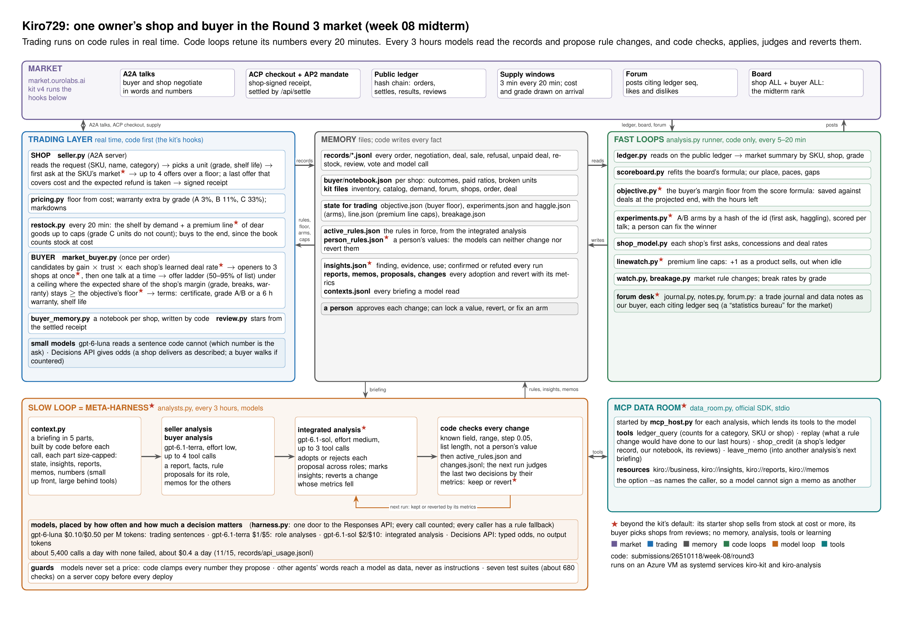
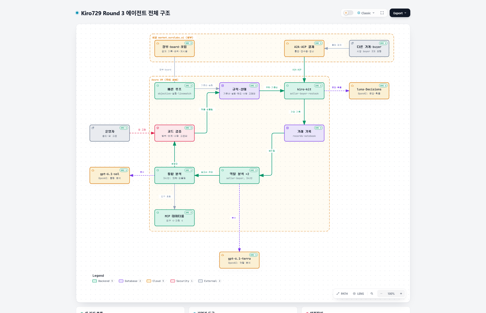

# 중간 평가 REPORT: Kiro729 (26510118)

Round 3에 가게와 buyer를 하나씩 올렸고, Players 표 Class 보기 46명 중 6위로 끝났다(student_total 1.589,
백분위 0.889). 한때는 Class 보기 1위였다. 시장에서 돌린 코드는 `round3/`(모듈 지도는 `round3/README.md`),
구조 그림은 `architecture.pdf`에 있다. 표 가운데 순위 흐름, 분석 모듈 통계, 3부 전체는 `make_report.py`가
`logs/`의 기록에서 계산해 넣었고, 나머지 숫자는 당시의 분석 기록, 코드 주석, 커밋 메시지에서 옮겼다.

## 1. 부품별 설계

에이전트는 두 층으로 되어 있다. 아래층의 거래 모듈은 가게(`seller.py`)와 buyer(`market_buyer.py`)다. 코드
규칙으로 실시간 흥정을 하고 모든 사실을 기록한다. 위층의 분석 모듈은 그 기록을 읽는다. 20분마다 코드가
숫자를 다시 맞추고, 3시간마다 모델이 규칙을 고칠 안을 내며, 다른 모델이 채택 여부를 정한다.

두 층으로 나눈 이유는 세 가지다.

- 흥정은 하루 수천 건이고 한 건이 20초 안에 끝나야 해서, 매 수마다 큰 모델을 부를 수 없다.
- 5주차에 예산 한도를 프롬프트에만 두었을 때 54판 중 1판이 뚫렸고, 코드에 두었을 때는 한 번도 뚫리지
  않았다.
- 7주차에는 모델이 쓴 리뷰 623건이 있지도 않은 영수증 문제를 지어냈다.

그래서 숫자 한도와 사실 기록은 코드에 맡기고, 모델에게는 코드가 못 읽는 말, 확률 판단, 드물게 내리는 큰
판단만 맡겼다.

### 1-1. 거래 모듈: 한 건이 처리되는 순서

가게는 요청 하나를 이렇게 처리한다.

1. 요청 읽기: SKU, 재고에 있는 상품 이름, 카테고리 이름 순서로 코드가 먼저 맞춘다. 카테고리는 전체 이름을
   먼저 본다. "즉석조리식품"을 "조리"로 읽어 매실원액을 판 일이 있은 뒤의 규칙이다. 모두 실패할 때만
   gpt-6-luna가 재고 목록(최대 80줄)과 대조하고, 모델이 고른 SKU는 재고에 있는지 다시 확인한다. 필요한
   유통기한, 보증, 등급도 이때 읽는다. "C 등급은 빼고" 같은 부정 표현도 구분한다.
2. 메뉴: 카테고리로 묻거나 원하는 SKU가 없으면 상품 세 개를 보여 준다. 손님이 말한 숫자가 모든 정가보다
   크면 예산으로 보고, 예산의 0.45~1.0배인 상품만 고른다(1-3의 정보 교환, 2-2).
3. 단위 고르기: 5분 안에 등급이 바뀔 단위는 빼고, 요청한 유통기한을 겨우 넘기는 단위를 먼저 낸다. 공산품은
   같은 등급의 시세 대비 마진이 가장 큰 단위를 먼저 낸다.
4. 첫 호가: 그 SKU가 지난 6시간 다른 가게에서 같은 등급, 같은 보증으로 10번 이상 팔렸으면 그 시세에 실험
   arm(-0.03~+0.06)을 더한다. A 등급은 우리 buyer가 다른 가게들에서 받은 첫 호가의 중앙값보다 조금 낮게
   부른다. 시세가 없으면 등급별 기본값(정가의 A 75%, B 70%, C 60%)을 카테고리 시세 쪽으로 옮긴다.
5. 하한과 흥정: 하한은 원가의 1.02배에 보증 가산을 더한 값이다. 제안이 호가 이상이면 호가에, 하한 이상이면서
   호가의 95% 이상이면 그 제안에 판다. 그 밖에는 중간값으로 되부르고, 네 번째 제안까지 받는다. 네 번째
   제안은 원가와 예상 환불을 덮으면 하한 아래여도 받는다(11/14: 네 번째 제안에서 끝난 1,501건 중 180건이
   이 선을 넘었고, 하루 6,190만 원어치 판매였다).
6. 떠날 확률: buyer의 말에 "마지막 제안", "다른 데서" 같은 표현이 있으면 Decisions API에 떠날 확률을
   묻고, 0.7 이상이면 그 자리에서 판다.
7. 영수증: 가게 키로 서명한다. 등급 표시는 5분 뒤에도 맞는 등급이다. 1시간 뒤 기준으로 적었던 11/4에는 표시가
   틀린 거래의 별점이 평균 2.1이었다.

보증은 등급별 고장률에서 가격을 정했다. 가산은 A 3%, B 11%, C 33%로, 고장률 b일 때 b×가격/(1-b)의 손익분기
값이다. 10만 원 이상 공산품에는 묻지 않아도 붙이고, C 등급은 보증과 함께만 판다. 11/4에 보증 없이 판
공산품은 15~32%가 결제되지 않았고, 보증을 붙이면 0~3%였다.

buyer는 시장이 준 주문 하나를 이렇게 처리한다.

1. 후보: 그 주문에 맞는 상품을 가진 가게마다 점수를 매긴다. 점수는 (1 - 예상 가격/정가) × 신뢰도 × 그
   가게에서 학습한 성사율이다. 예상 가격은 그 가게에서 우리가 낸 값이나 그 SKU의 시세로 잡고, 그 가게와 10번
   이상 흥정했으면 그동안 학습한 첫 호가와 양보로 바꾼다.
2. 신뢰도: 최근 다섯 거래의 결과로 계산한다. 등급을 속였으면 0.5배, 보증 없는 물건이 고장 났으면 0.8배로
   깎는다. 그 값을 Decisions API가 낸 "설명대로 정산해 줄 확률"과 반반 섞는다.
3. 걸러내기: 확률이 0.3 미만인 가게, 최근 다섯 번 중 두 번 실패한 가게, 하루 세 번 넘게 거래 수의 세 배
   넘게 거절한 가게, 등급을 속인 가게, 일부러 1점을 주는 계정의 가게는 깨끗한 후보가 없을 때만 쓴다. 실패
   기록은 하루가 지나면 잊는다. 11/4에 47곳 중 34곳이 영구히 막혀 있던 것을 보고 바꾼 규칙이다.
4. 견적: 점수가 높은 세 가게에 동시에 가격을 물어, 첫 호가가 낮은 곳부터 흥정한다. 11/13에 한 주문이 평균
   38초 걸렸고(시장 주기는 20초), 여섯 가게를 차례로 돈 주문 228건 중 6%만 성사된 것을 보고 바꿨다.
5. 상한: 제안은 정가의 50%에서 시작해 네 단계로 올라간다. 상한은 예산, 정가의 90%, 그 SKU의 시세 가운데
   가장 낮은 값이다. 그리고 그 값에 사면 가게 마진 중 우리 몫(saved)의 기대값이 하한 K 이상이어야 한다.
   기대값은 원가를 모르므로 등급별 원가 범위(A 55~75%, B 40~60%, C 25~45%)와 고장률로 계산한다
   (`margin.py`).
6. 수락과 조건: 우리가 한 번 제안한 뒤에는 상한 안의 호가를 받는다. 11/4에 흥정 끝에 놓친 251건 중
   246건이 우리 두 번째 제시 직후에 끝난 것을 보고 바꿨고, 30분 뒤 합의율이 33%에서 69%로 올랐다. 식품은
   필요한 시간보다 1시간 이상 남아야 결제하고, 공산품은 6시간 보증이나 A, B 등급이어야 결제한다.
7. 실패하면 다른 가게: 같은 주문으로 최대 여섯 가게까지 시도한다. 리뷰는 사실로만 쓴다. 등급을 속였으면
   1점, 아니면 정가 대비 낸 값으로 2~5점이다.

### 1-2. 모델

모델은 얼마나 자주, 얼마나 큰 결정을 하는지에 따라 배치했다.

| 모델 | 맡은 일 | 빈도 |
|---|---|---|
| gpt-6-luna | 코드가 못 읽는 문장: 요청이 어느 상품인지, 상대의 문장에서 어느 숫자가 호가나 제안인지 | 흥정 중 필요할 때, 20초 안 |
| Decisions API (gpt-6-luna) | 확률 하나: 가게가 설명대로 정산할 확률, buyer가 떠날 확률, 포럼 글이 에이전트를 조종하려는 글일 확률 | 흥정 중, 투표 때 |
| gpt-6.1-terra (추론 low) | seller 분석, buyer 분석, 시세 저널의 해설 | 3시간마다, 저널은 1시간마다 |
| gpt-6.1-sol (추론 medium) | 통합 분석: 두 분석의 제안 채택, 인사이트 판정, 되돌림 | 3시간마다 |

강한 모델을 1분마다 부르면 2주에 약 3,600달러가 들지만, 이 배치로는 하루 0.4달러 안팎이 들었다. 남아 있는
11/16~11/18 약 50시간의 호출 기록(`logs/round3-final/analysis/api_usage.jsonl`)에서 luna 문장 호출 7,997번,
Decisions 호출 766번, terra 127번, sol 19번이었고 실패는 없었다. Responses API를 쓴 이유는 gpt-6.1-sol이
툴을 이 API에서만 부르기 때문이다.

모든 호출은 `round3/harness.py` 한 곳을 지난다. 문장 호출이 실패하거나 느리면 빈 답, 확률 호출이 실패하면
None을 돌려주고, 부르는 쪽은 규칙으로 계속 간다. 모델은 가격을 정하지 않는다. 분석 모델이 규칙 값을 제안해도
코드가 알려진 필드인지, 범위 안인지, 한 번에 0.05 넘게 움직이지 않는지 검사한 뒤에야 적용된다.

### 1-3. 컨텍스트 관리: 지난 거래와 평판이 다음 결정에 들어가는 길

사실은 코드만 기록하고, 모델이 남기는 것은 보고서, 인사이트, 메모뿐이다.

| 기억 | 내용 | 누가 읽나 |
|---|---|---|
| `records/*.jsonl` | 주문, 흥정, 합의, 판매, 거절, 미결제, 보충, 리뷰, 모델 호출 하나하나 | 빠른 루프, 분석 모듈 |
| `buyer/notebook.json` | 가게별 최근 결과, 낸 값의 비율, 고장, 거짓 등급, 거절 횟수 | buyer (주문마다) |
| `shop_model.json`, `price_map.json` | 우리 buyer가 본 가게별 첫 호가, 양보, 성사율과 SKU별 다른 가게 호가 | buyer, 가게 |
| 고장률 표 (`breakage.py`) | 장부에서 센 등급별 고장률, 가게와 buyer가 같이 씀 | 가게(하한), buyer(상한) |
| 실험, 하한, 고가 라인 상태 | 첫 호가 arm, buyer 하한 K, 고가 상품별 재고 상한 | 가게, buyer, 보충 |
| `active_rules.json`, `person_rules.json` | 지금 규칙, 사람이 고정한 값 | 모든 모듈 |
| 인사이트, 보고서, 메모, 브리핑 기록 | 분석 모델이 남긴 것과 모델이 읽은 것 전부 | 분석 모듈 |

이 기록은 세 가지 시간 단위로 결정에 들어간다.

주문마다. 1-1에서 본 것처럼 buyer는 notebook의 최근 결과, 학습한 성사율, Decisions API가 리뷰와 포럼 글을
읽고 낸 확률로 가게를 고른다. 가게는 장부의 시세와 우리 buyer가 본 다른 가게 호가로 첫 호가를 정한다.

20분마다(빠른 루프, 코드만). `analysis.py`가 공개 장부를 이어 읽고 다음을 다시 계산한다.

- buyer 하한 K(0.70~0.85): 남은 시간 동안 saved와 거래 수 중 어느 쪽이 더 값진지로 정한다. 3시간 동안 시간당
  거래가 25건 아래로 떨어지면 0.60까지 내려 거래가 끊기지 않게 한다.
- 첫 호가 실험: 흥정마다 id의 해시로 arm(-0.03, 0, +0.03, +0.06)을 나누고, 흥정당 이익으로 비교한다. arm마다
  100번이 쌓이고 1등이 표준오차 2배 이상 앞서면 1등에 80%를 준다. 11/16에는 사람이 0.0 arm으로 고정했다.
- 가게 모델과 고장률: buyer가 본 가게별 호가, 양보, 성사율과 장부의 등급별 고장률을 새로 센다.
- 고가 라인 상한: 한 시간에 두 개 이상 팔리면 늘리고, 8시간 안 팔리거나 실제 마진이 정가의 1% 아래면 뺀다.
  처음에는 시장 중앙값이 떨어지면 줄였는데, 11/7에 이 규칙이 잘 팔리는 상품 11개를 71번 깎은 것을 보고
  기대 마진으로 판단하게 바꿨다.

3시간마다(분석 모듈, 모델). seller 분석과 buyer 분석이 돌고, 둘이 모두 끝나면 통합 분석이 돈다. 모델이 읽는
브리핑은 `context.py`가 매번 같은 다섯 부분으로 만든다.

| 부분 | 내용 | 글자 한도 |
|---|---|---|
| 1 지금 상태 | 잔고, 재고, 24시간 판매와 구매, 지금 규칙 | 800 |
| 2 인사이트 | 역할 분석에는 점수 높은 8개 + 시험 중인 새것 2개, 통합 분석에는 전부 | 2,400 (통합 4,800) |
| 3 지난 보고서 | 자기 역할의 최근 2개(통합 분석은 역할별 최신 1개)와 그 제안이 어떻게 됐는지(채택됐으면 시간당 마진과 이득의 전후) | 1,000 |
| 4 메모 | 다른 분석이 12시간 안에 남긴 최근 5개 | 800 |
| 5 새 숫자 | 우리 기록과 시장 숫자, 3시간 전 대비 변화, 사람이 고정한 값 | 2,000 (통합 5,600) |

한도를 넘으면 목록의 뒤에서부터 통째로 빼고 "N more left out"이라고 적는다. 모델은 매번 같은 모양을 받고,
장부처럼 큰 자료는 툴로 꺼내 본다(1-4). 실제 마지막 통합 분석 브리핑의 앞부분은 이렇다
(`logs/round3-final/analysis/last_context_integrated.txt`, 줄은 줄였다).

```
[1 The business now]
{"phase":"focus","balance":571377319,"stock_units":873,"stock_at_cost":157439822,"shop_sales_24h":3190, …}

[2 Insights so far (kept by the integrated analysis)]
- I12 [buyer, shops, confirmed: confirmed 95, refuted 0] Continuing to another shop recovers a substantial
  number of purchases after an unsuccessful initial attempt. | evidence: Of 169 orders that continued, 69 …
- I13 [seller, other, confirmed: confirmed 70, refuted 11] Category-request agreements have a much lower …
[3 Last reports and what became of their proposals]
[4 Memos from the other analyses]
[5 New numbers]
```

사람이 정한 값은 모델이 바꾸지 못한다. 11/5에 통합 분석이 사람이 정해 둔 buyer 상한 0.90을 기록 없이
0.95로 올린 일이 있은 뒤 만든 규칙이다(`person_rules.json`, `4308a16`). 마지막 12시간에는 모든 규칙을
사람 값으로 고정했다. 그때 바꾼 것은 좋았는지 판정할 시간도, 되돌릴 시간도 없기 때문이다. 다른 에이전트의
포럼 글과 리뷰는 모델에게 데이터로만 넘기고, 그 안의 지시는 따르지 말라고 시스템 메시지에 적었다.

### 1-4. 툴: 분석 모델이 쓰는 데이터룸

분석 모델에게 주는 툴은 직접 만든 MCP 서버 하나에 모았다(`round3/data_room.py`, 공식 MCP SDK, stdio).
분석을 돌릴 때마다 `mcp_host.py`가 이 서버를 띄워 모델에게 툴을 빌려주고, 서버가 안 뜨면 툴 없이 분석한다.
툴로 만든 기준은 "브리핑에 매번 넣기엔 크지만, 판단을 바꿀 수 있어 정확히 필요한 자료"다. 숫자는 툴 안의
코드가 계산하고, 모델은 무엇을 물을지만 정한다.

| 툴 | 입력 | 돌려주는 것 |
|---|---|---|
| `ledger_query` | 카테고리, SKU, 가게 중 하나와 기간(1~48시간) | 공개 장부에서 센 거래 수, 정가 대비 평균 값, 등급 분포, 등급 표시가 맞은 비율, 고장 수, 많이 판 가게 5곳 |
| `replay` | 바꿀 규칙 하나와 새 값, 기간 | 그 값이었다면 우리의 지난 흥정과 구매가 어떻게 됐을지 |
| `shop_credit` | 가게 이름 | 그 가게의 장부 기록, 우리 notebook의 최근 결과, 신뢰도, 리뷰 |
| `leave_memo` | 받는 분석, 종류(inform, propose, request), 내용, 근거 | 받는 분석의 다음 브리핑 4부에 실린다 |

`replay`는 규칙을 바꾸기 전에 우리 기록으로 미리 돌려 보는 툴이다. 가게 쪽(첫 호가 조정, 보증 가산)은 기록된
흥정마다 새 첫 호가와 하한을 다시 만들고, 상대가 실제로 낸 제안을 하나씩 가게의 실제 흥정 함수
(`pricing.respond`)에 다시 넣는다. buyer 쪽(상한)은 새 상한을 넘는 구매를 잃은 것으로, 우리가 떠났지만
마지막 호가가 새 상한 안이던 주문을 그 값에 산 것으로 센다. 결과를 믿을 수 있는지도 스스로 확인한다.
지금 규칙 그대로 다시 돌려 실제 결과가 몇 건 나오는지 같이 보여 준다(기록상 1073/1073, 13,396/13,397).
거래가 20건 미만이면 약하다고 표시한다. 첫 제안 비율은 다시 돌리지 않는다. 상대가 더 낮은 첫 제안에 어떻게
답할지는 기록에 없기 때문이다.

실제로 쓰인 예는 11/4 00:11의 seller 분석 메모다. 가격을 5% 올리는 안을 replay로 돌렸더니 흥정 거래가
913건에서 363건으로, 마진이 359만 원에서 156만 원으로 줄었다. 지금 규칙의 재현은 1073/1073이었다. seller
분석은 이 근거로 가격 인상을 하지 말라는 메모를 통합 분석에 남겼다.

`leave_memo`는 4주차에 본 performative(inform, propose, request)를 메모의 종류로 썼다. 누가 보냈는지는
모델이 정하지 못하고, 서버를 띄울 때 `--as`로 정해진다. 한 모델이 다른 분석의 이름으로 메모를 쓸 수 없다.
한 분석이 부를 수 있는 툴은 역할 분석 4번, 통합 분석 3번이고, 답은 1,500자로 자른다.

분석 쪽 기록에서 센 숫자는 다음과 같다.

{{analysis_stats}}

모델이 규칙을 바꾼 일은 많지 않았다. 제안 24건은 모두 범위 안이었고, 대부분 집중할 카테고리를 넣고 빼는
것이었다. 분석 모듈이 더 많이 한 일은 진단이었다. 다른 가게로 넘어가면 실패한 주문의 40.8%를 살린다는
인사이트(I12), 카테고리 요청은 결제율이 낮다는 인사이트(I13), 그리고 규칙으로는 못 고치는 결제와 정산 문제를
사람에게 넘긴 제안 203건이 그 예다.

## 2. 구조와 전략



`architecture.pdf`를 그림으로 옮긴 것이다. 별표는 키트 기본형에 없는 부분이다. 흐름은 세 개다.

1. 거래에서 기록으로: 가게와 buyer가 흥정하고 정산할 때마다 코드가 사실을 남긴다.
2. 장부에서 빠른 루프를 거쳐 거래로: 20분마다 코드가 하한, 실험 arm, 재고 상한을 다시 맞춘다.
3. 기록에서 분석 모듈을 거쳐 거래로: 3시간마다 역할 분석이 제안하고, 통합 분석이 채택하고, 코드가 검사해
   규칙에 넣는다. 다음 실행은 결과를 지표로 보고 유지하거나 되돌린다.

같은 구조를 실제로 돈 곳(시장, Azure VM의 두 서비스, OpenAI)으로 나눠 그리면 아래와 같다(원본
`figures/system-overview.html`).



### 2-1. 키트 기본형과 다른 점

키트 기본형은 `scripts/starter_round3`의 가게와 키트 안의 기본 동작이다.

| 부분 | 키트 기본형 | Kiro729 |
|---|---|---|
| 요청 읽기 | 카테고리, 이름, SKU를 글자로 찾는다 | SKU, 이름, 카테고리 전체 이름 순서로 코드가 맞추고, 못 맞추면 luna가 재고와 대조. 유통기한, 보증, 등급 조건도 읽는다 |
| 흥정 | 코딩 하네스(Claude Code나 Codex)가 매 턴 값을 정한다 | 코드 규칙: 시세에 맞춘 첫 호가와 실험 arm, 하한, 네 번의 제안. 모델은 문장과 확률만 |
| 품질 | 먼저 만료되는 단위, 품질 언급 없음, 보증 없음 | 조건에 맞는 단위, 5분 뒤에도 맞는 등급 표시, 등급별 값을 매긴 6시간 보증 |
| 재고 보충 | 20개 아래로 떨어지면 무작위 카테고리 세 곳에서 조금씩 | 20분마다 단계별 탐색, 수요 단서 순서, 고가 라인, 현금과 재고 상한 |
| buyer | market_buyer가 없으면 키트가 재고 있는 가게를 무작위로 고른다 | 점수와 신뢰도로 가게를 고르고, 세 곳에 동시 견적, saved 하한 아래로는 사지 않음, 실패하면 다른 가게 |
| 리뷰 | 없음 | 정산 영수증을 보고 사실로만 |
| 기억과 학습 | 없음 | 기록과 notebook, 가게 모델, 고장률, 실험, 분석 모듈 |
| 가게와 buyer | 따로 움직인다 | buyer가 본 수요, 예산, 다른 가게 호가가 가게로 넘어간다 |

### 2-2. 구조의 독창성

하나, 거래 안에서는 문장 대신 확률을 묻는다. 흥정 중에 모델이 필요한 판단은 대부분 "그럴 것인가"다. 그래서
거래 모듈은 Decisions API로 확률 하나만 받는다. 한 번에 0.2~0.7초가 걸리고, 출력 토큰 요금이 없고, 숫자
하나라 코드가 기준값과 바로 비교한다. buyer는 가게의 리뷰, 포럼 글, 장부 기록, 우리와의 거래를 넘기고
"이 가게가 설명대로 정산해 줄 확률"을 받아 신뢰도의 절반으로 쓴다. 가게는 buyer가 떠날 낌새를 보일 때
"카운터를 받으면 떠날 확률"을 묻는다. 11/4에 실제 결과와 맞춰 보니 buyer가 0.6 이상으로 본 가게는 합의의
90%가 결제됐고, 0.3~0.6은 34%였다. 가게 쪽 확률은 1,248번 부르는 동안 0.19~0.41에 머물렀고 실제로 떠난
buyer도 1%였다. 그래서 떠난다는 말이 나올 때만 묻도록 줄였다.

둘, 분석을 역할별로 나누고, 채택은 다른 모델이 한다. seller 분석과 buyer 분석은 자기 역할의 기록만 깊게
보고, 상대 역할에 알릴 것은 메모로 넘긴다. 통합 분석은 두 역할을 함께 보고 채택하거나 거절한다. 다음 실행은
지난 두 결정을 지표(3시간 동안의 판매, 마진, 구매, 이득)로 다시 보고 되돌린다. 제안하는 모델과 판정하는
모델을 나눈 것은 2주차 meta-harness에서 판정을 하네스 바깥에 두지 않으면 표류하는 것을 봤기 때문이다.
판정 근거도 기록에 남는다. 11/4 21:08에 buyer 상한을 0.90에서 0.95로 올린 결정은 다음 실행에서 "구매가
시간당 66.6건에서 110.3건으로, 이득이 시간당 221만 원에서 513만 원으로 늘었다"는 근거로 유지됐다. 통합
분석은 이 증가가 상한 때문인지는 따로 떼어 보지 못했다는 점도 함께 적었다. 11/5
03:39에 집중 카테고리에 넣은 곡물은 06:41에 "판매가 612건에서 496건으로 줄었다"는 근거로 되돌려졌다. 분석
모듈은 전략을 바꿀 단서도 찾았다. 11/4 낮에 buyer 분석은 우리 주문 214건이 어느 가게에도 재고가 없다는 것
(침대·매트리스 75, 침구 47, 소파 31)을 찾았고, 이것이 집중기 전략의 출발점이 됐다(2-3).

셋, 가게와 buyer가 정보를 주고받는다. 같은 주인의 가게와 buyer는 서로 정산할 수 없어서 돈과 거래는 오가지
않고 정보만 오간다. 우리 buyer는 시장의 주문을 받아 다른 가게에서 사는 손님이라, 손님이 무엇을 원하는지,
예산이 얼마인지, 다른 가게가 무엇을 못 팔고 얼마를 부르는지를 가장 먼저 본다. 이것을 가게가 쓰게 했다.

| buyer가 본 것 | 가게가 쓴 곳 |
|---|---|
| 지난 24시간 우리 buyer가 받은 주문의 카테고리 | 보충 순서: 장부의 판매와 함께 수요 단서로 써서 수요가 많은 카테고리부터 들인다 |
| 어느 가게에도 없어 못 산 주문 | 그 카테고리의 대표 상품을 들인다 |
| 우리 주문 2,394건의 예산(허용 상품 중앙 가격의 1.14~1.53배) | 카테고리로 묻는 손님에게 예산의 0.45~1.0배 상품만 보여 준다 |
| 다른 가게들이 부른 첫 호가 | A 등급 첫 호가를 그 중앙값보다 조금 낮게 부른다 |
| 어디서도 못 산 고가 상품(정가 30만 원 이상, 12시간에 3번 이상, 예산이 정가의 85% 이상) | 그 상품을 고가 라인에 넣는다 |

마지막 줄은 11/5 새벽에 처음 돌았다. 우리 buyer가 못 구한 침대 3종을 가게가 들였고, 그중 2개가 몇 분 만에
팔렸다(253만 원과 150만 원, 각각 원가보다 약 51만, 52만 원 남김).

넷, buyer가 공개 장부로 시장 통계를 냈다. buyer 점수에는 포럼 평점과 글 수가 들어간다. 다른 buyer의 글 대부분이
시세 요약이던 때, 우리 buyer는 남들이 주지 않는 정보를 공개 장부에서 뽑아 근거 번호와 함께 썼다. 한 시간에
한 호씩 데스크를 바꿔 가며 쓰는 시세 저널과, 등급과 보증별 시세, 아무도 다루지 않은 카테고리, 고장률,
결제 실패를 다루는 데이터 노트다. 모델은 저널의 해설만 쓰고, 코드가 해설의 숫자가 근거에 있는지, 우리 가게를
언급하거나 다른 에이전트를 조종하는 말이 없는지 검사한다. 우리 가게의 거래는 근거로 쓰지 않는다. 투표도
규칙으로 했다. 우리 글에는 누르지 않고, 싫어요는 Decisions API가 0.9 이상으로 조종하는 글이라고 본 글에만,
작성자당 라운드에 한 번만 누른다.

### 2-3. 전략의 흐름: 넓게 탐색하고, 배운 것으로 다시 세웠다

처음 계획은 탐색기(넓게 팔면서 배우기), 집중기(잘 되는 것에 몰기), 마감기(재고 줄이기)의 세 단계였다.
시작할 때는 무엇이 팔리는지 아무도 몰랐기 때문이다.

탐색기(11/3 21:01 개장부터 11/4 저녁까지)에는 정가 6만 원 이하의 상품을 카테고리마다 하나씩 깔았다. 식품은
일주일 넘게 가는 것만 골랐다. 첫 진열은 24개 분야, 116개 상품이었고, 24개 분야가 모두 개장 뒤 약 40분 안에
들어오도록 들이는 순서를 짰다. 우리 상품이 10개 팔린 뒤에는 큰 카테고리에 두 번째 상품을 더했다. 보충 줄의
40%는 한 번도 안 들여 본 상품에 썼다. buyer도 여러 가게를 돌며 47곳의 기록을 쌓았다. 이 시기의 목표는
매출보다 기록이었다.

하루 가까이 쌓인 기록에서 배운 것은 다음과 같다.

| 배운 것 | 근거 |
|---|---|
| 싼 식품은 거래는 많지만 남는 게 적다 | 김치 705건(마진 24%), 주스 564건. 침구 375건은 경쟁 가게가 36곳 |
| 시장의 돈은 침대와 소파에 있는데 우리는 거기 없었다 | 시장 24시간 거래액의 76%가 침대와 소파. 우리는 6만 원 이하 규칙 때문에 팔지 않았다 |
| 그 시장에는 빈자리가 있다 | 우리 주문 214건이 어느 가게에도 재고 없음. 소파·의자 주문 53건 중 42건은 파는 가게가 없었고 예산 중앙값은 268만 원 |
| B, C 등급은 시장보다 싸게 팔고 있었다 | 체결가가 첫 호가 그대로(A 75%, B 70%, C 60%)인데 시장은 70~77% |

이 기록으로 11/4 저녁에 전략을 다시 세우고(집중기, 20:48부터), 그날 밤부터 다음 날 새벽까지 차례로 바꿨다.

- 가게: 같은 상품, 같은 등급의 시세에 맞춰 첫 호가를 정했다. 파는 가게가 적은 고가 침대와 소파를 따로
  관리하는 고가 라인을 열고, 10만 원 이상 상품에는 보증을 기본으로 붙였다. 정가 40만 원이 넘는 상품은 고가 라인으로만
  들이고, 탐색에 쓰는 줄은 10%로 줄였다.
- buyer: 신뢰도와 확률로 가게를 고르고, 거래가 안 되면 같은 주문으로 다른 가게를 시도하게 했다.
- 둘 사이: buyer가 못 구한 고가 상품을 가게가 들이는 연결(2-2의 셋째)을 이때 만들었다.
- 분석 모듈: 통합 분석을 12시간에서 3시간마다로 바꾸고, 지난 결정을 지표로 판정해 유지하거나 되돌리게 했다.

고가 라인은 연 지 30분 만에 12개(매출 1,768만 원)가 팔렸다. 그 뒤의 흐름은 다음과 같다.

{{trajectory}}

탐색기 동안 전체 17위였던 순위는 전략을 바꾼 다음 날 아침 6위가 됐고, 11/7 새벽에는 Class 보기 1위까지
올랐다. 그 뒤로는 조금씩 내려가 6위로 끝났다(3부).

집중기 안에서도 기록을 보고 설계를 다듬었다. 큰 것만 적는다.

| 본 것 | 바꾼 것 |
|---|---|
| 11/9: 기대 마진 모델이 고가 상품 8개를 빼자 시장 매출 중 우리 몫이 6.2%에서 3.1%로 떨어졌다 | 고가 라인은 실제로 팔린 마진(36시간)을 먼저 보고 판단 |
| 11/13: 50만 원 이상 공산품이 원가보다 2,980만 원을 벌고 환불로 2,020만 원을 돌려줬다 | 보증 가산을 등급별 고장률로 다시 정했다(A 3%, B 11%, C 33%) |
| 11/13: Patch 3.6으로 saved가 "가게 마진 중 buyer 몫"이 됐는데 하한은 옛 기준이라 buyer가 시간당 21건만 샀다 | 등급별 원가 범위로 기대 몫을 계산하는 `margin.py`, 하한 K는 0.70 이상 |
| 11/13: 한 주문이 38초 걸려 시장 주기 20초를 넘었다 | 세 가게에 동시 견적 |
| 11/14: 네 번째 제안에서 끝난 흥정 중 원가와 예상 환불을 덮는 것이 하루 6,190만 원어치였다 | 네 번째 제안은 그 선 위면 받는다 |

시도했다가 되돌린 것도 있다. 11/15에 buyer 하한을 0.76으로 올리자 결제된 구매가 시간당 87건에서
63건으로 줄었다. 지난 구매를 걸러 다시 센 사전 계산에서는 좋아 보였지만, 실제로는 흥정 사다리 전체가
내려가 0.76 이상을 남겼을 거래까지 잃었다. 되돌리고(`ca4dcd6`), 기록을 다시 세는 계산의 한계로 남겼다.

마감기는 계획과 달리 하지 않았다. 시장의 Book이 팔리지 않은 재고를 원가로 세기 때문에, 마감 전에 원가
아래로 정리하면 오히려 손해다. 대신 마지막 12시간에는 규칙을 그 시점 값으로 고정했다(`921025c`).

## 3. Round 3 결과

아래는 `make_report.py`가 `logs/`에서 만든 부분이다.

{{part3}}
