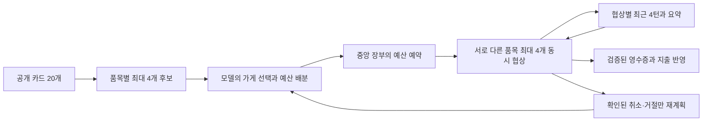

# 필수 도전 2: 카드 디렉터리로 장보기

최종 기본 시나리오 **3/3**에서 가게 20개의 카드를 읽고 다섯 품목을 모두 구매했다.
지출은 **1,160 / 1,160 / 1,260**, 각 총예산은 **1,500**이다. 매회 실제 영수증 5개·중복 없음·최대 4개 동시 협상을 확인했다.
공식 기본 테스트 21/21, 도전 1 재검사 15/15도 통과했다. 추가 가격 변동 실험은 미완료이며 아래에 구분한다.

## 구조와 확인할 지점



- **모델의 판단**: `prompts/cart.md`로 공개 skill을 읽어 가게와 품목별 상한을 정한다.
  `prompts/cart_buyer.md`로 가격 제안·수락·중단·요약을 정한다. 가격 공식이나 고정 제안 사다리는 없다.
- **코드의 권한**: `cart_contracts.py`가 누락·중복 배정·후보 밖 가게·예산 합계 초과를 거절한다.
  `cart_state.py`가 예산·예약·taskId·영수증을 소유한다. 모델이 요약에 쓴 금액으로 이 값을 변경하지 않는다.
- **통신과 기억**: 기존 `buying.py`의 A2A 루프를 사용한다. 선택 SKU를 확인한 뒤 정수 제안을 보내며 taskId를 유지한다.
  개별 협상에는 해당 카드 하나, 최근 4턴, 최대 600자 요약만 보낸다. 다른 가게의 대화 원문은 섞지 않는다.

중앙 장부는 **spent + held ≤ total_budget**을 유지한다. held는 예약·진행 중·결과 불확실 협상의 상한 합계다.
모든 상한을 먼저 원자적으로 예약한 뒤 동시 작업을 시작한다. 실제 구매를 반영하면 쓰지 않은 예약을 푼다.

| 상태 | 다음 동작 |
|---|---|
| pending / reserved | 아직 배정 전 / 예산과 가게를 예약하고 실행 대기 |
| active | 이 품목의 유일한 협상 진행 |
| purchased | 검증된 영수증 반영 완료, 재주문 금지 |
| stopped | 확인된 취소·거절, 예약 해제 후 다른 가게를 모델이 선택 가능 |
| uncertain | 예약 유지, 같은 품목 자동 재주문 금지 |

재계획은 최대 3회다. uncertain이 있으면 추가 주문을 멈추고 미완료를 반환한다.
개별 협상은 최대 8회 결정·180초, 장보기 CLI 자체 기한은 280초다.
이는 성공 보장이 아니라 무한 반복·결과 불명 상태의 재주문을 막는 경계다.

## 데이터와 실행

`shopping/generate.py`가 만든 자체 합성 가게다. 용도 5개마다 가게가 4개 있고 각 가게에 공통 흰 나무 상품과
서로 다른 파란 금속 대체 상품이 있다. 비공개 최저가도 다르다. 공개 profile의 참고 가격대는 확정 호가·최저가가 아니다.
구매자의 입력은 **실제로 조회한 공개 카드 디렉터리, SKU·설명이 있는 목록, 하나의 총예산**뿐이다.
검증기와 판매자는 비공개 카탈로그를 읽지만 구매자에게 그 경로나 최저가를 전달하지 않는다.
최초 계획은 카드 20개의 skill 발췌를 받고 품목별 허용 후보는 최대 4개다. 재계획에는 미구매 품목의 후보와 요약만 넣는다.

기존 `gpt-4o-mini`를 유지했고 실제 응답 모델은 `gpt-4o-mini-2024-07-18`이다.
빈 폴더에서 같은 API 하네스를 실행한다. cart 계획의 최대 출력은 1024토큰, 개별 협상은 512토큰이다.
표준 단일 구매자의 `prompts/buyer.md`는 유지하고 장보기용 구매자 지침을 별도로 뒀다.

이 제출 폴더에서 실행한다. 기존 로컬 키가 필요하며 로그·명령 인자에는 넣지 않는다.

```powershell
$env:PYTHONUTF8='1'
$env:PYTHONDONTWRITEBYTECODE='1'
# 판매자 20개 시작 → 별도 구매자 프로세스로 3회 장보기 → 서버 종료
.\.venv\Scripts\python.exe -u lab/check_shopping.py
# 불가능한 예산에 거래 없이 미완료를 반환하는지 검사
.\.venv\Scripts\python.exe -u lab/check_shopping.py --repeats 1 --budget 50 --expect-no-sale
# 추가 실험: 아래 설명한 실패·기억 전달 확인 조건
.\.venv\Scripts\python.exe -u lab/check_shopping.py --repeats 1 --reserve-offset 27 --require-summary
```

구매자만 실행하는 명령은 `python cart_buyer.py --directory <directory.json> --shopping-list shopping/shopping-list.json`이다.
실행 중인 가게의 URL 디렉터리를 제공해야 한다. 검사 로그의 directory.json은 당시 카드 스냅샷이며 검사 종료 뒤 서버는 닫혀 있다.

## 최종 기본 실행

원본은 `logs/challenge-2/run-20261017T070246.190291Z/`이다. 실제 입력은 directory.json·shopping-list.json,
구매자 기록은 buyer-N/cart-events.jsonl·model-*.jsonl, 판매자 기록은 sellers/, 독립 검사 결과는 summary.json이다.

| 실행 | 실제 거래 | 지출 / 총예산 | 남은 금액 | 최대 동시 협상 |
|---|---:|---:|---:|---:|
| 1 | 5 | 1160 / 1500 | 340 | 4 |
| 2 | 5 | 1160 / 1500 | 340 | 4 |
| 3 | 5 | 1260 / 1500 | 240 | 4 |

1·2회 가격은 lamp=100, chair=180, bookshelf=280, desk=320, cabinet=280이다.
3회는 일부 첫 협상을 중단하고 다른 가게에서 구매해 140·200·280·320·320이었다.
전역 최저 비용을 보장한 결과는 아니다. 모든 판매자의 실제 receipt 수·품목 집합도 따로 세어 구매자가 놓친 중복 거래를 검사했다.
가격은 해당 가게의 실제 상품 최저가와 대조했고 모든 장부 스냅샷의 예산 제한도 검사했다.

실제 첫 계획 상한은 lamp=120, chair=200, bookshelf=280, desk=320, cabinet=300, 합계 **1,220**이었다.
같은 로그의 lamp·chair·bookshelf·desk `cart_negotiation_started`가 정산 전에 이어져 동시성을 확인했다.
실제 `cart_memory` 기록:

```json
{"line_id":"lamp","task_id":"a73e10dc-271f-4598-9828-e24c5f69110a","summary_chars":155,"recent_count":1}
```

기본 성공 3회는 개별 협상이 첫 가격 교환에 끝나 **이전 요약을 다시 읽는 buyer 호출은 0회**였다.
3회차 재계획에는 중단된 협상 요약이 전달된다. 실제 다중 턴의 기억 전달은 추가 실험에서 별도로 확인했다.

## 실패·수정·추가 실험

1. 첫 실행 `run-20261017T065322.410142Z/`은 4개 구매·1,070 지출 후 미완료였다.
   판매자 모델이 지원되는 흰 나무 의자에 다음과 같이 답했다.

> The request specifies a wooden seat, but the color white is not supported for chairs.

지원 도메인을 trusted context에 넣고, 모든 속성이 지원되는 조합을 unsupported라고 할 수 없게 검사했다.
재고 유무는 모델이 추측하지 않고 검색 코드가 판정한다. 수정 전 로그는 커밋 `9871f34`에 보존했다.
수정 후 기존 구매자 정책으로는 3회 모두 1,270에 구매했다 (`run-20261017T065608.028247Z/`).

2. 첫 실행의 `buyer-1/model-5bdadf3621c144988440c59755b23499.jsonl`에는 실제로 다음이 있다.

```text
"event": "validation_failed", "attempt": 1, "code": "allocations_exceed_available_budget"
```

첫 상한 필드 합계는 1,620으로 1,500을 넘었다. 주문 전에 거절하고 모델에 수정 요청했다.
수정된 필드 합은 1,500인데 요약은 1,460이라고 했다. **요약의 합계도 믿지 않고 실제 정수 필드로 계산한다.**

3. 더 빠듯한 1,250 예산의 `run-20261017T065830.038827Z/`에서는 싼 품목에 넉넉한 상한을 주고
   cabinet에 190만 남겼다. 4개 구매 후 330이 남았지만 “300 exceeds ... 330”이라는 이유로 중단했다.
   전체 품목의 배분 균형과 새 가용 예산을 비교하도록 지침을 수정하고 장보기용 협상 정책을 분리했다.
   이후 `run-20261017T070029.135645Z/`에서 **5개를 1,200에 구매**했고, 확인된 lamp 중단 뒤 다른 가게를 선택했다.
   다만 개별 협상이 한 번에 끝나 `--require-summary`의 추가 커버리지 조건은 실패했다.
   이 실행의 summary.json은 false이며 이를 전체 검사 성공으로 바꿔 쓰지 않았다.

4. `run-20261017T070244.704687Z/`은 비공개 최저가에 27을 더한 추가 실험이다.
   실제 행은 private-inputs/에 보존했고 구매자에게 이 변경을 주지 않았다. 상한보다 판매자 하한이 높아진 품목에서
   낮은 제안을 반복했고 worker_failed·turn limit도 발생했다. worker_failed의 세부 원인은 원본만으로 확정하지 못했다.
   **지출 0·예약 620·미완료**였고 불확실한 주문이 있어 재주문을 멈췄다. 전 품목 구매 통과가 아니다.

하지만 읽기 전용 재검사 `memory-audit.json`에서는 구매자 요청 32회 중 **27회가 이전 요약을 재사용**했다.
최근 대화는 최대 4턴, 요약은 최대 251자였고 taskId는 같은 품목에 유지됐다. 실제 desk 후속 입력의 요약:

> The seller is asking 350 for the white wood desk, which exceeds my budget of 320. I am making an initial offer of 320, which is my maximum budget for this item. I hope the seller will accept this offer.

동시에 trusted budget=320, 별도 verified taskId·last_offer=320을 유지했다.
이것은 기억 전달의 증거이며 구매 완료 증거는 아니다. 불확실한 예약을 해제하거나 성공으로 바꾸지 않았다.

5. 최종 구매 불가 실험 `run-20261017T070554.827763Z/`은 총예산 50이었다.
   planner가 stop을 선택해 CLI는 incomplete·exit 1, 거래 0·지출 0·예약 0을 반환했다.
   검증기는 이 기대 결과를 1/1 통과로 기록했다. 상품 구매 성공을 뜻하지 않는다.

## 검증 범위와 한계

- 오프라인 **68개** 통과. 동시 예약 경쟁·중복 시작·잘못된 영수증·미확인 거래 재주문 금지를 포함한다.
  장애·경쟁 조건 중 모의 검사는 실제 장애 발생과 구분한다.
- 최종 공식 **21/21**: `logs/trade-runs/20261017-070113-564/console.log`.
- 도전 1 재검사 **15/15**: `logs/challenge-1/run-20261017T065722.908539Z/`.
- 매 실행 새 폴더를 만들고 원본을 수정하지 않았다. 검증용 판매자들은 실행 종료 시 닫았다.
- 상태는 메모리 기반으로 재시작 후 복원하거나 불확실한 구매를 외부 시스템과 재조정하지 않는다.
- 충분한 설명과 알려진 SKU를 가진 합성 목록을 사용한다. 구매자가 추가 질문에 답하는 흐름은 구현하지 않았다.
- 기본 성공이 모든 가격 변동·배분의 성공을 보장하지 않는다. 위 추가 실험의 미완료가 그 경계다.
