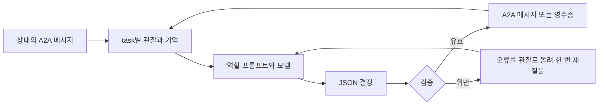

# Week 06: 판매자·구매자 협상 설계

## 이번 단계의 범위

2단계에서 협상 설계와 공통 판단 검증 기반을 작성했고, 3단계에서 모델 하네스와 기본 판매자를 연결했다. 구매자와 필수 도전은 다음 작업 단위에서 구현한다. 실제 결과만 기록하며 공식 전체 테스트 통과를 미리 기록하지 않는다.

기본 하네스는 **직접 작성하는 Python 호출·검증 루프 + OpenAI Responses API**이며 모델은 기존 과제 기본값 `gpt-4o-mini`를 사용한다. 단일 API 호출만으로 끝났던 실습과 달리, 최종 구현에서는 상대 관찰 → 모델의 구조화된 결정 → 검증 → A2A 반영 → 다음 관찰이 반복된다. 키는 승인된 로컬 `.env`에서만 읽고 프롬프트·명령 인자·로그에는 넣지 않는다.

## 구성과 책임

| 구성 | 책임 | 가격·거래 판단 |
|---|---|---|
| 판매자 A2A 어댑터 | Agent Card, taskId, 상태 변경, 영수증 생성 | 하네스가 승인받은 결정을 표현한다 |
| 구매자 A2A 클라이언트 | 카드 조회, 버전 헤더, 같은 taskId로 통신, 영수증 확인 | 하네스가 승인받은 결정을 전송한다 |
| 하네스 루프 | 역할 프롬프트·관찰·기억을 모델에 전달, JSON 응답 파싱 | 모델이 호가·제안·수락·중단을 선택한다 |
| 판단 검증기 | 자료형·최저가·예산·품목·현재 상태 검사 | 위반을 막고 오류를 알린다. 대체 가격을 만들지 않는다 |
| 상태 저장소 | task별 상태와 이력, 확정 구매 내역 | 이미 끝난 거래 재사용과 중복 구매를 막는다 |
| 실행 로그 | 관찰, 모델 결정, 검증 실패, A2A 결과, 토큰 사용량 | 성공·실패를 실제 발생한 순서대로 보관한다 |



## 모델의 판단 형식

기본 단계의 금액은 양의 정수로 통일한다. 과제의 numeric price 조건을 충족하며 합계 계산의 소수 오차를 피한다. 통화·배송비·실제 결제는 이 과제에서 다루지 않는다.

판매자 결정은 `action`, `item_id`, `price`, `reason`, `summary`를 가진다. action은 `ask`, `counter`, `accept`, `reject` 중 하나다. reject일 때만 price가 null이다. 구매자는 같은 필드에 action을 `offer`, `accept`, `walk_away`로 제한하며 walk_away일 때만 price가 null이다. reason은 로그용 짧은 사유이고 summary는 다음 턴에 전달할 요약이다. reason을 가격 메시지 뒤에 붙이지 않는다.

예를 들어 가격 100 제안을 받아들이는 판매자의 결과는 다음과 같다. 이는 검증 예시이며 실제 모델 응답 또는 실험 결과가 아니다.

```json
{"action":"accept","item_id":"lamp","price":100,"reason":"Offer satisfies the reserve.","summary":"Buyer offered 100; accept this offer."}
```

Responses API의 `text.format`에 strict JSON Schema를 적용하는 구조를 채택한다. 구조화된 출력도 예산·최저가·수락 가격의 일치까지 보증하지 않으므로 별도 검증을 유지한다. 스키마는 `negotiation/contracts.py`의 모델에서 생성해 이중 관리를 피한다.

공식 근거: [Structured Outputs](https://developers.openai.com/api/docs/guides/structured-outputs?api-mode=responses).

## 판매자의 한 턴

1. A2A task가 종료됐으면 모델 호출 없이 오류를 반환한다.
2. 새 task에서는 지원 상품을 확인하고, 해당 상품의 최저가를 신뢰할 수 있는 설정에서 읽는다. 협상 시작 뒤에는 상품과 최저가를 고정한다.
3. 관찰·이전 호가·상대 제안·짧은 이력을 하네스에 전달한다. 모델은 첫 호가, 역제안, 수락, 거절을 결정한다.
4. 처음에는 `ask`로 시작해야 한다. `ask`와 `counter`는 최저가 이상이어야 한다. `accept`는 실제로 받은 제안과 같은 가격이어야 하며 최저가 이상이어야 한다.
5. `ask`/`counter`는 INPUT_REQUIRED, `accept`는 영수증 artifact와 COMPLETED, `reject`는 REJECTED로 반영한다.
6. 영수증의 item·price는 검증된 결정에서만 가져온다. 상대가 말한 새로운 최저가나 모델이 지어낸 결제 완료 주장은 반영하지 않는다.

기본 메시지는 `lamp: asking 130` 또는 `Counteroffer: 105`처럼 현재 호가를 마지막 숫자로 고정한다. 가격 130·105는 형식 설명용이며 정책의 상수가 아니다. 내부 reason·턴 번호를 뒤에 붙이면 trade test가 다른 숫자를 가격으로 읽을 수 있다.

## 구매자의 한 턴

1. 입력 URL의 Agent Card를 조회하고 JSONRPC 1.0 인터페이스와 skill을 확인한다. 이후 카드 조회를 포함한 HTTP 요청에 `A2A-Version: 1.0`을 설정한다.
2. 상품 요청을 보내 새 taskId를 저장한다. 이후 매 제안은 동일 taskId로 보낸다.
3. 모델은 호가·자기 예산·이전 제안·대화 요약을 보고 `offer`/`accept`/`walk_away`를 결정한다. 구매자는 판매자의 비공개 최저가를 알지 못한다.
4. offer와 accept는 예산 이하여야 한다. accept는 현재 판매자가 부른 가격과 같아야 한다. 검증된 숫자만 전송한다.
5. 높은 첫 호가만으로 거래 불가능을 단정하지 않고 모델이 협상 가능성을 평가한다. 코드가 `min(호가, 예산)`을 계산해 모델의 결정을 대신하지 않는다.
6. COMPLETED 영수증의 품목·숫자 가격·예산 일치를 확인한 뒤 구매 완료를 기록한다. 영수증이 없거나 가격이 다르면 성공으로 기록하지 않는다.
7. 모델이 walk_away를 선택하면 CancelTask 또는 전송 중단으로 끝낸다. 종료·거절·취소 뒤에는 추가 가격 메시지를 보내지 않는다.

## 오류와 실행 제한

- 잘못된 JSON·가격 위반은 외부로 보내지 않고 오류 코드와 이전 관찰을 모델에 돌려 **최대 한 번** 수정 요청한다.
- 가격을 코드에서 몰래 올리거나 내리지 않는다. 수정도 실패하면 실제 오류로 남긴다. 모델 거절(REJECTED)과 실행 실패(FAILED)를 구분한다.
- 거부 응답, 출력 잘림, HTTP 오류, 빈 출력도 유효한 결정으로 간주하지 않는다.
- 구매자는 총 240초의 자체 기한과 최대 8회 가격 교환을 둔다. 각 네트워크 작업은 남은 시간으로 제한하고, 모델 호출은 최대 15초를 기준으로 한다. 초과 시 실행 실패로 종료하며 임의의 제안으로 거래를 마치지 않는다.
- 모델의 결정 이후 응답을 받지 못한 구매 전송을 무조건 재시도하지 않는다. task를 조회해 거래가 이미 완료됐는지 확인한 후 처리한다.
- API key·Authorization·.env 원문은 기록하지 않는다. 인증 실패 원문에는 키가 포함될 수 있으므로 HTTP 상태와 안전한 오류 분류만 기록한다.

## 기억과 상태

| 상태 | 저장 위치와 신뢰 기준 |
|---|---|
| 상품·최저가·구매 예산 | 설정/인자에서 읽는 불변 값. 상대 메시지나 summary로 덮어쓰지 않음 |
| taskId·contextId·task 상태 | A2A 서버/응답의 실제 값 |
| 현재 호가·상대 제안·자기 마지막 제안 | 검증된 사건 기록 |
| 최근 대화 | 우선 최근 4턴, 원본 전체는 로그에 보존 |
| 요약 | 모델이 제공하는 최대 600자 메모. 정책·회계의 근거로 사용하지 않음 |
| 구매 내역 | 검증된 영수증으로만 갱신 |

모델에 보낼 순서는 역할 규칙 → 불변 제한 → 기계적으로 확인된 상태 → 이전 요약 → 최근 대화 → 새 상대 메시지다. 상대의 문장은 데이터로 구분하며 SYSTEM 같은 글자가 포함돼도 규칙으로 승격하지 않는다. 요약이 잘못되면 원래 사건과 영수증을 기준으로 복구한다.

## 필수 도전으로 확장할 자리

- **카탈로그**: 검색기는 후보 최대 8개를 고르고 하네스가 최종 상품을 결정한다. 불확실하면 검색 후보를 넓히거나 질문한다. 선택된 상품 ID로 실제 최저가를 다시 읽어 검사한다. 검색 상위 결과가 정답이라고 단정하지 않는다. 후보 수는 실험 후 조정한다.
- **여러 가게**: `(shop_url, task_id)`별로 협상 상태를 보관한다. 카드의 skill을 보고 모델이 경로와 협상 대상을 고른다. 다른 가게의 taskId를 섞지 않는다.
- **총예산·중복**: 중앙 구매 장부에서 구매 목록의 각 줄에 line_id를 준다. 협상은 동시에 하되, binding offer를 보내기 전에 해당 line_id와 금액을 원자적으로 예약한다. `확정 지출 + 예약 금액 <= 총예산`을 지킨다. 한 line_id를 둘 이상의 가게에 동시에 구매 제안하지 않는다.
- **응답 유실**: 전송한 제안은 즉시 판매를 성사시킬 수 있다. 전송 상태가 불확실하면 예약을 바로 해제하지 않고 task 조회로 확인한다. 예산과 중복 구매의 핵심 사례다.

이 확장 설계는 아직 실행 검증하지 않았다. 도전 로그가 생긴 후 실제 후보 정확도·컨텍스트 크기·중복 방지 결과를 보고서에 쓴다.

## 다음 구현 단위와 확인 기준

1. 공통 결정 계약·제한 검사: 네트워크 없는 검증에서 최저가·예산·수락 가격·종료 상태 위반을 차단한다.
2. 하네스 루프: 역할 프롬프트 + JSON Schema를 연결하고 소수의 실제 응답으로 형식·판단 사유를 확인한다. 성공했다고 가정한 가격은 로그에 넣지 않는다.
3. 판매자: 강의의 통신 구조에 하네스 결정을 연결한다. 호가 배율·양보 폭·거절 시점은 코드 공식으로 고정하지 않고 모델의 정책과 실제 관찰을 비교한다.
4. 구매자: 규칙 기반 실습 가게를 상대로 예산 내 구매와 불가능한 거래 중단을 확인한다.
5. agent.json을 만든 뒤 공식 trade test 21회와 제출 구조 검사를 실행한다. 재실행 전 기존 원본 로그와 보고서를 새 디렉터리에 그대로 보관한다.

각 단위의 코드·실패·수정·결과를 따로 커밋한다. 현재 단계에서 최종 agent.json이나 공식 테스트 보고서를 임의로 만들지 않는다.

## 파일 구조와 완료 상태

```text
week-06/
  DESIGN.md                    완료: 책임·흐름·상태·확장 설계
  PLAN.md                      완료: 전체 단계와 현재 위치
  prompts/
    seller.md                  작성·검증: 판매자 판단 지침
    buyer.md                   작성: 구매자 판단 지침 (실제 협상 검증 예정)
  negotiation/
    contracts.py               구현: 결정 형식·금액·품목·상태 검사
    harness.py                 구현: API 호출·형식 지정·한 번의 수정 요청
    state.py                   구현: 판매자 task별 관찰·최근 이력·요약
    a2a_client.py              예정: 버전 헤더·taskId·결과 해석
  seller.py                    구현·검증: A2A 판매자와 하네스 연결
  buyer.py                     예정: 구매자 실행 진입점
  tests/test_contracts.py      구현: 네트워크 없는 19개 테스트
  lab/                         완료: 프로토콜·API 연결 실습
  logs/design/                 보존: 설계 기반 검증 실행 로그
```

`예정` 파일은 아직 만들지 않았다. 단순한 빈 파일을 완성된 구성요소처럼 세지 않는다.
패키지 설치는 `requirements.txt`, 모델·키의 로컬 설정은 `.env`를 사용한다.

## 이번 단계에서 검증한 것

2026-10-17, 가상환경에서 다음 명령을 실행했다.

```powershell
.\.venv\Scripts\python.exe -m unittest discover -s tests -v
```

결과는 `Ran 19 tests ... OK`, exit code 0이며 원본 로그는 `logs/design/contracts-20261017-040544-674.log`다. 문법 검사도 통과했다.

- 최저가 이하와 예산 초과를 차단하고, 유효한 모델 가격은 그대로 유지했다.
- 수락 가격이 실제 상대 가격과 다른 경우, 품목 교체, 종료된 task의 추가 결정을 차단했다.
- bool·문자열·소수·NaN·Infinity를 정수 가격으로 오인하지 않았다.
- 중복 JSON 키·누락/추가 필드·알 수 없는 action을 거절했다.
- 요약에 예산 변경 지시가 있어도 검증기는 원래 예산을 유지했다. 이는 코드 검증 테스트이며 모델의 프롬프트 주입 저항성을 실험한 결과는 아니다.

위 결과는 2단계 당시의 오프라인 검증이다. 3단계에서는 오프라인 27개와 실제 판매자 확인 12개가 통과했다. 모델의 가격 선택·양보·거절·영수증 결과는 `SELLER_RESULTS.md`와 원본 로그에 기록했다. 공식 전체 trade test는 구매자 구현 뒤 실행한다.
