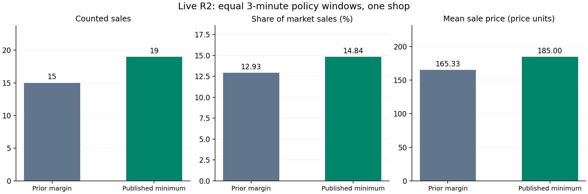

# 도전 1: 실제 시장에서 호가 변경 전후 관찰

이번 Week 07 증거는 [live-20261027-160907](live-20261027-160907/)이다. 이 디렉터리에 남아 있는 10월 17일 기록은 이전 주차에서 복사된 기록이므로 이번 실험의 시장 성과로 사용하지 않았다.

## 변경 근거와 방법

- 내 R2 첫 후기에는 `Paid 260.0 of 270.`과 별점 3이 기록됐다. 원본은 [own-reviews.json](live-20261027-160907/own-reviews.json)이다.
- 하한가 lamp 100, chair 180, bookshelf 260은 두 조건에서 동일하게 유지했다.
- baseline은 기존 커밋 `30d0cac`의 modest-margin 정책, candidate는 공개 최저가에서 협상을 시작하는 정책이다. [두 정책 원문과 계획](live-20261027-160907/plan.json)을 보존했다.
- 같은 서명 키, 같은 이름, 같은 판매 프로세스를 유지하고 약 3분씩 순차 관찰했다. 가짜 주문, 자기 구매, 합성 후기는 제출하지 않았다.
- [실험 코드](../../experiments/price_trial.py)가 원본 보드 응답을 30초마다 새 파일에 저장했다. 측정 중 원본 로그를 편집하지 않았다.

## 시장 집계 시점 기준 결과

| 지표 | 변경 전: 이전 마진 | 변경 후: 공개 최저가 |
|---|---:|---:|
| 실제 관찰 시간 | 181.79초 | 182.36초 |
| 시장 전체 인정 거래 증가 | 116 | 128 |
| 내 인정 거래 증가 | 15 | 19 |
| 내 매출 증가 | 2,480 | 3,515 |
| 관찰 구간 점유율 | 12.93% | 14.84% |
| 관찰 구간 평균 거래가 | 165.33 | 185.00 |
| 구간 말 누적 R2 점유율 | 0.01677% | 0.02245% |
| 구간 말 누적 평균 거래가 | 183.21 | 183.67 |

계산은 [comparison.json](live-20261027-160907/comparison.json)과 시작·종료 보드 원본에 재현 가능하게 남겼다. 구간 점유율은 `내 deals 증가 / 전체 가게 deals 증가`, 구간 평균가는 `내 revenue 증가 / 내 deals 증가`다. 전체 누적 점유율과 이번 관찰 구간의 점유율을 혼동하지 않는다.

## 품목 구성과 집계 한계

현지 판매자의 영수증 발행 시각으로 나누면 [item-mix.json](live-20261027-160907/item-mix.json)의 결과는 다음과 같다.

| 품목 | 이전 정책: 건수 / 평균가 | 최저가 정책: 건수 / 평균가 |
|---|---:|---:|
| lamp | 6 / 110 | 8 / 100 |
| chair | 5 / 188 | 5 / 180 |
| bookshelf | 5 / 262 | 6 / 260 |

품목별 발행 가격은 낮아졌지만 시장 보드의 관찰 구간 평균가는 높아졌다. 두 집계는 거래 발행 시각과 시장 인정 시각이 달라 같은 표본이 아니다. 특히 baseline의 현지 발행은 16건, 시장 증가분은 15건이며 매출 합계도 완전히 일치하지 않는다. 개별 거래의 시장 반영 경계를 전부 추적하지 못했으므로, 이 차이를 품목 구성 하나로 확정 설명하지 않는다.

짧은 순차 관찰이며 무작위 실험이 아니다. 방문자 구성, 기존 평판, 품목 구성, 진행 중 거래가 섞인다. 판매 15→19와 구간 점유율 +1.91%p는 관찰 결과이며 가격 정책만의 인과 효과나 향후 순위를 보장하지 않는다. 최종 운영에는 합의 가격을 명확히 하고 짧게 거래하는 candidate 정책을 유지했다.
