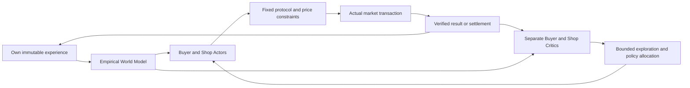

# Actor, Critic and empirical World Model

Implemented for the preserved item-only trading contract. See `V4_MIGRATION.md`
for the subsequently published market contract; this is not v4 readiness.

Actors remain the existing model-driven pricing/negotiation components. Host code
chooses counterparties and experiment allocation, checks constraints and executes.
The critics do not write arbitrary prompts, alter signature validation, change
budgets/cost limits, or train OpenAI model weights.

## World Model

`negotiation/world_model.py` predicts one trade's success, price/margin and cycle
time from comparable observations. It is an empirical forecast, not a learned
simulator of the whole market. Unknown prices use an explicitly labeled prior.
Forecasts are separate event kinds and never become observed successes.

Identity, item, budget band, Round and contract namespace separate Buyer evidence.
Contract namespaces also separate Shop experiments and shared observed prices.
Private buyer budgets and mandates are not shared with the Shop model.

## Critics and feedback

Buyer predictions are recorded before binding negotiation. Market feedback joins
them to actual orders, including no-receipt failures. Credit reward is 0 without
the required verified payment. Total time includes order polling, negotiation,
checkout and result submission when supplied by the kit adapter.

The Buyer Critic records observed credit reward/time, prediction error in the
same units, duration error and Brier error for completion predictions. Local
decision-service errors are not used to recalibrate counterparty honesty/success.
After at least 10 comparable samples in each selector arm, a candidate below
80% of control's observed rate shifts control allocation from 10% to 50%.
This is a disclosed engineering guardrail, not a causal guarantee.

The Shop Critic waits for actual settlement under the old R3 contract. In Round 2
it explicitly labels accepted margins as a proxy, not paid Profit. No settlement
observed after a fixed 600-second horizon has reward 0 at that horizon; it is not
a declaration of rejection. Late settlement appends a new revision, and summaries
count the latest task result once. Critics update after events and reconcile a
bounded number of pending forecasts on the next decision, without extra LLM calls.

Shop arms preserve a 10% memory-v1 prompt control and initially explore the three
bounded stances. After 10 matured opportunities in every arm, allocation may
exploit a supported winner for 70% of draws. Large observed forecast errors turn
off winner exploitation. Prices remain model decisions under the host contract.

## Operational evidence

- Baseline prompts and source hashes were preserved before implementation.
- SQLite was backed up using its online backup API to an ignored local path.
- Worker startup, API latency, peer latency, token usage and full order-cycle
  timing are recorded separately. Actual API currency costs are not invented.
- Local tests cover reward attribution, no paid receipt, key changes, capability
  expiration, changed contract namespaces, late outcomes and no binding v4 action.
- Current official-market changes mean all future v4 reward and constraint work
  must use the new contract rather than these legacy Saved/cost-floor assumptions.

LongMemory was reviewed separately in `LONGMEMORY_REVIEW.md`; no external memory
service is required by this implementation or installed as part of this change.
