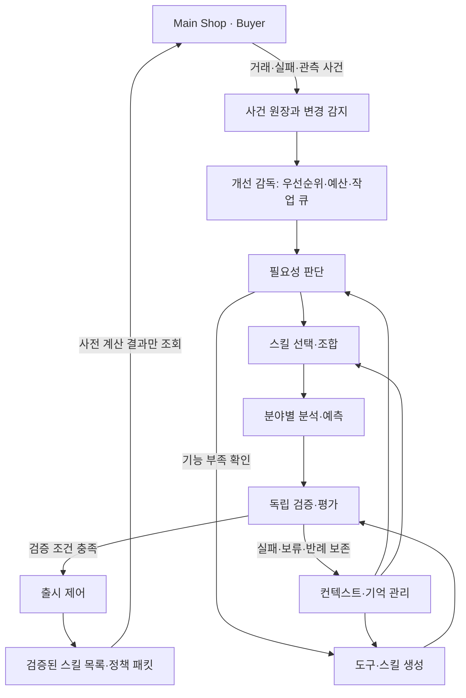

# Round 3 자율 개선 프레임워크 설계 — v14 후보

상태: **설계 완료용 문서. 구현·운영 적용·경제적 우월성 검증 전.**

사용자 조건: 시장에 참여한 Agent가 필요성 판단, 도구·스킬 생성, 선택, 컨텍스트 관리, 실험과 개선을 스스로 수행한다. Main의 거래 지연을 늘리지 않고 비용을 최소화한다. 현재보다 더 낫다는 검증을 통과한 변경만 반영한다. 이 문서는 신규 실행 코드나 활성 정책을 배포하지 않는다.

모든 미래 상황에서 우월함을 유한한 검증으로 증명할 수는 없다. 따라서 측정 범위·근거·불확실성을 명시하고, 근거가 부족하면 현재 버전을 유지하는 것이 배포 규칙이다. 테스트 통과를 경제적 우월성으로 바꾸어 표현하지 않는다.

## 1. 현재 구현에서 출발한다

| 영역 | 현재 확인된 기반 | 추가할 기능 |
|---|---|---|
| Main 실행 | `r3/model.py`의 빠른 수치 경로 | 버전이 고정된 정책 패킷 조회, 전체 지연 분해 측정 |
| 문제 감지 | `r3/control.py`, `r3/evolution.py` | 문제별 작업 큐, 기대효과·검증 가능성에 따른 우선순위 |
| 전략 실험 | 고정된 프로필 비교, 성숙 결과 평가 | 도구·스킬·컨텍스트 정책까지 동일한 증거 체계로 비교 |
| 경험 | `r3/outcomes.py`, `r3/long_memory.py` | 사실·가설·절차 분리, 역할별 검색, 오염·누락 검사 |
| 거래 경로 | `r3/contracts.py`, `r3/buyer_routes.py` | 식품/공산품별 검증된 전략 패킷 |
| 운영 | 기존 transport supervisor와 lifecycle lease | 개선 worker의 장애·예산·자원 격리 |
| 도구 생성 | 실행 중 임의 도구 생성 기능 없음 | 제한된 factory와 독립 검증·출시 제어 |

21:58 KST 읽기 전용 표본에서 v13 시작 이후 6,255개 결정은 모두 수치 경로였고 모델 호출은 0건이었다. Chooser 내부 p95는 Buyer .047초, Shop .172초다. 후보 생성·외부 RPC·협상·결제를 포함하는 전체 지연 수치는 아니다. 모델 이름 변경만으로 이 구간의 속도 개선을 주장할 수 없다.

현재 kit는 Buyer 주문 루프와 별도 sync thread를 사용한다. 다만 추가 진단·학습·게시 처리가 같은 sync callback에 모여 있으므로, 새 생성·분석 작업은 이 thread에 붙이지 않는다. 데이터 수집과 원장 정합의 최신성을 먼저 보존한다.

## 2. 전체 구조

원칙은 **Main이 사고가 많은 계층의 완료를 기다리지 않는 것**이다. 생성 코드와 긴 모델 응답은 Main에 직접 들어가지 않는다. Main은 실행 가능한 스킬 계획과 유효한 정책 패킷을 읽고, 현재 주문·재고·자금에 대해 보호 조건을 다시 검사한다.

## 3. Agent 역할과 권한

다음은 논리적 역할이다. 역할 수만큼 모델을 상시 띄우는 설계가 아니다. 통계·선택·검증·출시는 우선 일반 코드로 처리하고, 새로운 의미 해석·설계·코드 작성에만 모델을 사용한다.

| ID | 역할 | 시작 조건 | 결과 | 권한 |
|---|---|---|---|---|
| shop_main | Shop 거래 실행 | 외부 견적·체결 요청 | 견적·예약·정산 | 기존 검증된 거래 어댑터 사용 |
| buyer_main | Buyer 거래 실행 | 공식 주문 | 견적 비교·협상·결제 | 동일 주문의 단일 결제 경로 |
| director | 개선 감독 | 상태 변화·문제의 새 근거 | 우선순위와 작업 티켓 | 큐·예산·자원 배정, 직접 거래 금지 |
| need_assessor | 기능 필요성 판단 | 반복 실패·새 수요·예측 오차 | 데이터 갱신/튜닝/조합/새 도구/보류 | 근거 기반 제안만 |
| skill_router | 사용 스킬 선택 | 작업 티켓·활성 목록 변경 | 최대 소수의 스킬 ID·버전 | 유효한 등록 스킬만 선택 |
| context_curator | 컨텍스트·기억 관리 | 작업 시작·중요 결과·용량 초과 | 역할별 최소 컨텍스트 패킷 | 파생 뷰·색인 관리, 원장 삭제 금지 |
| market_portfolio | 수요·재고 분석 | 공급 주기·품절·유입 변화 | 상품/등급/수량별 후보 | 읽기·제안만 |
| buyer_path | 구매 경로 분석 | 거절·품절·유통기한·지연 변화 | 식품/공산품 경로 후보 | 읽기·제안만 |
| quality_reputation | 품질·보증·별점 분석 | 성숙한 고장/환불·새 평가 계정 | 위험 추정·계정별 진단 | 확인된 결과와 가설 분리 |
| tool_builder | 도구·스킬 생성 | 재사용·튜닝·조합으로 부족함이 확인됨 | 명세·코드·테스트·비용 추정 | 후보 작업공간만 쓰기 |
| evaluator | 독립 검증·평가 | 후보 결과 도착 | 통과/실패/근거 부족 | 별도 평가 자료·검증 규칙 읽기 |
| release_controller | 출시·되돌리기 | 평가 보고서·안전한 적용 시점 | 버전 manifest 전환 | 검증된 범위의 변경만 게시 |

감독·필요 판단·선택·기억 관리의 책임을 구분하되 같은 가벼운 서비스에서 수행할 수 있다. 첫 운영 후보는 모델 worker 동시 실행 2개 이하로 시작하고 실제 부하 측정으로 조정한다. 깊은 하위 Agent 호출과 토론을 주문마다 수행하지 않는다.

## 4. 필요성 판단: 새 도구를 만드는 기준

문제마다 먼저 다음 분류를 한다.

1. **관측 문제:** 오래된 재고·순위판·원장 지연·외부 접속 장애. 먼저 관측을 갱신한다.
2. **입력/해석 문제:** SKU·등급·보증·유통기한을 잘못 읽음. 최소한의 변환·검증을 교정한다.
3. **기존 기능의 조정 문제:** 파라미터 또는 기존 스킬 조합으로 해결 가능하다.
4. **실제 능력 부족:** 재사용 가능한 새 기능이 필요하다. 이때 factory 작업을 만든다.
5. **검증 불가능/현재 가치 부족:** 이유와 재검토 조건을 저장하고 보류한다.

판단에는 영향받은 주문 수·실패 손실·적용 범위·근거 최신성·생성/평가 비용·시장 남은 시간·실험 표본 확보 가능성을 사용한다. 높은 확신 문장만으로 우선순위를 정하지 않는다. 미지의 기회는 작은 조사 작업으로 다루며, 알 수 없다는 이유만으로 항상 배제하지 않는다.

같은 문제의 중복 티켓은 합친다. 시장 전체 장애를 각 거래 상대의 불량 신용이나 가격 거절로 학습하지 않는다. 한 번 성공한 거래와 오래된 실패가 충돌하면 시각·조건·실제 정산 근거로 갱신한다.

## 5. 스킬 선택과 Tool/Skill/Agent의 크기

- Tool: 하나의 입력 계약과 출력 계약, 제한된 계산 또는 명시적 효과.
- Skill: 검증된 Tool을 짧게 조합한 절차와 적용 조건·금지 조건·반례.
- Agent: 필요한 근거와 도구를 선택하며 여러 단계를 조율하는 역할.

선택 순서는 `규칙·권한·버전·유효기간 필터 → 조건/성과 검색 → 소수 후보 재확인 → 선택 또는 none`이다. 조건을 충족하지 않으면 아무 스킬도 선택하지 않는 결과를 허용한다.

거래 시점에는 미리 준비된 조건표와 스킬 계획을 사용한다. Main이 매번 스킬 설명 전체를 모델에 보내 선택하게 하지 않는다. 새 스킬은 기존 것과 입출력·효과·테스트 범위를 비교해 중복을 합친다. 쓰이지 않는 스킬은 활성 목록에서 빼되 코드·근거·실패 기록은 보존한다.

Jev는 추후 스킬 후보 재확인·기억 관련성 판단의 선택적 backend가 될 수 있다. 기본값은 미사용이며 도입 자체를 성능 개선으로 간주하지 않는다. REA는 우리 코드·공식 kit·허용된 통신 기록의 복잡한 동작 조사에 한정한 선택 도구다. 둘 다 필수 의존성이 아니다.

## 6. 컨텍스트 오염과 compaction

공유하는 것은 전역 대화방이 아니라 **출처가 있는 사실 저장소와 버전이 있는 파생 패킷**이다.

| 계층 | 보관 내용 | 압축·선택 방식 |
|---|---|---|
| 고정 기준 | 공식 점수 규칙, 서명·SKU·자금·결제 보호 조건 | 정확한 구조화 필드로 유지 |
| 현재 사실 | 재고·가격·공급 할증·순위판·접속 상태 | 시각·출처·버전·만료를 붙이고 역할별 조회 |
| 진행 중 의무 | 예약, 결제 불명, 미성숙 품질, 환불 의무 | 해결되기 전 필수 필드 누락 금지 |
| 경험·가설 | 실패 원인, 예측, 실험, 반례 | 사실과 분리, 같은 원장/주문 중복 제거 |
| 절차 | 검증된 스킬·도구·적용 조건 | 필요한 본문만 점진적으로 로드 |

모든 패킷은 `as_of`, `rules_hash`, `data_version`, `policy_version`, `evidence_ids`, `expires_at`, `fact_or_hypothesis`를 갖는다. 여러 Agent가 같은 가설을 반복 인용해도 근거가 여러 개로 늘어나지 않는다.

peer/forum 텍스트는 별도 untrusted 구역에 둔다. 그 문장을 정책·권한·코드 실행 지시로 승격하지 않는다. 동일 owner Buyer 수요를 우리 Shop의 외부 수요로 섞지 않는다. 확인되지 않은 고객 identity는 추정으로 채우지 않는다.

현재 `compact()`의 앞 12개 절단 방식은 의미와 무관한 누락 가능성이 있다. 대체안은 필수 사실을 보존한 뒤 관련성·최신성·적용 범위·반례를 기준으로 선택하는 것이다. 임의의 토큰 감축률을 목표로 계약 조건을 잃어서는 안 된다.

초기 설계 예산은 분석 입력 4k 토큰, 생성 입력 8k 토큰 안팎의 작은 패킷이다. 검증된 최적값이 아니며 필수 사실이 넘치면 작업을 분리한다. 정확한 금액·시간·등급·보증·주문 연결을 자연어 요약으로 대체하지 않는다. 원본은 삭제하지 않고 ID로 다시 읽을 수 있게 한다.

compaction은 현재 작업을 이어갈 최소 상태를 만드는 기능이고, Long Memory는 다음 작업이 재사용할 사실·절차를 남기는 기능이다. 두 기능과 원본 증거를 분리한다. 실패 사례와 중요한 반례도 보존한다.

## 7. 생성 도구의 검증과 실행 경계

ToolBuilder는 `manifest`, 소스, 작성자 테스트, 변경 이유, 대안, 예상 비용, 적용/금지 조건을 만든다. 출력은 후보 작업공간에만 기록한다. 생성자에게 운영 키·owner 자격 증명·전체 원장·출시 권한을 주지 않는다.

생성 코드의 검증은 실제 격리 실행 환경을 요구한다. 별도 subprocess와 timeout만으로 네트워크·파일 접근이 차단됐다고 주장하지 않는다. 네트워크 없음, 운영 비밀/폴더 미마운트, 읽기 전용 기본 파일시스템, 제한된 출력 폴더, CPU·메모리·프로세스·실행시간 제한을 확인해야 한다. 지원 환경을 입증하지 못하면 임의 생성 코드는 실행·승격하지 않는다.

작성자 테스트 외에 보호 조건 회귀, 입력 경계, 잘못된 자료, 외부 텍스트 오염, 재실행, 데이터 개정, 부하 검사를 수행한다. 생성자가 평가 기준이나 holdout 답을 바꾸지 못하게 한다.

생성 코드를 Main에 import하지 않는다. 생성된 분석 Tool은 격리 worker에서 실행하고 유효기간이 있는 정책/예측 데이터로 출력한다. Main에서 사용하는 Skill은 검증된 기본 동작의 제한된 실행 계획으로 표현한다. Main은 최신 사실로 다시 검증한 뒤 기존 신뢰된 어댑터로 실행한다.

계정·키·서명·같은 owner 거래 제한·정확 SKU·인증·실제 보증 약속·환불 준비금·결제 불명 시 중복 방지는 자율 변경 대상에서 제외한다. 새 도구가 예산·권한·실험 한도를 스스로 늘릴 수 없다.

## 8. 실행과 복구

- 사건 큐는 중복 제거 key와 lease를 가진다. 분석 작업은 재시도 가능하지만 결과 게시와 거래 효과는 별도 멱등 제어를 한다. 분산 환경에서 exactly-once를 가정하지 않는다.
- 오래된 분석 작업은 최신 자료 작업으로 대체한다. 이미 시작한 금융 거래는 임의 취소·재결제하지 않고 기존 정합 절차를 따른다.
- 모델 응답이 끊기면 예산 예약, 작업 상태, 사용량의 불확실성을 남긴다. 작업 재시작이 중복 과금·무한 호출을 만들지 않게 retry 상한과 예약 만료 정책을 둔다.
- 정책과 스킬은 immutable artifact hash로 저장하고 활성 manifest를 원자적으로 바꾼다. 진행 중인 주문은 최초 버전에 고정해 재시도 중 정책이 바뀌지 않게 한다.
- 새 worker가 실패해도 Main·공식 데이터 수집·등록 복구 supervisor는 계속 실행된다.
- 모델 추론 대기는 worker를 쉬게 하고 결과/성숙 시각/새 사건으로 깨운다. 생각을 반복 호출해 기다리지 않는다.
- Main p95/p99, DB lock 대기, 원장 지연이 악화되면 우선 개선 worker를 감속·중단한다. 거래의 보호 조건을 풀어 처리량을 회복하지 않는다.

## 9. 비용과 모델 사용

Main의 일반 거래 경로는 추가 모델 호출 0회·도구 생성 대기 0회를 목표로 유지한다. 로컬 CPU·네트워크·외부 시장 지연은 별도로 측정한다.

대부분의 감지·통계·검색·검증·출시는 일반 코드로 처리한다. 분석·생성 모델은 사건이 있을 때만 호출하고, 모든 역할의 비용 예약을 한 계정 단위 예산으로 합친다. 요청 입력+질문+예상 출력과 retry까지 사전 계산한다. 모델별 가격이 없으면 호출하지 않는다.

현재 `daily_api_budget_usd=null`은 코드상 한도 해제다. 자율 생성 worker가 이 값을 무제한 예산으로 상속해서는 안 된다. 새 worker의 예산은 **미설정/0이면 유료 모델 작업 보류**가 기본이다. 예를 들어 $0.05/일 같은 소액 상한은 설정 후보일 뿐 이 설계로 활성화하지 않는다. 로컬 모델을 사용하지 않으면서 새로운 코드를 외부 모델로 완전 자동 생성하는 데 추가 비용 0을 보장할 수는 없다.

모델의 이름보다 실제 검증 결과로 역할을 배정한다. 현재 Luna 설정을 변경하지 않는다. 더 강한 생성 모델·Jev·관리형 Agent 서비스·새 서버는 각각 비용과 효과 검증이 필요한 별도 선택이며 자동 도입하지 않는다.

## 10. Round 3 전략에 연결

### Shop

- 외부 수요와 실제 재고 노출을 함께 보고 충족하지 못한 가격/등급/보증 영역을 찾는다. 오프라인 동안 주문이 없었다는 이유로 수요 0으로 학습하지 않는다.
- 인기 SKU의 공급 할증과 경쟁을 포함해 대체 SKU를 비교한다. 다양화 소량 탐색 후 실제 회전과 순 Book 기여가 확인된 구성을 확대한다.
- 재고 종류·등급·보충 타이밍을 먼저 분석한다. 현금이 많다는 사실만으로 최대 재고를 매입하지 않는다.
- 가격은 실제 원가 제거·환불·보관·현금 구속과 보유 대안을 함께 비교한다. 보증 약속과 계정별 평가를 연결한다.
- 별점 예측은 계정 단위 holdout을 통과하기 전까지 shadow로 유지한다. 다수 리뷰가 소수 계정에 집중된 것을 큰 독립 표본으로 계산하지 않는다.

### Buyer

- 식품은 실제 주문 사용 시간과 checkout 지연을 반영해 유통기한 적합성을 먼저 확인한다. 부적합 재고와 transport 실패를 분리하고 적합한 대체 상품으로 빠르게 이동한다.
- 공산품은 SKU·등급·보증·가격 구간별 성립 영역을 찾는다. 반복 실패의 시한부 제외와 제한된 회복 probe를 사용하며 안전 구매 상한을 무작정 늘리지 않는다.
- 가격만이 아니라 성숙한 Saved와 실행 시간을 비교한다. 고가라는 이유로 정규화 점수에 임의의 가중치를 주지 않는다.
- 결제는 단일 경로로 유지한다. 성공 여부가 불명확한 결제는 예측으로 성공·실패를 확정하지 않는다.
- Forum은 검증된 가격 비교·대체품·성숙 품질·미충족 수요를 제공하고 실제 정보 효용을 측정한다. 기록되지 않은 거래·성과를 만들지 않는다.

새로운 도구마다 `해결할 실패 → 바뀔 행동 → 예측 지표 → 관측 결과 → 반례 → 유지/폐기`를 연결한다. Agent 수나 Tool 수를 성과 목표로 삼지 않는다.

## 11. 사용자 조건을 반영한 검증·배포 기준

별도 `AUTONOMY_V14_ACCEPTANCE.json`에 설계상 필수 gate를 명시한다. 현재 상태는 `deployment_allowed=false`다. 값이 없는 검증을 통과로 처리하지 않는다.

**Gate A — 기능과 권한:** 보호 조건 회귀 100% 통과, 자격 증명 접근·비허용 쓰기·허용되지 않은 네트워크 0건, 재시작·중복 실행 검사 통과. 생성자 자기 테스트만으로 충족하지 않는다.

**Gate B — 구조와 지연:** 같은 frozen 입력과 실측 background 부하에서 기존/후보의 행동 보존 범위를 비교한다. 전체 지연과 Chooser 지연을 분리하고 p50/p95/p99·DB 대기·데이터 최신성·API 호출량을 측정한다. 적어도 하나의 사전 정의한 구조 지표에 유의한 개선이 있고 나머지 보호 지표가 악화되지 않아야 한다. 반복 paired 측정과 불확실성을 기록한다. 과거 p95 .047/.172초를 서로 다른 환경의 후보 수치와 직접 비교하지 않는다.

**Gate C — 컨텍스트:** 필수 사실 손실 0, 단위/시간/계약 연결 오류 0, 가설이 사실로 승격된 사례 0, 잘못된 스킬 활성화 증가 없음. 토큰 감소만으로 통과시키지 않는다.

**Gate D — 경제적 효과:** Shop은 순 Book·순매출·계정별 별점, Buyer는 성숙 Saved·완결률·시간과 Forum을 같이 본다. 공식 규칙·모집단·품질 성숙 시각을 고정한다. 사전 지표·표본 필요량·기간을 정하고, 계정/상품/시간 상관과 반복 비교의 낙관 편향을 반영한다. 공급·오프라인·상대 변화가 섞인 단순 전후 상승은 증거가 부족하다.

과거 재생은 새 가격에 상대가 동의했을지, 새 재고가 실제 팔렸을지 증명하지 못한다. Shadow 예측 정확도 향상도 새 거래 정책의 이익 향상을 직접 증명하지 못한다. 경제적 효과가 식별되지 않으면 해당 정책은 보류한다.

최신 사용자 조건에 따라 **검증 전의 새 전략 실거래 canary도 현재 허용 범위로 가정하지 않는다.** 현행 v13 실험은 그대로 두되 새 후보를 그 실험에 몰래 끼워 넣지 않는다. 기존 행동을 보존하는 구조 최적화의 근거와 거래 행동을 바꾸는 전략의 근거를 별도로 평가한다. 경제적 검증에 통제된 실거래 실험이 꼭 필요하면 그 필요성과 영향 범위를 명시하고, 사전 우월성이 증명됐다고 부르지 않는다.

**Gate E — 운영 적용:** 해당 변경에 필요한 모든 gate가 통과하고 baseline/rules/artifact 해시가 일치해야 한다. 진행 중 결제의 안전 시점을 지키고 활성 manifest를 교체한다. 실패 시 기존 artifact로 돌아간다. 근거 부족·시간 부족·예산 부족이면 기준을 낮추지 않고 현행을 유지한다.

현재 확인된 API 호출/내부 timer 기록은 baseline 자료일 뿐 후보 우월성 검증이 아니다. 이 설계 작성으로 구현·경제 검증·배포가 완료됐다고 표시하지 않는다.

## 12. 구현 순서와 완료 증거

| 단계 | 산출물 | 완료 증거 | 현재 운영 영향 |
|---|---|---|---|
| P0 | event/job/context/manifest 계약, full-latency 계측 설계 | 형식·권한·출처·freshness 계약 일관성 | 없음 |
| P1 | 별도 작업 큐·역할별 읽기·컨텍스트 패킷 | 재시작·중복 제거·최신성·기존 보호 회귀 | staging/shadow만 |
| P2 | router·기존 스킬 조합·분야별 분석 | 과거 독립 자료 재생, 동일 조건 지연·품질 검사 | 후보만 생성 |
| P3 | 격리 ToolBuilder와 registry lifecycle | 실제 sandbox 차단 검증, 독립 holdout, 비용 한도 | 생성물 격리 |
| P4 | 후보 평가·출시 제어 | 변경 종류별 필수 gate 통과 보고서 | 통과한 범위만 적용 |

새 모듈 후보는 `r3/autonomy/{contracts,queue,director,assessor,router,context,workers,factory,registry,evaluator,publisher}.py`다. 기존 `r3/contracts.py`의 거래 계약과 새 autonomy 계약은 이름공간을 분리한다. 이 경로는 구현 계획이며 현재 파일이 존재하거나 활성화됐다는 뜻이 아니다.

최소 인터페이스는 다음으로 고정한다. 이는 앞으로 구현할 계약이며 현재 실행 가능한 API가 아니다.

| 계약 | 필수 필드와 의미 |
|---|---|
| JobTicket | `job_id`, `dedupe_key`, `role`, `problem`, `evidence_ids`, `snapshot_hash`, `deadline`, `budget_reservation_id`, `attempt`, `lease_until`, `status` |
| ToolManifest | `tool_id`, `version`, `artifact_hash`, 입출력 schema, 허용 효과, 자원 상한, 의존 버전, 적용/금지 조건, 테스트 보고서 ID, 만료·폐기 조건 |
| ContextPacket | 6절의 필수 출처·시각 필드, 역할, 필수 사실, 선택 사실, 미해결 의무, 가설, 반례, 원본 조회 ID |
| EvaluationReport | 후보/기준/규칙/자료 hash, 평가 계획 ID, 비교 범위, 표본·성숙도·불확실성, gate별 결과, 알려진 한계, 평가자 ID |
| ReleaseManifest | 활성 artifact hash, 평가 보고서 ID, 호환 버전, 활성 시각, 유효기간, 이전 manifest hash, 되돌리기 조건 |

작업 상태는 `queued → leased → completed/failed/deferred`다. lease 만료는 재시도 가능 여부를 다시 판단하는 사건이며 성공으로 간주하지 않는다. 후보 상태는 `draft → isolated → evaluated → eligible → active → retired`로 구분하고, 실패·근거 부족은 별도 상태로 보존한다. `eligible`도 baseline이나 규칙 hash가 바뀌면 재검증한다. 여러 후보의 개별 개선이 조합의 개선을 보장하지 않으므로 함께 활성화할 묶음 자체를 평가한다.

정책 패킷의 유효기간이 지나거나 자료 버전이 맞지 않으면 기존 검증된 기본 경로로 돌아간다. 출시 후에도 같은 지표로 감시하고, 중복 결제 위험·필수 사실 손실·예산 초과는 즉시 후보를 중단한다. 성과 악화는 사전에 정한 창·성숙도·통계 기준으로 판단해 되돌린다. 새 모델 호출이나 또 다른 생성 작업의 완료를 기다리며 복구하지 않는다.

staging은 기존 v13 격리 트리를 덮어쓰지 않는 별도 디렉터리를 사용한다. 원본 로그·금융 원장·키·계정을 보존하고, 임시 sandbox에 자격 증명을 복사하지 않는다. 이 대화가 종료돼도 작동하는 worker와 상태 재개는 P1~P3의 실제 실행 검사로 입증해야 한다.

## 13. 근거

- 현재 구조: `r3/model.py`, `r3/control.py`, `r3/adapter.py`, `r3/evolution.py`, `r3/long_memory.py`, `r3/outcomes.py`, `r3/contracts.py`, `scripts/market_kit.py`(읽기 전용).
- [현재 실행의 수치 경로](logs/main-routing-20261110T115822343174Z.json), [v13 구현 경계](SYSTEM_V13_FRAMEWORK.md), [진행 진단](PROGRESS_REVIEW_2026-11-10_2007.md).
- [OpenAI: Agent 구성과 역할 분리](https://developers.openai.com/tracks/building-agents).
- [OpenAI: memory와 compaction](https://developers.openai.com/cookbook/examples/agents_sdk/building_reliable_agents_memory_compaction).
- [TypeSafe: 스킬 선택과 progressive disclosure 사례](https://docs.typesafe.ai/cookbooks/skill_suggestion).

외부 문서는 설계 패턴의 근거다. 그 문서의 성능 수치가 우리 시장의 성능이나 1등 달성을 검증하지 않는다.
