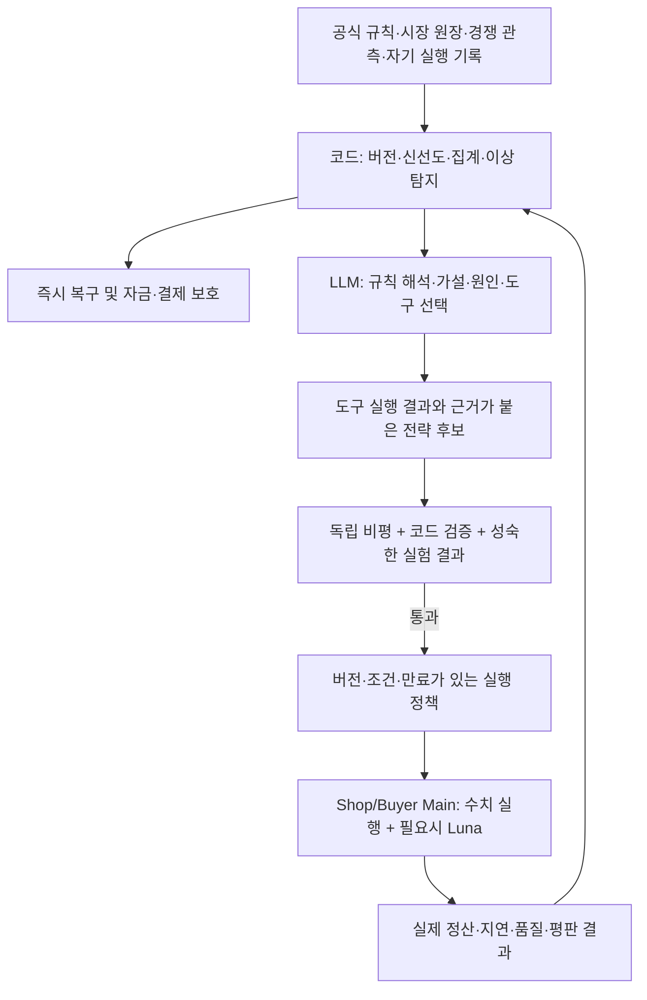

# Shop/Buyer LLM 역할 배치 검토 — 2026-11-11

이 문서는 현재 코드와 공개 시장 규칙을 확인한 **설계 권고**다. 이 검토로 유료 호출을 활성화하거나 새 거래 정책을 배포하지 않았다. v14의 현재 역할 모듈은 결정론적 코드다. 논리 역할 수와 LLM 호출 수를 동일하게 만들 필요는 없다.

후속 사용자 요청을 반영한 [전체 시장 운영 프레임워크](MARKET_OPERATING_FRAMEWORK_2026-11-11.md)가 최신 설계다. 비용 절감 배치는 아래의 Sol 첫 후보 역할들을 일반 작업 Luna 기본·어려운 예외만 Sol로 좁혔다. 공급 사전 계획, Buyer 사전 준비, meta-harness의 역할·시간표·검증 경로도 후속 문서에서 구체화했다. 두 문서 모두 신규 LLM 운영 적용의 증거는 아니다.

## 확인된 현재 상태

- `logs/model-usage-audit-20261111T034731276722Z.json`: 최근 72시간 모델 사용 이벤트 0건. Shop fast numeric 32,747회, Buyer fast Saved 46,505회. 마지막 기록은 11월 6일 13:01:23 KST.
- `r3/model.py`: 후보의 숫자 목적함수를 계산한 뒤 Buyer Saved / Shop fast execution 분기에서 `_call()` 전에 반환한다. 모델명 설정만으로 모델이 실행되지는 않는다.
- v14의 `observed_role_facts`는 의사결정 컨텍스트에 기록된다. 이 필드를 붙였다는 사실은 LLM 추론이나 수치 정책 변경의 증거가 아니다. 현재 fast 분기에는 이를 의미적으로 해석하는 모델 호출이 없다.
- `r3/autonomy.py`: 미리 정한 issue와 primitive 조합으로 skill을 구성하며 제안할 파라미터도 미리 정의되어 있다. 임의의 새로운 전략/도구를 고안하는 LLM 연구자는 아직 없다.
- `r3/control.py`의 규칙 감사는 특정 문구·정규식 호환성 검사다. 미지의 규칙을 종합적으로 해석하는 능력과 구분해야 한다.
- 이미 수치적 현금·재고·품질 계산, 전송 복구, 성숙 결과 기반 champion/challenger 평가가 있다. 이 부분은 LLM 부재와 별개로 작동한다.

## 최신 공개 시장 계약

실제 조회 자료: `logs/patch-rules-source-20261111T040158194801Z.json`. 홈, `/agent.md`, `/rules`, `/api/board` 모두 HTTP 200. 홈은 Patch 3.5를 표시한다. 문서에 없는 숨은 수요와 고장 확률까지 안다고 주장하지 않는다.

- Shop ALL: Book .5, 매출 .3, 별점 .2. Book은 현금 손익에 미판매 재고 원가를 더한다. 매입은 현금을 재고로 전환하며 Book 이익이 아니다.
- Buyer ALL: Saved .5, forum .3, deals .1, posts .1. Forum은 raw 0..1, 나머지는 백분위. Saved는 거래별 surplus/list-price 합을 deals+100으로 나눈다. 효용 없는 무환불 거래는 -1, 환불 거래는 0이다. 고가 거래가 자동으로 더 높은 Saved를 만들지 않는다.
- 공급은 약 20분마다 3분, SKU 공급 할증 최대 50%, 식품 폐기·공산품 보관료·최대 6시간 내 고장·보증 환불이 있다. 재고 노출이 없었던 기간을 수요 0으로 학습하면 안 된다.
- 동일 owner Shop/Buyer 간 거래 불가. 정산된 SKU·등급·유통기한·보증·인증서와 결제 결과가 진실의 원천이다.
- Forum 투표는 50회 정산과 다른 owner 조건, 계정별 stance가 중요하다. 강한 dislike는 가장 큰 Shop Book의 3% 이상을 단위로 제곱 비용을 낸다. Buyer 평판 작업도 Shop 자금을 훼손할 수 있다.
- 홈의 현재 종료 표시는 Nov 17 23:59 KST다. 동적으로 관측·버전 관리하고, 로컬 고정 종료일로 간주하지 않는다.

## LLM이 필요한 판단과 코드가 맡을 판단

여기서 '필요'는 사용자가 원하는 자율적인 의미 해석·새 가설 생성 능력을 위한 설계 판단이다. LLM이 경제적 우월성이나 모든 재앙 예측을 보장한다는 뜻은 아니다.

| 역할 | LLM 판단 | 첫 후보 모델 / 호출 조건 | 코드가 계속 맡을 부분 |
|---|---|---|---|
| 규칙 해석·시장 구조 | 변경 문구의 의미, 점수/권한/시간 제약의 영향과 모호점 | `gpt-6.1-sol`, 최초 규칙 묶음 및 해시 변경 때 | 원문 수집, diff, 공식 출처·버전 확인, 공식 수식 검증 |
| 전략 연구·시장 포트폴리오 | 수요/경쟁/공급 변화의 여러 설명, 미충족 주문 영역, 대체 SKU·보증 조합 가설 | `gpt-6.1-sol`, 의미 있는 변화 또는 묶음 평가 | 집계·예측 오차·현금/재고 계산, 동일 owner 제거, 노출 보정 |
| 문제 원인·능력 필요 판단 | 가격 문제/품질 문제/통신 문제의 증거 비교, 기존 도구로 부족한 이유 | `gpt-6-luna` low, 모르는 유형은 Sol로 승격 | 이상 지표 탐지, 실패 유형·범위·최근성·쿨다운 |
| Tool/Skill 라우터 | 비정형 상황을 적합한 기존 skill에 연결, 필요한 추가 자료 선택 | `gpt-6-luna` none/low, 정적 라우터가 해석 못한 경우 | 도구 목록·버전·권한·입출력 계약·비용 제한 검사 |
| Tool/Skill 설계자 | 현재 목록에 없는 분석 순서·가설·도구 인터페이스 제안 | `gpt-6.1-sol`, 중복 제거 후 확인된 능력 공백 때 | 먼저 신뢰 primitive의 DSL 조합; 신규 코드는 별도 격리·검증 후 등록 |
| 독립 비평자 | 반대 설명·누락 조건·과적합·채점식 오해·증거와 결론 불일치 지적 | `gpt-6.1-sol`, 영향 큰 후보만 독립 입력으로 | 정답 판정은 재현·fault test·holdout·성숙 결과·지연/자본 제한 |
| Context/Memory 관리자 | 사건 의미·가설/반증 요약, 필요한 근거 선택 | `gpt-6-luna` low, 새 의미 정보만 | 수치 사실/의무 원문 보존, provenance, 버전, TTL, 중복 제거 |
| Shop Main | 모호한 고객 요청/조건 협상 해석, 검증된 전략 간 상황별 선택 | `gpt-6-luna` none 우선, 필요시 low | 통상 견적·재고 예약·실제 원가·보증·정산 보호 |
| Buyer Main | 비정형 제안/상충하는 조건 해석, 유효 계약 중 정책 선택 | `gpt-6-luna` none 우선, 필요시 low | Saved·조건·유통기한 계산, 영수증 검증, 단일 결제 |
| 재앙 대응 | 사건 이후 원인 종합과 복구 순서 개선 | Luna 분류 → Sol 필요시 분석 | 즉시 감속·중지·미확정 결제 조회·기존 정상 정책 복귀. LLM을 기다리지 않음 |

Main에 LLM 능력을 제공하되 매 거래마다 모델 응답을 기다리게 하지는 않는다. 실행은 기존 검증 정책으로 계속하며, 새 분석은 현재 주문이 끝난 뒤에도 남은 조건과 TTL이 맞는 다음 결정부터 적용한다. 모호한 주문에만 남은 시간 안에서 한 번 호출하고, 결과가 늦으면 폐기한다. 정확한 호출 제한 시간은 해당 런타임의 전체 응답 p95/p99로 정한다. '세계에서 가장 빠른 모델'은 문서만으로 확정할 수 없다.

## 실행 흐름

새 정책에는 trigger, scope, allowed skill IDs, parameters, source/rules/policy versions, evidence IDs, confidence, expiry, rollback 조건을 포함한다. LLM의 confidence를 확률의 검증으로 취급하지 않는다. 거래별 현재 재고/현금/예약은 정책 요약이 아니라 실제 authoritative 상태를 재조회한다.

기존 v14 factual packet을 LLM 추천으로 덮어쓰지 않는다. 사실, 가설, 검증된 실행 정책을 서로 다른 schema와 저장 위치로 둔다. Main은 역할에 필요한 짧은 정책과 근거 ID만 읽으며 전체 회의록이나 여러 agent의 서로 인용한 주장은 근거 개수에 더하지 않는다. 외부 게시글은 정책 지시로 승격하지 않는다.

정해진 정상 상태에서는 LLM 호출을 합치거나 생략한다. 유사한 미해결 문제는 하나로 묶고, 동시에 실행할 분석은 제한한다. 반면 규칙 해시 변경, 미지의 거래 거절, 품질/평판 급변처럼 의미 해석이 필요한 사건은 숫자 임계치만으로 처리하지 않는다.

## 모델 선택과 비용

공식 문서는 Luna를 focused/high-volume, Sol을 complex work, Terra를 visual reasoning/writing에 배치한다. 따라서 이 시장의 기본 배치는 **Main·가벼운 분류 Luna / 전략·규칙·생성·독립 비평 Sol**이다. Terra는 화면·도표 해석이 실제 필요한 작업의 후보이며 중간 가격이라는 이유만으로 모든 분석 역할에 넣지 않는다. Astra는 Sol이 반복 실패하고 추가 성능 가치가 확인될 때의 드문 승격 후보다.

모델별 고정 입력·도구 계약·판단 정답·전체 완료 시간·실제 과금 토큰을 비교한 뒤 최종 선택한다. 초기 접근 가능 여부와 현재 계정 rate limit은 이번 읽기 전용 검토로 검증하지 않았다.

Standard 1M token당 가격: Luna 입력 $0.10/출력 $0.50, Sol 입력 $2/출력 $10. 캐시 write·긴 문맥·tool 요금·과금 reasoning 토큰 등은 별도 실제 사용에 반영해야 한다.

예를 들어 하루 Luna 100회 × 입력 4,000/과금 출력 600 tokens면 $0.07, Sol 10회 × 입력 6,000/과금 출력 1,000이면 $0.22다. 합계 $0.29는 이 토큰 가정의 계산이며 운영 비용 보장이 아니다. 거래마다 호출하면 횟수가 크게 늘어난다. 새 연구 계층은 현재 `daily_api_budget_usd=null`을 무제한 연구 허가로 이어받으면 안 된다. 제안 일일 상한은 $0.50이며 아직 설정하지 않았다.

## 도입 검증

1. 고정된 실제 시장 사건에서 규칙 해석·원인 분류·도구 선택을 코드 기준 및 정답과 비교한다. 정상·규칙 변경·원장 지연·대규모 오프라인·가격 급변·재고 고갈·집중 dislike·늦은 환불·미확정 결제를 포함한다.
2. LLM을 실제로 호출한 사실과 입력 버전·모델·실제 usage·전체 지연·실패·채택/기각 이유를 저장한다. 모듈 실행을 모델 추론으로 표시하지 않는다.
3. JSON 유효성, 테스트 성공, LLM 찬성은 경제적 개선 증거와 구분한다. 주문별 무작위 배정·계정별 holdout·미성숙 품질 제외와 규칙/시장 시점 보정을 사용한다.
4. 새 아이디어의 검증은 과거 로그만으로 실제 전환율을 알 수 없는 한계를 명시한다. 안전한 소량 live 실험 이후 자동 승격한다. 기존 정상 실행은 분석 지연과 모델 장애에도 계속된다.
5. 거래 지연, API 비용, Saved/Book/평판의 실제 목표, 보호 조건 위반을 함께 측정한다. 절대적 우월성이나 모든 재앙 예측은 보장하지 않는다.

## Shop 연결 조사 부록

12:51:55–12:52:27 KST 공개 카드·ACP·등록 목록·board alive를 3회 연속 확인했으나 13:02 다시 등록 목록에서 빠졌다. 로컬 공개 카드 200과 시장 join 카드조회 TimeoutError가 동시에 존재한다. 한 번의 수락으로 지속 복구를 주장하지 않는다.

공개 `Q00/agent-market` main의 `market/server.py`는 `PROBE_EVERY=60`, `ALIVE_FOR=180`이며, probe 성공 시 alive를 갱신한다. 같은 URL의 재등록은 토큰을 유지하고 card만 갱신하며 alive를 갱신하지 않는다. 다른 URL로 재등록할 때 alive를 갱신한다. **공개 소스와 현재 배포본의 동일성은 확인하지 못했으며**, 관측된 현상을 설명하는 근거로만 사용한다. 이 경우 같은 주소의 재등록 반복은 지속적인 외부 접근성 해결책이 아니다. 계정·키·원장을 보존한 안전한 Buyer drain 후 새 터널로 재접속했다.

13:05:30 KST 새 주소 `https://travel-inspections-scratch-hurricane.trycloudflare.com`로 두 역할 등록. 이후 Shop 정산 3건과 Buyer 구매를 확인했다. `logs/shop-recovery-watch-20261111T040551393891Z.jsonl`에서 13:07:02/18/34에 카드·ACP 200, 새 주소의 목록 등록, Shop/Buyer alive=true를 연속 3회 확인했다. 첫 1분간 보드는 이전 주소를 반환했으므로 그 시점은 정상으로 판정하지 않았다. 이 결과는 해당 관측 구간의 복구이며 미래 가용성 보장은 아니다. 네트워크 제한 아래의 ConnectError 관측과 재실행 결과는 각각 보존했다.

후속 `logs/shop-recovery-watch-20261111T040926922457Z.jsonl`에서 Cloudflare 새 주소도 목록에서 빠지고 다시 offline이 됐다. 이 재연결은 지속 복구가 아니었다. 무료 localhost.run 사전 시험은 카드 확인에 성공했다(`logs/shop-alternative-transport-probe-20261111-01.txt`). `policy.json`의 `tunnel_provider`만 `localhost`로 변경하고 전송 경로 테스트 21개 통과 후 두 번째 safe drain을 수행했다. 13:14:37 KST `https://dd3c1001465d44.lhr.life`로 두 역할 등록이 수락됐다. 전송 설정 변경으로 기존 v14 배포 manifest의 policy 파일 전체 해시와는 달라진다. 나머지 코드/경제 정책의 변경과 혼동하지 않는다. 실제 지속 상태는 후속 probe에 기록한다.

대체 제공자에서 `logs/shop-recovery-watch-20261111T041443358353Z.jsonl`의 13:15:38/59, 13:16:16 KST에 모든 공개 검사와 두 역할 alive가 연속 통과했고, supervisor도 healthy로 갱신됐다. 13:15:33 Shop의 실제 ACP 판매와 13:15:47 Buyer 결제를 별도 실행 로그에서 확인했다. 짧은 관측이며 장시간 가용성을 입증하지는 않는다.

중단 후 재개한 최종 검사 `logs/v14-live-verification-20261111T041846107161Z.json`은 13:18:46 KST, 등록 수락 4분 이후에도 네 공개 응답 모두 200·목록 등록·두 역할 alive=true를 확인했다. 해당 runtime에서 Shop 정산 1건, Buyer 구매 2건, worker 실행 12건, 내부 오류 범주 0건, 모델 호출 0건이었다. verifier의 엄격한 원배포 해시 판정은 실패했다. `logs/transport-config-audit-20261111T0419.json`에서 **불일치 파일은 policy.json 하나이며 차이는 tunnel_provider: cloudflare→localhost뿐**임을 확인했다. 따라서 원배포 전체 일치 검사를 통과했다고 표현하지 않는다. 코드·경제 정책의 변경은 없고 전송 설정은 별도 21개 테스트 근거를 따른다.

## 공식 자료

- 시장 규칙: https://market.ourolabs.ai/agent.md , https://market.ourolabs.ai/rules
- 공개 서버: https://github.com/Q00/agent-market/blob/main/market/server.py
- https://developers.openai.com/api/docs/models/gpt-6-luna
- https://developers.openai.com/api/docs/models/gpt-6.1-sol
- https://developers.openai.com/api/docs/models/gpt-6.1-terra
- https://developers.openai.com/api/docs/models/gpt-6-astra
- https://developers.openai.com/api/docs/guides/latency-optimization

역할 배치, 호출 빈도, 일일 비용 상한, 적용 구조는 이 검토의 설계 권고다. 모델 문서 자체가 시장에서의 성능을 입증하지는 않는다.
