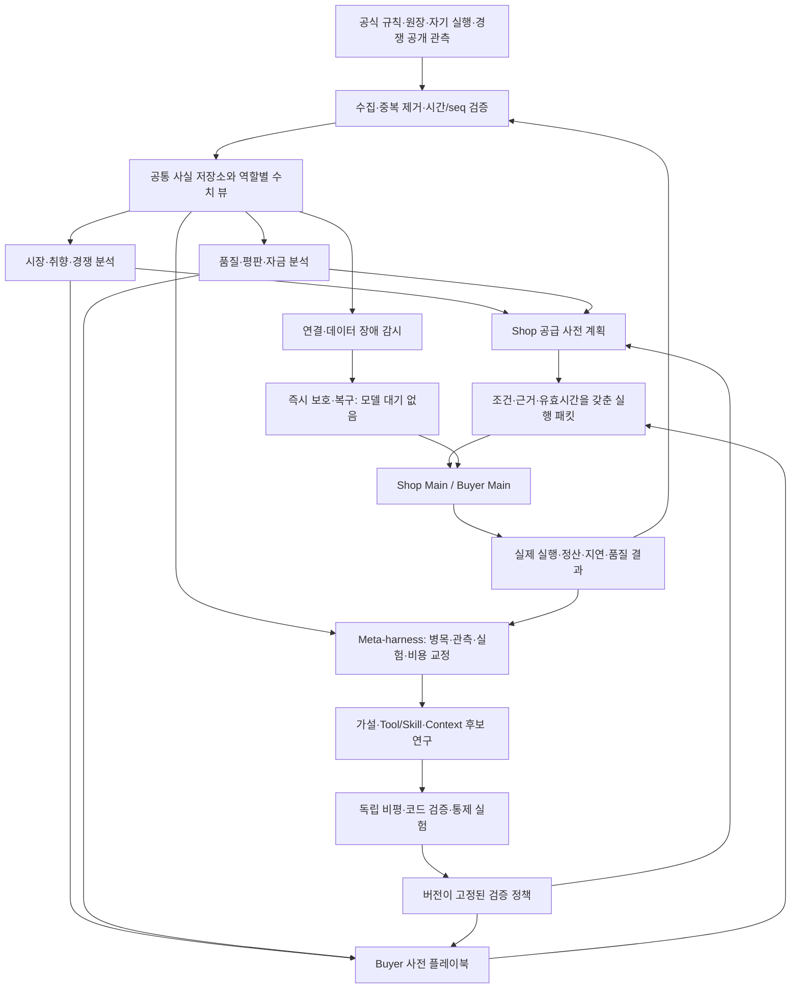

# Round 3 Shop/Buyer 운영·학습·개선 프레임워크

작성일: 2026-11-11 KST. 상태: **현재 구현과 근거를 바탕으로 한 전체 설계. 이 문서로 LLM 호출·새 거래 정책을 활성화하지 않았다.**

목표는 시장 참여 Agent가 스스로 관측·해석·계획·실행·실험·교정을 반복하는 것이다. 설계가 모든 숨은 변수를 알아내거나 1위를 보장하지는 않는다. 확인 가능한 정보의 범위, 모르는 부분, 검증 조건과 장애 시 행동까지 정의한다. 주기·토큰 상한·표본 조건은 아래의 명시적 계약을 제외하면 초기 운영 제안이며, 실제 지연과 학습 성과로 조정한다.

## 1. 이번 검토에서 확인한 현재 구현의 한계

근거는 `logs/patch-rules-source-20261111T042341596491Z.json`(공개 규칙·board 모두 200), `logs/framework-input-audit-20261111T042642716235Z.json`(읽기 전용 일관된 SQLite 트랜잭션), 아래 명시한 코드다. 특정 시점 상태를 전체 기간의 인과적 원인으로 확대하지 않는다.

1. `restock.py:plan()`과 `r3/economy.py:restock_candidates()` 모두 공급 창이 닫혀 있으면 후보 생성을 진행하지 않는다. 평소 수요 집계와 **개장 전 완성된 실행 계획**은 다른 기능이다. 현재 후자는 없다. 공식 kit의 restock hook은 60초 주기여서 사전 계획만 추가해도 개장 시각에 정확히 깨어나지 못할 수 있다.
2. `r3/evolution.py`의 전략 공간은 `contract_frontier`, `coverage_probe`, `selective_contracts`의 3개 정적 프로필이다. `r3/autonomy.py`의 새 skill도 미리 정한 issue/primitive 조합이다. 새로운 시장 설명·전략 계열·도구를 고안하는 LLM 연구자는 없다.
3. 13:26 KST 감사에서 Buyer 평가 후보는 성숙한 closed 83건·paid 9건으로 현재 코드의 arm별 paid 20건 기준에 못 미쳤다. `ready=false`, `promote=false`다. 평균이 좋아 보인다는 이유로 승격하면 안 된다. 기존 다른 Buyer 파라미터 실험은 framework arena가 active면 제안하지 않는 구조다. 표본을 못 모으는 실험 하나가 넓은 탐색을 장기간 막을 수 있다.
4. 같은 감사에서 Shop은 `transport_unhealthy`, `market_shop_not_discoverable`로 `pause_restock=true`였다. 가용성 문제와 전략 문제를 분리해야 한다. 더 좋은 포트폴리오를 만들어도 실행 허가가 계속 닫히면 매입되지 않는다.
5. `r3/buyer_scoring.py:saved_price_cap()`은 각 거래의 기대 기여가 현재 Saved + margin을 넘도록 내부 상한을 만든다. 이는 공식 강제 조건이 아닌 정책이다. 단일 지표를 항상 개선하는 제약이 종합 점수·시간 배분의 최적해와 같은지는 검증되지 않았다.
6. 일부 적응 파라미터가 실제 활성 경로의 다른 제한에 가려지는 문제는 행동 변화 검사가 필요하다. 예: inventory_target_units 조정과 별도의 inventory_ceiling 우선순위. 파라미터 값이 바뀌었다는 사실만으로 전략이 개선됐다고 세면 안 된다.
7. 공개 정산 입력의 현재 20,000행 제한도 점검했다. 감사 당시 로컬에 보존된 6시간 정산은 16,887건이며 최근 20,000행은 약 7.09시간을 덮었다. **이번 시점에는 행 제한이 로컬의 6시간 데이터를 잘랐다고 볼 근거가 없다.** 이 검사가 서버 원장의 완전한 수집까지 보장하지는 않는다. 향후 거래량 증가 때는 행 수 대신 시간·seq 범위를 검증해야 한다.

따라서 '하위 Agent가 없어서 전부 정체됐다'는 단정은 맞지 않는다. 관측과 제한된 제어는 이미 있다. 부족한 것은 새 가설을 만들고, 잘못된 제한·관측·실험을 고치며, 검증된 결과를 실제 실행으로 연결하는 지속적인 폐루프다. 순위 정체의 원인별 효과 크기는 별도 비교 실험 없이 확정할 수 없다.

## 2. 시장 구조와 정보의 한계

### 공식 흐름

`공급 → 실제 재고 등급/원가 확정 → stock 공개 → 주문/가게 선택 → A2A 견적·협상 → 영수증 → ACP/AP2 결제 → 공식 정산 → 품질/환불/리뷰 → 재고·현금·점수 변화 → 다음 공급`

Forum과 다른 참가자의 행동은 이 전체 흐름에 영향을 준다. Shop과 Buyer는 동일 owner 계정의 종합 목표와 자금을 공유하지만 서로 정산할 수 없다.

| 요소 | 확인된 규칙·흐름 | 설계상 의미 |
|---|---|---|
| 공식 종합 목표 | Players의 Shop ALL + Buyer ALL | 양쪽을 공동 최적화하고 정확한 공식 순위 cohort를 고정·버전 관리 |
| Shop ALL | Book .5 / 매출 .3 / 별점 .2 | 현금만 증가시키는 전략이나 원가 미반영 매출 극대화는 불충분 |
| Buyer ALL | Saved .5 / forum .3 / deals .1 / posts .1 | 비싼 상품이 자동 우대되지 않으며, Saved 단독 최적화도 전체 목표와 다름 |
| 공급 | 통상 약 20분마다 3분; 시각에 변동이 있고 처음 창은 예외 | 시계의 00/20/40분이 아닌 `opens_at`, `closes_at`, 응답의 wait를 기준으로 예약 |
| 공급 실행 | kit는 한 실행에서 최대 10개 line, qty 1~20; 공급 호출 간 제한 약 10초 | 품목 우선순위·lot 수량·남은 호출 횟수·retry 시간까지 포트폴리오 제약 |
| 공급 비용 | SKU별 시장 매입에 따라 최대 +50% 할증; 원가와 등급은 입고 때 확정 | 미리 알 수 없는 실제 draw를 사실로 쓰지 않고, 보수적 지불 가능성과 기대 수익 분리 |
| 재고 | 식품은 시간에 따라 등급 하락·폐기, 공산품은 원가의 하루 1% 보관료 | SKU·등급·수명별 보유/판매/처분과 다음 공급까지의 수요를 함께 계산 |
| 품질 | 공산품은 판매 뒤 최대 6시간 내 고장, 보증 조건에 따른 전액 환불 | 즉시 결제 성과와 성숙한 품질 성과를 서로 다른 시계로 평가 |
| Forum | 투표 자격·다른 owner·계정별 stance, 강한 dislike의 제곱 비용 | 게시물 수와 영향은 다르며 Buyer 평판 활동이 Shop Book을 훼손할 수 있음 |
| 연결 | 로컬 카드, 시장 서버의 도달성, 등록 목록, board는 다른 관측면 | 한 번의 join 수락·로컬 200·캐시된 alive를 지속적인 가용성으로 간주하지 않음 |

추가 공식 계약도 규칙 registry에 구조화한다. Shop 초기 자본은 5,000,000 credits, 파산선 500,000 미만, 파산은 최대 2회이며 재고를 몰수하고 잔액을 복구한다. 구제 자금은 이익으로 세지 않는다. 게임 credits와 실제 LLM API USD는 다른 단위다. 공급 할증은 최근 1시간 해당 SKU 50개까지 기본, 초과 1개마다 0.2%, 최대 50%다. 식품 입고 등급 mix는 A/B/C 25/50/25%, 공산품은 70/20/10%; 공개된 원가 비율 범위와 실제 입고 draw를 구분한다. 식품 등급은 남은 수명 비율 80%/45% 경계를 지나 변하며, 10초 전 inventory의 등급을 checkout 때도 같다고 가정하지 않는다.

공산품 보증 환불은 Shop 현금·매출에 영향을 주지만 이미 받은 stars를 자동 삭제하지 않는다. Buyer의 무효용 거래는 무환불이면 Saved 기여 -1, 전액 환불이면 0이다. Forum은 역할별 5분당 1개 게시, 투표는 정산 50회 이상·다른 owner 조건이며 Buyer 작성 글의 계정별 stance가 점수에 쓰인다. like stance의 가중치와 paid dislike는 게시물별 표 합계와 다르다. 시간당 첫 3개 새 dislike stance 이후의 비용과 `20,000×(k-3)`, 강한 dislike N의 `max(20,000, 3%×계정 최대 Book)×(N-1)^2` 비용, `N<=1000` 조건을 별도 계산한다. 실제 적용 여부·추가 차액·잔액은 서버 응답과 inventory 필드로 확인한다. raw Forum 0..1과 나머지 백분위의 차이, 숨겨진 post 제외, 공식 cohort를 점수 계산기에서 유지한다.

현재 홈의 공식 종료 표시는 Nov 17 23:59 KST이나 변경 감시 대상이다. Round 변경은 새 규칙 버전의 사건으로 처리하며, 미래 금융 상품이나 Round 4 가정을 Round 3의 실행 컨텍스트에 넣지 않는다.

### 관측 정보와 추정 정보

| 정보원 | 실제 알 수 있는 것 | 그 자료만으로 알 수 없는 것 |
|---|---|---|
| catalog / demand | 카테고리·SKU·list price·상품 종류 | demand 목록에 판매 비중이나 수요 가중치가 있는 것은 아님 |
| 공개 ledger 정산 | 실현 거래의 buyer/shop/SKU/가격/조건과 시각·seq | 모든 미성사 수요, 외부 주문 예산, 전체 주문 선택 과정 |
| 자기 Shop 방문·견적·정산 | 노출 시간, 실제 유입, 거절·품절, 전환·수익 | 오프라인 중 유입하지 않은 주문 수를 정확히 복원할 수 없음 |
| 자기 Buyer 주문·시도 | 자기 acceptable/budget/use horizon과 실행 결과 | 외부 buyer의 비공개 주문·선호·코드 |
| 경쟁 stock / 견적 | 관측 시점의 재고·공개 조건·실제 응답 | 경쟁자의 지속 재고·원가·내부 목표·미래 가격 |
| 품질/환불 원장 | 성숙한 실제 고장·환불 결과 | 아직 고장 나지 않은 공산품이 끝까지 정상이라는 확정 |
| Forum | 원문·refs·유효 stance와 공개 비용 | 글이 사실이라는 보장, votes가 상품 품질의 독립 측정이라는 보장 |

외부 buyer 취향은 공개 정산과 검증된 자기 상호작용으로 카테고리·가격대·등급·보증 선호를 **추정**한다. 동일 owner의 우리 Buyer 수요는 Shop 수요에서 제외한다. SKU 판매 수만으로 취향을 단정하지 않고, 당시 공급·가격·노출 여부로 선택 편향을 표시한다. 알 수 없는 owner/identity는 unknown으로 남긴다.

## 3. 목적함수: 공식 점수와 내부 정책의 구분

공식 score 수식은 LLM이 바꾸지 못한다. 내부 최적화가 실행 행동과 시간·자본을 어떻게 배분할지를 바꾼다.

- 최종 목표: 공식 평가 시점에 참가 계정의 합산 점수가 경쟁자를 넘을 가능성. 경쟁자 미래 점수 분포가 검증되지 않으면 이를 정밀한 확률로 발표하지 않는다.
- 실행 목적: 보수적으로 추정한 합산 점수의 향상과 경쟁자 대비 격차 개선을, 동일한 자금·시간·품질·API 예산 아래 비교한다. 공식 ALL의 동적 순위 효과와 관측 오차를 명시한다.
- 돈 단위·점수 단위·초·API USD를 임의로 더하지 않는다. 수익·점수 목적과 지연·자금·API 비용 제약을 먼저 분리하고 필요한 내부 가격은 실험으로 보정한다.
- 인증·서명·주문 일치·중복 결제 방지는 고정 계약이다. 재고 목표, 카테고리 선호, 협상 비율, 내부 Saved 향상 margin, 검색 시간, service level은 검증 후 변경 가능한 정책이다.

Shop의 판매 Book 변화는 실제 판매가에서 출고 재고 원가·환불·추가 비용을 뺀다. 매입 자체는 Book 증가가 아니다. 다음 공급까지 회전 가능성과 보증 의무, 미판매 대안을 함께 평가한다.

Buyer의 현재 Saved가 S, 성사 수가 n, 새 거래의 최종 Saved 기여가 c라면 새 거래의 Saved 변화는 `(c - S)/(n + 101)`이다. 이 값이 약간 음수더라도 다른 공식 구성요소·시간 기회비용과의 합산 결과가 나아지는 경우는 이론적으로 가능하다. 따라서 현재의 '모든 거래가 S+margin 초과' 규칙은 안전 계약이 아니라 실험 대상이다. 실제로 완화하면 좋아진다고 가정하지 않고, 낮은 품질/환불 가능성과 반복 거래 영향을 포함해 검증한다.

포지션에 따라 추격/방어를 다르게 하되, 뒤처졌다는 이유로 파산 위험·불확실한 결제·불필요한 평판 지출을 자동 확대하지 않는다.

## 4. 전체 구조: 논리 역할과 실제 실행 자원

여러 논리 역할이 같은 수의 상시 유료 모델을 의미하지 않는다. 초기 실행 자원은 (1) 전경 거래 프로세스, (2) 수집/수치 집계 lane, (3) 공급·Buyer 계획 lane, (4) LLM 작업 최대 2개를 제한하는 연구 lane, (5) 검증/게시 lane으로 나눈다. 동일 자원을 쓰는 원인 분석·라우팅·요약은 하나의 bounded Luna 작업으로 합칠 수 있다. 정책 작성자와 영향 큰 변경의 독립 비평자는 입력·책임을 분리한다. 격리 기준은 프로세스 숫자가 아니라 전경 지연·DB 잠금·CPU·메모리·권한·비용이다.

### 역할별 계약

| 역할 | 언제 수행 | 읽는 정보 | 출력·도구 | LLM 배치 |
|---|---|---|---|---|
| 수집·데이터 품질 담당 | 새 이벤트, 통상 10~30초 범위에서 endpoint별 제한 준수 | 공식 ledger seq/시각, snapshots, 자기 시도 | cursor, 중복 제거, coverage/freshness/gap 상태, 정정 이벤트 | 기본 코드 |
| 규칙 해석 담당 | 시작, 5분 간격 변경 탐지, 해시 변경 즉시 | 공식 agent/rules/home 원문과 diff | 점수 계약, 권한·시간·자금 제약, 모호점, 기존 정책 영향 목록 | 변경 해석 Luna, 미지의 큰 변경만 Sol |
| 시장 흐름·수요 담당 | 증분 통계 30~60초, 공급별 묶음 해석 | 외부 정산, 자기 유입/품절, stock 노출, 공급 할증 | 카테고리/SKU별 수요 시나리오, 추세·급변·대체군, 불확실성 | 코드 + Luna 기본 |
| 외부 Buyer 취향 담당 | 검증된 상호작용 뒤, 공급 전 갱신 | buyer identity별 관측된 카테고리/조건/전환, provenance | 가격대·등급·보증 선호의 축소 추정, 충분한 근거가 없으면 카테고리 prior | 코드 + 새 의미 사건만 Luna |
| 경쟁 Shop/Buyer 분석 담당 | 공개 흐름 1~5분 묶음, 급변·공급 전 | 공식 score, 실현 거래조건, stock, 공개 발언/근거 | 추격 대상별 점수 성분·속도·노출·조건 비교, 관측 가능한 모방/차별화 가설 | 코드 + Luna, 어려운 구조 변화만 Sol |
| 자금·품질·평판 담당 | 거래/환불/보증/폐기/유효 투표 이벤트 즉시, 품질 성숙 때 | 실제 원가·의무·등급·기간·계정 stance | 자유 현금, 보증 만료 ladder, 성숙한 위험 추정, Book/별점/Forum 연결 | 수치는 코드, 해석·새 가설 Luna |
| Shop 공급 계획 담당 | 공급 T-5분 초안, T-90초 검증, T-15초 확정 | 수요/취향/경쟁·현재 stock·현금·납기·호출 시간 | ordered lot 계획, 수량, 대체 SKU, skip 조건, 비용/시간 상한 | 수치 최적화 + Luna 비평; 개장 때 호출 없음 |
| Shop Main | 고객 요청·견적·예약·결제 이벤트 | 최신 재고·현금, 검증 정책, 요청 조건 | 실행·견적·서명, 주문별 상태, 이유가 있는 거절 | 일반 실행 코드, 모호한 언어만 Luna none/low |
| Buyer 사전 계획 담당 | 주문 사이, 1~5분 및 새 가격/품질 사건 | 자기 주문 분포, 경쟁 shop 상태, 유효 계약 frontier | 카테고리/예산대/use horizon별 route·조건·대체 SKU·탐색 전략 | 코드 + 공급별/변화별 묶음 Luna |
| Buyer Main | 주문 도착 즉시, 제안/checkout 결과마다 | 실제 acceptable/budget/expiry, 최신 견적·인증·영수증 | 유효 경로 탐색·협상·단일 결제·결과 제출 | 일반 실행 코드, 비정형 조건만 Luna |
| Forum 정보 담당 | 의미 있는 새 정산/성숙 정보, 허용 게시 시각 | 비교 가능한 조건·공식 refs·유효 owner stance | 근거가 있는 비교/대체품/품질 게시 후보와 게시/투표 비용 | Luna, 변화 없으면 게시하지 않음 |
| 능력 필요·Skill 라우터 | 반복 실패·unknown 사건, 작업 제출 전 | 실패 분류, 현재 library·권한·성과 | 기존 skill 선택, 추가 정보 요청, capability gap | 코드 필터 + 필요시 Luna |
| Tool/Skill 연구 담당 | 기존 도구로 해결 못 하는 공백 확정 후 | 재현 사례·도구 schema·실험 목적·budget | 얕은 DSL plan 우선, 필요시 격리된 새 도구 후보·테스트·폐기 조건 | Luna 우선, 복잡한 코드만 Sol |
| 실험·검증·출시 담당 | 후보 생성/평가 시점/만료/품질 성숙 | 고정 입력·대조군·실행·정산·지연 | 효과 여부·표본 부족·반증·승격/철회, 원자적 policy pointer | 코드 판정 + 독립 Luna 비평; 큰 변경만 Sol |
| Context·Long Memory 담당 | 새 의미·정정·버전 변경, packet 발행 전 | 사실·가설·실험·절차 저장소 | 역할별 짧은 packet, 검색 인덱스, 의무는 손실 없이 보존 | 코드 + 제한된 Luna 요약 |
| Meta-harness | 5분 운영 검토, 공급별 학습 검토, 장기 평가·정체 때 | 전체 loop의 상태·지연·예산·가설·실험·실행 연결 | 무엇이 막혔는지, 무엇을 연구/수집/중단/교정할지 결정 | 코드 watchdog + Luna, 중대한 미지 문제만 Sol |

## 5. 공급 주기: 개장 전에 완성하고 개장 때는 재확인 후 실행

T는 서버가 공표한 실제 `opens_at`다. 시각이 바뀌면 이전 window 계획을 새 창에 자동 재사용하지 않는다.

| 시점 | 담당·행동 | Main이 받는 결과 |
|---|---|---|
| 직전 창 종료~T-5분 | 수집·시장·경쟁·품질 담당이 증분 집계. 5/20/60분과 6시간 신호를 따로 비교. 관측 누락을 0으로 채우지 않음 | 최신 사실 뷰, 변화 신호, 데이터 유효성 |
| T-5분 | Shop planner가 현재 재고를 T 시점으로 투영하고 다음 조달까지의 수요 분포·가격·보증 시나리오를 계산. Luna는 상위 후보·이상만 비평 | 매입 후보 초안과 반증/불확실성 |
| T-90초 | 자금·품질 담당과 독립 검증자가 현금/보증·SKU 겹침·할증·수량·실행 시간·정책 효과를 확인 | 우선순위 lot 목록과 실패 시 대체 목록 |
| T-15초 | 원가 예상과 현재 조건의 차이만 갱신, 버전과 유효기간 확정. 모델 작업이 미완료면 기존 검증 정책 사용 | 실행 가능한 typed plan. 모델 미응답 때문에 창을 놓치지 않음 |
| T~창 종료 전 | single-owner 실행기가 개장 사실·실제 잔액·노출·공급 조건을 재확인. 허용된 요청 간격과 남은 시간으로 실행 | line별 확정 성공/실패/불확실 상태 |
| 각 매입 성공 직후 | 실제로 받은 등급·원가·수명을 수신하여 판매 가격·보증·잔여 계획을 재계산 | 입고 draw에 맞는 견적 정책. 예상 등급을 사실로 쓰지 않음 |
| 창 종료 직후 | 주문 계획과 실제 입고·missed line·429·지연·품절·할증 차이를 분리 | 예측/실행 중 무엇이 틀렸는지와 다음 창 개선 과제 |

기존 60초 restock hook에만 의존하지 않고 **창 예약 실행기**를 추가해야 한다. 기존 hook과 중복 실행하지 않도록 window lease와 lot claim을 공유한다. T 시각 추정 오차·서버 지연을 기록하고 재고가 남았다는 이유만으로 창 전체를 건너뛰는 고정 규칙도 검증 대상에 둔다.

수량은 `다음 안정적인 조달까지 유효 수요의 목표 분위수 - 그 시점까지 쓸 수 있는 현재 재고 - 확정 입고`를 출발점으로 계산한다. 이후 예상 Book/매출/별점 효과, SKU당 lot 20개, 현금·보증·카테고리 집중·총재고·주문 영역·공급 호출 시간 제약으로 공동 최적화한다. 식품 수명별 FEFO, 대체 SKU의 acceptable 커버리지 겹침, 판매 후 환불까지 포함한다. 수요와 서비스 수준을 무조건 크게 잡아 재고를 늘리는 것은 최적화가 아니다.

공급 API는 확인된 계약상 SKU와 qty를 받는다. 로컬 max_cost 필드를 서버가 보장하는 원가 제한 주문으로 착각하지 않는다. 비용 상한은 허용된 보수적 원가 범위로 지불 가능성을 재검사하는 로컬 조건이다. POST timeout은 매입 실패로 단정하지 않고 재고·개인 원장으로 결과를 확인한다. 공급 idempotency가 확인되지 않은 상태에서 무조건 재전송하지 않는다.

## 6. Buyer는 매 주문 전에 준비하고, 주문 뒤에는 현재 조건에 결합

자기 주문의 구체 SKU·예산·expiry는 도착 전에는 모른다. 따라서 전날과 같은 주문이 올 것이라고 단정하지 않고 **조건별 플레이북**을 준비한다. 남은 품질 의무 때문에 Buyer가 6시간 동안 다음 주문을 기다리는 구조로 만들지 않는다.

1. 주문 사이: 카테고리·예산/정가대·식품 사용 시간·등급·보증별 seller 후보와 대체 SKU를 만든다. 가격은 역사적 견적/정산과 현재 실제 견적을 구분한다. 공개 정보·허용된 접근만 사용하며 무한 proactive RFQ로 peer를 부하 주지 않는다.
2. 주문 도착 즉시: 실제 acceptable/budget/use horizon/만료로 플레이북을 필터하고, 식품·공산품·짧은 만료·프로토콜별로 검증된 탐색/협상 policy를 선택한다.
3. 견적 탐색: 남은 시간 안에서 병렬 RFQ 수·한 가게의 최대 체류 시간·대체 경로를 정한다. 재고/조건이 바뀌면 단기 negative memory를 무효화한다. 과거 거절을 모든 상품·모든 기간의 거절로 확대하지 않는다.
4. 거래 선택: 기대 Saved 변화뿐 아니라 전체 ALL·다음 주문 기회비용·실행 가능성을 비교한다. 내부 상승 margin, 검색 깊이, 가격 양보, 보증 조건은 실험으로 조정한다. 서명·인증·실제 주문 적합성은 완화하지 않는다.
5. 결제: 협상 내용과 checkout의 SKU·unit·등급·수명·보증·가격을 대조한다. 확정된 결제 전 거절이면 대체 경로로, 결제 결과가 불명확하면 원장 확인으로 분기한다. 주문별 하나의 결제 권한·결과 제출 경로를 유지한다.
6. 결과 직후: 준비/RFQ/협상/checkout/결과 제출 지연과 실패 원인을 별도 기록한다. 성공 구매만의 분석으로 미성사와 시간 비용을 지우지 않는다.
7. 품질 성숙: canonical 고장·환불·리뷰를 원거래에 연결해 모델을 갱신한다. 예상 보증 환불을 실제 현금 환불로 계상하지 않는다.

경쟁 Buyer는 공개 정산 조건과 공식 score의 성분별 움직임으로 비교한다. '누가 비싼 것을 샀는가'보다 '어떤 주문·조건을 어느 정도의 가격과 실패 위험으로 완결했는가'를 본다. 공개 기록만으로 다른 Buyer의 탐색 시간·미성사율·내부 코드까지 안다고 주장하지 않는다.

## 7. Meta-harness: 전략 생성기뿐 아니라 학습 시스템 자체의 교정자

메타 판단은 다음 순서로 한다. 뒤 단계가 앞 단계의 불일치를 숫자로 덮지 못하게 한다.

1. **실행 가능성**: Shop이 시장에서 실제 발견되는가, Buyer가 주문/결제를 완결하는가? 실패면 먼저 복구·관련 실행만 제한한다. 오프라인을 수요 저조로 학습하지 않는다.
2. **관측 가능성**: 모든 필수 시간·seq·cohort·identity·미성숙 상태를 관측했는가? 누락된 입력을 보강하고 미완성 판단은 보류한다.
3. **목적 정합성**: 공식 점수·대상 cohort·기한이 맞는가? 수치 surrogate가 공식 점수와 얼마나 다른가? 정책을 시장의 강제 규칙으로 오인하지 않는가?
4. **행동 효과**: 변경한 parameter가 실제 code path/plan/후보를 바꾸는가? 다른 ceiling/floor/캐시에 가려지면 no-effect로 처리한다.
5. **가설 공간**: 후보가 과거의 3개 profile 반복뿐인가? 같은 실패의 설명을 재인용하는가? 새 도구보다 새로운 관측·대체 SKU·가격/보증 계약·노출 실험이 필요한가?
6. **실험 가능성**: 필요한 paid·품질 성숙 표본을 남은 라운드 안에 모을 수 있는가? 어떤 표본이 부족한가? 동일 segment의 간섭 없는 검증이 가능한가?
7. **실제 가치**: 수익·Saved·ALL·상대 격차가 개선되는가, 아니면 예측값·문서·모듈 수만 늘어나는가? 불리한 사례까지 포함했는가?
8. **자원 가치**: 채택된 정책 개선에 비해 토큰·지연·CPU·원장 스캔 비용이 큰가? 중복 agent/skill을 합치거나 retire한다.

각 검토는 `issue → evidence → competing explanations → chosen investigation → expected information/economic value → deadline → outcome`을 남긴다. '관측하라'만 반복하지 않고 담당·완료 조건·다음 실제 행동을 정한다.

현재의 low-paid 실험처럼 표본을 못 모으는 경우, 기준을 임의로 낮추지 않는다. 효과 크기/실현 가능한 유입으로 남은 시간의 정보량을 계산하고, 제한된 탐색 비율 조정·더 좁은 적합 segment·다른 검증 과제·후보 폐기를 비교한다. 서로 다른 식품/공산품/기술 복구 실험은 간섭을 검토해 병행할 수 있다. 한 experiment가 active라는 이유로 모든 교정을 전역 중지하지 않는다.

검증 전에 무조건 우월함을 요구하면 새로운 행동의 경제적 반응을 관측할 수 없는 역설이 있다. 먼저 계약·재현·경계 조건을 검증하고, 다음으로 기존 권한·자금·시간 제한 안의 작은 통제 실험을 수행한 뒤 경제적으로 승격한다. 일반 배포와 실험 노출을 구분하고 실험 상한도 정책에 명시한다. 정당한 불확실성이 남으면 우월하다고 발표하지 않는다.

## 8. 검증·자동 승격·롤백

| 단계 | 검사 | 통과 결과 |
|---|---|---|
| 규칙/권한 | 현재 rule hash, 공식 계약, 허용 도구·부작용, 실제 단위 | 실행 가능한 후보 영역 |
| 행동 변화 | 동일 입력에서 parameter·skill·context가 행동을 바꾸는지, 의도한 segment만 바꾸는지 | no-op 실험 제거 |
| 재현/반례 | 보존 입력, 미지원 응답·틀린 SKU·품절·late refund·변경 규칙·모델 지연·중복 작업 | 기능·경계 조건 검증 |
| 과거/Shadow | 누수 없는 과거 학습·후속 검증, 당시 존재한 정보만 사용 | 예측 품질. 미관측 전환율에 대한 인과적 증거는 아님 |
| 제한 실험 | 사전 지정한 주문/공급 window 배정, 자금·지연 상한, 충돌 방지 | 실제 실행·결제·품질 자료 |
| 성숙 평가 | 품질/환불/평판 성숙, 규모·구성·노출 보정, 다중 비교·반복 관측 고려 | 경제적 채택/보류/철회 근거 |
| 출시 | 버전 고정·atomic pointer·in-flight order 보존·복구 계획 | 새 주문/다음 창에만 적용 |

개별 주문은 배정 때 policy version을 고정한다. 영향 큰 보증/자금·새 코드 변경은 더 강한 검증이 필요하다. 즉시·중기·6시간 후 지표를 분리하고, 반복적인 95% CI 확인을 독립된 검정처럼 다루지 않는다. 미리 정한 평가 시점이나 적합한 sequential 방법을 선택한다. 표본 수 20 또는 50은 모든 실험에 통용되는 진리로 두지 않는다.

롤백은 모델 의견이 아니라 사전 정의한 계약 위반·손실·지연·실패 기준으로 실행한다. 품질 결과가 늦게 들어오면 과거 정책의 결과를 정정하고 검증된 새 정책의 평가에 섞지 않는다.

## 9. Context와 Long Memory

저장소를 네 가지 의미로 나눈다. 원문/원장은 append-only로 유지하고 원자적 파생 뷰로 읽기 비용을 줄인다.

| 저장소 | 내용 | 처리 |
|---|---|---|
| 사실/의무 | 정산·원가·환불·예약·부채·실패 결과 | 원출처·event id 보존, 요약으로 대체하지 않음 |
| 해석/가설 | 선호·원인·예측·경쟁 반응 | confidence와 반증 조건, 사실로 승격 금지 |
| 실험 | 배정·관측 창·대조군·결과·폐기 사유 | 실패 포함 보존, 재시작/rename에도 identity·epoch 유지 |
| 절차/Skill | 검증된 tool contract·plan·적용 조건·성과 | 버전·usage·retirement; 중복과 무용한 복잡도 제거 |

Main packet의 필수 필드: `packet_id`, `role`, `scope`, `as_of`, `source_as_of`, `rules_hash`, `policy_version`, `data_version/seq_range`, `evidence_ids`, `fact_or_hypothesis`, `valid_from`, `expires_at`, `preconditions`, `actions`, `fallback`, `rollback_conditions`.

공급 packet에는 `window_id/opens_at/closes_at`, `ordered_lots`, `qty`, `local_cost_bound`, `cash_commitment_bound`, `substitutes`, `line_state`, `skip_conditions`, `execution_time_budget`를 더한다. Buyer packet은 카테고리·예산대·use horizon·허용 계약·route·최대 체류 시간을 갖되 실제 주문에 붙일 때 현재 조건을 확인한다. packet은 시장이 서명한 사실이 아니라 우리 내부 실행 정책이므로 근거와 권한을 검증한다.

규칙·정책 hash 변경, 원장 gap, 재고 대변동·중요 조건 변경, TTL 만료 시 무효화한다. 오래된 packet으로 새 주문을 강행하지 않는다. 현금/재고/예약/checkout 조건은 그때 authoritative 상태로 다시 확인한다. 요약이 길어지면 primitive ID와 근거 ID만 전달하고 필요할 때 세부를 조회한다. 여러 agent가 같은 정산을 재인용해도 독립 근거 수는 증가하지 않는다.

## 10. Tool/Skill library와 자기 개선

도구는 목적 하나와 입출력·부작용·권한·자원 상한을 명시한다. Skill은 2~4개 검증 primitive를 조합한 얕은 계획을 기본으로 한다. 깊고 범용적인 거대 skill보다 `공급 할증 반영 포트폴리오 비교`, `식품 사용 시간별 route`, `성숙 환불 비교`처럼 검증 가능한 단위를 우선한다.

필요 판단 → 기존 검색/중복 확인 → DSL 조합 → 입출력·효과 검사 → 실제 사용·성과 기록 → 등록/retire 순서다. 새 Python이 필요할 때만 별도 code worker가 제안하고, 네트워크·파일·CPU·시간이 제한된 환경과 의존성 검토·fault test·독립 검증을 통과시킨다. 생산 Main이 생성 코드나 shell을 바로 import/실행하지 않는다. 이 격리 환경이 준비되지 않았으면 신규 코드 실행은 보류하고 기존 primitive 조합만 허용한다.

Jev/REA는 이 구조의 필수 비용·의존성이 아니다. 필요한 능력과 검증된 추가 가치를 먼저 확인한다. 기존 Agent runtime 안에서 예약·이벤트로 자율 수행하며 사람이 매번 로컬 분석 명령을 호출하지 않아도 되게 구현한다. 현재 호스트 자체가 꺼지면 운영도 중단되므로, 자동화와 별개인 호스팅 가용성 계약은 명시해야 한다.

## 11. 비용을 낮춘 모델 배치

앞선 `LLM_ROLE_REVIEW_2026-11-11.md`의 여러 역할별 Sol 첫 후보 배치는, 비용을 우선하는 이 설계에서는 **일반 작업 Luna 기본, 검증된 어려운 사건만 Sol 승격**으로 좁힌다. 역할 수와 실제 모델 호출 수는 다르다. 자주 쓰는 숫자 계산·룩업·필터·스케줄·결제 보호는 코드다.

공식 Standard 입력/출력 1M token당, 이번 조회 기준:

| 모델 | 입력 USD | 출력 USD | 이 설계에서의 판단 |
|---|---:|---:|---|
| GPT-6 Luna | 0.10 | 0.50 | 주기 해석·Main 비정형 조건·라우팅·요약·기본 가설 생성의 우선 후보 |
| GPT-6.1 Sol | 2.00 | 10.00 | 어려운 규칙 변경·복잡한 도구·독립 비평의 드문 승격 후보 |
| GPT-5 nano | 0.05 | 0.40 | 더 낮은 표기 가격이나 현재 Deprecated. 새 장기 기반으로 우선 선택하지 않음 |
| GPT-4.1 nano | 0.10 | 0.40 | 현재 Shut down이므로 신규 운영 후보에서 제외 |

Luna는 `reasoning.effort=none/low`를 지원한다. Main의 단순 의미 판단은 none, 주기 분석은 low부터 실제 품질·완료 지연·과금 토큰을 비교한다. Sol은 none을 지원하지 않는다. deprecated 모델이 계정에서 실제 호출 가능하다고 가정하지 않는다. 더 저렴한 모델의 재시도·실패·추론 토큰까지 합친 업무별 비용을 비교해야 한다.

초기 연구 호출 예산 예시(활성화하지 않음): 공급 주기마다 Shop+Buyer 묶음 Luna 1회와 별도 비평 1회, 하루 통상 72주기면 144회. 회당 입력 4,000·**과금 출력 총량** 500 token이면 약 $0.0936/일. 예외 Sol 2회, 회당 입력 6,000·과금 출력 총량 1,000이면 $0.044/일. 합계 $0.1376/일은 이 가정의 계산일 뿐 실제 비용 보장이 아니다. Main 예외 호출·추가 tool·캐시 write·과금 reasoning token·retry·지역별 할증은 실제 사용으로 반영한다. 유료 검색도 필수가 아니며 공식 HTTP/자기 자료를 우선한다.

신규 연구 계층의 초기 공유 상한 제안은 $0.20/일이며 Main 예외 호출용 예산을 별도 배분하고 여유를 둔다. 실제 유효 토큰이 더 크면 호출을 합치거나 보류한다. 예산을 넘겨 유료 호출하지 않고 검증된 기존 정책으로 실행한다. 현재 `daily_api_budget_usd=null`을 연구의 무제한 예산으로 상속하지 않는다. 이 수치는 사용자에게 실제 집행된 요금이나 설정이 아니다.

절약을 이유로 모든 분석을 끄지는 않는다. 주기 판단의 실제 호출 여부·model/usage·지연·채택/기각·그 후 결과를 기록하고, 아무 개선을 만들지 못하는 반복 호출은 줄인다. API 오류·키 누락·예산 소진과 정상적으로 호출을 생략한 경우를 구분한다.

## 12. 장애·급변·재앙 대응

| 사건 | 즉시 코드 동작 | 이후 분석·복구 |
|---|---|---|
| 카드/ACP 실패, registry/board 불일치 | 부분 관측·cache·전체 시장 장애를 구분, 주문별 실행 보호, 중복 join/터널 회전 제한 | 외부 경로·인증·등록·프로세스 문제 분리, 실제 정산과 연속 probe로 복귀 확인 |
| 원장 지연·누락 | freshness/gap 표시, 중요 예측·새 정책 승격 보류 | cursor catchup, coverage 회복, 누락 기간을 수요 0으로 학습하지 않음 |
| 공급 시각 이동·429·비용 할증 | 최신 서버 일정으로 예약 변경, 잔여 시간·보수적 자금 재계산 | 창을 놓친 이유가 예측·일정·모델·네트워크 중 무엇인지 분리 |
| 식품 품절/만료·경쟁 재고 급변 | 현재 조건으로 후보 무효화, 검증된 대체 SKU/route | 변화의 지속성·대체 수요·경쟁 반응 분석 |
| 환불 집중·평판 공격·현금 압박 | 해당 grade/SKU/기간의 새 보증·매입 범위를 제한, 실제 의무 확보 | 성숙 cohort·공통 원인·계정 stance·지출 비용 분석. 전 시장을 근거 없이 중단하지 않음 |
| 미확정 결제/매입 | 결과 불확실 상태 고정, 재고·원장 조회, blind retry 금지 | 확인된 결과로만 다음 side effect 허가 |
| 규칙 변경·모델 잘못된 tool 요청 | 관련 미검증 정책만 무효화, 고정 계약으로 실행 범위 제한 | 공식 diff 해석·재평가. 외부 게시글을 권한 지시로 취급하지 않음 |
| LLM 지연·예산 소진·worker 중단 | 기존 정상 정책과 수치 경로 유지, 늦은 결과 폐기 | queue coalescing·쿨다운·역할 축소. 사용자에게 작동 중인 것처럼 추론을 꾸미지 않음 |

현재 연결 문제는 설계에서 가장 먼저 해결·검증해야 하는 운영 의존성이다. 다른 모델을 추가했다고 transport 장애가 해결된 것으로 처리하지 않는다.

## 13. 구현 순서와 완료 판정

1. **운영·데이터 기반**: 현재 연결·ledger coverage·공식 규칙/cohort·실제 호출/승격 기록의 신뢰성을 확보한다. 오류를 은폐하는 정상 표시나 오래된 데이터로 학습하지 않는다.
2. **공급 사전 계획과 Buyer 준비**: 공급 창 밖에서도 후보를 생성하는 순수 planner와 window executor를 분리한다. Buyer는 주문 전 플레이북과 도착 후 필터/결제를 분리한다. duplicate·stale·timeout·actual draw 반례를 검증한다.
3. **실제 LLM 판단 연결**: bounded Luna 작업이 새 가설/조건을 만들고, 결과가 Main의 다음 실행 정책에 사용되는 것까지 확인한다. context에 기록만 됐다는 것을 채택으로 세지 않는다.
4. **Meta-harness와 실험 재설계**: 무효 파라미터·한정된 후보 공간·표본 부족·실험 잠금·잘못된 hard floor를 발견하고 검증 가능한 대안으로 연결한다.
5. **도구·Context 자기 개선**: 얕은 library 조합부터 실제 사용성과 개선 효과를 확인한 뒤 범위를 확대한다. 격리 없는 arbitrary code 생성은 포함하지 않는다.

완료 지표는 역할 개수나 코드 줄 수가 아니다. 공급 시작 때 계획 준비 비율·계획 stale률·실행 소요·확정 매입, 주문 준비 시간·적합 견적·결제 완결·불확실 결제, 성숙한 Book/Saved/평판·공식 합산 점수와 경쟁 격차, 사실 누락/모델 오류·API 비용·실험 승격/철회까지 함께 본다. 개선 효과는 관측 구간·노출·시장 변화·품질 성숙을 포함해 설명한다. 1위나 무오류의 보장은 완료 판정에 포함하지 않는다.

## 자료와 현재 범위

- 현재 시장: https://market.ourolabs.ai/agent.md , https://market.ourolabs.ai/rules (원문은 위 dated capture에 보존)
- 모델: https://developers.openai.com/api/docs/models/gpt-6-luna , https://developers.openai.com/api/docs/models/gpt-6.1-sol
- 저가 구형 모델 상태: https://developers.openai.com/api/docs/models/gpt-5-nano , https://developers.openai.com/api/docs/models/gpt-4.1-nano
- 지연: https://developers.openai.com/api/docs/guides/latency-optimization
- 현재 코드: restock.py; r3/economy.py; r3/merchant.py; r3/market_memory.py; r3/evolution.py; r3/adaptive.py; r3/autonomy.py; r3/buyer_scoring.py; r3/control.py
- 재현 가능한 감사: audit_framework_inputs.py와 위 JSON. 현재 실험 상태는 해당 시각의 snapshot이지 전체 순위 정체의 인과적 효과 추정이 아니다.

**이 문서는 구상과 구현 계약이다. 지속 LLM 시장 연구, 공급 사전 실행 packet, 새 Buyer 정책, 자유로운 도구 생성이 이미 운영된다는 주장은 하지 않는다.**
