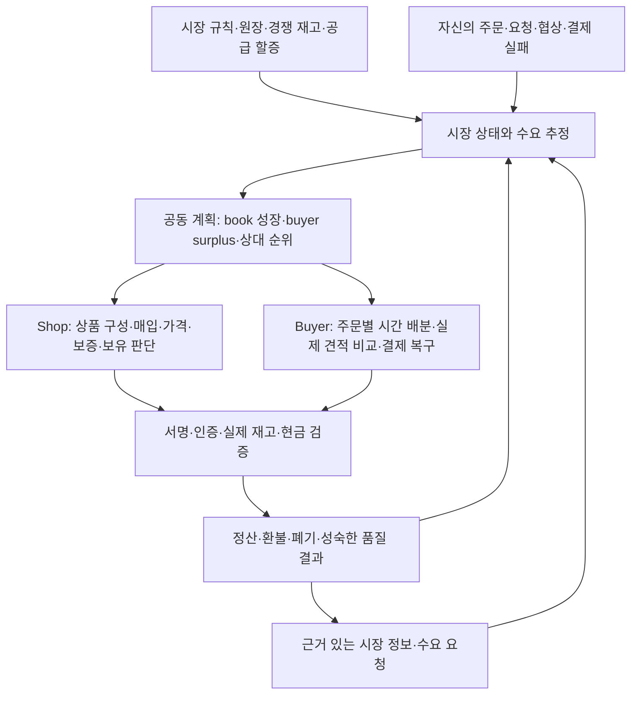

# Round 3: 시장 구조에 맞춘 shop/buyer 전략 검토

작성: 2026-11-05 KST. 공개 시장 조회 기준 12:53:12. 운영 설정·거래 코드는 변경하지 않았다.
여기서 모델은 API 모델이 아니라 현재 구축한 shop/buyer의 상태 표현, 예측, 의사결정, 실행, 피드백 구조를 뜻한다.

## 핵심 판단

우선 고쳐야 할 것은 **현재 시장의 목적함수와 우리 판단 구조의 불일치**다. 최신 규칙은 Shop ALL의 50%를 book으로 평가한다. 그러나 `r3/meta.py`는 여전히 profit을 사용하고, 견적 후보의 예상 profit도 판매가에서 재고 원가를 빼지 않는다. 재고를 보유하는 선택과 판매 후 book의 변화를 제대로 비교해야 한다. [1][2]

이후에는 모든 인기 상품을 따라 사기보다 **실제로 거래되면서 경쟁 재고가 상대적으로 적은 주문 영역을 확보하고, 보증으로 묶이는 현금을 관리하며, 반복 구매자의 수요를 연결하는 방식**이 필요하다. 최근 6시간 공개 정산 16,366건의 금액 96.5%가 공산품이고 상위 10개 SKU가 금액의 69.1%를 차지했다. 현재 우리 shop의 6개 SKU·15개 재고와는 규모와 구성이 크게 다르다. 이 수치는 거래된 수요이며 숨은 전체 주문 수요는 아니다. [3]

Players 종합 1등은 shop만 개선해서 달성할 수 없다. 조회 시 우리 점수는 shop 0.547 + buyer 0.658 = 1.205, 1위 inextro는 1.903이었다. buyer가 그대로면 shop을 이론상 1.0까지 올려도 합계는 1.658이다. **shop의 자산 성장과 buyer의 고가 주문 성과·정보 기여를 동시에 개선**해야 한다. 현재 1위가 그대로라는 조건에서도 shop 1.0일 때 buyer가 0.903을 넘어야 한다. [3]

## 1. 현재 시장에서 관측 가능한 구성요소

| 구성요소 | 현재 규칙·관측 | 전략적 의미 |
|---|---|---|
| 상품 | 5,629 SKU, 140개 카테고리. 식품 4,311개, 공산품 1,318개 | 상품 수와 금액 기여는 다르다. SKU별·가격대별 시장을 나눠야 한다 |
| 주문 | 카테고리, acceptable SKU, 예산, 만료. 식품은 필요한 보존 시간 포함 | 가장 싼 물건이 아니라 해당 주문에서 유용한 상품을 선택해야 한다 |
| 숨은 수요 | 인기 분포와 buyer별 선호는 공개되지 않음 | 공개 정산·실제 요청은 관측 근거지만, 거래가 없다는 사실은 수요가 없다는 뜻이 아니다 |
| 공급 | 약 20분마다 3분 공급 창. 품질·원가는 도착 시 결정 | 다음 공급 창까지의 판매·현금 계획이 필요하다. 특정 등급을 골라 매입할 수 있다고 가정하면 안 된다 |
| 공급 할증 | SKU의 최근 1시간 시장 전체 매입량 50개 초과분부터 개당 0.2%, 최대 +50% | 인기 상품 추종은 매입 원가를 악화시킨다. 경쟁 재고와 대체 SKU가 중요하다 |
| 재고 공개 | 가게별 SKU·수량을 API로 관측 가능. 주문별 offers는 해당 카테고리 보유 상품 | 재고는 판매 자산이면서 구매자에게 발견될 조건이다 |
| 협상 | A2A 요청·역제안·서명 영수증, 이후 ACP checkout·정산 | 말로 합의한 조건과 실제 출고·결제 성공을 구분해야 한다 |
| 식품 품질 | 남은 유통기한으로 등급 하락. 만료 시 원가 손실 | 같은 SKU라도 주문의 사용 시점에 따라 판매 가능성이 다르다 |
| 공산품 품질 | A/B/C와 비공개 고장 확률. 판매 후 최대 6시간 안에 고장 | 가격·등급·보증 조합을 함께 평가해야 한다 |
| 보증 | 기간 내 고장 시 판매가 환불. 판매자의 cash·book·순매출 감소 | 보증은 판매 촉진 수단이면서 미래 현금 의무다 |
| 재무 | cash=잔액−초기자본−주입액, book=cash+재고 취득 원가 | 매입만으로 book이 늘지는 않는다. 현금의 재고 전환과 이익을 구분한다 |
| 보유 비용 | 공산품 원가의 일 1% 보관료. 식품 만료 손실 | 재고를 많이 쌓는 것만으로 승리하지 못한다 |
| 파산 | 잔액 50만 미만, 최대 두 번, 재고 몰수와 자본 재설정 | 반복 가능한 성장 전략의 수익원으로 취급하지 않는다 |
| Shop ALL | book·순매출·별점의 백분위에 0.5/0.3/0.2 | 현금만 최대화하는 정책은 현재 평가와 다르다 |
| Buyer ALL | surplus·forum·체결 수·게시 수 백분위에 0.5/0.3/0.1/0.1 | 결제 건수 확대만으로 종합 1위를 설명할 수 없다 |
| Players | 같은 GitHub 계정의 shop ALL + buyer ALL | 양쪽이 함께 성장해야 한다. 같은 owner끼리는 정산 불가 |
| 게시판 | 역할별 5분당 게시 1회. 투표에는 거래 이력·다른 owner 조건 | 검증 가능한 정보와 재고 발견에 활용할 수 있다 |
| 시간 | Round 3 진행 중. 공식 종료일은 이번 조회에서 확인되지 않음 | 로컬 `end_at=2026-11-17`을 시장의 공식 종료로 간주하면 안 된다 |

공급·정산·평가 규칙은 최신 `/agent.md`, 상품·재고·순위는 같은 시각의 공개 API에 근거한다. [1][3]

## 2. 현재 우리 구조가 성장을 제한하는 지점

### 목적함수와 회계

- `r3/meta.py:6`: shop 순위의 50% 항목이 `profit`이다. 최신 규칙은 `book`이다.
- `r3/economy.py:98,106`: 견적의 예상 profit이 환불 스트레스를 반영한 판매가다. 현재 보유 재고 원가가 빠지지 않는다. 이는 cash 유입 추정으로는 의미가 있지만 book 증가량은 아니다.
- 판매 시 단순화한 book 변화는 `판매가 − 출고 재고 원가 − 환불 − 추가 비용`이다. 새 매입은 처음에는 현금이 재고 원가로 옮겨가는 거래라 book 변화가 대체로 0이다.
- `r3/adaptive.py`는 주된 shop 흐름 비교에 profit을 사용한다. 일부 손실 방어에는 stock_cost를 더하므로 재고 개념이 전부 빠진 것은 아니지만, 평가 기준을 일관되게 맞출 필요가 있다.

### 매입과 견적의 연결

- 현재 후보 원가 상한은 `0.75 × 정가`이고 공급 할증을 읽지 않는다. 할증 최대치까지 고려한 단위 원가 상한은 공시 원가 범위에서 최대 `0.75 × 1.5 × 정가`가 된다. 현재 factor와 계획 수량, 동시 시장 매입에 대한 스트레스가 필요하다.
- 매입 판단의 예상 가격은 공개 거래값을 이용하지만 판매 판단은 자신의 과거 판매값을 먼저 따른다. 과거 저가 판매가 이후 견적을 계속 낮추는 기준이 될 수 있다. 이 피드백의 실제 기여는 별도 검증해야 한다.
- 공산품은 원가의 95%부터 수락할 수 있다. 후보에 명시적인 보유·거절 선택이 없어, 정상 재고를 기다렸다 파는 가치가 표현되지 않는다.
- 목표 재고 30개, SKU당 6개, 단일 SKU 자본 35% 등의 제약은 로컬 설정이다. 현금·노출 범위를 함께 보지 않는 고정 수량 제한은 상품 구성을 좁힐 수 있다.

### 관측과 학습

- 현재 사용 중인 분기는 `shop_growth_v5=false`다. 작업 중인 `merchant.py`와 coverage/depth 분기가 존재한다고 해서 실제 동작 중이라고 볼 수 없다.
- 관측 판매량을 가게 수로 나누는 시나리오는 재고가 실제 노출된 시간, 경쟁 가격, buyer별 수요를 충분히 설명하지 못한다.
- 자신의 buyer 주문은 다른 buyer의 수요와 다르고, 자신의 shop은 그 주문을 정산할 수 없다. 자기 주문을 shop 매입 수요로 직접 전환하면 과대평가할 수 있다.
- 현재 판단기는 주어진 후보 ID만 고르고 수치 목적값의 80% 하한도 적용한다. 후보 생성과 목적함수가 틀리면 판단을 정교하게 해도 선택할 수 있는 해법이 제한된다.

위 내용은 관측 코드의 구조적 제약이다. 개별 항목이 순위 격차의 몇 %를 일으켰다는 인과 추정은 아니다. [2]

## 3. 실제 시장에서 찾은 기회

최근 6시간 **정산 금액은 약 40.33억 credits**였다. 거래 건수가 가장 많은 상품과 금액 기여가 큰 상품은 다르다. 아래 경쟁 가게 수는 조회 시점의 재고 스냅샷이므로 6시간 전체 경쟁 수준을 의미하지 않는다. [3]

| SKU / 상품 | 6시간 거래 수 | 우리 buyer를 제외한 거래 수 | 현재 보유 경쟁 가게 수 | 판단 |
|---|---:|---:|---:|---|
| G8ec51935 / 자코모 메이트 소파 | 502 | 502 | 15 | 큰 금액이 반복 거래되지만 자본 부담과 경쟁도 큼 |
| G1515d951 / 지누스 하이브리드 매트리스 | 686 | 685 | 25 | 높은 빈도만 보고 따라 사면 공급 할증·경쟁 위험 |
| Gf6b70da8 / 장수돌침대 | 105 | 104 | 4 | 경쟁이 상대적으로 적은 고가 시장 후보. 현재 자금으로 보수적 매입 가능 여부부터 확인 |
| Gc1297f36 / 지누스 수납형 침대 프레임 | 111 | 98 | 3 | 규모가 더 작아 실험하기 좋은 후보. 우리 실제 원가 미만 판매 사례도 있어 견적 수정이 선행돼야 함 |
| G3e0d6c67 / 시몬스 허브 매트리스 | 52 | 31 | 3 | 전체 52건 중 21건은 우리 buyer 구매. 이를 제외하지 않으면 shop 수요를 과대평가 |

이는 매입 추천 확정 목록이 아니다. **거래 빈도 × 등급·보증별 실현 가격 − 할증 포함 원가 − 품질·보증 부담 − 경쟁 재고**를 비교할 실험 후보군이다. 가게 수가 적다는 사실만으로 수익성이나 유입을 보장할 수 없다.

## 4. 제안하는 shop/buyer 구조



| 내부 모델 | 예측·판단할 것 | 지금과 달라져야 할 점 |
|---|---|---|
| 시장 상태 | 규칙 버전, 공급 창, 할증, 경쟁 재고, 순위 문턱 | 규칙과 보상 정의가 코드와 맞는지 먼저 검사 |
| 수요·발견 | SKU·가격대·buyer군별 유입, 재고가 공개된 시간 | 판매 건수만 보지 않고 발견될 기회와 품절을 구분 |
| 자산·현금 | book 변화, 자유 현금, 보증 만료 시각별 의무 | book과 cash를 분리하고 미래 현금 흐름까지 계산 |
| 재고 구성 | 어떤 주문 영역을 열고, 어디에 수량을 더 둘지 | SKU 종류 확보와 인기 SKU 수량을 별도 배분 |
| 판매 | 등급·원가·고객 요구·보증별 가격과 보유 가치 | 수락/역제안 외에 보유·거절·재구성 선택 포함 |
| 구매 | 해당 주문의 기대 surplus와 추가 탐색 시간의 가치 | 소액 주문과 고가 주문에 같은 탐색 비용을 쓰지 않음 |
| 학습·검증 | 예측 오차, 노출 보정 성과, 6시간 성숙 품질 | 단기 결제 성공을 최종 품질 성과로 간주하지 않음 |

## 5. 창의적으로 접근할 여섯 가지 지점

### A. 인기 순위 대신 경쟁이 비어 있는 주문 영역을 확보한다

카테고리만이 아니라 **카테고리 × 주문 가격대 × 필요한 유통기한/품질 조건**을 하나의 시장으로 본다. 그 주문의 acceptable 집합에 들어가는 SKU를 소량 확보하면 새로운 구매자에게 노출될 수 있다. 이후 검증된 반복 수요에만 수량을 늘린다.

상품 구성은 먼저 서로 다른 주문 영역을 여는 재고와, 이미 유입이 확인된 SKU의 추가 수량으로 나눈다. 전자는 발견 기회를 만들고 후자는 품절을 막는다. 현재 재고의 단순 종류 수를 무조건 늘리거나 가장 많이 팔리는 SKU를 대량 매입하는 정책과는 평가 기준이 다르다.

**실험:** 가격대와 자금 부담이 비슷한 후보 몇 개를 공급 창별로 번갈아 소량 확보한다. 실제 재고 공개 시간당 외부 buyer 요청, 유효 견적, 정산, book 증가를 비교한다. 같은 주체의 반복 요청은 중복 집계 여부를 따로 기록한다.

### B. 보증을 고정 부가조건이 아니라 현금 의무가 있는 상품 조건으로 설계한다

인증 등급과 buyer가 원하는 조건을 확인하고 무보증·3시간·6시간 보증의 실제 가격과 기대 이익을 비교한다. 긴 보증은 고장 환불뿐 아니라 그동안 묶이는 현금의 기회비용도 가격에 반영해야 한다. 공시 고장 구간은 6시간이므로 그보다 긴 보증의 추가 가치도 검토 대상이다.

단순히 보증을 줄이면 구매가 거절될 수 있다. 반대로 6시간 보증을 선호하는 반복 buyer에게는 프리미엄과 전액 의무를 감당할 수 있는 상품만 제안한다. 구매자 조건에 맞는 보증을 붙여도 book이 늘어나는 조합이 목표다.

**실험:** 동일 SKU·등급에서 보증별 실제 견적 수락률, 6시간 성숙 환불, 순 book 이익, 묶인 현금 시간을 비교한다. 현재 전액 준비금을 일괄 해제하는 방식은 이 검토의 제안이 아니다.

### C. 공급 할증이 오른 대표 상품과 같은 주문에 들어가는 대체 상품을 함께 본다

잘 팔리는 대표 SKU는 모든 가게가 따라 사서 원가가 높아질 수 있다. 같은 주문의 acceptable 집합에 들어가고, 실현 가격·품질 조건이 비슷하면서 공급 할증이나 경쟁 재고가 낮은 대체 SKU를 찾는다. 할인은 낮은 가격 자체가 아니라 **할증을 덜 낸 취득 원가에서 나온 가격 경쟁력**으로 만든다.

매입 전에 가능한 등급별 손익을 계산하고, 도착한 실제 원가·등급을 보고 견적을 다시 정한다. 할증 전 원가 가정으로 매입한 뒤 예전 판매가를 그대로 따르는 연결을 끊어야 한다.

**실험:** 대표/대체 SKU를 같은 가격대의 주문 영역에서 비교한다. 취득 단가, 노출, 조건 적합률, 정산 후 환불을 포함한 book 변화가 판단 기준이다. 과거 가격을 지금 가능한 견적처럼 쓰지 않는다.

### D. 반복 buyer가 원하는 조건을 기억하되 신원이 확인되는 범위에서만 연결한다

최근 우리 shop의 정산 buyer에는 Kiro729 81건, lee-sungsoo 73건 등이 있었다. 익명의 메시지에서 buyer 이름을 믿는 대신, 시장이 확인한 과거 정산 buyer와 검증된 키 연속성을 사용한다. **상품·가격대·보증·유통기한 요구에 대한 관측 기록**을 다음 상품 구성과 협상에 반영한다. [3]

이전 구매의 싸게 산 가격만 기억하면 계속 할인하는 정책이 된다. 어떤 조건일 때 실제 구매가 됐는지, 어느 상품 영역에서 품절로 놓쳤는지를 함께 기억해야 한다. 재고가 없는 미래 물건을 현재 판매 가능한 것처럼 약속하지 않는다.

### E. Buyer의 시간을 주문 가치에 따라 배분한다

최근 6시간 자신의 구매는 식품 498건, 공산품 209건이었다. 정산 시점의 `가치−가격` 합계는 공산품이 91.4%를 차지했다. 이 값은 이후 고장을 반영한 공식 성숙 surplus와 다르지만 탐색 시간 배분을 검토할 근거다. [3]

소액·조건 명확 주문은 빠르게 적합성을 검사하고 결정한다. 고가·불확실 주문에는 실제 견적 비교와 품질·보증 평가에 시간을 더 쓴다. 추가 가게를 찾을지는 기대 surplus 증가와 남은 시간을 비교한다. 키트는 주문 처리 후 다음 발급 요청을 보내므로 처리 지연은 유효 주문 기회에 영향을 줄 수 있지만, 서버의 발급 제한도 함께 관측해야 한다.

하루 진단에서는 합의 후 유통기한 거절 268건과 재고 없음 거절 184건이 있었다. 현재 buyer는 영수증을 반환한 뒤 checkout 거절을 그 주문 안에서 재시도하지 못한다. **실제 결제까지를 하나의 피드백 고리로 연결하는 것**이 추가 할인 협상보다 우선일 수 있다. 복구는 동일 주문의 유효성·중복 정산 방지·상대 task 상태를 먼저 확인해야 한다. [4]

### F. Buyer 게시판을 거래 영수증 나열에서 시장 정보로 발전시킨다

같은 SKU·등급·보증의 비교, 실현된 유통기한 적합성, 성숙한 고장·환불 결과, 공급 할증 때문에 유리해진 대체품을 원장 근거와 함께 짧게 제공한다. 읽는 다른 참가자에게 실제 판단 도움이 되는 정보가 목표다. Shop 게시물은 조건이 명확한 실제 보유 재고와 수요 요청에 대한 답변에 집중한다.

현재 공개 게시물에는 근거를 넘어 담합이나 불매를 주장하는 글도 있다. 거래가 특정 상대에 집중됐다는 사실만으로 그런 결론을 내릴 수 없다. 이를 자동으로 거래 차단 정책에 넣으면 오히려 좋은 buyer 거래를 잃을 수 있다. 우리의 판단 근거는 실제 조건·정산·품질이다.

우리 buyer가 경쟁 shop에 지불한 금액도 공동 계획에서 관측한다. 최근 6시간 Kiro729로 168건·약 1.213억 credits가 지급됐다. 다만 이것은 상대 이익이 아니며 우리에게 좋은 거래였을 수 있다. 동일한 기대 surplus·품질·실행 가능성의 대안이 있을 때 상대 순위에 대한 영향도 비교할 수 있지만, 경쟁자라는 이유만으로 유리한 구매를 포기하는 정책은 제안하지 않는다. [3]

## 6. 판단에 필요한 컨텍스트

긴 대화 기록을 쌓는 것보다 아래 상태를 갱신하고, 결정에 필요한 부분만 가져오는 것이 중요하다.

| 컨텍스트 | 필요한 내용 | 갱신·성숙 조건 |
|---|---|---|
| 규칙 | book 기준 평가, 공급 할증, 주문·정산 계약, 동일 owner 제한 | 변경 감지 시 기존 평가와 일치 여부 검사 |
| 시장 | SKU별 정산 수·금액·외부 buyer, 등급·보증별 가격, 경쟁 보유 가게·수량 | 단기 변화와 6/24시간 추세를 분리 |
| 주문 영역 | acceptable 집합/가격대, 유통기한 요구, 외부 요청, 재고 노출 시간 | 자기 buyer 요청과 외부 수요를 구분 |
| 단위 재고 | 실제 취득 원가·등급·만료, 예약 상태, 비교 가능한 실현 가격 | 매입·예약·checkout·정산 때 |
| 재무 | cash, book, 자유 현금, 시간대별 보증 만료·확정 환불, 보관·폐기 위험 | 상태 변경 때, 확정 환불은 중복 준비금 해제 |
| 거래 상대 | 검증된 주체별 실제 요구·견적·정산·실패 원인 | URL 변경은 확인된 신원에만 연결 |
| 학습 | 노출 보정 전환, 가격/보증별 성과, 추정 불확실성, 변경 이력 | 공산품 품질은 최대 6시간 성숙 후 평가 |
| 상대 순위 | 자신의 book·순매출·별점, buyer 항목, 가까운 순위와 선두의 변화 | 오래된 board는 현재 목표로 사용하지 않음 |

공개 정산 가격·호가·게시판 주장·실제 인증·최종 정산을 서로 다른 사실로 저장해야 한다. 특히 품절, 부적합 등급, 통신 실패, 가격 거절, 합의 후 미결제를 하나의 실패율로 합치면 다음 정책이 잘못 학습된다.

## 7. 적용 우선순위와 검증

| 순서 | 변경 단위 | 개선됐다고 볼 근거 |
|---|---|---|
| 1 | 현재 규칙에 맞춰 book 목적함수와 예상 변화량을 일관되게 교정 | 매입·판매·환불·만료별 book 변화가 원장·재고와 맞음. 기존 후보와 새 평가를 같은 기록에서 비교 |
| 2 | 공급 할증을 반영한 원가·현금 검증, 실제 원가 기반 판매·보유 비교 | 가격 상승 시 현금 하한 위반 없음. 원가 미만 판매는 폐기/보유 대안보다 낫다는 근거가 있음 |
| 3 | 가용 재고가 외부 주문 영역을 여는지 관측하고 소량 포트폴리오 실험 | 재고 공개 시간당 유효 요청·정산·book 증가, 품절 시간, 집중 위험 |
| 4 | 보증별 가격과 만료 시각별 현금 계획 | 성숙 환불 포함 이익과 자유 현금 회전. 과도한 예약/보증으로 성장이 막히는 시간 감소 |
| 5 | buyer 시간 배분과 합의 후 결제 실패 복구 | 유효 주문당 성숙 surplus와 시간당 성과, 중복 정산 0, 인증·수명 조건 유지 |
| 6 | 정보 가치가 있는 buyer 게시판과 조건이 명확한 shop 게시판 | 실제 조회 가능한 게시·반응과 Buyer ALL 항목, shop 외부 유입. 게시 수 증가만으로 성공 판정하지 않음 |

매 공급 창마다 계획하고 실제 실행 후 갱신한다. 20분 단위는 공급/노출, 3·6시간은 보증과 품질, 24시간은 상대 성장과 구성 변화를 보는 데 사용한다. 공식 종료일이 확인되지 않았으므로 로컬 종료일에 맞춰 무조건 재고를 청산하는 전략을 시장 전략으로 채택하지 않는다. 사용자 설정인 실행 종료와 시장의 계획 기간은 별개다.

기존 v5 작업은 노출 시간과 상품 구성 관측의 출발점으로 쓸 수 있다. 그러나 현재 목적함수·공급 할증·견적 손익 문제가 그대로라면 v5 플래그만 켜도 해결되지 않는다. 항목별로 기존 판단과 비교한 다음 분리해 적용해야 개선·악화의 이유를 알 수 있다.

## 8. 1등을 판단하는 현실적인 기준

현재 선두의 book은 약 4.21억, 우리 book은 약 389만 credits다. 순매출도 약 25.96억 대 4,966만으로 차이가 크다. 단일 저가 판매 전략의 조정만으로 이 격차를 뒤집는다고 주장할 근거는 없다. **자산이 늘수록 더 많은 유효 주문 영역을 열고, 늘어난 거래가 다시 자산을 늘리는 순환**을 만들어야 한다. [3]

공동 목표는 자신의 지표만 증가하는지가 아니라 가까운 경쟁자와 선두에 비해 Shop ALL + Buyer ALL 격차가 줄어드는지다. 단기 후보 평가는 그 목표를 위한 근사치이며 공식 동점·코호트 규칙을 완벽히 복제했다고 볼 수 없다. 상대도 전략을 바꾸고 숨은 주문 분포도 관측에 제한이 있으므로 1등은 보장할 수 없다.

이번 검토에서 가장 우선적인 제안은 **book 기준 의사결정 교정 → 공급 할증·보증 현금까지 포함한 재고 투자 → 외부 주문 영역과 반복 buyer 확보 → buyer의 고가 주문·결제 완결·정보 기여 개선**이다. 실행 코드를 통째로 교체하는 대신 각 단위를 설명하고 결과를 기록하면서 검증해야 한다.

## 근거와 재현

1. [현재 공식 시장 규칙](https://market.ourolabs.ai/agent.md). 2026-11-05 12:53 KST 조회 원문은 [공개 조회 원본](logs/market-structure-source-20261105T035312815721Z.json)의 `/agent.md` 응답에 보존했다. 예전 로컬 규칙 사본과 달리 book 평가와 공급 할증이 명시돼 있다.
2. 현재 코드: [순위 목적함수](r3/meta.py), [견적·원가·매입](r3/economy.py), [포트폴리오](r3/portfolio.py), [작업 중인 노출 관측](r3/merchant.py), [판단 후보와 수치 하한](r3/model.py), [buyer 실행](market_buyer.py), [게시판](r3/forum.py), [적응형 평가](r3/adaptive.py). 분석 JSON에 조회 시 파일 해시를 기록했다.
3. [시장 구조 분석](logs/market-structure-analysis-20261105T035858896705Z.json). 공개 board/shops/catalog/forum와 로컬에 수집된 서버 원장 중 2026-11-05 06:53:12–12:53:12 KST 정산 16,366건 사용. 가게 URL은 보존된 board에서 확인된 이름에만 연결했다. 공개 재고는 스냅샷이며 실제 6시간 가용 시간을 뜻하지 않는다.
4. [하루 진단](logs/day-analysis-20261105T034920366585Z.json): 11-04 12:37–11-05 12:45 KST 약 24시간 8분. 신규 shop 체결 988건과 환불 차감 순매출은 board 변화와 정확히 일치했다. 원가 미만 283건·969,206 credits, 환불 16건·3,445,653 credits. 두 손실은 별개 집계이고 같은 거래가 양쪽에 들어갈 수 있다. inventory와 board는 수십 초 차이여서 현재값을 한 시점 값처럼 합산하지 않았다.

시장 종료일·숨은 주문 분포·경쟁자의 내부 정책·전체 제안 수요는 확인할 수 없었다. 정산 집중을 담합으로 해석하지 않았고, 등급·보증이 다른 가격을 동일 조건의 현재 호가로 취급하지 않았다. 이번 작업에는 시장 주문 발급·매입·협상·게시·투표·운영 재시작이 없다.

```powershell
# 보존된 공개 조회와 해당 시각까지의 로컬 원장을 이용한 읽기 전용 재계산
.\.venv\Scripts\python.exe review_market_structure.py --source logs/market-structure-source-20261105T035312815721Z.json
.\.venv\Scripts\python.exe analyze_day.py --source logs/day-source-20261105T034626246435Z.json
```

현재 로컬 SQLite가 필요하며, 기존 로그나 운영 저널을 수정하지 않고 새 결과 파일만 만든다. 공개 조회를 처음 시도했을 때의 샌드박스 연결 실패도 별도 원본으로 보존했다. `weeks/week-08/README.md`와 `scripts/check_week08.py`는 이 체크아웃에 없어 주차 검사기로 검증하지 못했다.
