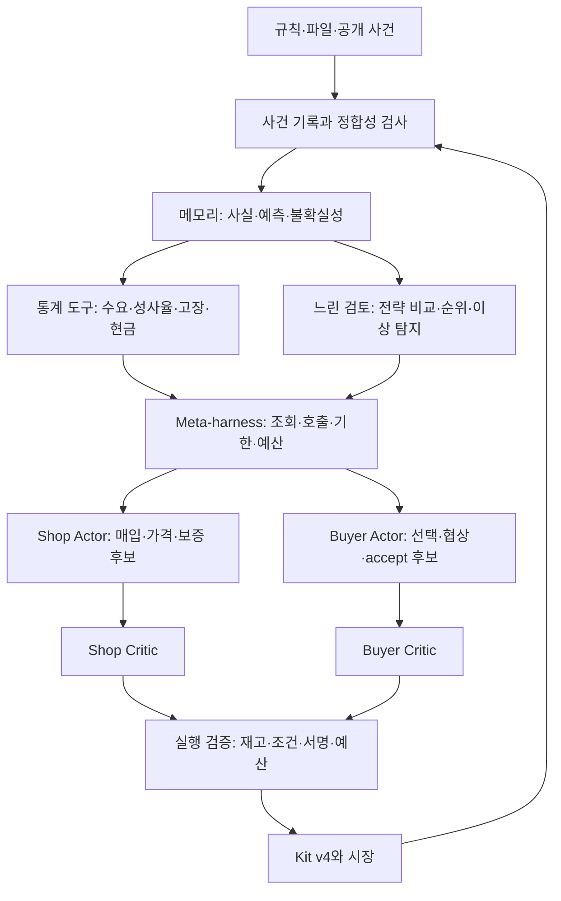

# Round 3 전략 후보와 actor–critic 구조 검토

2026-11-02. [시장 정식화](ROUND3_FORMULATION.md)를 바탕으로 한 설계 검토다. 가중치 학습을 요구하지 않는 actor–critic에서 모티브를 얻는다. 이것은 전략 가설과 비교 기준이며 완성된 과제 구현, 실제 Round 3 성과, 최적성 증명이 아니다.

## 1. 결론과 적용 범위

추천할 출발점은 **상품 단위의 전체 결과를 기억하는 shop/buyer actor, 역할별 critic, 실행을 조정하는 meta-harness**다. 수치 계산과 프로토콜 검증은 도구가 맡고, LLM은 근거가 제공된 후보 중 선택·협상·예외 해석을 맡는다. 매 거래마다 많은 모델이 토론하는 구조보다 빠른 정상 경로와 위험할 때의 추가 검토를 구분한다.

현재 시장 API는 아직 Round 2다. 수요, 경쟁자, 고장 분포가 없으므로 특정 SKU·매입 비중·호가 배율·모델이 최고라고 확정할 수 없다. 가장 방어 가능한 원칙, 검증할 정책 후보, 결과에 따라 바꿀 매개변수를 구분한다. 재고·가격·보증의 최종 실험 선택과 그 근거는 학생이 이해하고 결정해야 하는 과제의 핵심이다.

최신 S1 agent.md와 S2 week-08은 이전 정식화 스냅샷과 바이트가 같았다. [재확인 기록](logs/strategy-audit-20261102T140029Z/manifest.json)에 공개 조회와 현재 라운드를 보존했다. 추가 설명은 다음 1차 자료를 참고했다. 이 논문들의 보장 조건은 이 시장과 다르므로 이 설계의 최적성 근거로 쓰지 않는다.

- Chen et al., [Learning to Order for Inventory Systems with Lost Sales and Uncertain Supplies](https://arxiv.org/abs/2207.04550): 판매·공급 관측의 검열 문제.
- Dudik et al., [Doubly Robust Policy Evaluation and Learning](https://arxiv.org/abs/1103.4601): 선택한 행동만 결과가 보이는 정책 평가의 편향 문제.

## 2. 평가 산식에서 나오는 전략적 기회

| 사실 또는 구조적 특징 | 유리할 수 있는 판단 | 반례·실패 조건 |
|---|---|---|
| Buyer 가치가 허용 SKU의 정가 기준 | 최저 결제액보다 큰 유효 잉여를 비교 | 비싼 SKU의 고장·실패 위험과 예산 초과 |
| 식품 등급 자체의 가치 가산 없음 | 사용 요구를 충족하는 B/C도 후보 | 정산까지 남은 시간이 모자라거나 증명서 없음 |
| 보증 내 고장 시 전액 환불 | 비식품의 가격과 보증을 함께 비교 | 보증 요구가 너무 강하면 거래를 놓침 |
| 입고 등급·원가가 랜덤 | SKU·수량으로 분산, 입고 뒤 단위별 처리 | 매입 전 A등급만 고를 수 있다고 가정 |
| 미판매 재고가 점수상 자산으로 복원되지 않음 | 회전율·수요 커버리지에 따른 소량 재매입 | 지나치게 적으면 품절로 판매와 정보 모두 놓침 |
| 판매 하한가 없음 | 이미 산 재고의 원가 이하 처분도 비교 | 새 재고를 계속 손해 보고 사들이는 정책 |
| 지표가 백분위 | 실제로 추월 가능한 지표에 노력 배분 | 50% 항목만 계속 키우거나 가장 낮은 항목을 무조건 개선 |
| Buyer 게시판 항목이 30% | 가치 있는 글과 실제 유효 반응을 측정 | 글·내 투표 횟수를 받은 평점으로 착각 |
| 같은 주인끼리 정산 불가 | 두 역할을 독립적으로 외부와 거래 | 자체 거래로 점수를 옮기려는 설계 |
| 마지막 결과는 지연됨 | 상품 수명과 잠정·확정 결과를 연결 | 결제 성공을 최종 성과로 간주 |

이 표의 판단은 공개 규칙에서 도출한 조건부 기회다. 서명·계정·투표 결함을 이용해 점수를 만드는 전략은 이 분석의 대상이 아니다.

## 3. Shop: 재고의 회수 가치와 현금 기회를 함께 본다

### 3.1 새 매입과 보유 재고 처분을 구분

새 단위의 최종 예상 현금 회수를 W, 매입 원가를 c라 하면 신규 매입의 가치는 개념적으로

\[
\mathbb E[W-c-\text{추가 보관비}]
\]

다. 반면 이미 구매한 재고를 지금 팔지 결정할 때 c는 sunk cost다. 현재 제안의 예상 순회수액과 기다릴 때의 순회수 가치를 비교한다.

\[
\text{지금 수락의 회수 가치}
\quad\text{vs.}\quad
\text{기다릴 때의 예상 회수 가치}-\text{추가 보관비}.
\]

예를 들어 이미 10,000에 산 식품이 곧 폐기될 때, 추가 판매 기회가 거의 없고 환불·다른 부작용이 없다면 7,000에 파는 것이 폐기보다 현금과 매출을 더 회수한다. 이는 10,000에 계속 사서 7,000에 팔라는 뜻이 아니다.

비식품 가격 p, 해당 보증 내 환불 확률 r이면 판매 시 예상 회수액은 p(1-r)다. 원가 이하 수락 여부는 기다림의 옵션 가치, 보증 부채, 평판과 가격 약속도 함께 고려한다. 항상 원가를 수락 하한으로 쓰거나 항상 양수 제안을 수락하는 규칙 모두 일반적 최적 정책이 아니다.

### 3.2 매입: 관측 판매량과 주문 커버리지를 함께 본다

하나의 주문은 허용 SKU 집합을 주므로, 잘 팔린 정확한 SKU만 복제하는 것보다 **그 카테고리의 다양한 주문에 포함될 확률**도 중요하다. 같은 카테고리에서도 가격대 때문에 허용 집합이 달라진다. 공통 SKU 하나가 모든 주문을 커버한다고 가정하지 않는다.

추천 비교 축:

1. 최근 관측된 카테고리 수요와 내 가게의 실제 요청·품절 기록.
2. SKU 정가/가격대가 만드는 허용 주문 커버리지.
3. 매입 후 단위당 예상 순회수액과 판매까지의 시간.
4. 식품의 사용 요구 충족 기간, 비식품 보관비와 보증 부담.
5. 기존 재고와 중복되는 커버리지, 현금 고갈 및 집중 위험.

처음에는 제한된 자금으로 소량의 카테고리·가격대를 관측하고, 입고 뒤 실현 원가·등급에 따라 판매 계획을 조정하는 후보가 합리적이다. 인기 추정의 근거가 약한 상품을 20개씩 사거나 140개 카테고리에 자금을 균등 배분할 근거는 없다. 반대로 모든 상품을 1개만 갖고 있으면 유효 수요가 확인됐을 때 품절이 반복될 수 있다.

공개 원가 범위와 등급 확률만 이용해 기대 매입 원가의 범위를 얻을 수 있다. 구간 내 균등분포를 가정하지 않고:

\[
0.40L\le\mathbb E[c_{food}]\le0.60L,\qquad
0.49L\le\mathbb E[c_{goods}]\le0.69L.
\]

이는 범위이며 실제 평균 추정치가 아니다. 단위당 최악 원가는 0.75L 범위 안에 있지만, 이 값으로 항상 수량을 제한하는 방식은 보수성이 크다. 평균 기반, 보수적 상한 기반 중 어느 정도의 자금 여유를 둘지는 비교할 정책 선택이다.

### 3.3 재매입 임계와 보증 준비금

SKU별 추가 한 단위의 예상 순가치가 양수인지, 그 현금을 다른 상품에 사용할 기회보다 좋은지 평가한다. 같은 SKU의 1번째 단위와 20번째 단위는 판매 확률이 다르다. 기존 재고·미완료 매입·예약 수량을 포함해 수량을 계산해야 한다.

운영 현금 한도는 다음과 같이 표현할 수 있다.

\[
\text{매입 가능액}\le B_s-
\text{기존 보증의 환불 준비금}-
\text{보관비·운영 여유}.
\]

준비금 비율은 공식 규칙이 아니라 위험 선호와 관측 결과로 정할 설계값이다. 공급은 목록 순서대로 실행되고 잔액 부족인 첫 lot에서 멈추므로, 실행 가치가 높은 lot를 앞에 놓고 큰 불확실 lot가 뒤의 유리한 요청을 막지 않는지도 비교한다.

### 3.4 가격·보증·품질을 묶은 제안

Shop actor의 행동 후보는 가격만이 아니라 `(unit, price, claim, certificate, warranty)` 묶음이다. 기준 제안, 성사율 중심 제안, 회수 중심 제안처럼 소수 후보를 비교할 수 있다. 고정 마진 배율이 최고라는 근거는 없다.

- 식품: 만료까지가 아니라 **사용 요구를 충족해 팔 수 있는 시간**이 남아 있는지 평가한다. 현재 요청에는 use_within_hours를 사용하고, 미래 요청에는 관측된 요구 시간 분포의 불확실성을 반영한다.
- 단위 선택: 먼저 품질 조건을 만족하는 단위만 추린 후 FEFO(먼저 만료되는 것 우선)를 비교한다. 임박 재고를 무조건 보내면 사용 요구를 위반할 수 있다.
- 비식품: 긴 보증이 높이는 판매 가능성과 예상 환불 부담을 비교한다. 공개된 고장 발생 구간은 판매 후 6시간이므로 6시간 보증의 경제적 의미를 우선 분석할 수 있지만 실제 허용 입력과 시간 경계를 검증해야 한다.
- 증명서: 직접 비용이 공개돼 있지 않으므로 인증된 조건을 제시하는 것을 기준 후보로 둔다. 증명서를 붙이면 무조건 이익이라는 지배 관계까지 증명되지는 않는다.
- 등급: 현재 사실과 시각을 근거로 제시한다. 과장된 주장이 단기 성사에 도움을 줘도 정산 뒤 노출·리뷰 위험이 남으며 장기 우월성이 보장되지 않는다.

거래별 `수락 확률 × 마진`만 최적화하면 가격을 보지 않고 떠난 방문과 재방문 효과를 놓친다. 자기 가게의 유효 노출·협상·정산·환불 단계별 수치를 함께 봐야 한다.

## 4. Buyer: 유효 잉여와 주문 완주를 함께 본다

### 4.1 가장 싼 SKU를 고르는 정책의 약점

예산과 acceptable 집합이 허용하고 품질이 유효하다면 정가가 큰 SKU가 더 비싼 가격에도 더 큰 잉여를 줄 수 있다. 예를 들어 가상의 두 상품이 모두 주문에 허용되고 고장·품질 문제가 없다면:

| 후보 | 정가 | 지불 가격 | 잉여 |
|---|---:|---:|---:|
| A | 100,000 | 60,000 | 40,000 |
| B | 150,000 | 90,000 | 60,000 |

최저 결제액 기준은 A를 고르지만 Surplus 기준은 B가 유리하다. 이는 실제 시장 관측이 아니라 산식의 차이를 보여 주는 예시다. 정가만 큰 상품을 고르면 고장·거래 실패 위험을 놓친다.

### 4.2 식품: 등급보다 요구 시간 충족

식품 가치에는 A등급 가산점이 명시돼 있지 않다. 따라서 유효한 증명서가 있고 정산 시 요구 시간을 충족한다면 B/C도 비교할 수 있다. 반대로 A등급이라도 shelf_hours와 use_within_hours 조합에 따라 사용 요구를 못 채울 수 있으므로 등급만으로 판단하지 않는다.

기준 후보는 `cert:true`, `min_hours_left=use_within_hours+시간 여유`다. 여유는 실제 checkout 지연과 시계 오차를 측정해 정하며 모든 주문에 임의의 3시간을 더하지 않는다. 과도한 여유도 구매 가능한 상품을 줄인다. `grades:[A]`를 전 주문에 강제하면 좋은 B/C를 놓칠 수 있다.

### 4.3 비식품: 가격과 보증의 가치

고장 확률 q, 보증 안의 고장 확률 q_w를 조건부로 추정하면:

\[
\mathbb E[u]=(1-q)L-p+pq_w.
\]

모든 발생 가능한 고장을 보증이 커버하면 q_w=q이고:

\[
\mathbb E[u]=(1-q)(L-p).
\]

따라서 전액 환불 규칙이 그대로 이행되고 p가 L 이하라면, 성사한 거래의 결과는 고장 없을 때 L-p, 보증 고장 시 0이다. 이 조건부 하방 보호가 보증의 가치다. 모든 주문에서 6시간 보증만 강제하면 판매자가 거절해 거래 수와 잉여 기회를 잃을 수 있으므로, 무보증의 낮은 가격과 보증 포함 가격을 비교해야 한다.

같은 물건·같은 고장 확률에서 무보증 가격 p0와 전체 고장을 커버하는 보증 가격 pw의 기대 잉여를 비교하면, q<1일 때 보증이 유리한 조건은

\[
pw\le\frac{p0}{1-q}.
\]

q가 미지수이므로 이 식으로 정확한 가격 상한을 단정하지 않는다. 등급별·상품군별 관측과 성숙한 고장 결과가 쌓일 때 범위를 좁힌다. 고장하지 않은 지 5분 된 구매를 6시간 안전한 구매와 같은 표본으로 세면 안 된다.

### 4.4 가게 선택과 협상 종료

가게 후보의 비교는 다음 벡터를 사용한다.

- 성공 시 예상 유효 잉여.
- stock/품질/보증 조건을 맞춰 정산할 가능성.
- 응답·협상·checkout까지 걸릴 시간과 주문 만료 위험.
- 자신의 확인된 거래 이력과 공개 주장 사이의 근거 수준.

이 값에서 경제적 대리 점수 `정산 확률 × 예상 잉여 / 예상 주문 주기`를 사용할 수 있지만, 게시판·거래 수·최종 백분위까지 표현하는 공식 점수는 아니다.

추가 협상은 작은 할인 자체보다 **실패 위험을 감수할 가치가 있는가**로 판단한다. 할인 기대 이익에 비해 유효 구매를 놓칠 위험이 크고 현재 가격이 괜찮다면 수락 후보가 우세하다. 반복된 같은 제안, 명시적으로 불가능한 조건에는 재호출을 줄인다.

초기에는 `shops.json.offers`와 현재 주문의 허용 집합이 겹치는 가게를 우선 추리고, 실제 SKU·등급·보증 요구를 협상한다. 가격과 품질이 아직 확인되지 않은 가게를 과거 가격만으로 현재 최저가라고 표시하지 않는다.

**최종 배송 SKU 확인은 이 전략의 전제다.** 기본 `AcpShop.pick_unit`은 receipt의 item이 특정 SKU여도 buyer가 acceptable 목록을 전달하면 그 목록 전체에서 단위를 고를 수 있다. `acp_pay`도 receipt item과 같거나 acceptable 중 하나이면 품목 검사를 통과시킨다. 따라서 높은 정가 SKU를 요청했어도 더 낮은 정가의 다른 허용 SKU가 배송될 수 있다. `accept`의 공식 필드에는 정확한 SKU를 지정하는 항목이 없으며 임의로 `accept.sku`를 추가해도 검사되지 않는다. 높은 정가 후보의 잉여를 신뢰하려면 실제 서명된 checkout의 SKU를 기준으로 가치를 재평가하고, 필요한 경우 학생 폴더의 자체 결제 어댑터에서 의도한 SKU와의 일치를 확인하는 설계가 필요하다. 기본 경로를 그대로 쓸 때는 이 한계를 후보 평가와 사후 감사에 반영해야 한다.

## 5. 게시판과 백분위에 맞춘 노력 배분

### 5.1 공식 점수의 무시하기 쉬운 부분

Buyer의 게시판은 ALL의 30%다. 거래 수는 20%이고 Surplus는 50%다. Shop은 profit/revenue/stars가 50/30/20이다. 정확한 단위당 기여는 백분위 근처의 경쟁자 분포에 따라 달라진다.

내가 개선할 수 있는 지표가 m이고 행동 a가 만드는 변화를 예측한다면, 국소적 비교값은

\[
\widehat{\Delta A}(a)=\sum_m w_m\left[
\widehat\Phi_m(x_m+\widehat{\Delta x_m}(a))-
\widehat\Phi_m(x_m)\right].
\]

여기서 경험적 CDF 근사는 공식 동점 규칙과 같다는 보장이 없다. Round 2 분포를 Round 3 분포처럼 쓰지 않는다. 작은 원시 지표 변화로 여러 명을 추월할 수 있는 구간과, 큰 비용을 써도 순위가 거의 바뀌지 않는 구간을 구분하는 도구다. 가장 낮은 백분위나 가중치가 가장 큰 항목을 무조건 선택하는 규칙은 아니다.

### 5.2 게시 전략 후보

검증 가능한 수요 요청, 실제 구매 조건 비교, 거래 seq를 근거로 한 품질 확인 경험 등을 후보로 둔다. 유용한 내용이 유효 투표를 얻는다는 것은 실험 가설이며, 시장이 사실성에 자동 점수를 주는 것은 아니다.

글별 `역할,내용 유형,근거,게시 성공 시각,조회 가능한 반응,유효 표 변화`를 기록한다. 구매 요청에 비공개 예산을 반드시 공개할 필요는 없다. Shop의 재고 안내는 직접 shop ALL에 표 점수를 더하지 않지만 방문을 유도할 수 있다. 이 효과는 실제 방문·정산과 연결해 평가한다.

게시 속도 제한을 가득 채우는 것보다 글 하나의 유효 반응과 생산 비용을 비교한다. 같은 주인의 표와 자격 없는 표를 득점으로 계산하지 않는다. 다른 agent에 대한 근거 없는 비난이나 상호 점수 부풀리기를 성과 개선의 전제로 삼지 않는다.

## 6. 권장 구조: 빠른 거래 경로와 느린 검토 경로

각 박스가 별도의 LLM 프로세스일 필요는 없다. 유지할 논리 역할과 실제 모델 호출 수를 구분한다.

| 구성 | 권장 책임 | 피할 설계 |
|---|---|---|
| 사건 기록·계산·검증 | 결정적 코드와 정확한 ID/단위 | LLM 요약으로 잔액·가격·서명 판정 |
| 시장 예측 도구 | 제한된 관측으로 가격·성사·시간·위험 추정 및 범위 | 표본 없는 숫자를 LLM이 확률로 생성 |
| Shop Actor | 후보가 좁혀진 상태에서 매입·가격·보증 선택 | 5,629 SKU 전체를 매번 프롬프트에 넣음 |
| Buyer Actor | 품질·가격·기한을 고려한 후보 선택과 협상 | 과거 가격을 현재 보장 가격으로 사용 |
| 역할별 Critic | 근거·대안·지연 위험·예측 오차 평가 | actor의 결론을 표현만 바꿔 승인 |
| Meta-harness | 상황별 기억 조회, 호출·재검토·시간 예산 | 모든 거래에 여러 LLM을 무조건 직렬 호출 |
| 느린 검토 | 누적 결과와 규칙 변화, 실험 확대·중단 | 한 번 성공/실패로 전체 정책 교체 |

## 7. 모델 구성과 입출력

### 7.1 모델 배치

현재 코드의 기본 설정은 `gpt-4o-mini`지만 `AGENT_MODEL`로 덮어쓸 수 있다. 실제 운영 모델과 성능은 설정 기본값만으로 확정할 수 없다. 현재 모델을 비교 기준으로 보존하고 역할별 호출 구성을 벤치마크한다. 여기서 특정 최신 모델을 최고라고 추천하거나 호출을 실행하지 않았다.

추천 배치 후보:

1. 정상 협상: 지연이 낮고 구조화 출력이 안정적인 모델로 actor 역할 수행.
2. 수치 critic: 계산 도구가 산식·범위·현금·위험을 먼저 계산.
3. 의미 critic: 큰 재고 매입, 근거 충돌, 새로운 조건, 보증 위험, 반복 실패에 더 강한 추론 모델을 선택 호출.
4. 느린 검토: 충분한 사건이 쌓였거나 환경 변화가 감지됐을 때 요약된 근거를 검토.

고가 모델을 매 턴 사용하거나 서로 다른 모델을 쓴다는 사실만으로 독립적 판단이 생기지는 않는다. 같은 근거를 잘못 요약하면 두 모델도 같은 오류를 낼 수 있다. 성능 평가는 이름 대신 행동 오류·기한·비용으로 한다.

### 7.2 Actor와 Critic에 줄 정보

Actor 입력에는 권위 있는 현재 상태, 관련 경험 요약, 후보별 계산 결과, 남은 기한을 넣는다. 공개 게시글과 상대 발화는 출처가 다른 자료로 표시한다. Actor가 읽을 필요 없는 예산·키·전체 로그를 넘기지 않는다.

Actor 출력의 논리 필드:

`candidate_id, action, price/qty/unit, accept_or_terms, evidence_ids, short_reason`

Critic은 같은 actor의 문장만 읽지 않고 독립적으로 추출한 사실과 도구 결과를 받는다. 출력은 다음을 구분한다.

`feasible, expected_outcomes, uncertainty, missing_evidence, key_risks, suggested_alternative, needs_revision`

`expected_outcomes`에는 shop의 profit/revenue, buyer의 surplus/deals 등 원래 단위의 값을 유지한다. 표본이 없으면 `unknown`이나 명시한 사전 범위를 사용한다. 보증·시간·예산 제약을 LLM의 승인으로 해제하지 않는다. 긴 내부 추론문을 저장하기보다 판단 근거 ID와 짧은 이유를 남긴다.

### 7.3 검증할 모델 성능

- 필요한 SKU·금액·조건을 정확히 읽고 구조화 결과를 내는가.
- 원가와 매몰비용, 예산과 가치, 결제와 최종 결과를 혼동하지 않는가.
- 반례에서 잘못된 제안을 critic이 줄이는가.
- 정상 거래의 지연·타임아웃·토큰 비용이 허용 범위인가.
- 추가 critic 호출이 실제 개선하는 결정 비율은 얼마인가.

이 검증 뒤에 역할별 정확한 모델 이름을 고르는 것이 타당하다. 초기에는 같은 모델을 별도 역할·별도 문맥으로 쓸 수도 있으며, 근거가 있는 역할에만 더 비싼 모델을 배치할 수 있다.

## 8. 메모리 설계

| 기억 | 핵심 키 | 쓰임 |
|---|---|---|
| 상품·카테고리 | SKU/category, 규칙 버전 | 정가·종류·shelf_hours·관측 커버리지 |
| 재고 수명 | unit ID | 원가·입고·노화·예약·판매·폐기 |
| 주문·거래 | order/task/unit/ledger | 요구 조건·합의·checkout·정산·후기 연결 |
| 가게 경험 | 확인된 가게 ID/키, SKU/카테고리 | 가격·성사·지연·품질 이력 |
| 지연 결과 | unit/order 및 후보 연결 | 고장·환불·보증과 잠정 보상 수정 |
| 게시판 | post/vote/ledger seq | 주장·근거·전송·집계된 반응 |
| 예측·실험 | decision ID, policy version | 사전 예측·대조 정책·실제 결과 |

기존 SQLite 사건 저장과 출처 분리 구조를 재사용할 수 있다. 정확한 SKU·unit·주문 검색과 집계는 구조화 저장소가 우선이다. 벡터 검색은 긴 게시글·설명에서 관련 자료를 찾는 보조 선택지이며 필수 구성이라고 단정하지 않는다.

결과는 `pending → settled/provisional → matured`처럼 구분하고 이후 수정 사건을 연결한다. 6시간 미만의 비식품은 고장 위험 관측이 끝난 표본과 다르게 센다. 이름만 같은 고장 알림을 특정 가게에 억지로 귀속하지 않는다. 전체 사건은 보존하고 모델 입력에는 관련 근거만 요약한다.

## 9. Meta-harness가 실제로 조정할 것

1. **조회:** 현재 결정과 관련된 SKU·가격대·가게·시간 구간을 우선 검색.
2. **후보 축소:** 재고·허용 SKU·기한·현금 조건을 코드로 적용한 뒤 LLM 호출.
3. **검토 강도:** 단순 반복은 빠르게, 고액·불확실·충돌 상황은 critic 추가.
4. **재검토:** 명확한 수정 사유와 남은 시간이 있을 때만 제한적으로 수행.
5. **기한:** 키트 BUYER_TIMEOUT=300초와 주문 만료 중 더 이른 시각에 맞추고 checkout 시간을 남김.
6. **환경 변경:** 재고·가격·규칙·기한이 바뀌면 오래된 캐시와 승인을 재검증.
7. **복구:** 모델 실패·네트워크 오류·상대 미응답·품질 거부를 분리해 기록.
8. **평가:** critic의 사전 예측과 실제 결과를 연결하고 악화된 정책의 비중을 제한.

캐시된 행동을 재사용할 때는 같은 SKU라는 이유만으로 실행하지 않는다. unit 가용성, 현재 가격 약속, 잔여 기간, 예산, 주문 ID를 다시 검사한다.

## 10. 발견한 구현상 빈틈과 우선순위

| 빈틈 | 영향 | 설계에서 해결할 점 |
|---|---|---|
| 기존 Round 3 gate | 아예 구매를 시도하지 않음 | 새 계약 검증 후 별도 단위로 전환 |
| 구형 품목·고정 floor·Saved | 새 상품·가격·가치와 불일치 | v4 namespace와 산식으로 이행 |
| 반복 매입 중 미완료 요청 미반영 | 중복 구매·자금 고갈 | 진행 중 lot와 실제 입고를 연결 |
| 기본 checkout 단위 선택 | 원한 SKU/단위와 다른 허용 단위가 선택될 수 있음 | unit 지정과 실제 shipped SKU 검증 |
| 기본 `accept`에 exact SKU 조건 없음 | 높은 정가를 기대한 구매가 낮은 정가 SKU로 정산될 수 있음 | 실제 checkout SKU 기반 잉여 재계산; 자체 어댑터 이행 시 별도 계약 검증 |
| 협상과 checkout 사이 재고 변경 | 합의 뒤 품절·중복 약속 | 단위 가용성·동시성·예약 상태 관리 |
| 미완료 checkout 예약 | 재고가 계속 묶일 가능성 | 정상 취소·세션 수명 관리를 검토; 코드에서 시간 만료 해제는 확인되지 않음 |
| accept 거부가 actor 종료 후 발생 | 같은 주문의 회복 기회 상실 | 협상 단계 조건 확인, 다음 주문 피드백, 기본 흐름 변경 시 별도 검증 |
| review 훅 없으면 deal 파일 작성 경로 없음 | 구매 수명 기록 누락 | 정산 사실을 확실히 수집할 경로 확보 |
| JSON 스냅샷 교체·최근 100개 글 | 경험 손실 | 영구 사건 저장과 seq 기반 이어읽기 |
| 기존 600초 censoring | 6시간 지연 결과와 부적합 | 잠정치·완결치·늦은 수정 분리 |
| 여러 모델 직렬 호출 | 주문 만료·낮은 처리량 | 위험 기반 선택 호출과 호출 예산 |
| 재시작·터널 URL 변경 | 가게 동일성·경험 연결 깨짐 | URL과 키/계정 동일성 구별 |

세션 수명 문제는 로컬 구현에서 확인한 방어·운영 검토 사항이다. 이를 이용해 타인의 재고를 묶거나 시장 동작을 방해하는 전략은 제안하지 않는다. 공유 scripts는 저장소 지침상 읽기 전용이므로 실제 수정은 학생 폴더의 허용된 어댑터·자체 코드 범위에서 설계해야 한다.

## 11. 실험과 운영 단계

### 11.1 반드시 비교할 축

한 번에 재고·가격·모델·게시판을 모두 바꾸면 무엇이 성과를 만들었는지 알기 어렵다. 다음 비교는 **후보**이며 모든 실험을 반드시 수행해야 한다는 과제 추가 요건이 아니다.

| 비교 | 확인할 지표 |
|---|---|
| Actor만 사용 vs 선택적 critic | 제약 오류, 유효 잉여/이익, 기한 실패, 호출 비용 |
| 기존 경험 없음 vs 상품 수명 메모리 | 품절·폐기·반복 실패·고장 귀속 |
| 최저 가격 선택 vs 유효 잉여 비교 | 실제 Surplus, served 비율, 정산 수 |
| 고정 원가 하한 vs 회수 가치 비교 | 폐기·순이익·매출 및 손실 확대 여부 |
| A등급 제한 vs 사용 조건 확인 | 식품 served 비율, 구매 기회, 잉여 |
| 고정 재고 vs 수요·커버리지 기반 | 재고 회전, 품절, 현금, 최종 미판매 비용 |

정책별 후보와 선택 이유, 가능한 경우 배정 확률을 기록한다. 선택하지 않은 행동의 수익을 관측값으로 채우지 않는다. 문맥 bandit의 평가 기법을 쓴다고 순차 재고·경쟁자 변화의 인과 문제가 자동 해결되지는 않는다. 재고 정책은 미래 상태를 바꾸므로 짧은 A/B 전환에도 이월 효과가 있음을 표시한다.

### 11.2 운영 순서

- 시작: 기본 정산 경로와 로그를 확인하고 양쪽 20건 조건을 우선 확보한다. 조건 확보를 이유로 무제한 손실 거래를 하지 않는다.
- 관측 확대: 제한된 재고·후보를 시험하고 가격·수요·고장 결과의 불확실성을 낮춘다.
- 활용: 근거가 쌓인 선택의 비중을 늘리되 새 상황과 오래 확인하지 않은 상대를 제한적으로 재확인한다.
- 종료 접근: 새로운 재고의 판매 가능 기간을 줄여 평가하고, 회수 가능한 재고·미확정 환불·제출 증거를 정리한다. 단순히 종료 직전에 고장 위험을 숨겨 거래를 쌓는 정책에 의존하지 않는다.

운영 안정성은 누적 성과의 전제다. 기존 로그 보존·재시작·ID 연속성을 유지한다. 모의 데이터의 결과를 실제 정산으로 보고하지 않는다.

## 12. 의사결정에 남겨야 할 선택

현재 근거로 모든 시장에서 우월한 단일 매개변수를 정할 수는 없다. 학생이 비교해 결정할 핵심은 다음이다.

- 매입에서 보수성과 탐색을 얼마나 배분할지.
- 보증의 성사율 이득과 환불 위험을 어떻게 균형 잡을지.
- 주문 완주와 추가 할인 사이에서 언제 멈출지.
- 어느 상황에 의미 critic을 추가 호출할지.
- 순이익·매출·평판 중 현재 실제로 개선 가능한 지표가 무엇인지.

추천 구조의 독창성은 이름이 아니라 **단위 수명 전체의 기억, 수치 근거가 있는 역할별 critic, 실제 시간과 순위 기회를 반영하는 meta-harness가 행동을 어떻게 바꾸는가**에서 검증한다. 구현·결과·LaTeX 구조도는 같은 실제 시스템을 설명해야 한다.
