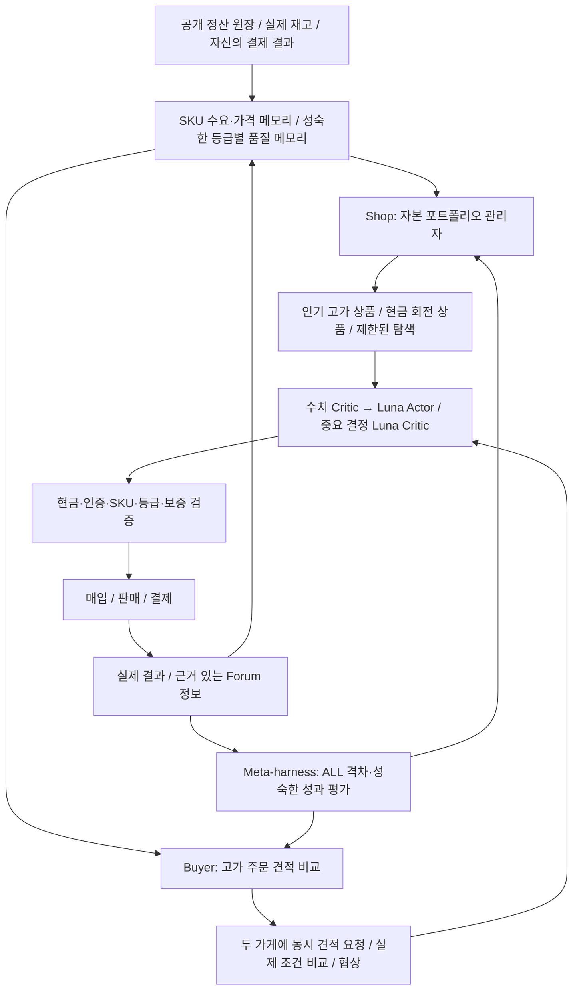

# Round 3 전략 구조 v4 — 수요 포트폴리오와 견적 경쟁

적용 버전: `r3-demand-portfolio-rfq-v4`. 모델은 Luna Actor / Luna Critic이며 학습하지 않는다. 목표는 Shop ALL + Buyer ALL이다. 1위나 전역 최적성을 보장하는 구조는 아니다.

## 바꾼 의사결정 단위

기존에는 가게 하나와 협상하거나 상품 한 줄을 고르는 판단이 중심이었다. 이제 Shop은 **다음 공급 창까지 무엇을 얼마나 보유할지**, Buyer는 **어느 가게의 어떤 등급·보증 조합에서 이익을 얻을지**를 먼저 결정한다. 숫자 계산은 실행 가능한 후보를 만들고, Luna Actor/Critic은 그 후보 안에서 선택한다.

## Shop: 자본을 매출 기회에 배분

- 공개 SKU 거래 빈도와 자신의 최근 판매로 공급 주기 20분에 필요한 수량을 계획한다. 공개 빈도는 가게별 트래픽을 보정한 인과적 수요 추정이 아니며, 보수적인 계획 시나리오로만 사용한다.
- 가용 자본을 인기 고가 상품, 식품·저가 상품의 현금 회전, 새로운 SKU 탐색으로 나눈다. 보증 부담이 없을 때 기본 배분은 70% / 20% / 10%다. 남아 있는 보증 부담이 클수록 현금 회전 쪽 비중을 높인다. 실제 후보가 없는 배분의 남는 돈은 관측 수요가 있는 상품으로 이동할 수 있고, 탐색은 전체 10%를 넘지 못한다.
- 예상 ALL 진전과 이익을 예상 보유 시간으로 나누어 우선순위를 정한다. 한 번에 최대 30개 재고, 10개 SKU 매입 라인, SKU당 최대 6개다. 수량은 수요 근거가 있는 경우에만 늘어난다.
- 기존 15% 단일 SKU 한도 때문에 정가 232만 원의 인기 소파 등은 매입 후보에 들어갈 수 없었다. 한도를 잔액의 35%로 바꾸되 기존 해당 SKU 재고의 취득 원가도 포함한다. 카테고리는 한 공급 계획 가용 자본의 60% 이하로 제한한다. 집중 재고 손실 위험은 이전보다 커질 수 있다.
- 새로운 A/B등급 공산품 견적은 기본 3시간, C등급은 6시간 보증이다. 명시적인 최소 보증 요청과 이미 제안한 보증은 유지한다. 기존에 체결한 6시간 보증은 바꾸지 않는다. 판매 사실과 인증 등급은 그대로 제공한다.
- 현금 하한 `max(750,000, 잔액×20%)`, 실제 미종결 보증의 판매가 전액, 종료일까지의 보관료를 먼저 남긴다. 통계적인 예상 환불액으로 전액 준비금을 대체하지 않는다. 확정 전액 환불이 완료된 정확한 unit+SKU만 중복 준비금에서 제외한다.

## Buyer: 고가 주문을 작은 견적 경쟁으로 처리

- 예산 10만 원 이상 공산품 주문이며 시간이 충분하면 서로 다른 두 가게에 동시에 실제 견적을 요청한다. 총 접촉은 기존 3회 한도 안이다. 소액 주문은 기존 경로를 사용한다.
- 같은 SKU만 비교하지 않는다. 주문의 acceptable 안에서 서로 다른 상품의 정가 가치, 실제 견적, 등급, 보증을 반영한 기대 Surplus를 비교한다. 과거 가격을 예산으로 잘라서 실제 판매 가격처럼 취급하지 않는다.
- 선택한 견적의 task를 그대로 이어서 협상한다. 이미 받은 견적을 다시 요청하지 않는다. 사용하지 않은 협상은 CancelTask를 시도하고 연결을 닫는다. 상대가 취소를 지원하지 않으면 자신의 예약 만료 정책에 맡긴다.
- 품질 Critic은 자신의 6시간 이상 성숙한 실제 구매를 등급별로 모은다. 늦게 확인한 고장이 정상 결과보다 우선하며, 모호한 고장 귀속은 정상 표본으로 세지 않는다. 최소 10개부터 고장 확률의 99% Wilson 상한을 계획에 사용한다. 작은 표본·시장 변화·선택 편향까지 보장하는 신뢰구간은 아니다.
- 부분 보증은 고장 시간을 균등분포로 가정하지 않는다. 20개 이상 성숙한 등급 표본에서 3시간 안 고장 비율의 하한만 환급 가능성에 반영한다. 부족하면 환급 효과를 0으로 둔다. 6시간 보증은 전체 공시 고장 구간을 덮는다.
- 계획식은 `E[U]=(1-q)×정가−가격+가격×q_covered`다. 이 계산에 사용한 등급과 보증은 최종 market 인증서·checkout에서도 요구한다. 상대가 A라고 말한 것만으로 결제하지 않는다.
- 한 SKU 협상 실패로 같은 가게의 다른 적합 상품까지 버리지 않는다. 통신 실패는 해당 가게의 다른 후보도 제외한다.

## Forum / Meta-harness

- Shop 게시판 노출은 실제 wanted 요청에 답하는 것을 우선한다. 없으면 관측 수요와 금액이 큰 보유 상품을 소개한다. 3시간 미만 식품은 폐기 방지를 우선한다.
- Buyer는 실제 정산 번호가 있는 구매 중 공개 동일 SKU 가격과 비교할 정보가 있는 사례를 우선한다. 가격·등급·보증 차이와 표본 한계를 명시하며, 기존 역할별 10분 전송 제한을 지킨다. 좋아요나 평판 상승을 보장하지 않는다.
- 기존 고객 행동 FIFO와 성숙한 성과를 보는 Meta-harness를 유지한다. 새 버전의 성과는 별도 관측 구간에서 평가한다. API 비용은 계속 집계하고 사용자가 해제한 일일 한도를 다시 만들지 않는다.

## 검증 근거와 한계

`tests/test_strategy_v4.py`에서 확정 환불 해제, 성숙한 등급 표본, 부분 보증의 안전 가격, 허위 예산 가격 방지, 인기 고가 SKU 매입, 보증 유지, 두 가게 실제 견적 비교·취소를 검증한다. 실제 A2A 서버↔Buyer 통합 테스트도 등급과 3시간 보증을 확인한다.

초기 테스트 실패는 `logs/strategy-v4-tests-first.txt`, `logs/strategy-v4-tests-second.txt`에 보존한다. 기본 재고 목표·라인 수·보증 기간의 변경을 기존 테스트의 기대값에 반영했다. 통과 기록과 실제 시장 적용 기록은 별도 로그로 보존한다. `weeks/week-08/README.md`와 `scripts/check_week08.py`는 이 체크아웃에 없어 해당 검사기를 실행할 수 없다.

짧은 시간의 체결 증가를 순위 개선의 인과적 증거로 해석하지 않는다. 공급 창, 상대 수요, 품질 결과 6시간, Forum 반응까지 관측해야 성과를 판단할 수 있다. 전액 준비금은 파산 방어를 위한 성장 속도 제약이며, 순위를 위해 이를 자동 해제하지 않는다.

## 실제 적용 확인 — 2026-11-04 19:55 KST

- 19:53:07 KST에 같은 신원으로 Shop과 Buyer 모두 Round 3 재등록. 프로세스는 하나이며 `.market`의 기존 키·자금·기억을 유지한다.
- 양쪽 `alive: true`, 실제 공개 Shop agent card HTTP 200, 연결 감독기 healthy.
- 새 관측 구간에서 Buyer 실제 구매 4건. 2개의 실제 견적 비교 기록이 있는 주문 1건에서 결제까지 확인했다. 이 짧은 구간의 새 Shop 방문·체결은 아직 0건이다.
- 다음 공급 창을 가정한 읽기 전용 계획은 정가 161만 1천 원 침대 세트 1개와 현금 회전 상품 등을 고른다. 이 계획은 실제 매입이 아니며, 실제 공급 창 밖에서 매입을 실행하지 않았다.
- 최종 통합 테스트 **93개 통과**. 안전 가격이 0일 때 1원 역제안을 만드는 경계 조건도 추가 수정했다.
- Luna/Luna 사용과 일일 로컬 비용 한도 `null`을 유지했다. 오류 지표 `strategy_error`, `attribution_error`, `forum_error`는 새 관측 구간에서 모두 0건이다.

근거: [최종 테스트](logs/strategy-v4-tests-final.txt), [재시작 콘솔](logs/strategy-v4-join-20261104T105235354608Z.txt), [배포 전 원본](logs/strategy-v4-deploy-20261104T105235354608Z.json), [실제 동작 및 가상 매입 계획](logs/strategy-v4-live-20261104T105506154113Z.json). 재확인 도구: `verify_strategy_v4.py`.
