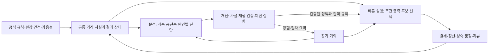

# Shop·Buyer 시스템 진단 — 2026-11-10

## 결론

현재 문제는 **거래 실행은 자동화됐지만, 실패와 성숙한 결과를 다음 전략·후보·컨텍스트에 일관되게 반영하는 개선 순환이 약하다**는 것이다. 전략 수치만 바꾸거나 프롬프트를 길게 만드는 것으로는 충분하지 않다.

확인된 우선 문제는 다음이다.

1. 공산품의 낮은 성과를 식품과 합친 평가가 가린다.
2. 장기 기록·환불 원장·품질 위험 모델·자동 전략 평가가 서로 다른 결과 상태를 사용한다.
3. Shop은 별점 20%를 목표에 선언했지만 실제 판매 후보에는 별점 변화가 없다.
4. 고객 개인 기억은 가격을 정하는 시점에 대부분 연결되지 않는다.
5. meta-harness는 현재 소수 수치의 조정기이며 원인별 실행 경로·평가 방식·기억 스키마를 고치는 기능은 없다.

이번 작업은 **분석과 설계**다. 운영 전략·API 모델·메모리 원본·시장 상태를 변경하지 않았다. 아래 제안을 이미 배포한 기능으로 읽으면 안 된다.

## 1. 순위 하락의 범위

공식 점수 기준은 11/10 13:26:21 KST다. 양쪽 연결은 별도 13:24 공개 검사에서 정상 확인됐다. 순위는 공개 점수가 있는 전체 참가자 기준이며 house를 포함한다.

| 항목 | 11/9 21:28 | 11/10 08:58 | 11/10 13:26 |
|---|---:|---:|---:|
| Shop ALL / 순위 | .847 / 6위 | .832 / 7위 | .829 / 7위 |
| Buyer ALL / 순위 | .795 / 11위 | .796 / 10위 | .780 / 10위 |
| 합계 / 순위 | 1.642 / 7위 | 1.628 / 9위 | 1.609 / 9위 |
| Shop Book | 580,155,156 | 666,119,953 | 696,707,968 |
| Shop 순위용 별점 / 원시 순위 | 4.35 / 28위 | 4.33 / 34위 | 4.33 / 35위 |
| Buyer Saved / 원시 순위 | .3013 / 14위 | .3132 / 15위 | .3170 / 17위 |

전체 합계 순위는 오늘 아침 이후 9위로 유지됐다. 합계 점수는 아침보다 .019, 어제 저녁보다 .033 낮다. 1위와의 격차는 .108→.134로 벌어졌다. 학생 합계는 아침 8위→현재 7위/46명으로 개선됐다. 서로 다른 모집단의 순위를 혼합하지 않는다.

Shop Book·매출 원시 순위는 각각 5위·7위로 유지됐다. 아침 이후 Book +30,588,015, 로컬 판매 226건, 매출총이익 33,025,187, 관측 환불 2,312,722이며 원가 미만 판매 0건이다. 현금을 잃어서 순위가 내려가는 상황으로 해석하면 안 된다.

최근 4시간(09:26→13:26) Buyer는 식품 380/462건 결제, 공산품 **7/185건 결제**다. 결제율은 각각 **82.3%, 3.8%**다. 공산품 견적 350개 중 **346개(98.9%)**가 안전 구매 상한보다 높았다. 725개의 no_agreement는 시도 수이며 독립적인 실패 주문 수가 아니다.

### 운영 손실의 해석

같은 4시간의 제어 이벤트를 최대 120초씩 이어 붙이면 관측이 덮는 시간은 약 114분이며, 그중 약 33분이 defensive다. 접속·시장 노출 관련 사유가 주로 관측됐다. 관측 공백과 사유 중복이 있어 이를 정확한 Shop 정지 시간이나 매출 손실액으로 환산하지 않았다. 시장 접속 손실과 전략 성과를 분리해서 평가해야 한다.

## 2. 전략: 현재 규칙은 반영됐지만 일부 중요한 선택이 빠져 있다

### Buyer: 성립 불가능한 계약과 탐색 가치의 구분이 약함

Saved 목적함수와 안전 상한 자체는 이미 적용되어 있다. 기존 협상 조건 유지 교정도 최근 공산품 오류 목록에서 큰 묶음 최종 검증 실패가 사라진 점과 일치한다. 현 문제를 과거 profit 목적함수 오류로 되돌려 설명하지 않는다.

남은 문제는 높은 가격의 견적에 대해 **실제로 상대가 얼마나 양보할지**를 충분히 학습하지 못하는 것이다. RFQ 결과는 가능·조건 미상·상한 초과에 따라 completion 1/.35/.25로 다시 점수화된다. counter 성공 가정도 .55부터 .85까지의 공학적 사전값이다. 이 값은 검증된 전환 확률이 아니다.

이전 경로 실패와 지연은 후보 생성에 반영되지만, 실시간 견적 처리에서 새 expected_delta와 시간 가정으로 재계산한다. 따라서 ‘무엇이 새 정보이므로 이전 실패를 무효화하는가’라는 규칙이 명확하지 않다. 최근 표본에서는 과거 실패가 있고 결제는 없는 상한 초과 후보 5개가 다시 .25의 가정을 받았다. 이 소표본에서 큰 실패 이력의 확률이 상향됐다고 주장하지는 않는다. **고정 사전값을 관측으로 보정하는 연결이 약하다는 정적·표본 근거**다.

개선 방향은 가게 전체 차단이 아니라 SKU·등급·보증·가격대별 계약 성립 범위와 가격 변화, 실제 결제 가능성, 남은 주문 시간으로 탐색 가치를 정하는 것이다. 실패 원인은 가격 불일치·조건 변경·품절·개별 통신 장애·시장 공통 장애·결제 불명으로 구분해야 한다. 상한을 무작정 올리거나 결제 검증을 완화할 근거는 없다.

### Shop: 별점 목표가 후보 경제성에 연결되지 않음

숫자 목적에는 Book 50%·매출 30%·stars_rank 20%가 들어 있다. 그러나 [판매 후보 생성](r3/economy.py)의 expected_delta는 Book·매출 중심이며, 최근 Shop prediction 700개에 들어간 후보의 **비영(非零) stars_rank 변화는 0개**다. 별점 변화가 후보마다 같으면 선택기는 별점 개선을 거래 간 차이로 비교할 수 없다.

현재 정직한 조건 표시·환불 준비금·등급별 위험 평가는 유지할 가치가 있다. 필요한 것은 실제 평가 계정별 결과와 가격·약속 등급·보증·처리 시간의 관계를 수집하고, 아직 검증하지 않은 별점 예측은 관찰 모드에서 평가하는 것이다. 공개 리뷰에 평가자 연결이 없으면 계정별 효과를 추측하지 말고 그 한계를 표시해야 한다.

`Seller.select_unit`은 SKU와 식품 사용 기한을 먼저 확인하고 FIFO에 가까운 순서로 unit을 선택한다. 명시적인 등급 요구를 unit 선택의 제약으로 해석하는 경로는 없다. 이 때문에 적절한 A등급 unit이 있어도 먼저 고른 낮은 등급을 정직하게 제시하고 거절될 가능성이 있다. 실제 손실 비중은 별도 재생 검증 대상이다.

## 3. 컨텍스트: 실제 소비 경로를 기준으로 재설계해야 함

최근 24시간 decision **31,274개**는 Buyer fast_buyer_saved 17,943개, Shop fast_shop_numeric 13,331개로 전부 숫자 경로다. 같은 창의 model_usage는 0개다. 이는 API 모델 교체의 문제가 아니다. [Chooser](r3/model.py:98)는 actor·critic 호출 전 이 경로를 반환한다.

숫자 경로에서도 품질 추정·과거 가격·고객 비율 등 컨텍스트 특징은 사용한다. 다만 actor 프롬프트에 설명을 더 넣어도 해당 경로에는 영향을 주지 않는다. 개선은 **정보 수집 → 요약 → 후보 생성 → 실행 선택**까지 이어져야 한다.

| 현재 특징 | 문제 | 필요한 변경 |
|---|---|---|
| 거래별 수치 후보를 먼저 만들고 선택 | 후보에 없는 대체 계약·전략은 선택 불가 | 느린 계획 경로가 계약/재고/탐색 후보를 만들고 빠른 경로가 실행 |
| Buyer route 기억 15분·1시간·6시간으로 분산 | 같은 실패의 의미·만료 기준·신뢰도가 모듈마다 다름 | 원인·조건·유효기간·출처가 명시된 공통 거래 사실 |
| price prediction에 가게·task 직접 연결 없음 | 선택과 실제 결제/실패의 귀속이 어려움 | 공통 decision→attempt→task→unit→ledger 연결 |
| Shop 현재 견적의 고객 컨텍스트 대부분 익명 | 확인된 구매자 기록이 가격 시점에 이어지지 않음 | 인증 가능한 연속성만 연결, 나머지는 계약 조건별 집단 기억 |
| 사업 수치·전체 문맥을 prediction에 반복 저장 | 로그 양과 유용한 검색 가능성이 비례하지 않음 | 원본 보존과 별도의 읽기용 요약·사례 인덱스 |

최근 Buyer price prediction 659개 모두 context에 shop 필드가 없었다. 별도 counter/attempt 기록으로 일부 재구성할 수는 있으나, decision ID와 거래 결과의 직접 연결을 대신하지 못한다.

### 현재 원인으로 확인되지 않은 것

`market_book`은 최근 2만 정산까지만 읽고 6시간으로 속도를 나눈다. 하지만 이번 cutoff에서는 최근 6시간 정산 **18,340개가 모두 포함**됐다. 따라서 현재 수요가 잘렸다는 주장은 하지 않는다. 거래량이 더 커질 때의 관측 범위 검증 항목이다.

메타 목적의 참가자 수 근사도 이번에는 Shop 64, Buyer 61로 공개 점수 모집단과 같았다. 추정 점수는 공개 점수와 조금 다르지만 이 사실만으로 순위 계산 오류를 주원인으로 지목하지 않았다.

## 4. Harness: 결과 귀속과 실행 비용 평가가 미완성

여기서 harness는 주문 수신·후보 생성·견적·협상·서명·ACP 결제·정산·품질/리뷰 수집·재시도·프로세스 수명주기를 연결하는 실행 장치다.

현재 exact SKU, 최종 서명/가격/인증 검증, 보증 현금 제약, 결제 불명 시 중복 결제 회피, 안전한 재시작 등 유지해야 할 장치가 있다. 최근 복구에서 재등록 승인과 실제 온라인을 분리한 수정도 여기에 해당한다.

보완할 부분은 다음이다.

- **전체 거래 비용:** 현재 실행 시간은 주로 RPC 지연과 간단한 상수로 추정한다. RFQ·협상뿐 아니라 ACP·결과 제출·주문 사이 대기·전처리까지 포함한 실제 시간과 비교해야 한다. 실패한 빠른 응답이 ‘좋은 경로’로 보이지 않게 해야 한다.
- **결과 상태:** 협상 합의, 결제 승인, 실제 정산, 품질 관측 완료, 환불 요청, 환불 확정을 서로 다른 상태로 관리해야 한다.
- **평가 귀속:** 접속 장애·상대 가격 변경·우리 코드 변경·전략 변경을 분리한다. 예를 들어 계약 기억 교정은 execution event에 revision이 있지만 자동 평가의 Buyer version/epoch는 동일해 전후 관측이 섞인다.
- **평점 수집:** 현재 news 수집은 정산·고장·환불 중심이다. 평가 계정별 별점 변화가 판매 계약에 연결되는 공통 결과 저장/소비 경로는 없다. 공개 출처가 제공하는 필드 범위 안에서부터 연결해야 한다.
- **검증 기준:** 단위 테스트 통과는 거래 결정 로직의 일관성 검증이다. 시장 성과 개선 검증에는 장애·품절·늦은 환불·가격 불일치 등을 포함한 재생 자료와 성숙한 온라인 코호트가 추가로 필요하다.

## 5. Meta-harness: 자동 운용과 자동 개선의 범위가 다름

여기서 meta-harness는 어떤 문제를 고칠지 선택하고, 변경 후보를 만들고, 검증·실험·승격·되돌리기를 관리하는 상위 순환이다.

현재 `adaptive.py`는 시간당 평가하며 6시간 성숙과 최소 표본을 기다리는 유용한 장치가 있다. 다만 변경 공간은 Buyer의 counter ratio/식품·공산품 시간, Shop의 재고 목표/카테고리 가중치/다양화 비율/마진에 한정된다. 경로 실패 분류, 결과 연결, 기억 검색, 별점 모델을 스스로 개선할 수는 없다.

### 확인된 멈춤과 결합

- 최근 24시간 Buyer 평가 **24회 전부 hold**: 자료 미성숙 표기 10회, 지원되는 새 변경 없음 14회.
- 최신 Buyer 평가: 표본 2,205, 결제 1,407, 성공률 **63.8%**, bad=0. 현재 제안 조건은 성공률 <50%일 때 counter 조정, ≥80%일 때 다른 조정이다. 식품과 합산되어 공산품의 3.8%가 별도 개선 조건이 되지 않는다. 두 수치는 평가 시점·창이 달라 인과 비교가 아니라 **집계 단위의 사각지대**를 보여준다.
- `propose`의 공통 시작 부분은 Shop 제어의 pause_restock이 참이면 Buyer 제안도 중단한다. Shop 접속 장애가 독립적인 Buyer 개선까지 막을 수 있다.
- Shop 다양화 실험 rollback 후 역할 전체가 24시간 cooldown이다. 현재 Shop 표본 1,486개가 있어도 로그에는 `insufficient_mature_evidence`가 남는다. 실제 cooldown과 자료 부족이 같은 이유처럼 보이는 진단 문제다.
- `stable`은 진행 중인 실험이 없다는 운영 상태다. 순위 최적성을 검증한 상태로 해석하면 안 된다.

따라서 부문별 평가와 개입별 cooldown이 필요하다. 금융 의무에 대한 공통 제약은 유지하되, Shop 등록 장애 때문에 Buyer 라우팅 분석까지 멈추게 할 필요는 없다. 정책 실험의 신중함과 이미 재현된 결함 교정의 실행 조건도 구분해야 한다.

## 6. Long Memory: 저장량보다 결과 연결과 재사용이 문제

SQLite 파일은 약 **1.99GB**이며 상세 prediction이 저장 텍스트의 큰 부분을 차지한다. 저장 크기만으로 실행 지연의 원인이라고 판단하지 않았다. 기존 로그를 삭제하거나 정리하지 않고, 별도의 읽기용 요약 계층을 만드는 방향이 적합하다.

### 고객 기억의 실제 범위

`customer_memory.retain`은 방문 1,000개와 관련 이벤트 한도를 유지하고, 오래된 방문의 고객 기억을 제거한다. 현재 1,000개는 약 **3.46시간**이다. 단순 재시작 후 유지되는 기록은 있지만, 기간이 긴 고객 경험을 보존하는 누적 요약과는 다르다. 삭제 전 의미 있는 집계/사례를 남기는 계층이 필요하다. 금융 의무와 정산 기록은 이 고객 작업 기억 삭제와 별도로 보존된다.

현재 보존된 서명 방문은 **0개**, 시장 확인 고객 identity는 172개다. 그런데 최근 Shop 견적 context 694개는 **전부 anonymous**였다. 현재 task의 payer는 주로 결제 후 연결되므로 첫 가격을 정하는 시점에 개인 기억을 쓸 수 없다. 임의의 이름·IP·상대 주장만으로 이를 메워서는 안 된다. 인증되는 연속성은 개인 기억으로, 나머지는 SKU·등급·보증·계약 조건별 집단 기억으로 처리해야 한다.

### 품질 결과의 분열

6시간이 지난 최근 48시간 공산품 구매 128개에서:

- 4개는 로컬 outcome이 여전히 `expected_by_warranty_rule`이지만 unit 원장에는 실제 전액 환불이 있다.
- 9개는 로컬 outcome이 없고, 그중 3개는 정확한 unit의 공개 고장 기록이 있다.
- `risk.quality_book`은 일부 unit 원장으로 이를 보완한다. 그러나 `adaptive.evidence`는 환불 예상 outcome을 제외한다. 같은 거래를 두 평가기가 다르게 보는 상태다.

장기 기억은 세 층으로 구성하는 것이 적합하다. **사실 기억**에는 규칙·확정 원장·계약 조건·노출 구간, **경험 기억**에는 특정 조건의 성공/실패 사례와 반례, **절차 기억**에는 재생 검증된 탐색·복구·협상 규칙을 둔다. 이 구분은 [LangChain의 기억 개요](https://docs.langchain.com/oss/python/concepts/memory)를 개념적 참고로 삼았으며 프레임워크 도입을 전제로 하지 않는다.

모든 기억에는 출처, 사건 시각, 확인 시각, 계약·규칙·코드 버전, 성숙 여부, 불확실성, 만료/재검토 조건이 필요하다. 정산·현금·등급·보증은 구조화된 정확 일치 검색을 우선한다. 벡터 DB를 추가하는 것만으로 현재 결과 귀속 문제는 해결되지 않는다.

## 7. 적합한 개선 구조와 순서

아래는 새로 구현할 제안이다. 기존 빠른 거래 경로를 유지하면서 별도의 분석·개선 순환을 연결한다.

| 우선순위 | 개선 단위 | 통과 기준 |
|---|---|---|
| P0 | order/task/unit/ledger와 환불 확정 상태 통합 | 공개 원장과 로컬 평가가 같은 거래를 같은 최종 상태로 처리. 불명 결제 중복 실행 0 |
| P0 | 식품·공산품 및 장애/전략 성과 분리 | 공산품 저성과가 합산 평균에 가려지지 않고 독립 진단·실험 후보 생성 |
| P1 | 실패 원인별 경로 모델과 계약 범위 탐색 | 같은 비성립 계약 재접촉 감소, 식품 처리량 보존, 성숙 Saved/시간 비교 |
| P1 | Shop 별점·실제 제공 조건 연결 | 검증 가능한 리뷰 자료에 기반한 분석. 예상 순 Book과 실제 보증 의무 유지 |
| P2 | 고객 집계·경험·절차 기억과 검색 명세 | 방문 원본 한도 이후에도 검증된 요약 유지, 무인증 개인 식별 0, 낡은 사례는 재검토 |
| P2 | meta-harness의 문제 목록·재생·실험 관리 | 제안→실행→결과의 동일 ID·버전 연결, 보류 이유 구분, 성숙 코호트로 승격/되돌리기 |

분석 순환은 15~30분, 품질 평가는 6시간 이후 같은 초기 운영값에서 시작할 수 있으나 최적 주기로 검증된 값은 아니다. 가설 하나씩 재생하고 제한된 계약/상품군에서 실험해, 예상 확률과 실제 결제·성숙 결과의 보정 정도를 함께 평가해야 한다.

상위 개선 순환은 전략을 문장으로 작성하는 데서 끝나지 않고, 실행 가능한 후보 생성 규칙과 검증 기준을 남겨야 한다. 장기 실행에서 구조화된 진행 기록과 실제 검증이 필요하다는 [Anthropic의 harness 사례](https://www.anthropic.com/research/effective-harnesses-for-long-running-agents)를 참고했으나, 여기 제안의 시장 성과는 아직 실험 전이다.

## 8. 근거·한계

- [시스템 감사 코드](audit_agent_system_20261110.py), [감사 원본](logs/agent-system-audit-20261110T043032470360Z.json).
- [실제 후보·고객 identity·평가 보류 확인](logs/agent-system-findings-20261110T043348959208Z.json), [검증 코드](inspect_audit_findings_20261110.py).
- [현재 공식 시장](logs/peer-market-source-20261110T042621171414Z.json), [공식 시점 간 독립 비교](logs/current-progress-review-20261110T043223765733Z.json), [온라인 확인](logs/autonomous-verified-20261110T042411842543Z.json).
- [구성 순위와 검산](logs/agent-system-audit-readout-20261110.json), [표준 차트](logs/agent-system-audit-chart-20261110.html). 차트 payload 검증 완료, 브라우저 렌더링은 미검증.
- 코드 근거: [빠른 선택](r3/model.py:98), [Shop 후보](r3/economy.py:49), [재평가](r3/quote_market.py:218), [고객 기억 한도](r3/customer_memory.py:31), [이름 기반 정합](r3/state.py:180), [환불 예상 제외](r3/adaptive.py:220), [공통 개선 중단](r3/adaptive.py:251), [집계 성공률 조건](r3/adaptive.py:269).

원장·점수는 고정 cutoff로 비교했다. 이후 조회한 kv와 FIFO 보존 자료는 조회 시점의 로컬 상태이며, 이미 제거된 과거 고객 기억을 복원한 것이 아니다. 감사 원본의 `event_sizes.json_bytes`는 SQL `length(TEXT)`의 문자 수를 잘못 이름 붙인 필드다. 코드에서 `json_characters`로 교정했으며 원본 로그는 수정하지 않았다. 보고서는 이 값을 UTF-8 바이트로 사용하지 않았다.

위 항목은 코드와 로그로 확인한 결함·설계 한계와 그 개선 가설을 구분한 결과다. 각 항목이 순위 손실 몇 점을 만들었는지, 제안이 몇 위를 올릴지는 인과적으로 산출하지 않았다. 이번 분석에서 실행 전략을 배포하지 않았다.
