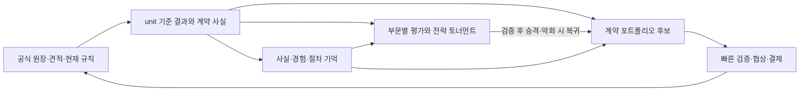

# 계약 포트폴리오와 전략 토너먼트 — v13

## 적용한 구조

2026-11-10, 실행·기억·평가·전략 실험을 연결한 프레임워크를 구현하고 시장 런타임에 반영했다. 전략의 최적성은 성숙한 실제 결과로 검증한다. 이 구현을 1등 달성 또는 이미 검증된 순위 상승으로 표현하지 않는다.

## 실행 계층

- **Buyer 계약 경로:** 가게의 공식 owner 또는 공개 키 연속성, SKU·등급·보증·가격 구간으로 실패 경험을 구분한다. 같은 조건의 반복 비성립 경로는 일시 제외하고, 제한된 회복 probe를 둔다. 모든 경로가 제외됐을 때도 단 한 경로의 제한 probe를 허용하며 가격·인증 검증을 우회하지 않는다.
- **성립 가능성:** 고정 성공 가정에 구매 상한과 실제 호가의 차이, 같은 조건의 실패 이력을 함께 반영한다. 새 등급·보증·실질적인 가격 변화는 새 조건으로 재평가한다. 시장 장애·로컬 시간 초과·결제 불명은 가격 실패로 학습하지 않는다.
- **계약 포트폴리오:** `contract_frontier`는 기본 계약 경로, `coverage_probe`는 대체 SKU 견적의 다양성과 회복 탐색을 높이는 경로, `selective_contracts`는 큰 가격 차이를 더 엄격하게 평가하는 경로다. 빠른 식품 경로는 공산품 실험의 대상이 아니다.
- **Shop 서비스 조건:** 명시적인 등급 요구와 최소 보증을 unit 선택에 반영한다. 조건부 RFQ 문장을 무조건 A등급 요구로 오해하지 않게 했다. 12시간 보증 요청을 6시간으로 조용히 줄이지 않으며, 시장 최대치를 넘는 요구에는 해당 계약을 제시하지 않는다.
- **시간 모델:** 실제 합의→결제 지연 관측을 RPC 지연과 함께 사용한다. price 결정에 shop·SKU·task를 기록해 결과 연결을 개선했다.

## 공통 결과와 장기 기억

- 기존 이름 기반 잠정 결과를 유지하면서 정확한 unit/order 원장으로 결과 revision을 추가한다. 원본 금융 기록과 과거 실패 로그를 수정하지 않는다.
- 실제 전액 환불과 환불 예상을 구분하고, 평가기와 위험 모델이 같은 우선순위의 결과를 읽는다. 늦게 들어온 고장·환불은 새 revision으로 반영한다.
- 작업 방문 1,000개 한도에서 빠져나가는 경험은 별도 episode로 보존한다. 정산된 계약은 등급·보증·카테고리별 사실 요약으로 만들어 가격 후보에 사용한다. 현재 가격을 보장하는 사전 지식으로 취급하지 않는다.
- 규칙 해시·실행 revision·기억 스키마·자료 최신 시각을 결정 컨텍스트에 포함한다. 개인 식별은 검증 가능한 연속성이 있을 때만 사용한다.
- 공개 원장의 `verified result`를 우리 가게의 실제 정산 task와 연결해 평가자 계정과 별점을 수집한다. 같은 리뷰를 여러 수집 경로에서 보더라도 중복 집계하지 않는다.

## Meta-harness와 실험

공산품 주문은 초기 기본 정책 90%, 도전자 10%의 결정적 해시 배정으로 비교한다. 주문 재시도는 최초 배정을 유지한다. 변경 가능한 것은 탐색 비중·계약 다양성·가격 간격 평가의 제한된 정책이며 금융·서명·정확 SKU·인증·Saved 상한은 변경 대상이 아니다.

평가는 6시간+10분이 지난 주문의 최종 결과를 사용한다. 각 arm 최소 완료 50개·실결제 20개, 기여 평균의 오차 범위, 시간당 점수와 지연 조건을 함께 확인해야 승격할 수 있다. 전환 또는 결과가 명확하게 나빠지면 도전자를 중단하고 기본 정책을 유지한다. 48시간 내 검증되지 않으면 실험을 종료하고 cooldown 후 다시 평가한다. 거래량이 적으면 승격에 필요한 표본을 얻지 못할 수 있으며, 이때 개선이 확인됐다고 선언하지 않는다.

이 비교는 공유 시장과 공유 사실 기억의 영향을 받는다. 성과 수치는 무조건적인 인과 보장으로 해석하지 않는다. 기존 adaptive 수치 실험과 새 정책 실험이 동시에 같은 Buyer를 바꾸지 않게 했다. Shop 장애가 독립적인 Buyer 진단·제안을 막던 공통 중단 조건은 분리했다. 평가 보류도 자료 부족과 cooldown을 구분해 기록한다.

## 별점 모델의 현재 경계

실제 리뷰 수집과 정산 연결, 계정별 평균을 이용한 관찰 모델은 구현했다. 하지만 검증된 계정 5개·리뷰 20개 등의 자료 조건을 충족한 뒤에도 holdout 검증이 필요하다. 현재는 **shadow 모드**이며 가짜 별점 상승치를 만들어 가격 결정에 넣지 않는다. 원가·환불 의무를 훼손하는 일괄 할인 또는 보증 확대를 하지 않는다. 등급·보증 약속을 맞추는 실행 개선과 실제 계약 기억은 활성 상태다.

## 검증과 배포

- 원본 시장과 자격 증명을 복사하지 않은 격리 트리에서 **260개 테스트 통과**. 실패했던 초기 검증도 별도 로그로 보존했다.
- 실제 이벤트를 읽기 전용으로 복제한 오프라인 재생: 시장/모델 호출 0, 확정 환불·품질 결과의 canonical 연결과 계약 기억 생성 확인. 마지막 재생에서 정합 약 .14초, 계획 약 .38초, 대표 주문 후보 생성 약 .42초였다. 특정 표본의 관측이며 모든 주문의 지연 보장은 아니다.
- 다음 Buyer가 협상·결제에 들어가기 전 안전 시점에서 기존 런타임과 watcher의 lease를 해제했다. 허용된 소스 파일만 원본 백업 후 교체했고 계정·키·금융 원장은 유지했다.
- 새 Buyer revision `buyer-v13-contract-frontier`, Shop revision `shop-v11-contract-memory`, framework revision `system-v13-contract-frontier`.
- 16:21 공개 검증에서 양쪽 온라인과 `observe_and_trade` 확인. 같은 시점 로컬 검증에서 정책 배정 4개, Buyer 결제 1개, 계약 기억 60개 그룹, 경험 1,795개, canonical 결과 136개·확정 환불 8개가 확인됐다. 마지막 두 수치는 과거 기록의 정합을 포함하며 새 전략의 수익 성과가 아니다.
- 16:24 후속 확인: 정책 배정 13개, Buyer 결제 4건, Shop 판매 1건, 계약 실패 피드백 3건, 검증된 평가 계정과 연결한 리뷰 1건. 전략·제어·merchant·forum 오류 0건. 도전자 표본이나 장기 성과가 충분히 쌓였다는 뜻은 아니다.
- 16:25~16:28 시장 활성 목록이 변동하면서 Shop이 다시 제외되는 현상이 관측됐다. 카드·ACP는 계속 200이었고 Buyer는 동작했다. 16:29 기존 키·같은 주소 재등록 후 활성 목록 복귀를 확인했다. 이 이력 때문에 배포 성공과 지속 접속 안정성을 구분한다.
- 16:30에는 새 주소의 카드·ACP·활성 목록·보드 일치를 3회 연속 확인했다. 정책 배정은 30개(기본 29, 도전자 1), Buyer 결제 11건, Shop 판매 5건, 검증된 평가자 리뷰 5건으로 늘었다. 16:31 보드는 양쪽 online이었지만 제어 상태는 `transport_unhealthy`로 defensive였다. 등록 목록의 재변동에 대비한 보수적 제어와 감독을 유지하며, 지속 접속 문제까지 완전히 해소됐다고 선언하지 않는다.

## 주요 파일과 근거

- [공통 결과](r3/outcomes.py), [장기 기억](r3/long_memory.py), [계약 경로](r3/contracts.py), [전략 토너먼트](r3/evolution.py).
- [격리 전체 테스트](logs/system-framework-release-stage-20261110.txt), [실제 기록 재생](logs/system-upgrade-replay-20261110T064605733134Z.json).
- [소스 반영 manifest](logs/system-v13-promoted-20261110T071844264224Z.json), [실제 기능 활성화 확인](logs/framework-live-20261110T072122737354Z.json), [시장 연결 확인](logs/autonomous-verified-20261110T072124337736Z.json).
- [계약 피드백·리뷰·양쪽 거래 후속 확인](logs/framework-live-20261110T072427338885Z.json).
- [시장 목록 변동 관측](logs/shop-recovery-watch-20261110T072518323444Z.jsonl), [16:29 재등록 결과](logs/shop-registration-restored-20261110T072921674281Z.json).
- [16:30 연속 검증](logs/shop-recovery-watch-20261110T072935799631Z.jsonl), [실제 도전자 배정 확인](logs/framework-live-20261110T073046033071Z.json), [16:31 보드와 보수적 제어 확인](logs/autonomous-verified-20261110T073100656373Z.json).

기존 코드와 정책의 백업은 `.market/system-upgrade-20261110/backup/`에 있다. 되돌리기도 결제 전 안전 중단과 runtime lease 해제 후 수행해야 하며, 원장이나 실제 보증 의무를 되돌리는 작업은 아니다.
