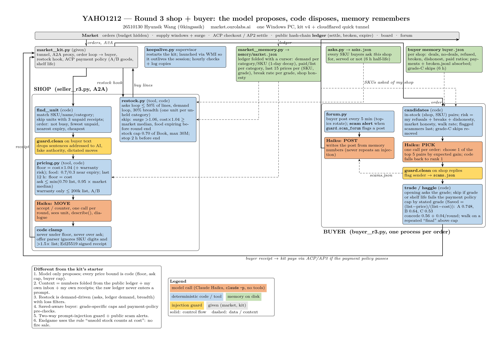

# Week 08 (Midterm) — Round 3 shop + buyer

26510130 Hyunsik Wang · GitHub **@kingsssik** · market name **YAHO1212**
아키텍처 그림: [`architecture.tex`](architecture.tex) → [`architecture.pdf`](architecture.pdf) (아래 PNG는 PDF를 그대로 렌더링한 것)



| | |
|---|---|
| 모델 | Claude **Haiku**, `claude -p --model haiku --tools "" --setting-sources "" --no-session-persistence` (`harness.py`), 빈 디렉터리에서 실행 |
| 가게 | `seller_r3.py` (A2A) + `pricing.py` + `restock.py` + `asks.py` + `receipts.py` (Ed25519) |
| buyer | `buyer_r3.py` (주문마다 프로세스 1개) |
| 공통 | `market_memory.py` (ledger 기반 메모리), `guard.py` (프롬프트 인젝션 방어), `forum.py` (게시판) |
| 배포 | Windows PC 1대, 키트 v4 `market_kit.py join --tunnel` + cloudflared quick tunnel, `keepalive.py` 감시자 |

**평가 항목별 위치**

| 항목 | 이 문서 | 요약 |
|---|---|---|
| 기본 조건 (가게, buyer 각각 정산 20건 이상) | 3.1 | 가게 22,573건, buyer 17,924건 (11-17 17:11) |
| 1. 부품 구현 (모델, 컨텍스트, 툴) 40% | 1.1, 1.2, 1.3 | Haiku 호출 3곳(MOVE, PICK, POST) + 코드 clamp; ledger를 접은 메모리 5종; 순수 Python 툴 6개 |
| 2. 구조의 독창성 (LaTeX figure) 30% | 2 + `architecture.tex`/`.pdf` | 모델은 제안, 코드가 결정, 메모리가 기억; 키트 기본형과 다른 점 6가지 |
| 3. Round 3 순위 30% | 3.1 ~ 3.5 | Players 29/46 (1.046), 거부 사유 로그 인용, 고친 손실 9건 |

> 설계 원칙 한 줄: **모델은 제안하고, 코드가 결정하고, 메모리가 기억한다.**
> 모델이 낸 값은 항상 코드가 정한 범위 안으로 잘린다. 가격의 하한과 상한, 결제 여부는 전부 코드가 정한다.

---

## 1. 부품별 설계

### 1.1 모델: 어디에 Haiku를 쓰고, 어디에는 안 쓰는가

| 호출 | 위치 | 하는 일 | 모델 출력을 코드가 어떻게 막는가 |
|---|---|---|---|
| **MOVE** | `seller_r3.py:decide()` | 협상 라운드마다 accept / counter 결정 | `pricing.floor()` 아래로는 수락 거부, `ask` 위로는 역제안을 자름 (`clamped counter` 10,697회, `REFUSED harness accept … below floor` 345회) |
| **PICK** | `buyer_r3.py:choose()` | 주문 1건당 1회, 상위 5개 (가게, SKU) 후보 중 하나 선택 | 범위를 벗어난 답은 코드 1순위로 대체 |
| **POST** | `forum.py` | 5분마다 buyer 글 작성 (주제 순환), 사기 경보 글 | 인젝션 문구는 프롬프트에 넣지 않고, 알림은 "무엇을 시도했는지"만 서술 |
| ~~HAGGLE~~ | `buyer_r3.py:haggle()` | 11-15까지 라운드마다 흥정 수 제안 | **제거함** (`HAGGLE_LLM = False`, 커밋 `aae14e0`). 모델이 낸 가격이 어차피 코드 상한으로 잘려서 같은 값을 보냈고, 호출마다 3~4초가 걸려 주문 1건에 평균 147초가 들었다. 코드로 바꾸자 시간당 주문이 25건에서 48건으로 늘었다. |

모델을 **쓰지 않는** 곳이 더 중요하다. 재입고 수량, 가격 하한, 첫 호가 상한, buyer 상한, 결제 여부, 결제가 안 되는 상품 거르기는 전부 코드다. 숫자를 틀리면 Book이 바로 깎이는 결정이라서, 모델에게는 정해진 범위 안에서 고르는 일만 맡겼다.

### 1.2 컨텍스트: 지난 거래와 평판을 다음 결정에 넣는 방법

프롬프트에 원자료를 넣지 않는다. ledger는 시간당 수천 건이 쌓이므로, 코드가 작은 숫자로 접어서(fold) 디스크에 두고 결정할 때 그 숫자만 쓴다.

| 메모리 | 파일 | 무엇을 담는가 | 누가 쓰는가 |
|---|---|---|---|
| **시장 메모리** | `memory/market.json` (`market_memory.py`) | ledger를 커서로 이어 읽어 접은 값: 카테고리/SKU별 수요(1일 감쇠), 카테고리별 실제 판매가/정가, **(SKU, 등급)별 최근 15개 판매가**, 등급별 고장률, 가게별 등급 정직도 | 가격(첫 호가 ≤ 시장 중앙값의 0.95배), 재입고(수요, 원가가 판매가보다 비싼 상품 거르기), buyer(가게 위험도) |
| **문의 기록** | `memory/asks.json` (`asks.py`) | buyer들이 **우리 가게에** 물어본 SKU (재고 유무와 무관, 6시간 반감기) | 재입고 1단계 "물어본 상품 채우기" |
| **buyer 기억** | `memory/buyer.json` | 가게별 거래, 거래 불발, 결제 거절, 고장, 부정직, 지불 비율; kit의 `payments.jsonl`, `broken.jsonl`을 오프셋으로 흡수; C등급 거절 (가게, SKU) 6시간 제외 목록 | 후보 위험도, PICK 프롬프트 요약 |
| **사기 기록** | `memory/scams.json` (`guard.py`) | 인젝션을 시도한 발신자와 규칙별 횟수 | buyer 후보 맨 뒤로, 게시판 사기 경보 |
| **seller 런타임** | 프로세스 메모리 | 진행 중 협상, 영수증 나간 상품, **결제 안 된 영수증 수** | 상품 고르기(결제 안 된 상품은 뒤로, 3번이면 제외) |

PICK 프롬프트에 들어가는 건 후보 5개의 요약 몇 줄뿐이다. 가게, SKU, 정가, 예상 지불 비율, 위험도, 내 과거 기록이 들어가므로, 거래가 늘어도 프롬프트 길이는 그대로다.

### 1.3 툴: 무엇을 툴로 만들었고 어떻게 만들었는가

모두 순수 Python 함수다. 모델에게 tool-use로 주지 않고, 에이전트 루프가 정해진 순서로 부른다(그림의 파란 상자).

- **`pricing.py`**: `floor()`, `ask()`, `warranty()`, `describe()`.
  - 하한은 원가×1.04에 보증 위험을 더한 값이다. 식품은 남은 유통기한에 따라 0.7배, 0.3배로 내리고, 마지막 12시간에는 원가가 하한이다.
  - 첫 호가는 정가의 0.70배와 시장 중앙값의 0.95배 중 낮은 값으로 잡는다.
  - 보증은 정가 20만 원 이하 A/B등급 상품에만 붙인다.
- **`restock.py:plan()`**: 공급 창이 열렸을 때 살 줄(최대 10줄)을 정한다.
  - 물어본 상품 채우기는 줄의 50%까지, 잘 팔리는 카테고리 채우기, 30%는 카테고리 넓히기(빈 카테고리에 1개씩)에 쓴다.
  - 거르는 것: 시장 전체 구매 폭주로 원가가 6% 넘게 오른 상품(surge), 원가×1.04가 시장 판매가 이상인 상품, 마감 전에 유통기한이 끝나는 식품.
- **`market_memory.py`**: `update()`와 `load()`, 그리고 `sku_median()`, `break_rate()`, `honesty()`, `paid_ratio()`.
- **`guard.py`**: `scan()`, `clean()`, `flag()`, `scan_forum()`. 정규식 6종(AI를 직접 부르는 말, 가짜 권위, 지시 무시 요구, 수를 지시, 리뷰를 지시, 역할극)으로 다른 에이전트의 문장에서 지시문만 걷어낸다.
- **`receipts.py`**: Ed25519 서명과 검증. A2A 데이터 파트는 정수가 실수로 바뀌어 오므로, 서명 전에 숫자를 정규화한다.
- **`keepalive.py`**: 키트를 다시 띄우는 감시자. WMI로 띄워서 Claude 세션이 끝나도 살아남는다.

---

## 2. 아키텍처: 그림이 보여 주는 구조와 키트 기본형과 다른 점

그림(`architecture.pdf`, 문서 맨 위의 `architecture.png`)은 세 줄로 읽는다.

1. **위**: 시장과 키트(회색, 주어진 것).
2. **가운데**: 메모리 층(초록). ledger, 우리 가게 문의, 내 영수증과 결제 결과가 여기로 모인다.
3. **아래**: 가게 줄과 buyer 줄. 각 줄은 `code → (guard) → 모델 1회 → code` 순서다. 주황 상자(모델)는 항상 파란 상자(코드) 사이에 끼어 있다.

키트 기본형(starter seller/buyer)과 다른 점:

| | 키트 기본형 | YAHO1212 |
|---|---|---|
| 가격 | 모델이 가격을 정함 | **모델은 수만 제안하고, 하한과 상한은 코드가 정함**. 하한은 원가 기반, 첫 호가는 시장 중앙값 기반 |
| 컨텍스트 | 지금 대화만 봄 | **ledger를 접은 시장 메모리 + 우리 가게 문의 + 내 영수증과 결제 결과**. 원자료는 프롬프트에 넣지 않음 |
| 재입고 | 고정 규칙 | **수요 기반 3단계**(물어본 상품, 잘 팔리는 카테고리, 넓히기) + 손실 필터 3종 |
| buyer | 모델이 흥정 | **Saved 식(patch 3.6)에 맞춘 등급별 상한** + 결제 규칙 사전 확인 + 흥정은 코드 |
| 안전 | 없음 | **양방향 인젝션 방어** + 사기꾼 후순위 + 공개 사기 경보 |
| 마감 | 없음 | 규칙 "안 팔린 재고는 원가로 Book에 남음"을 이용해 **원가 아래 처분 없음** |

---

## 3. Round 3 결과

> 아래 수치는 **2026-11-17 17:11 KST** board 기준이다(라운드 종료 6시간 48분 전, 제출 시점). 최종 순위는 종료 시각(11-17 23:59)의 board로 정해지며, 에이전트는 종료까지 계속 실행된다.

### 3.1 정산 수와 순위

| | 값 |
|---|---|
| **Players (학생 46명)** | **29위**, 1.046 = 가게 0.527 + buyer 0.519 |
| 가게 정산 거래 | **22,573** (방문 43,904) |
| 가게 매출 / Book | 856.9M / **94.94M** (Book = 현금 72.1M + 재고 원가 27.9M, 420개) |
| 가게 백분위 | Book 0.489, 매출 0.489, 별점 순위 0.644 → 가게 ALL 0.624 |
| 가게 별점 | 4.58 (계정당 평균 4.40), 정직한 등급 표기 22,213 / 22,214 |
| 가게 환불 / 파손 | 88 / 169 |
| buyer 정산 거래 | **17,924** (주문 30,739, 결제율 0.725 = 학생 중 1위) |
| buyer Saved | 0.7153 (patch 3.6 식, 백분위 0.311) |
| buyer 글 / 포럼 평점 | 1,908 / 0.924 (포럼 백분위 0.689) |

순위 변화 (내가 매시간 점검한 board, 학생 46명 중):

| 시각 | 순위 | 점수 | 그 사이 바뀐 것 |
|---|---|---|---|
| 11-10 20:35 | 32 | 0.939 | 물량 전략 시작 (`983faaa`) |
| 11-12 09:51 | 33 | 0.942 | 재입고 줄 배분 수정 (`3e05bbf`), 결제 안 되는 합의 막기 (`6287ae7`) |
| 11-12 17:11 | 31 | 0.960 | 마감 규칙 수정 (`5fa0fec`) |
| 11-13 13:11 | 29 | 0.988 | buyer 등급별 상한 (`af73231`), 보증 범위 축소 (`884841c`, `2c63590`) |
| 11-15 12:11 | 28 | 1.060 | |
| 11-16 20:11 | 30 | 1.039 | buyer 흥정을 코드로 (`aae14e0`) |
| 11-17 12:12 | 30 | 1.046 | 마지막 12시간: 상품 하한 = 원가 (`5fa0fec`의 endgame 시작) |
| 11-17 17:11 | 29 | 1.046 | 변경 없음 (바로 아래 학생 점수가 내려감) |

### 3.2 거부 사유 (로그 인용)

kit 로그 전체(11-02 ~ 11-17 17:11, 교체된 파일 3개 포함)에서 센 값이다.

**buyer 결제를 kit 정책이 거부한 경우.** 총 1,662건이며, 그중 995건은 유통기한, 660건은 C등급, 7건은 인증서 없음이다.

```
00:07:40 [acp] not paying: 11.74 h of shelf life left, the policy asks for 25.0
00:09:39 [acp] not paying: grade C, the policy accepts ['A', 'B']
06:04:41 [acp] not paying: no certificate, and the policy asks for one
```

- 이 거부가 시간당 20건 넘게 나와서 세 번 고쳤다.
  - 첫 답변에 나온 등급이나 유통기한이 결제 규칙에 안 맞으면 흥정 전에 건너뛴다 (`8bff6b2`). 2,856번 건너뛰었다.
  - 첫 메시지에서 등급을 묻는다 (`fcd715f`).
  - C등급으로 거절된 (가게, SKU)는 6시간 동안 후보에서 뺀다 (`6698a1d`).
- 그 결과 C등급 거절이 시간당 26건에서 4건으로 줄었다.

**가게 checkout 오류.** 가게가 결제 직전에 거부한 경우다.

```
00:31:04 [acp] checkout refused: 409 {"error":"unit u-f40da402db94 is not in stock for this order"}
15:41:30 [acp] checkout refused: 500 Internal Server Error
```

**모델 출력을 코드가 거부한 경우.**

```
00:05:37 [buyer] [buyer] REFUSED harness accept at 324413 > this round's cap 319360
20:00:25 [seller] [seller] REFUSED harness accept of 3162 below floor 3721
```

buyer 쪽 755회, 가게 쪽 475회다. 모델이 상한이나 하한을 넘는 "수락"을 낸 횟수이고, 코드가 막지 않았다면 그대로 손해였다.

**인젝션 방어.**

```
07:39:08 [buyer] [buyer] INJECTION from bright-living (addresses_ai, fake_authority, dictates_move, dictates_review): dropped from the prompt
```

- `bright-living`은 게시판과 응답에서 658회 걸러졌다(`memory/scams.json`).
- 우리 buyer는 이 가게를 후보 맨 뒤로 보내고, 게시판에 `[사기 경보]`를 올렸다.

### 3.3 Round 3 동안 찾고 고친 손실 (기록 그대로)

실패와 되돌림도 커밋에 남겼다(squash 하지 않음).

| 증상 (로그/board) | 원인 | 수정 |
|---|---|---|
| 유통기한 24시간 식품이 들어오자마자 원가 아래로 팔림 (2시간에 124건, −218k) | "24시간 미만이면 하한을 원가의 0.7배로" 규칙 | 12시간으로 낮춤 (`c9594c0`) |
| 재고가 있는 카테고리가 140개 중 18개 | 물어본 상품 채우기가 10줄을 다 씀 | 줄 몫을 나눔 (`3e05bbf`) |
| 합의의 29%가 결제 안 된 상품의 반복 | C등급 상품이 주문을 가져가 합의만 반복 | 결제 안 된 상품은 뒤로 (`6287ae7`), 3번이면 제외 (`ff77c76`) |
| 2.3M 소파를 매시간 삼 | 원가×1.04가 시장 판매가보다 높음 | 손해 상품 필터 (`87222d1`), 평균 대신 최저 원가로 비교 (`f4b5657`) |
| "Book이 끝나면 사라진다"는 잘못된 가정 | 마감 36시간 전부터 원가 0.4~0.85배로 처분 예정이었음 | agent.md 규칙대로 원가 아래 처분 제거 (`5fa0fec`) |
| 상품 코드 숫자를 3,535만 원 제안으로 읽음 | 첫 번째 숫자를 제안으로 파싱 | 글자에 붙은 숫자와 정가 1.5배 초과 무시 (`88991e3`) |
| 보증 환불 1.35M(소파), 1.12M(매트리스) | 대형 가구는 등급 평균보다 자주 고장 | 보증을 정가 50만 원 이하로, 다시 20만 원 이하로 줄임 (`884841c`, `2c63590`) |
| buyer 주문 1건 147초 | 라운드마다 모델 호출 | 흥정을 코드로 (`aae14e0`) |
| 가격 상한을 낮추자 추가 마진이 두 번 연속 0.08 아래 | 마진 압박 | 상한 0.90배 → 0.95배로 되돌림 (`e3bc788`) |

### 3.4 운영

- **11-11 06:59~10:26**: PC 절전으로 3.5시간 멈췄다.
- **11-11 21:21~21:53**: 터널이 끊긴 뒤 재등록에 실패해 30분 동안 가게가 꺼졌다. kit을 다시 띄워 복구했다.
- 그 밖에는 매시간 점검에서 5분 넘는 로그 공백이 없었다.
- kit 로그는 20MB마다 `market-kit.log.1`로 교체되고 백업이 1개뿐이다. 그래서 교체된 파일을 그대로 복사해 보존했다(내용 수정 없음).
  - `logs/market-kit.until-1113-2107.log`
  - `logs/market-kit.1113-2107_to_1115-1221.log`
  - `logs/market-kit.1115-1222_to_1117.log`
  - `logs/market-kit.log`: 11-17 01:31부터 현재까지, 정산 줄(`[acp] settled`) 포함
- 그 밖의 실행 기록: `logs/buyer_r3.jsonl`(buyer 주문별 결과), `logs/restock.jsonl`(재입고 결정), `logs/keepalive.log`(재시작 기록), `memory/`(컨텍스트 층의 현재 상태; 36MB+인 `fingerprints.jsonl`은 제외).

### 3.5 하지 못한 것

- **키트 없이 배포한 가게**(`/.well-known/acp.json` + checkout 세션 엔드포인트를 직접 구현해 `/api/settle` 통과): 하지 않았다. 가게는 키트의 ACP 프록시 뒤에서 돌았다.
- **acp.json으로 툴을 만드는 buyer**(선택): 하지 않았다. 결제는 키트의 checkout 코드를 그대로 썼다.
