# A2A 에이전트 시스템 아키텍처

[벡터 원본 SVG](docs/architecture-final.svg) · [수정 가능한 Mermaid 원본](docs/architecture-final.mmd) · [이전 설계안](docs/architecture.png)

위 PNG·SVG·Mermaid 파일은 호가 정규화와 역할 목표를 추가하기 전의 구조를 보존한 이미지다. 아래 인라인 Mermaid가 현재 실행 연결을 나타낸다. 하네스는 각 프로세스에서 사용하는 재사용 모듈이며 별도로 배포한 추론 서버가 아니다. 학습 입력은 `train_policy.py`가 생성한 합성 협상 시나리오이고 실행 로그는 정책 승격을 검증하는 근거다. 활성 학습 정책은 구매·판매의 전략 선택에만 적용하며 예산 배분·상점 선택은 실제 하네스의 독립 판단이다.

구매자와 판매자는 각각 자신의 하네스와 전략 정책을 갖는다. 구매자가 판매자의 의사결정을 덮어쓰는 위계는 없다. `protocol.py`가 Agent Card를 읽고 A2A v1.0 JSON-RPC 요청을 보내며, 양쪽의 실제 Codex CLI가 가격과 거래 종료를 결정한다. 검증 코드는 모델의 잘못된 가격을 자동으로 고치지 않고 거부 사유를 전달해 다시 결정하도록 한다.

```mermaid
flowchart LR
    subgraph inputLayer["입력과 상점 탐색"]
        userRequest["구매 목록과 총예산"]
        directory["공개 Agent Card 20개"]
        coordinator["구매 조정기 shopping.py: 실제 하네스 예산 배분과 상점 선택"]
        coordination["시도 전 사실 요약: 실제 원장 · 다른 구매 · 남은 전체 시간 · 공유 호출 용량"]
        retryGuard["재선택 검사: no_deal + 구매 증거와 충돌 없는 종료 + 목록 칸 모두 해제 + 잔여 시간"]
        userRequest --> coordinator
        directory --> coordinator
    end

    subgraph buyerProcess["구매 프로세스: 기본 최대 2개 독립 거래 스레드"]
        buyerState["거래별 taskId와 최근 8개 이력: 개별 기본 280초 · 전체 기본 600초"]
        normalization["quote_normalization.py: metadata · DataPart 관측과 출처 보존"]
        observer["가격 불명일 때 quote_observer: 실제 하네스로 호가 · 상품 · 견적 ID 추출"]
        quoteGuard["관측 검증: 충돌 차단 · 원문 근거 · 구조화된 credits · 수량 1"]
        buyerDecision["정규 관측으로 전략 선택 후 구매 판단: 낮은 가격과 성사 가능성"]
        buyerGuard["구매 검증: 예산 · 상품 · task · 견적 · 영수증 · 종료/구매 증거 충돌"]
        ledger["공유 JSON 원장: 제안 전 예약 / 검증 후 확정 / 모호한 완료는 분쟁 유지"]
        buyerState --> normalization
        normalization -->|"유일한 정상 구조화 호가는 관측 호출 추가 없음"| quoteGuard
        normalization -->|"숫자 호가를 바로 읽을 수 없음"| observer
        observer -->|"현재 원문에서 관측"| quoteGuard
        quoteGuard --> buyerDecision
        buyerDecision --> buyerGuard
        buyerGuard <--> ledger
    end

    subgraph sellerProcess["독립 판매자 프로세스: seller.py와 A2A SDK"]
        server["Agent Card · task 상태 · 게시 잠금과 취소 종료 보호"]
        sellerDecision["판매 판단: 상품 · 높은 가격과 성사 가능성 · 수락 · 거절"]
        sellerGuard["판매 검증: 상품별 최저가 · 실제 제안 · 상품"]
        catalog["원본 카탈로그 3,003개"]
        search["전체 또는 가게별 구성: 검색 후보 최대 8개"]
        catalog --> search
        search --> sellerDecision
        server --> sellerDecision
        sellerDecision --> sellerGuard
        sellerGuard --> server
    end

    coordinator --> buyerState
    ledger -->|"시점이 표시된 원장 스냅샷"| coordination
    coordination -->|"상점 선택의 사실 문맥"| coordinator
    coordination -->|"목록 전체를 고려한 구매 문맥 · 예산 변경 권한 없음"| buyerDecision
    buyerGuard -->|"실제 반환 상태"| retryGuard
    ledger -->|"해당 목록 칸의 모든 기록 확인"| retryGuard
    retryGuard -->|"FAILED · REJECTED · CANCELED에서 최대 1회"| coordinator
    buyerGuard -->|"A2A v1.0 · 같은 taskId · 숫자 제안과 장보기 공개 태도"| server
    server -->|"비신뢰 견적: metadata · DataPart · 텍스트"| normalization
    server -->|"수신 완료 응답은 deadline 뒤에도 검증 · 영수증 artifact"| buyerGuard

    subgraph sharedExecution["공통 모듈: 각 프로세스에서 실행"]
        harness["harness.py: 역할별 JSON 스키마 · 호출당 40초 · 최대 4회"]
        queue["로컬 FIFO 대기열: 프로세스와 스레드 공유 · 기본 5초 간격"]
        codex["실제 Codex CLI: gpt-6-sol · low · 빈 임시 디렉터리"]
        harness <--> queue
        queue <--> codex
    end

    coordinator <-->|"배분·선택 호출 / JSON"| harness
    observer <-->|"관측 호출 / 전용 JSON 스키마"| harness
    buyerDecision <-->|"구매 호출 / JSON"| harness
    sellerDecision <-->|"판매 호출 / JSON"| harness

    activePolicy["기존 활성 정책 active.json 유지: balanced / patient / direct"]
    activePolicy -. "시작 시 고정: 구매 전략 선택" .-> buyerDecision
    activePolicy -. "시작 시 고정: 판매 전략 선택" .-> sellerDecision

    logs["실행 로그: 판단 · 검증 · HTTP · 원문 CLI"]
    buyerGuard --> logs
    quoteGuard --> logs
    observer -->|"큐 대기 포함 시간과 남은 deadline"| logs
    sellerGuard --> logs
    ledger --> logs

    subgraph offlineLearning["오프라인 전략 학습과 승격"]
        synthetic["v2 합성 협상: 공개 관측과 자기 제약만 행동 입력"]
        bandit["train_policy.py: 전략별 합성 보상으로 Bandit 추정값 갱신"]
        candidate["env2 후보 candidate-env2-20261015.json: 실제 평가 대기 · 미승격"]
        gate["승격 검사: 실제 판단 · 공격 검사 · 공식 21개 · 정책/소스 해시"]
        promotion["통과한 정책 적용: 다음 실행부터"]
        synthetic --> bandit
        bandit --> candidate
        candidate --> gate
        gate --> promotion
    end

    logs -. "실행 근거 대조" .-> gate
    promotion -. "승격 정책 반영" .-> activePolicy
```

| 구성 요소 | 구현 | 책임 |
|---|---|---|
| 실제 추론 | `harness.py`, `inference_queue.py` | 빈 임시 디렉터리에서 CLI 호출, JSON schema, 제한 시간, 검증 재시도, FIFO 대기열·호출 간격 |
| A2A 판매자 | `seller.py` | SDK 서버, Agent Card, task 상태 전이, 상품 선택, 영수증 artifact |
| A2A 구매자 | `buyer.py`, `protocol.py` | Card 탐색, 동일 taskId 협상, 수신한 완료 증거 보존, 충돌 없는 한 번 구매 후 종료 |
| 호가 관측 | `quote_normalization.py`, `quote-observation.schema.json` | 알려진 metadata/DataPart 필드 정규화, 필요한 경우 실제 모델로 텍스트 의미 추출, 출처·충돌·숫자/ID 근거 검증 |
| 대규모 상품 검색 | `catalog.py`, `data/catalog.json` | 의미 있는 설명·속성으로 후보 축소, 후보 선택은 하네스 |
| 여러 상점 구매 | `shopping.py`, `run_challenges.py` | 실제 Card 디렉터리, 하네스 상점 선택·초기 예산 배분, 기본 2개 병렬 거래, 원장 사실 요약·조건부 1회 재선택 |
| 거래 증거·예산 | `buyer.py`, `evidence.py`, `quote_normalization.py` | 구조화 단위·제약 검증, 예약·중복 방지, 종료 상태와 영수증 증거 충돌의 분쟁 처리 |
| 전략 학습 | `policy.py`, `train_policy.py` | v2 합성 환경의 작은 contextual bandit, 기존 활성 파일 유지, 새 후보 평가 분리 |
| 평가·승격 | `evaluate_policy.py`, `run_adversarial.py`, `promote_policy.py` | 실제·합성 결과 구분, 정책 및 검사 파일의 해시 결합, 통과한 후보만 적용 |
| 외부 구현 비교 | `benchmark_prepare.py`, `benchmark_a2a.py`, `benchmark_transport.py`, `benchmark_summary.py` | 커밋별 소스 고정, 원래 제공자/동일 모델 실행 구분, 고정 상대/직접 교차 거래 구분, 원문 근거 집계 |

상점 거래는 기본 2개 스레드에서 병렬로 진행하고, 추론 호출은 한 개의 로컬 FIFO 입장 슬롯과 완료 후 기본 5초 간격을 공유한다. 중앙 `inference_slot()`이 `A2A_INFERENCE_GAP_SECONDS`의 유한한 0 이상 값을 읽으며, 일반 하네스와 비교 transport가 같은 정책을 사용한다. 큐 이벤트와 비교 요청에 실제 간격을 남기고, 예전 10초 실행은 별도 조건으로 보존한다. 기존 429 backoff는 유지하며 잘못된 gap 설정은 모델 실행 전에 차단한다. 초기 3개 동시 협상에서 공유 호출 대기와 많은 협상 턴이 누적되어 제한 시간에 도달한 실패를 반영한 설정이다. 개별 협상의 기본 상한은 280초이며 전체 장보기의 기본 600초를 함께 지킨다. `--workers`, `--negotiation-timeout`으로 조정할 수 있고 개별 상한은 유한한 양수·300초 미만이어야 한다. 단일 구매자와 도전 1의 기본 240초는 유지한다. 파일 잠금은 대기열의 짧은 상태 변경을 보호하며, A2A 서버는 추론을 작업 스레드에 넘겨 다른 요청을 처리한다.

상점 선택과 구매 시도 직전에 실제 원장·현재 목록 칸·다른 확정 구매·남은 전체 시간을 압축해 양쪽 판단 문맥으로 전달한다. 별도 요약 모델을 호출하거나 모든 대화를 합치지 않는다. 구매자는 공유 호출 용량과 전체 목록의 성사를 고려해 협상 진전을 판단하지만, 받은 문맥으로 자신의 예산 한도를 올리거나 판매자 하한가를 추정하지 않는다. 이 값은 시도 직전의 스냅샷이며 매 턴 갱신되는 실시간 원장이 아니다.

재선택은 `no_deal`과 실제 FAILED·REJECTED·CANCELED 종료를 받고 해당 목록 칸의 기록이 모두 해제됐거나 지출 기록이 없을 때만 최대 한 번 허용한다. 종료 응답에 `price` DataPart나 이름이 `receipt`인 artifact가 있으면 잘못된 값·부분 영수증도 `terminal_receipt_conflict`로 처리한다. 이 경우 기존 예약은 분쟁으로 유지하고 재선택하지 않는다. 영수증 이름·가격 증거가 없는 일반 진단이나 빈 artifact는 구매 증거로 간주하지 않는다. 같은 전체 deadline을 유지하며 실제 하네스가 다시 상점을 고른다. 완료·분쟁·응답 유실·시간 초과·진행 중 상태·모델 중단·회차 제한에는 재구매하지 않는다. 초기 배분한 예산은 고정하며 전역 재배분은 하지 않는다.

정규화된 호가는 전략 정책의 `ask` 입력과 협상 이력에 들어간다. 구조화된 숫자 호가가 유일하면 관측용 모델 호출은 추가하지 않는다. 텍스트 의미를 읽어야 할 때만 실제 `quote_observer`를 호출하며, 이 호출도 같은 FIFO와 협상 deadline을 사용한다. 숫자 정규식은 관측 모델이 낸 값의 원문 존재 여부만 검증하며 숫자의 순서로 가격을 결정하지 않는다. 구조화된 가격·상품·견적·통화·수량이 충돌하면 중단한다. 지원하는 구조화 거래 단위는 credits·수량 1과 같아야 하고, 단위가 없는 기존 상대는 이 기본 규약으로 처리한다. 텍스트에만 있는 통화·수량은 별도 단위 필드로 추출하지 않아 구매 모델의 의미 판단에 의존한다. 과거 task metadata 호가와 현재 메시지 호가가 다르면 임의로 최신 값을 고르지 않고 충돌로 중단하는 호환 한계도 있다.

구매자는 낮은 구매 가격, 판매자는 높은 판매 가격을 각자의 제약과 성사 가능성 안에서 추구하도록 프롬프트를 구분했다. 전략 선택은 양보 속도와 근거 검토를 조정한다. 장보기 제안에서 모델이 고른 `negotiable/firm`만 선택적 메타데이터로 전달하며, 비공개 예산·reason은 보내지 않는다. 판매자는 이를 비신뢰 공개 태도로 참고하고 독립적으로 판단한다. 이 변경은 가격 공식을 코드로 정하거나 상대의 비공개 예산·하한가를 제공하는 기능이 아니다.

원장은 한 구매 프로세스의 여러 거래가 공유하는 스레드 안전 원장이다. 여러 구매 프로세스나 여러 머신이 공유하는 결제 데이터베이스는 아니다. 영수증 검증은 가격·상품·task·견적·재사용 식별자와 명시된 통화·수량의 불일치를 발견하며, 실물 배송이나 판매자의 법적 신원을 보증하지 않는다. 완료 응답이 유실되면 구매가 일어났을 가능성이 있으므로 예약을 분쟁으로 유지한다.

`protocol.py`는 새 RPC 전에 deadline을 검사하지만 이미 수신한 응답은 검증·파싱한다. 구매자는 마지막 8번째 제안의 완료 응답도 다음 시간·턴 검사보다 먼저 처리한다. 이미 승인한 거래의 영수증은 수신·처리가 한도를 넘겨도 검증할 수 있으며, 늦게 받은 견적을 근거로 새 가격을 제안하지 않는다. 전송 시간 초과나 유실된 응답을 성공으로 바꿔 해석하지 않는다.

단계 4의 학습 환경은 `negotiation-surrogate-v2`, 보상은 `feasible-surplus-v2`다. 여유가 있는 `balanced/patient`는 합성 호가가 예산 안이어도 탐색할 수 있고 `direct`나 마지막 턴은 가능한 성사를 빨리 검토한다. 합성 상대의 수락·양보·인내 규칙은 실제 LLM과 다르다. 보상 계산기는 양쪽 한도로 성사 가능한 폭에 대한 자기 이익 비율과 호출 비용을 계산하지만, 정책·행동 입력에는 자기 제약과 공개 관측만 전달한다. 구매자에게 상대 reserve를, 판매자에게 상대 budget을 전달하지 않는다. 합성 사기 사례도 영수증 위반이 관측된다는 모의 가정이며 실제 검출 성능이 아니다.

실행된 범위와 검증 결과는 [REPORT.md](REPORT.md)에 기록한다. 전체 카탈로그 검증은 3,003개를 제공하는 판매자를 사용하고, 여러 상점 검증은 분류별 구성으로 실행한 전문점 20개를 사용한다. 새 `synthetic-bandit-env2-s42-n5000` 후보는 5,000회 합성 갱신을 마쳤지만 실제 평가·승격 대기 상태다. 기본 활성 파일은 기존 정책을 유지한다. 공통 전략 문구의 변경은 활성 파일 해시만으로 식별되지 않으므로 소스 버전도 함께 확인한다. 오프라인 학습은 전략 추정값만 갱신하며 실제 거래 가격이나 Codex 가중치를 학습하지 않는다. 로그에서 학습기로 자동 피드백하는 경로와 전역 예산 재배분은 없다. 최종 개선 성과나 조기 종료 판단은 완료된 측정 보고서로 확인한다.
