# A2A 에이전트 시스템 아키텍처

[벡터 원본 SVG](docs/architecture-final.svg) · [수정 가능한 Mermaid 원본](docs/architecture-final.mmd) · [이전 설계안](docs/architecture.png)

위 PNG·SVG·Mermaid 파일은 호가 정규화와 역할 목표를 추가하기 전의 구조를 보존한 이미지다. 아래 인라인 Mermaid가 현재 실행 연결을 나타낸다. 하네스는 각 프로세스에서 사용하는 재사용 모듈이며 별도로 배포한 추론 서버가 아니다. 학습 입력은 `train_policy.py`가 생성한 합성 협상 시나리오이고 실행 로그는 정책 승격을 검증하는 근거다. 활성 학습 정책은 구매·판매의 전략 선택에만 적용하며 예산 배분·상점 선택은 실제 하네스의 독립 판단이다.

구매자와 판매자는 각각 자신의 하네스와 전략 정책을 갖는다. 구매자가 판매자의 의사결정을 덮어쓰는 위계는 없다. `protocol.py`가 Agent Card를 읽고 A2A v1.0 JSON-RPC 요청을 보내며, 양쪽의 실제 Codex CLI가 가격과 거래 종료를 결정한다. 검증 코드는 모델의 잘못된 가격을 자동으로 고치지 않고 거부 사유를 전달해 다시 결정하도록 한다.

```mermaid
flowchart LR
    subgraph inputLayer["입력과 상점 탐색"]
        userRequest["구매 목록과 총예산"]
        directory["공개 Agent Card 20개"]
        coordinator["구매 조정기 shopping.py: 실제 하네스 예산 배분과 상점 선택"]
        userRequest --> coordinator
        directory --> coordinator
    end

    subgraph buyerProcess["구매 프로세스: 기본 최대 3개 독립 거래 스레드"]
        buyerState["거래별 taskId와 최근 8개 이력"]
        normalization["quote_normalization.py: metadata · DataPart 관측과 출처 보존"]
        observer["가격 불명일 때 quote_observer: 실제 하네스로 호가 · 상품 · 견적 ID 추출"]
        quoteGuard["관측 검증: 충돌 차단 · 원문 근거 · credits · 수량 1"]
        buyerDecision["정규 관측으로 전략 선택 후 구매 판단: 낮은 가격과 성사 가능성"]
        buyerGuard["구매 검증: 예산 · 상품 · task · 견적 · 영수증과 명시 단위"]
        ledger["공유 JSON 원장: 제안 전 예약 / 검증 후 확정 / 모호한 완료는 분쟁 유지"]
        buyerState --> normalization
        normalization -->|"유일한 정상 구조화 호가는 관측 호출 추가 없음"| quoteGuard
        normalization -->|"숫자 호가를 바로 읽을 수 없음"| observer
        observer -->|"현재 원문에서 관측"| quoteGuard
        quoteGuard --> buyerDecision
        buyerDecision --> buyerGuard
        buyerGuard <--> ledger
    end

    subgraph sellerProcess["독립 판매자 프로세스: seller.py와 A2A SDK"]
        server["Agent Card · task 상태 · task별 잠금"]
        sellerDecision["판매 판단: 상품 · 높은 가격과 성사 가능성 · 수락 · 거절"]
        sellerGuard["판매 검증: 상품별 최저가 · 실제 제안 · 상품"]
        catalog["원본 카탈로그 3,003개"]
        search["전체 또는 가게별 구성: 검색 후보 최대 8개"]
        catalog --> search
        search --> sellerDecision
        server --> sellerDecision
        sellerDecision --> sellerGuard
        sellerGuard --> server
    end

    coordinator --> buyerState
    buyerGuard -->|"A2A v1.0 JSON-RPC · 버전 헤더 · 같은 taskId로 제안"| server
    server -->|"비신뢰 견적: metadata · DataPart · 텍스트"| normalization
    server -->|"완료 영수증 artifact"| buyerGuard

    subgraph sharedExecution["공통 모듈: 각 프로세스에서 실행"]
        harness["harness.py: 역할별 JSON 스키마 · 호출당 40초 · 최대 4회"]
        queue["로컬 FIFO 대기열: 프로세스와 스레드 공유 · 10초 간격"]
        codex["실제 Codex CLI: gpt-6-sol · low · 빈 임시 디렉터리"]
        harness <--> queue
        queue <--> codex
    end

    coordinator <-->|"배분·선택 호출 / JSON"| harness
    observer <-->|"관측 호출 / 전용 JSON 스키마"| harness
    buyerDecision <-->|"구매 호출 / JSON"| harness
    sellerDecision <-->|"판매 호출 / JSON"| harness

    activePolicy["활성 정책 active.json: balanced / patient / direct"]
    activePolicy -. "시작 시 고정: 구매 전략 선택" .-> buyerDecision
    activePolicy -. "시작 시 고정: 판매 전략 선택" .-> sellerDecision

    logs["실행 로그: 판단 · 검증 · HTTP · 원문 CLI"]
    buyerGuard --> logs
    quoteGuard --> logs
    observer -->|"큐 대기 포함 시간과 남은 deadline"| logs
    sellerGuard --> logs
    ledger --> logs

    subgraph offlineLearning["오프라인 전략 학습과 승격"]
        synthetic["현재 학습 입력: 합성 협상 시나리오"]
        bandit["train_policy.py: Contextual Bandit 전략 선택 학습"]
        candidate["후보 정책 candidate.json"]
        gate["승격 검사: 실제 판단 · 공격 검사 · 공식 21개 · 정책/소스 해시"]
        promotion["통과한 정책 적용: 다음 실행부터"]
        synthetic --> bandit
        bandit --> candidate
        candidate --> gate
        gate --> promotion
    end

    logs -. "실행 근거 대조" .-> gate
    promotion -. "승격 정책 반영" .-> activePolicy
```

| 구성 요소 | 구현 | 책임 |
|---|---|---|
| 실제 추론 | `harness.py`, `inference_queue.py` | 빈 임시 디렉터리에서 CLI 호출, JSON schema, 제한 시간, 검증 재시도, FIFO 대기열·호출 간격 |
| A2A 판매자 | `seller.py` | SDK 서버, Agent Card, task 상태 전이, 상품 선택, 영수증 artifact |
| A2A 구매자 | `buyer.py`, `protocol.py` | Card 탐색, 버전 헤더, 동일 taskId 협상, 한 번 구매 후 종료 |
| 호가 관측 | `quote_normalization.py`, `quote-observation.schema.json` | 알려진 metadata/DataPart 필드 정규화, 필요한 경우 실제 모델로 텍스트 의미 추출, 출처·충돌·숫자/ID 근거 검증 |
| 대규모 상품 검색 | `catalog.py`, `data/catalog.json` | 의미 있는 설명·속성으로 후보 축소, 후보 선택은 하네스 |
| 여러 상점 구매 | `shopping.py`, `run_challenges.py` | 실제 Card 디렉터리, 하네스 상점 선택·예산 배분, 독립 거래 병렬 실행 |
| 거래 증거·예산 | `evidence.py`, `quote_normalization.py` | 제약·명시 통화/수량 검증, 원자적 예약, 중복 방지, 모호한 완료의 분쟁 처리 |
| 전략 학습 | `policy.py`, `train_policy.py` | 역할별 전략을 선택하는 작은 contextual bandit, 실행 중 정책 고정 |
| 평가·승격 | `evaluate_policy.py`, `run_adversarial.py`, `promote_policy.py` | 실제·합성 결과 구분, 정책 및 검사 파일의 해시 결합, 통과한 후보만 적용 |
| 외부 구현 비교 | `benchmark_prepare.py`, `benchmark_a2a.py`, `benchmark_transport.py`, `benchmark_summary.py` | 커밋별 소스 고정, 원래 제공자/동일 모델 실행 구분, 고정 상대/직접 교차 거래 구분, 원문 근거 집계 |

상점 거래는 여러 스레드에서 병렬로 진행한다. 이 환경에서는 실제 CLI가 429 응답을 반환했으므로 추론 호출만 로컬 FIFO 대기열로 직렬화하고 10초 간격을 둔다. 파일 잠금은 대기열의 짧은 상태 변경을 보호하며, 먼저 기다린 호출이 뒤에 온 요청에 밀리지 않도록 한다. A2A 서버의 이벤트 루프는 추론을 작업 스레드에 넘겨 다른 요청을 처리할 수 있다.

정규화된 호가는 전략 정책의 `ask` 입력과 협상 이력에 들어간다. 구조화된 숫자 호가가 유일하면 관측용 모델 호출은 추가하지 않는다. 텍스트 의미를 읽어야 할 때만 실제 `quote_observer`를 호출하며, 이 호출도 같은 FIFO와 협상 deadline을 사용한다. 숫자 정규식은 관측 모델이 낸 값의 원문 존재 여부만 검증하며 숫자의 순서로 가격을 결정하지 않는다. 구조화된 가격·상품·견적·통화·수량이 충돌하면 중단한다. 명시된 거래 단위는 credits·수량 1과 같아야 하고, 단위가 없는 기존 상대는 이 기본 규약으로 처리한다.

구매자는 낮은 구매 가격, 판매자는 높은 판매 가격을 각자의 제약과 성사 가능성 안에서 추구하도록 프롬프트를 구분했다. 전략 선택은 양보 속도와 근거 검토를 조정한다. 이 변경은 가격 공식을 코드로 정하거나 상대의 비공개 예산·하한가를 제공하는 기능이 아니다.

원장은 한 구매 프로세스의 여러 거래가 공유하는 스레드 안전 원장이다. 여러 구매 프로세스나 여러 머신이 공유하는 결제 데이터베이스는 아니다. 영수증 검증은 가격·상품·task·견적·재사용 식별자와 명시된 통화·수량의 불일치를 발견하며, 실물 배송이나 판매자의 법적 신원을 보증하지 않는다. 완료 응답이 유실되면 구매가 일어났을 가능성이 있으므로 예약을 분쟁으로 유지한다.

실행된 범위와 검증 결과는 [REPORT.md](REPORT.md)에 기록한다. 전체 카탈로그 검증은 3,003개를 제공하는 판매자를 사용하고, 여러 상점 검증은 분류별 구성으로 실행한 전문점 20개를 사용한다. 이번 관측·역할 목표 개선에서는 기존 활성 정책을 고정했고 RL을 재학습하지 않았다. 재계획 확장과 RL 재학습 단계는 아직 수행하지 않았다. 오프라인 학습기는 전략 선택 정책을 갱신할 수 있지만 실제 거래 가격을 계산하거나 Codex 모델 가중치를 학습하지 않는다. 최종 개선 성과나 조기 종료 판단은 단계별 측정이 끝난 보고서로 확인한다.
