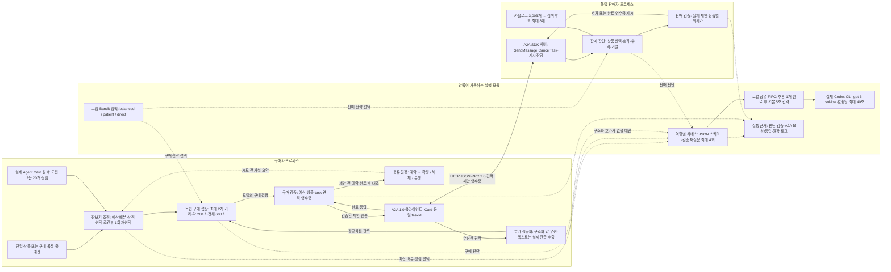

# 현재 A2A 시스템 아키텍처

구매자와 판매자는 각자의 비공개 한도와 실제 모델 판단으로 협상한다. 구매자는 낮은 구매가, 판매자는 높은 판매가와 거래 성사를 추구한다. 아래 그림의 하네스·정책·대기열은 각 프로세스가 사용하는 공통 모듈이며, 별도의 추론 서버가 아니다.

단일 구매는 조정기 없이 `buyer.py`에서 시작하며 기본 제한은 240초다. 장보기는 기본 2개 협상을 병렬로 진행하지만 추론은 로컬 FIFO의 한 슬롯을 공유한다. 개별 협상 280초와 전체 600초를 함께 지키며, 도전 2는 램프·의자·책장과 총예산 600을 사용한다. 원장과 남은 시간의 요약은 각 시도 직전의 사실 스냅샷이다.

| 구성 | 운영 파일 | 역할 |
|---|---|---|
| 구매·A2A 통신 | `buyer.py`, `protocol.py` | Card 검증, 같은 taskId로 최대 8회 판단, 한 번 구매 후 종료 |
| 판매·상품 검색 | `seller.py`, `catalog.py`, `data/catalog.json` | 실제 상품 후보 축소, 독립 판매 판단, A2A 상태·영수증 게시 |
| 장보기 | `shopping.py`, `run_challenges.py` | 실제 모델의 초기 예산 배분·상점 선택, 병렬 거래, 조건부 재선택 |
| 호가 관측 | `quote_normalization.py`, `quote-observation.schema.json` | metadata·DataPart 정규화, 텍스트의 가격·상품·견적 ID 관측과 원문 근거 대조 |
| 실제 모델 실행 | `harness.py`, 역할별 `*.schema.json`, `inference_queue.py` | 역할별 프롬프트, 스키마·제약 검증, CLI 실행·FIFO·제한 시간 |
| 거래 안전·원장 | `evidence.py` | 예산·최저가 검증, 원자적 예약, 영수증 대조·중복 방지·분쟁 유지 |
| 고정 전략 | `policy.py`, `policies/active.json` | 자기 한도와 공개 관측으로 balanced·patient·direct 중 선택 |
| 실행 근거 | `tracing.py` | 새 실행의 판단·원문 응답·검증 결과 기록 |

구조화된 호가가 유일하고 유효하면 관측용 모델을 추가 호출하지 않는다. 텍스트 의미를 읽어야 할 때만 실제 `quote_observer`를 사용하며 같은 대기열과 거래 deadline을 적용한다. 구조화 값의 충돌은 차단한다. 통화·수량이 구조화되어 있으면 credits·수량 1을 검사하지만, 텍스트에만 있는 단위는 모델의 의미 판단에 의존한다. 과거 task metadata와 현재 메시지 호가가 다를 때도 임의로 하나를 고르지 않고 충돌로 중단한다.

모든 가격 제안 전에 예산을 예약하고, 완료 영수증의 상품·합의 가격·반환된 식별자를 대조한 뒤 한 번만 확정한다. 식별자는 상대가 실제로 반환한 경우 일치 여부를 검사한다. 응답 유실이나 종료 상태와 구매 증거의 충돌은 분쟁으로 유지한다. 재선택은 명확한 FAILED·REJECTED·CANCELED 종료와 해당 상품의 모든 예약 해제를 확인했을 때만 한 번 허용한다. 분쟁·시간 초과에는 재구매하지 않는다. 이미 수신한 마지막 완료 응답은 시간·턴 한도 검사보다 먼저 검증한다.

판매자는 협상 순서를 보호하는 잠금과 짧은 게시 잠금을 구분한다. 취소가 먼저 확정되면 늦게 끝난 모델 결과를 폐기하고, 완료 게시가 먼저 끝나면 뒤늦은 취소로 완료를 덮어쓰지 않는다. 장보기의 `negotiable/firm`은 모델이 선택한 공개 협상 태도이며 비공개 예산이나 구매자 우선권을 뜻하지 않는다.

운영 중에는 `active.json`의 전략 선택 값을 읽기만 한다. 온라인 강화학습이나 Codex 가중치 갱신은 없으며, 시험한 env2 합성 학습 후보는 미체결 개선을 입증하지 못해 승격하지 않았다. 정리 이전의 동일 모델 교차 실험에서는 구매 7/7, 판매 3/7이 성사됐다. 이는 Git 이력에 남긴 과거 측정이며 정리 후 새 실행의 결과가 아니다. 정리 후 검증은 REPORT.md의 현재 실행 기록을 기준으로 확인한다. 판매자가 높은 호가를 유지하는 동안 상대가 먼저 종료할 수 있어, 높은 체결가와 높은 성사율을 동시에 보장하지는 않는다. 원장의 안전 검사는 합의 증거를 검증하며 실물 배송이나 판매자의 법적 신원을 보증하지 않는다.
