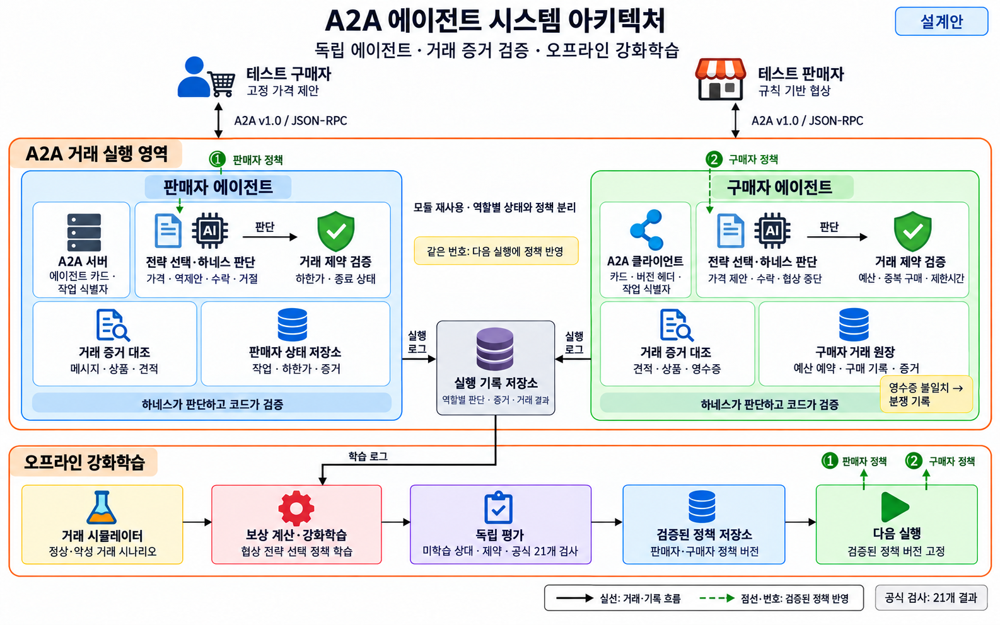
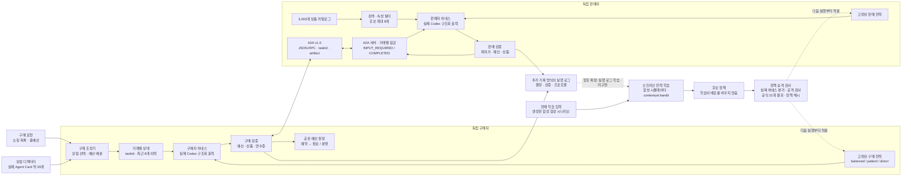

# A2A 에이전트 시스템 아키텍처

이미지의 실행 로그에서 학습으로 이어지는 연결은 향후 확장이다. 현재 학습 입력은 `train_policy.py`가 생성한 합성 협상 시나리오이며 실행 로그를 자동으로 훈련에 넣지 않는다. 아래 Mermaid는 이 구현 범위를 구분한다.

구매자와 판매자는 각각 자신의 하네스와 전략 정책을 갖는다. 구매자가 판매자의 의사결정을 덮어쓰는 위계는 없다. `protocol.py`가 Agent Card를 읽고 A2A v1.0 JSON-RPC 요청을 보내며, 양쪽의 실제 Codex CLI가 가격과 거래 종료를 결정한다. 검증 코드는 모델의 잘못된 가격을 자동으로 고치지 않고 거부 사유를 전달해 다시 결정하도록 한다.

| 구성 요소 | 구현 | 책임 |
|---|---|---|
| 실제 추론 | `harness.py`, `inference_queue.py` | 빈 임시 디렉터리에서 CLI 호출, JSON schema, 제한 시간, 검증 재시도, FIFO 대기열·호출 간격 |
| A2A 판매자 | `seller.py` | SDK 서버, Agent Card, task 상태 전이, 상품 선택, 영수증 artifact |
| A2A 구매자 | `buyer.py`, `protocol.py` | Card 탐색, 버전 헤더, 동일 taskId 협상, 한 번 구매 후 종료 |
| 대규모 상품 검색 | `catalog.py`, `data/catalog.json` | 의미 있는 설명·속성으로 후보 축소, 후보 선택은 하네스 |
| 여러 상점 구매 | `shopping.py`, `run_challenges.py` | 실제 Card 디렉터리, 하네스 상점 선택·예산 배분, 독립 거래 병렬 실행 |
| 거래 증거·예산 | `evidence.py` | 제약 검증, 원자적 예약, 중복 방지, 모호한 완료의 분쟁 처리 |
| 전략 학습 | `policy.py`, `train_policy.py` | 역할별 전략을 선택하는 작은 contextual bandit, 실행 중 정책 고정 |
| 평가·승격 | `evaluate_policy.py`, `run_adversarial.py`, `promote_policy.py` | 실제·합성 결과 구분, 정책 및 검사 파일의 해시 결합, 통과한 후보만 적용 |

상점 거래는 여러 스레드에서 병렬로 진행한다. 이 환경에서는 실제 CLI가 429 응답을 반환했으므로 추론 호출만 로컬 FIFO 대기열로 직렬화하고 10초 간격을 둔다. 파일 잠금은 대기열의 짧은 상태 변경을 보호하며, 먼저 기다린 호출이 뒤에 온 요청에 밀리지 않도록 한다. A2A 서버의 이벤트 루프는 추론을 작업 스레드에 넘겨 다른 요청을 처리할 수 있다.

원장은 한 구매 프로세스의 여러 거래가 공유하는 스레드 안전 원장이다. 여러 구매 프로세스나 여러 머신이 공유하는 결제 데이터베이스는 아니다. 영수증 검증은 가격·상품·task·견적·재사용 식별자의 불일치를 발견하며, 실물 배송이나 판매자의 법적 신원을 보증하지 않는다. 완료 응답이 유실되면 구매가 일어났을 가능성이 있으므로 예약을 분쟁으로 유지한다.

그림은 합의한 설계이고, 실행된 범위와 검증 결과는 [REPORT.md](REPORT.md)에 기록한다. 오프라인 학습은 전략 선택 정책을 갱신한다. 실제 거래 가격을 계산하거나 Codex 모델 가중치를 학습하는 기능은 아니다.
