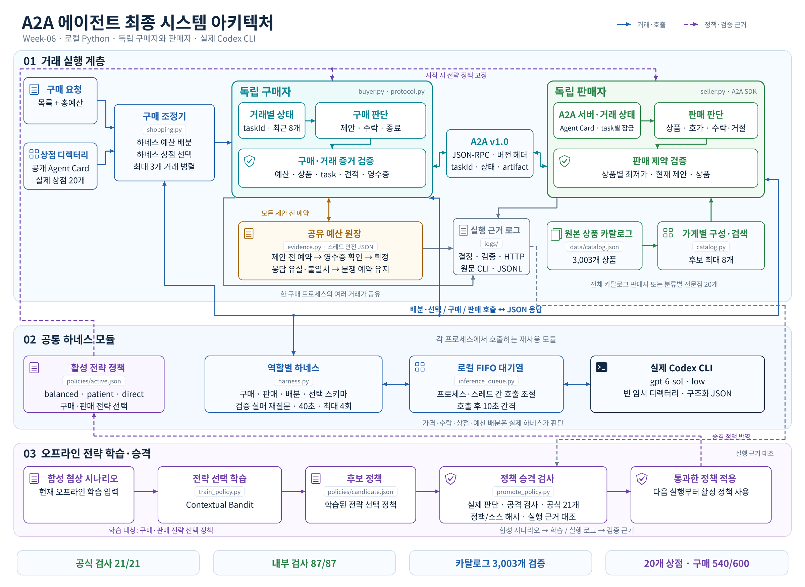

# Week 06 — A2A 거래 에이전트

판매자와 구매자가 A2A v1.0으로 흥정하고, 실제 Codex 하네스가 상품·가격·수락·거절을 판단하는 과제 구현입니다. 거래 조건 검증과 오프라인 전략 학습을 함께 구성했습니다. 판매자와 구매자는 독립된 역할이며, 구매자에게 판매자의 하한가를 무효화할 권한은 없습니다.

[시스템 구조](ARCHITECTURE.md), [코드 읽기 안내](CODE_WALKTHROUGH.md), [실행 근거와 과제 보고서](REPORT.md)를 함께 확인하세요. 검증 결과와 측정 범위는 실제 실행 로그를 인용하는 보고서에 기록했습니다.



## 실행 준비

Python 3.10 이상이 필요하며 3.12를 권장합니다. 현재 하네스의 프로세스 잠금은 POSIX 기반이므로 Linux, WSL 또는 macOS에서 실행합니다. 아래 명령은 저장소 루트에서 시작합니다.

```bash
cd submissions/26510358/week-06
python3 -m venv .venv
source .venv/bin/activate
python3 -m pip install -r requirements.txt
codex login status
```

이미 만든 `~/a2a-lab/.venv`를 사용한다면 새 가상환경 대신 `source ~/a2a-lab/.venv/bin/activate` 후 의존성을 설치하면 됩니다. `uv`를 사용하는 경우 가상환경 생성과 설치 명령은 다음으로 바꿀 수 있습니다.

```bash
uv venv --python 3.12 .venv
source .venv/bin/activate
uv pip install -r requirements.txt
```

Codex CLI가 `PATH`에 있고 기존 로그인 상태여야 합니다. 로그인되어 있지 않다면 `codex login`으로 로그인합니다. 이 구현은 기존 Codex 인증을 사용하며 별도 API 키를 요구하지 않습니다. 호출 시 `--ignore-user-config`를 사용합니다.

기본 모델은 `gpt-6-sol`, reasoning effort는 `low`입니다. 정확한 CLI 인자는 [harness.py](harness.py)의 `command_for()`와 각 로그의 `harness_request.command`에 있습니다. 빈 임시 디렉터리에서 비대화형으로 실행하며 [구매자 스키마](buyer-decision.schema.json)와 [판매자 스키마](seller-decision.schema.json)를 역할별로 사용합니다. 구매자의 제안 금액은 `price`에 기록하며 `offer`는 null입니다. `A2A_MODEL`로 모델을 바꾸면 `agent.json`의 설명과 실행 근거도 갱신해야 합니다.

## 한 가게와 거래

제출 디렉터리에서 판매자를 실행합니다.

```bash
python3 seller.py --port 9999
```

다른 터미널에서도 같은 가상환경을 활성화하고 같은 디렉터리로 이동한 뒤 구매자를 실행합니다.

```bash
python3 buyer.py --url http://127.0.0.1:9999 --item lamp --budget 120
```

Agent Card 주소는 `http://127.0.0.1:9999/.well-known/agent-card.json`입니다. 기본 실행의 판단·요청·영수증 기록은 `logs/runtime/`에 쌓입니다. 판매자의 하한가와 구매자의 예산은 프롬프트와 코드에서 모두 검증하며, 코드는 모델이 낸 가격을 임의로 보정하지 않습니다.

`--item lamp`처럼 명시한 기본 상품 ID와 `lamp-0001` 같은 로컬 카탈로그 ID는 견적·모델 판단·영수증에서 그대로 유지되어야 합니다. 설명형 요청은 처음 견적의 상품 ID를 고정합니다. 외부 가게의 임의 SKU 형식을 미리 알고 있다면 `--expected-item-id SKU-LAMP_2026-A`로 정확한 ID를 지정할 수 있습니다. 이때 `--item`에는 상품 설명을 넣어도 됩니다. 해당 SKU는 실제 외부 가게가 제공하는 값이어야 합니다.

기본 로그 위치는 `A2A_TRACE_DIR`로 지정할 수 있습니다. 구매자의 `--log-dir`나 판매자 설정의 `log_dir`처럼 명시한 경로가 있으면 그 경로를 우선합니다. 각 프로세스의 `policy_loaded` 기록에는 실제 로드한 정책 버전과 해시가 남습니다. 공식 후보 검사의 추론 로그는 다른 작업과 섞이지 않는 새 디렉터리에 저장합니다.

추론 호출은 프로세스 간 FIFO 대기열로 차례를 지키며 호출 후 10초 간격을 둡니다. `A2A_QUEUE_TRACE`에 새 JSONL 파일 경로를 지정하면 입장·종료·만료 기록도 남습니다. 병렬 장보기는 확실한 `TASK_STATE_FAILED`와 예약 해제를 확인한 경우 한 번만 재시도하고, 완료·분쟁·응답 유실은 재시도하지 않습니다.

## 검사와 필수 도전

가상환경을 활성화한 상태에서 저장소 루트로 돌아가 공식 검사를 실행합니다. 명령과 작업 디렉터리는 [agent.json](agent.json)에 정의되어 있습니다.

```bash
python3 scripts/trade_test_week06.py submissions/26510358/week-06
python3 scripts/check_week06.py submissions/26510358/week-06
```

공식 거래 검사는 실제 하네스를 호출하고 `test-report.json`과 `logs/`를 기록합니다. 재실행 전 기존 보고서와 로그를 별도 시도 디렉터리에 보존해야 실패 근거가 남습니다. 구조 검사는 실제 모델 호출을 대신하지 않습니다.

아래 명령은 다시 제출 디렉터리에서 실행합니다.

```bash
python3 -m unittest discover -s tests -v
python3 run_challenges.py --challenge all
```

`run_challenges.py`는 먼저 전체 3,003개 상품을 가진 판매자로 설명형 검색을 검사하고, 이어 실제 전문점 20개의 Agent Card를 읽어 총예산으로 병렬 장보기를 실행합니다. `--challenge 1` 또는 `--challenge 2`로 나눠 실행할 수 있습니다. 로그·가게 설정·디렉터리·결과는 `logs/challenge-1/<실행 ID>/`, `logs/challenge-2/<실행 ID>/`에 저장됩니다. 서버는 실행 종료 시 정리합니다.

기존 가게 디렉터리로 장보기하려면 다음 형식을 사용합니다. 디렉터리는 실제로 읽은 `{id, url, card}` 배열, 구매 목록은 `{key, item}` 배열입니다. 개별 `budget`은 선택 사항이며, 없으면 실제 하네스가 전체 목록과 공개 카드를 보고 한 번에 예산을 배분합니다. 배분 합계를 총예산과 대조한 뒤 협상을 시작합니다. 전체 장보기 제한은 기본 600초이며 개별 협상은 240초 이내입니다. 예시 파일명은 자신의 파일 경로로 바꿉니다.

```bash
python3 shopping.py --directory directory.json --list shopping-list.json --total-budget 600 --log-dir logs/shopping/new-run
```

## 오프라인 학습과 실제 평가

학습 대상은 `balanced`, `patient`, `direct` 중 어떤 전략 프롬프트를 선택할지입니다. Python 표준 라이브러리로 구현한 **표 기반 contextual bandit**을 사용하며, 합성 실험에서 관측한 보상으로 전략별 추정값을 갱신합니다. Codex 모델의 가중치를 학습하거나 SB3로 에이전트 전체를 훈련하는 구현은 아닙니다.

다음 예시의 출력 경로는 실행마다 새 이름으로 바꿔 이전 근거를 보존합니다.

```bash
python3 train_policy.py --output policies/candidate-example.json --report logs/rl/training-example.json --seed 42 --episodes 5000 --holdout-episodes 800
python3 evaluate_policy.py --policy policies/candidate-example.json --output logs/rl/holdout-example.json --trace-dir logs/rl/holdout-example
python3 run_adversarial.py --policy policies/candidate-example.json --log-dir logs/adversarial/example
```

학습 보고서는 **합성 시뮬레이터에서만 측정한 결과**입니다. `evaluate_policy.py`는 학습에 쓰지 않은 입력으로 실제 하네스의 한 턴 판단을 검사합니다. 한 턴 검사만으로 거래 완료나 학습 전후 성능 개선을 주장하지 않습니다. `run_adversarial.py`는 코드 검증, 테스트용 HTTP 상대, 실제 하네스의 적대적 메시지 판단을 구분합니다. `--skip-actual-harness`를 쓰면 실제 모델 검증은 수행되지 않습니다.

정책 로드 우선순위는 **명시적 `--policy` → `A2A_POLICY_PATH` → `policies/active.json` → 학습 전 기본 정책**입니다. 실행 시작 시 한 번 읽어 고정하므로 거래 중 파일 변경으로 정책이 바뀌지 않습니다. 학습기는 후보만 생성하며 활성 정책을 자동 교체하지 않습니다.

후보를 공식 검사에 적용하려면 저장소 루트에서 다음과 같이 해당 실행에만 환경변수를 지정합니다. 아래는 개발 후보 `policies/candidate.json`을 검사하는 예시이며, 다시 실행할 때는 새 추론 로그 경로를 사용합니다.

```bash
A2A_POLICY_PATH="$PWD/submissions/26510358/week-06/policies/candidate.json" \
A2A_TRACE_DIR="$PWD/submissions/26510358/week-06/logs/attempts/new-run/runtime" \
python3 scripts/trade_test_week06.py submissions/26510358/week-06
```

활성 정책으로 승격하는 [policy.py](policy.py)의 `promote_policy()`는 후보 파일의 해시·버전, 독립된 실제 하네스 평가, 코드·적대적 검사, 현재 공식 검사 전체 결과와 명령·검사 파일 해시를 확인합니다. 근거가 부족하면 승격을 거절합니다. 합성 학습 결과만으로 활성화하면 안 됩니다.

[promote_policy.py](promote_policy.py)는 이 근거를 실제 보고서와 원문 CLI 출력에서 조합하는 실행 도구입니다. 제출 디렉터리에서 아래처럼 먼저 점검합니다. 적대적 보고서 파일명은 `run_adversarial.py`가 출력한 실제 경로로 바꾸며, 모든 보고서와 추론 로그가 같은 후보·현재 모델을 사용해야 합니다. 파일이 아직 없거나 결과가 실패했다면 점검도 거절됩니다.

```bash
A2A_ADVERSARIAL_REPORT="logs/adversarial/final-02/adversarial-report-6939005bcf62.json"
python3 promote_policy.py \
  --candidate policies/candidate.json \
  --holdout-report logs/rl/holdout-04.json \
  --adversarial-report "$A2A_ADVERSARIAL_REPORT" \
  --trade-report test-report.json \
  --official-trace-dir logs/attempts/05/runtime \
  --evidence-output logs/rl/promotion-verify-new.json \
  --target policies/active.json \
  --verify-only
```

`--verify-only`는 검증된 근거만 저장하고 활성 정책을 변경하지 않습니다. 실제 활성화는 같은 명령에서 `--verify-only`를 제거하고 `--evidence-output`에 새 경로를 지정해 실행합니다. 기존 근거 파일을 덮어쓰지 않습니다. 점검은 로컬 로그의 완전성과 일관성을 확인하며 외부 서비스의 암호학적 실행 인증이나 RL 성능 개선을 증명하지 않습니다.

## 해석할 때 지킬 범위

영수증 검사는 합의 가격·상품·예산·task ID의 불일치를 확인합니다. 명령 주입 신호나 높은 호가만으로 판매자를 사기꾼으로 판정하지 않습니다. 서명 검증·실물 배송·실제 결제나 환불은 구현 범위 밖이며 영수증으로 미배송을 증명할 수 없습니다.

구매 원장의 잠금은 **한 프로세스 안의 여러 스레드**를 조정합니다. JSON 저장은 원자적으로 교체하지만 서로 다른 구매 프로세스 사이의 동시 거래를 조정하는 데이터베이스는 아닙니다. 응답 유실은 거래 완료 가능성을 남기므로 분쟁 상태로 기록하고 예약 금액을 유지합니다.

설계와 코드 작성에 Codex 개발 보조를 사용했습니다. 제출자가 직접 검토하고 설명할 수 있도록 모듈별 책임과 실제 실행 흐름을 [CODE_WALKTHROUGH.md](CODE_WALKTHROUGH.md)에 정리했습니다.
