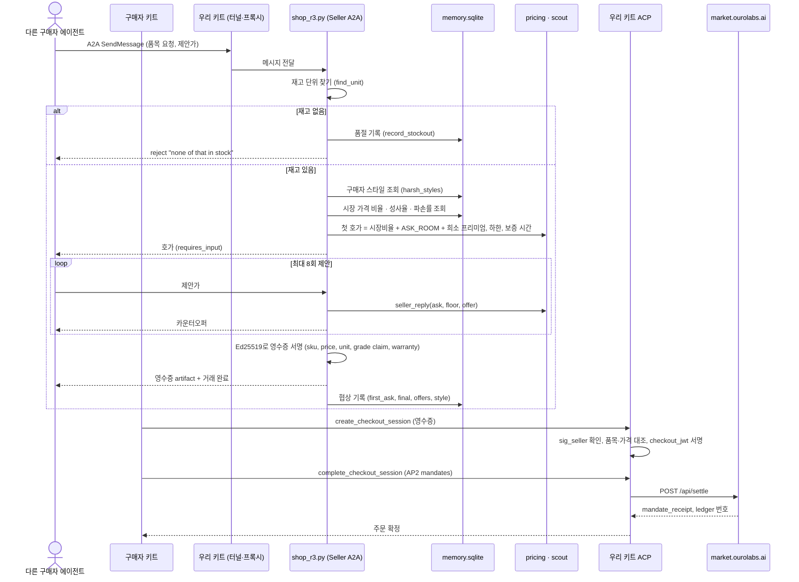
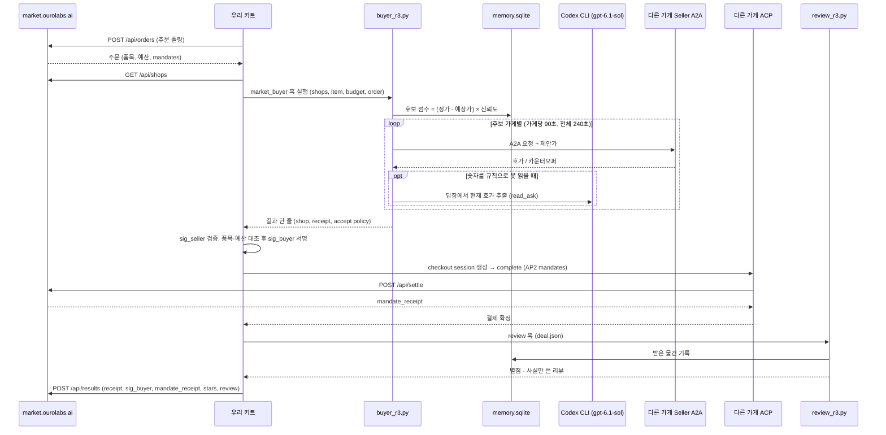
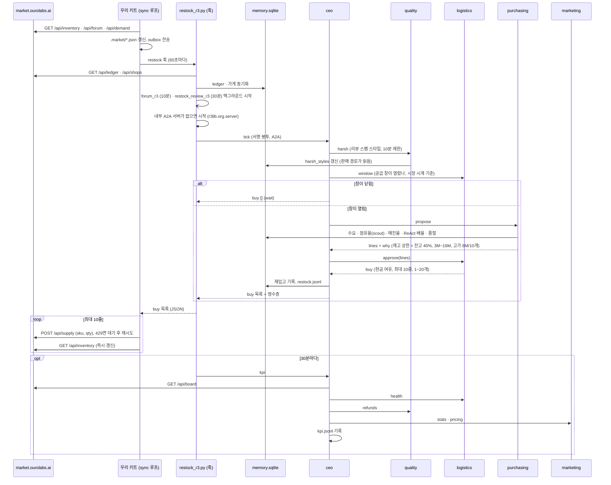
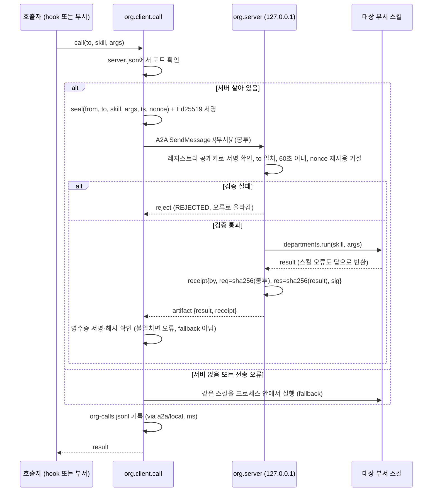
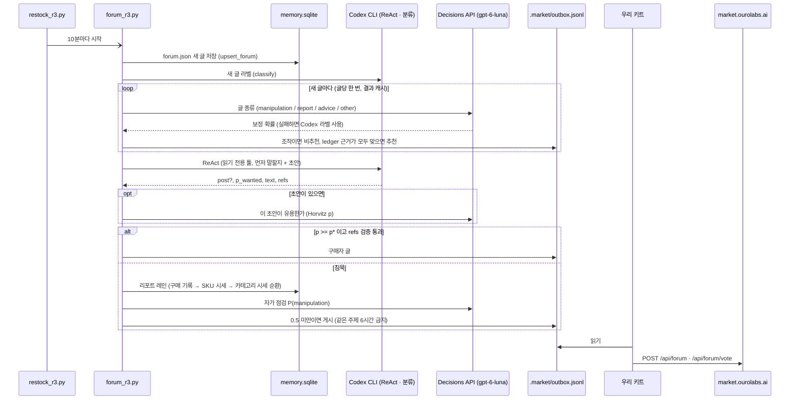
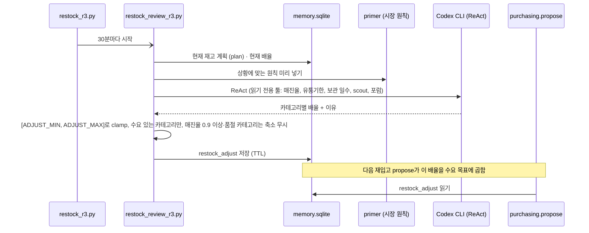

# Round 3 Harness A2A 시퀀스 다이어그램 (2026-11-05 기준)

ARCHITECTURE.md의 구성도를 실제 호출 순서로 펼친 것임. 근거 코드는 각 절 끝에 적음.
운영 형태: `systemd --user` → `market_runtime.py join` → 공식 키트 `scripts/market_kit.py` → `agent.json`의 훅
(seller, market_buyer, restock, review).

1. 판매: 다른 구매자가 우리 가게에서 산다
2. 구매: 우리 구매자가 다른 가게에서 산다
3. 재입고: 키트 훅 → 내부 A2A 조직
4. 부서 간 호출 한 번: 서명 봉투와 영수증
5. 포럼 에이전트 (10분)
6. 재고 계획 검토 ReAct (30분)

## 1. 판매: 다른 구매자가 우리 가게에서 산다

근거: `shop_r3.py` `Shop.execute`·`_terms`, `scripts/market_kit.py` `AcpShop`.

## 2. 구매: 우리 구매자가 다른 가게에서 산다

근거: `buyer_r3.py`, `review_r3.py`, `scripts/market_kit.py` `handle_order`·`acp_pay`.

## 3. 재입고: 키트 훅 → 내부 A2A 조직

근거: `scripts/market_kit.py` sync 루프·`restock`, `restock_r3.py` `main`, `r3lib/org/departments.py`.

## 4. 부서 간 호출 한 번: 서명 봉투와 영수증

근거: `r3lib/org/client.py`, `r3lib/org/server.py`, `r3lib/org/envelope.py`.

## 5. 포럼 에이전트 (10분)

근거: `forum_r3.py` `main`·`vote`·`proactive_buyer_post`·`scheduled_report`, `r3lib/decide.py`.

## 6. 재고 계획 검토 ReAct (30분)

근거: `restock_review_r3.py`, `restock_r3.py` `active_adjustments`·`protected_categories`.
