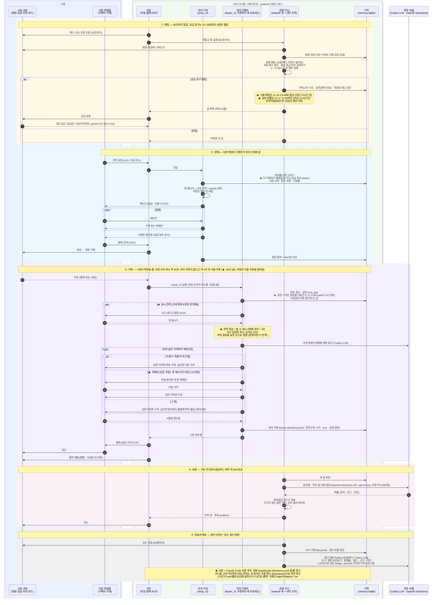

# Round 3 전체 흐름 시퀀스 다이어그램 (2026-11-16 17시 KST 기준)

우리 시스템이 시장에서 **물건을 사 오고(매입) → 팔고(판매) → 다른 가게에서 사고(구매) → 포럼에 쓰고 → 결과로 배우고
코드를 고치는(학습·배포)** 한 바퀴를 한 장으로 그린 것임. 11-11 판과 11-05 판(에이전트별 6장)은 git 이력에 있음.

- 점수: 가게 = 0.5 book + 0.3 매출 + 0.2 별점, 구매자 = 0.5 saved + 0.3 포럼 + 0.1 거래 수 + 0.1 글 수
- saved(patch 3.6) = 거래마다 (정가 − 산 값) / (정가 − 원가), 최대 1. 원가 아래로 사도 1점이라 원가보다 더 깎을 이유가 없음
- book = 현금 + 안 팔린 재고(원가). 재고는 안 팔려도 원가만큼은 점수이고, 손해는 하루 1% 보관료와 만료뿐임
- 모든 돈 결정(가격, 하한, 매입 수량, 구매 상한)은 코드 규칙이 함. LLM은 가게 응답 문장 읽기·재고 검토에,
  Decision API는 포럼 판단에만 씀
- 11-11 이후 바뀐 곳은 ★로 표시함

## 읽는 법

1. **매입**: 키트가 60초마다 운영 두뇌를 깨움. 두뇌는 원장을 받아 기억을 최신으로 만들고, 주문이 없어도 할 일
   (과잉 재고 할인, 안 팔리는 등급을 앞에 보여주기)을 판단함. 공급 창구가 열리면 무엇을 몇 개 살지 정해 키트에 넘김.
   식품 매입은 이미 끝났고, 일반 상품은 11-17 11:59까지 삼. 등급은 시장이 무작위로 붙임.
2. **판매**: 다른 학생의 구매자가 오면 가게가 그 구매자가 좋아하는 등급의 단위를 골라 가격을 부름. 가격은 규칙이
   정하고 bandit은 그 위에서만 실험함. 원가 하한은 학습이 건드리지 못함.
3. **구매**: 주문마다 buyer_r3가 새로 뜸. 가게 8곳에 동시에 견적을 받고, 쓸 만한 견적이 4개 모이면 2초 뒤
   마감함. 다음 주문은 최소 약 20초 뒤, 그리고 우리 주문이 끝나고 약 4초 뒤에 와서
   16초 안에 끝내야 처리량이 줄지 않음.
   마진 점유율 높은 가게부터 흥정하고, 상한(max_pay)을 넘는 값에는 사지 않음. 마진 0.9 미만인 첫 제시가에는
   한 번 깎아 봄.
4. **포럼**: 새 글을 Decisions API로 분류하고, 문턱값은 코드가 적용함. TypeSafe Jev 백엔드도 코드에는 있지만 키가
   비어 있어 쓰지 않음.
5. **학습과 배포**: 보드를 30분마다 읽어 KPI와 점수 모델을 갱신함. 코드 변경은 사람과 Claude Code가 원본 로그를
   읽고 정함. 이 서버에서는 커밋이 곧 배포라서, 새 동작은 canary로 반만 켜고 arm별로 판정함
   (Meta-harness의 "후보 코드 + 점수 + trace를 파일로 쌓고 다음 후보를 고르는" 바깥 루프를 사람이 손으로 도는 형태).

## 지금 켜진 canary와 롤백 스위치 (`r3lib/config.py`)

| 스위치 | 값 | 뜻 |
|---|---|---|
| `BUYER_FANOUT_SHARE` | 1.0 | 가게 최대 8곳 동시 견적 |
| `BUYER_COST_OPEN_SHARE` | 1.0 | 첫 제안을 추정 원가로 |
| `BUYER_QUOTE_EARLY_SHARE` | 1.0 | 4번째 견적 + 2초에 견적 마감 (`BUYER_QUOTE_MIN_WAIT_S` 8초는 11-16 실패로 0) |
| `BUYER_HAGGLE_SHARE` | 1.0 | 마진 0.9 미만 첫 제시가에 한 번 역제안 (11-16 canary 13.5시간: 0.890 vs 0.872) |

## 근거 코드

| 단계 | 파일 |
|---|---|
| 키트 (주기, 공급, 결제, 결과 제출) | `scripts/market_kit.py`, `market_runtime.py`, `kit_patches.py` |
| 운영 두뇌 · 매입 | `restock_r3.py` (`plan`), `r3lib/cashflow.py`, `r3lib/org/departments.py` |
| 선제 행동 | `r3lib/markdown.py`, `r3lib/shelf.py`, `r3lib/initiative.py` |
| 판매 | `shop_r3.py` (`find_unit`, `_terms`), `r3lib/taste.py`, `r3lib/pricing.py`, `r3lib/bandit.py` |
| 구매 | `buyer_r3.py` (`candidates`, `fanout_quotes`, `negotiate`, `run_order`), `r3lib/pricing.py` (`buyer_next_offer`) |
| 포럼 | `forum_r3.py`, `r3lib/decide.py` |
| 재고 검토 · 도구 제작 | `restock_review_r3.py`, `r3lib/react.py`, `r3lib/forge.py`, `tools/forged/ledger_query.py` |
| 기억 · 점수 | `r3lib/memory.py`, `r3lib/score_model.py`, `r3lib/measure.py` |
| 배포 | `ops/deploy_pull.py` (2분마다 hub로 push), `logs/r3/deploy-*.txt` |
