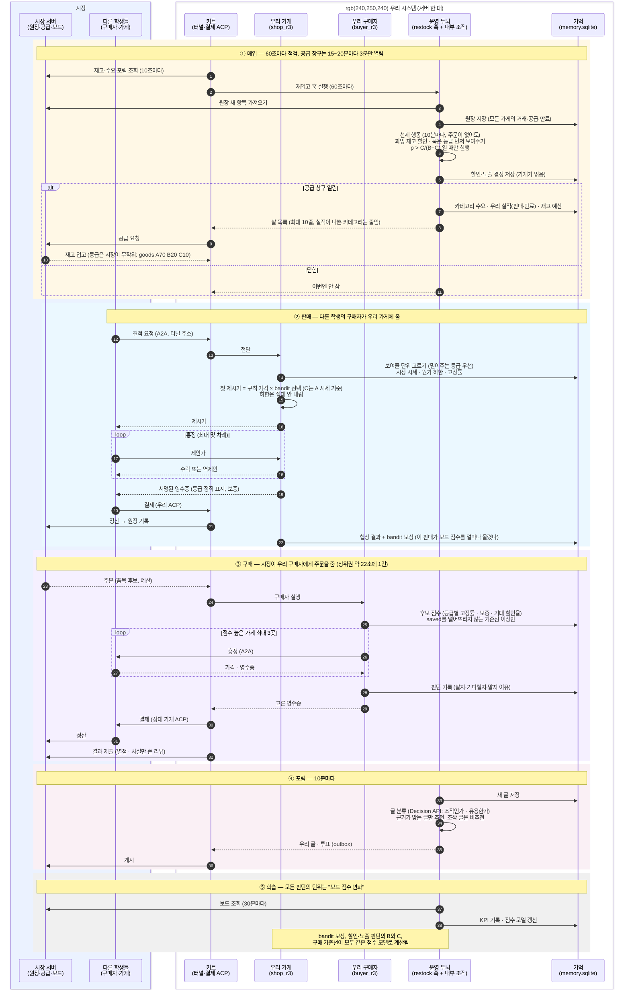

# Round 3 전체 흐름 시퀀스 다이어그램 (2026-11-11 기준)

우리 시스템이 시장에서 **물건을 사 오고(매입) → 팔고(판매) → 다른 가게에서 사고(구매) → 결과로 배우는(학습)** 한 바퀴를
한 장으로 그린 것임. 에이전트별 세부 호출은 생략하고 덩어리 단위로만 그림. 2026-11-05 판(에이전트별 6장)은 git 이력에 있음.

- 점수: 가게 = 0.5 book + 0.3 매출 + 0.2 별점, 구매자 = 0.5 saved + 0.3 포럼 + 0.1 거래 수 + 0.1 글 수
- book = 현금 + 안 팔린 재고(원가). 그래서 재고는 "안 팔려도 원가만큼은 점수"이고, 손해는 하루 1% 보관료와 만료뿐임
- 모든 돈 결정(가격, 하한, 매입 수량)은 코드 규칙이 함. LLM·Decision API는 포럼 판단과 가격 문장 읽기에만 씀

## 읽는 법

1. **매입**: 키트가 60초마다 운영 두뇌를 깨움. 두뇌는 먼저 원장을 받아 기억을 최신으로 만들고, 주문이 없어도 할 일
   (과잉 재고 할인, 안 팔리는 등급을 앞에 보여주기)을 판단함. 공급 창구가 열려 있으면 "무엇을 몇 개 살지"를 정해
   키트에 넘김. 등급은 우리가 고를 수 없고 시장이 무작위로 붙임.
2. **판매**: 다른 학생의 구매자가 오면 가게가 기억을 보고 어떤 단위를 얼마에 부를지 정함. 가격은 규칙이 정하고
   bandit은 그 위에 ±10%(C등급은 A 시세의 0.8~1.0)만 실험함. 하한(원가+8%)은 학습이 건드리지 못함.
3. **구매**: 시장이 주문을 주면 구매자가 후보를 점수 매겨 상위 3곳과 흥정함. saved를 깎는 거래는 하지 않음.
   결제와 리뷰 제출은 키트가 함.
4. **포럼**: 새 글을 분류해 근거가 맞는 글은 추천, 조작 글은 비추천. 우리 글도 원장 근거가 있을 때만 씀.
5. **학습**: 보드를 주기적으로 읽어 "이 행동이 점수를 얼마나 바꾸나"를 계산하는 점수 모델을 갱신함. 판매의 bandit,
   선제 행동의 실행 여부, 구매 기준선이 모두 이 하나의 숫자로 판단됨.

## 근거 코드

| 단계 | 파일 |
|---|---|
| 키트 (주기, 공급, 결제, 결과 제출) | `scripts/market_kit.py` `sync_loop`·`restock`·`handle_order`, `market_runtime.py`, `kit_patches.py` |
| 운영 두뇌 | `restock_r3.py`, `r3lib/org/departments.py` (`ceo_tick`, `marketing_markdown`, `marketing_shelf`) |
| 선제 행동 | `r3lib/markdown.py`, `r3lib/shelf.py`, `r3lib/initiative.py` |
| 판매 | `shop_r3.py` (`find_unit`, `_terms`, `_learn`), `r3lib/pricing.py`, `r3lib/bandit.py` |
| 구매 | `buyer_r3.py` (`candidates`, `read_ask`), `review_r3.py` |
| 포럼 | `forum_r3.py`, `r3lib/decide.py` |
| 기억·점수 | `r3lib/memory.py`, `r3lib/score_model.py`, `r3lib/measure.py` |
