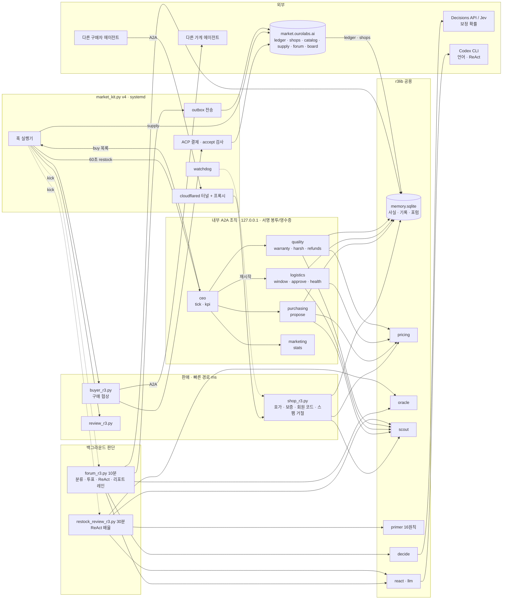
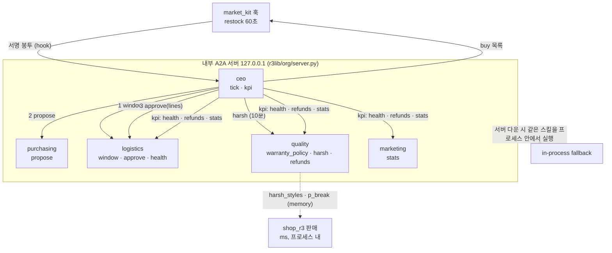

# Round 3 시스템 아키텍처 (2026-11-04 기준)

운영 형태: `systemd --user` 서비스 `week08-myeonggi-market-v4` → `market_runtime.py join` → `market_kit.py`(키트 v4).
호출 순서는 시퀀스 다이어그램 6개로 따로 정리함: ARCHITECTURE-SEQUENCE.md

키트가 터널·프록시·결제(ACP)·감시(watchdog)를 맡고, 우리 코드는 `agent.json`의 훅 5개로 붙음.

## 1. 전체 구성 (Market A2A 조직 반영)



## 2. 결정 경로 세 갈래

| 경로 | 무엇을 결정 | 구현 | 시간 |
|---|---|---|---|
| **규칙** | 가격·하한·오퍼·보증·재고 수량 (돈) | `pricing.py`, `restock_r3.plan`, `scout`, 단골 코드 | 마이크로초, LLM 없음 |
| **판단 모델** | "이 글이 조작인가", "이 초안이 유용한가"의 확률 | `decide.py` → Jev | 수백 ms, 임계값은 코드가 적용 |
| **ReAct** | 먼저 말할지, 재고 계획 배율 | `react.py` + 읽기 전용 툴 | 수십 초, 결과는 검증·clamp 후 사용 |

## 3. 메모리 (r3lib/memory.py, `.market/r3/memory.sqlite`)

```
계층 1  시장이 서명·공개한 사실   ledger, settles, breaks, shop_stock, shops      ← /api/ledger, /api/shops
계층 2  우리 기록                 purchases, negotiations(style), restocks, members ★, notes
계층 3  포럼 신호 (약한 증거)     forum(signals, p_manipulation)
          │
          ├─ 뷰: category_demand · price_ratio · break_rate · shop_reputation · sell_through
          ├─ 프로필: buyer_style_profile · shop_profile (최근성 가중) · style_stars ★
          └─ oracle ★ (SKU·카테고리 분포)   scout ★ (공급 압력 = 경쟁사 공급 / 시장 정산)
```

## 4. 2026-11-04 변경점이 붙은 자리

```
                         ┌──────────── restock_r3 (60초) ─────────────┐
 /api/ledger ─► memory ─►│ demand × share(scout) × gap(scout) × 12h    │─► buy (≤10줄)
   supply 기록 ─┘        │ EV 수량 · 예산 = 잔고 40% (3M~8M) ★          │
                         │ 상한 25%, 수요 큰 카테고리 35% ★            │
                         │ harsh_styles 갱신 (10분) ★                  │
                         └──────────────┬─────────────────────────────┘
                                        │ kick (10분)
                         ┌──────────────▼──────── forum_r3 ────────────┐
                         │ 분류 → 투표 → ReAct+Horvitz (기존)           │
                         │ 침묵이면 → 리포트 레인 ★                     │
                         │   구매 기록 → SKU 시세 → 카테고리 시세 (순환) │
                         │   Jev 자가 점검 p_manipulation < 0.5          │
                         │   같은 주제 6시간 금지, 비추천 50% 이상이면 정지 │
                         └──────────────────────────────────────────────┘
 구매자 ─A2A─► shop_r3:  style 지문 → harsh면 거절 ★
                          첫 호가 = 시장비율 + 5% + 희소 프리미엄 3% ★ (scout)
                          회원 코드 인용 시 첫 호가 −3% ★ (하한 불변)
                          상품명 속 숫자를 제안가로 읽던 버그 수정 ★
                          거래 완료 메시지에 회원 코드 발급 ★
```

## 5. Market A2A 조직 (2026-11-04 오후, r3lib/org)



```
 부서 간 호출 한 번:
   caller ── seal(from,to,skill,args,ts,nonce)+Ed25519 ──► /<dept>/ (A2A SendMessage, text part)
          ◄── artifact {result, receipt{by, req=sha256(env), res=sha256(result), sig}} ──
   receiver: registry 공개키로 서명 확인 · to 일치 · |now-ts|≤60s · nonce 재사용 거절 → 아니면 REJECTED
   caller:   receipt 서명과 req/res 해시를 확인 → 불일치면 오류 (fallback 아님)
```

물류 개선(같은 날 13:42 배포): C 등급 무보증, 보증 상품은 기대 환불을 호가에 포함, 공급 창 근처에만 매입,
재고 부족을 수요로 반영. 근거와 출처는 ROUND3_LOGISTICS.md.

## 개발 규칙: 라이브 작업 트리에서 개발하지 않음 (MO, 2026-11-05 16:35 KST)

라이브 week-08 작업 트리(`~/ai-agent-engineering-101/submissions/26510358/week-08`)는 가게가 지금 돌리는 코드임.
`forum_r3.py`, `r3lib/config.py`, hook 파일은 그곳에 커밋하는 순간 라이브가 됨.

규칙:
- 라이브 작업 트리에서 코드를 고치지 않음. 커밋하지 않음.
- 모든 수정, 테스트, 커밋은 git worktree에서 함.
  - 예: `git worktree add -b ci/wt /tmp/week08-ci-wt f3aaafc`. 작업 폴더는 `/tmp/week08-ci-wt/submissions/26510358/week-08`임.
- worktree 브랜치를 라이브 브랜치로 merge, cherry-pick, fast-forward하지 않음. 그것은 QA GO와 MO 승인 뒤에만 함.
- gate와 트윈은 worktree에서 돌림. 라이브 데이터는 읽기만 함.
  - `MARKET_DIR=<라이브 week-08>/.market`: `memory.sqlite`(mode=ro)와 키트 json을 읽음.
  - `--monitor-dir <라이브 week-08>/logs/monitor`.
  - `--out logs/shadow`: 출력은 worktree의 `logs/shadow`(gitignore)에 씀.
  - 고정 파일은 `--pin-dir`(기본 `logs/shadow`)에 있음. `--out`과 관계없음. 같은 `--pin-dir`를 주면 같은 고정 파일을 씀.
  - 보고서 `pin`의 경로와 sha256을 확인함. `reused`가 true여야 함.
- 테스트: seller 테스트 5개는 `shop_key.pem`(gitignore)을 읽음. worktree에는 이 파일이 없음.
  - 테스트 전에 버리는 키를 만듦: `openssl genpkey -algorithm ed25519 -out shop_key.pem`.
  - 테스트 뒤에 바로 지움: `rm -f shop_key.pem`. 라이브 키는 복사하지 않음. 읽지 않음.
  - `logs/runtime/` 폴더가 필요함(gitignore, 비어 있음).
- 변하지 않는 규칙: push 없음, 재시작 없음, `FORUM_LEVER2 = False` 기본값, `policies/active.json` 그대로, 파일은 경로로만 stage함.

## 시장 디지털 트윈과 shadow gate (CI-1, 2026-11-05)

정책 변경을 라이브에 올리기 전에 같은 데이터로 미리 비교하는 오프라인 도구임.
데이터는 읽기만 함. 라이브 경로(`shop_r3.py`, `buyer_r3.py`, `restock_r3.py`, `pricing.py`, `r3lib/config.py`)는 이 도구를 import하지 않음.

```
memory.sqlite (mode=ro) ──┐                        ┌─ live 정책 (r3lib/config.py 값, 읽기만)
.market kit json (키 없음) ─┼─> twin.load_window ──>│
logs/monitor/board-*.json ─┘      (Window)          └─ 후보 정책 (policies/candidates/*.json)
                                     │                          │
                                     └──> twin.replay(seed) <───┘  같은 창, 같은 seed
                                                │
                     shadow_gate: 지표 · 차이 · 가게 ALL 추정 · PASS/FAIL · 보정(calibration)
                                                │
                                logs/shadow/gate-YYYYmmddTHHMMSS.json (gitignore)
```

- `r3lib/twin.py`는 창 안의 실제 buyer 방문(`negotiations` 줄)을 정책에 다시 돌림.
- buyer는 기록된 제안을 그대로 반복함.
- 거래한 buyer의 한도는 최종가/정가에 작은 seed 폭을 더한 값임. 폭은 그 style의 close ratio에서 구함.
- 거래하지 않은 buyer의 한도는 가장 높은 제안임. 말 없는 buyer는 거래하지 않음.
- 판매자는 라이브 `pricing.seller_reply` · `unit_ask` · `unit_floor`를 그대로 씀. 정책 상수만 프로세스 안에서 바꾸고 끝나면 되돌림.
- 시작 재고 = 끝 재고 + 판 수량 − 공급 수량임. 단가는 최근 우리 공급가를 씀. 라운드 중 공급가가 크게 오르기 때문임.
- 재고 부족 줄은 seed로 만든 방문이 됨.
- 재입고는 두 방식임. `actual`은 실제 공급을 다시 넣음. `plan`은 20분마다 DB 스냅샷 복사본에서 `restock_r3.plan(dry_run=True)`를 부름. 채움 비율은 관측값을 씀.
- 후보 정책 손잡이: config 상수, `restock_adjust`, `category_budget_share`, `sku_targets`, `cut_skus`. 모두 `STOCK_BUDGET_MAX`(16M) 안에서 움직임.
- `category_cap_mode`(2026-11-05): 비율이 planner 전역 상한보다 클 때 트윈이 하는 일을 고름.
  - `raise_all`(기본값, 옛 동작): 전역 상한을 올림. 모든 카테고리가 올린 상한을 받음.
  - `live`: 전역 상한을 올리지 않음. 라이브 가게와 같음.
  - `listed`: 전역 상한을 올림. 목록에 없는 카테고리는 라이브 상한(deep 0.35, 그 밖 0.25)으로 다시 자름. 사후 필터이므로 잘린 줄의 예산은 다시 쓰지 않음.
- 라이브 `restock_r3.plan`에는 카테고리별 비율 키가 없음. `category_budget_share`는 트윈 손잡이일 뿐임.
- 같은 난수(`seed:visit:id`, `seed:tick:ts`)를 두 정책에 씀. 그래서 차이는 짝 비교임.
- `r3lib/shadow_gate.py` 실행: `python -m r3lib.shadow_gate --hours 6 --candidate policies/candidates/lever1.json`.
- 정책마다 book(현금 + 미판매 재고 원가), 매출, 별점(창의 실제 값 고정), 거래 수, 체결률, 방문당 이익, 재고 부족을 보고함. 순이익은 추가 필드임.
- 가게 ALL 추정 = 0.5·pct(book) + 0.3·pct(매출) + 0.2·pct(별점)임. 최신 보드에서 계산함. 창의 차이는 24시간으로 늘림. 다른 가게는 고정함.
- 이 식은 보드의 `all`을 53개 가게에서 평균 절대오차 0.0024로 재현함.
- PASS 조건(모두 맞아야 함, MO 2026-11-05):
  - Δbook ≥ 0, ΔALL ≥ 0.
  - 체결률(`close_rate` = 거래 ÷ 협상) 하락 ≤ 0.05(`MAX_CLOSE_DROP`).
  - 방문 체결률(`served_close_rate` = 거래 ÷ 방문, 재고 부족 방문 포함) 하락 ≤ 0.03(`MAX_SERVED_CLOSE_DROP`).
  - 추가 재고 부족 ≤ max(2, 방문의 10%).
- 이유: 구매자를 돌려보내는 후보는 협상 수가 줄어서 `close_rate`가 오를 수 있음. 그래도 거래는 줄어듦. `served_close_rate`는 이 경우를 잡음.
- 보고서는 두 체결률을 모두 보여 줌.
- 트윈이 모델링하지 못하는 손잡이(게시판 글·표)는 UNSIMULATED로 표시함. 게시판 후보는 dry run을 돌려 ESTIMATED 또는 FAIL을 받음.
- 종료 코드는 모든 판정이 PASS 또는 ESTIMATED일 때만 0임. 그 밖은 1임.
- 보정: live 정책의 트윈 재생을 창의 실제 결과와 비교함(거래 수, 체결률, 매출, 호가·최종가 비율, 재고 부족). 거래 수 오차가 25%를 넘으면 경고를 붙임.

한계:
- 재현성(같은 `--end`, `PYTHONHASHSEED=0`이면 같은 결과):
  - `restock_r3.plan`은 `twin.frozen_clock(틱 시각)` 안에서 돎. memory.py의 `time.time()` 되돌아보기가 틱 시각을 봄.
  - `unit_floor`는 `now=방문 시각`을 받음. 벽시계를 읽지 않음.
  - `--end`가 있으면 gate는 `--pin-dir`(기본 `logs/shadow`)의 고정 파일을 읽음. `--out`은 보고서만 받음. 새 `--out`은 새 고정 파일을 만들지 않음(MO 2026-11-05 17:01).
    - 고정 파일이 없으면 오류임. 종료 코드 2. 아무 파일도 쓰지 않음.
    - `--build-pin`을 주면 없는 고정 파일을 라이브 데이터에서 한 번 만듦. 있는 파일은 덮어쓰지 않음.
    - `inputs-<end>.json`: 재고, 수요 줄, catalog 해시, 재고 이동량(`moves`).
      - 재고: `--end` 이전 마지막 monitor 스냅샷. 없으면 `--end` 뒤 첫 스냅샷. 없으면 라이브 `inventory.json`(만든 시각). 뒤 두 경우는 미래 정보이고 notes에 WARNING을 씀.
      - `moves`: 스냅샷 시각과 `--end` 사이의 우리 정산과 공급(`twin.inventory_moves`). `--build-pin` 때 한 번만 라이브 DB에서 읽음. 다시 실행하면 이 값을 씀.
      - 이유: 창 2(QA 17:20)에서 재고 시각이 "지금"이었음. 그 직전 우리 정산 2건(시각 −2.5 s, −1.6 s)이 만든 실행과 다시 쓴 실행 사이에 DB에 들어옴. 그래서 두 실행의 시작 재고가 달랐음.
      - `moves`가 없는 옛 고정 파일은 이동량을 매번 라이브 DB에서 읽음. notes에 WARNING을 씀.
    - `memory-<end>.sqlite`: plan용 DB 복사본. 약 320MB. gitignore임. 모든 표를 `--end`로 자름(`twin.cut_to_end`).
    - `memory-<end>.cut.json`: 표마다 자른 상태(`cut`, `partly cut`, `not cut`)와 자르지 못한 열·키. 보고서 `pin.db.cut`에도 들어감.
    - 보고서 `pin`: 고정 파일 경로, 전체 sha256, `reused`.
  - 보드는 `--end` 이전 마지막 monitor 보드를 씀. SKU 집합은 정렬함. DB 읽기는 `ts, rowid` 순서임.
- 남는 미래 정보(`memory-<end>.cut.json`에 적음):
  - `forum`의 likes·dislikes·score·voted·signals, `members.uses`, `purchases`의 paid·ledger·reason: 줄은 ts로 자르지만, 나중에 고친 열 값은 되돌릴 수 없음.
  - `meta`의 카운터와 오프셋(`broken_offset`, `buyer_post_seen`, `explore_spent`, `harsh_styles`, `ledger_seq`, `payments_offset`, `report_turn`): 시각이 없음. 복사 시각의 값임.
  - `shops`: `--end` 뒤에 동기화한 경쟁 가게 줄은 지움. 우리 가게 줄은 남기고 ts를 `--end`로 둠.
  - `shop_stock`(경쟁 재고): 창 1과 창 2에서는 모든 줄이 ts > end였음. 그래서 0줄이 됨. 그래서 plan의 경쟁 비율 사전값이 1이 됨. 옛 고정 파일(경쟁 재고 2024줄)과 결과가 다름.
- `--end`가 없으면 입력을 라이브에서 읽음. 다시 돌리면 값이 다를 수 있음.
- 보증 floor와 식품 유통기한은 트윈에 없음.
- 등급·보증은 관측 첫 호가에서 구한 호가 배수로 접음.
- 대체 상품은 같은 카테고리, 정가 0.5–1.5배 안에서만 찾음.
- 별점과 다른 가게는 고정함.
- 트윈 매출은 실제 거래 매출보다 약 20% 낮음(같은 거래 기준). 거래 수는 3% 안으로 맞음. 비싼 상품의 재고 부족 재현이 원인으로 보임.
- 알려진 라이브 버그 두 개(seller ContextVar ValueError, 반복 409 "unit not in stock")는 모델링하지 않음. 고치지도 않음.

## lever2-forum: 게시판 후보 (MA-3, 2026-11-05)

라이브에 연결하지 않은 후보임. 스위치는 `r3lib/config.py`의 `FORUM_LEVER2 = False`임.
`forum_r3.py`는 이 모듈을 import하지 않음. 그래서 기본값에서 라이브 동작은 그대로임.
`forum_r3.vote()`는 스위치 값만 읽음. True이면 LLM 표시만 근거인 −1을 보내지 않음. −1에는 결정 모델 P ≥ 0.9가 있어야 함.

```
memory.sqlite (mode=ro) ─┐
logs/monitor/board-*.json ┴─> forum_lever2.dry_run(end)
                                 ├─ plan_posts: 구매 기록 · 카테고리 시세 · 가격 동향, 300초 간격
                                 │     check_post: 숫자 ≥ 2, refs = 우리 원장 seq, 중복·비슷한 글 버림
                                 ├─ plan_votes: 최근 글에 +1 / −1 / 없음
                                 ├─ dislike_baseline: 되돌리기 기준선(지난 2시간)
                                 └─ estimate: posts 백분위 → buyer ALL (추정)
                                       │
                 logs/shadow/forum-dryrun-<ts>.jsonl, .md (보내지 않음, LLM 0회)
```

- `config.py`에 새 상수 11개를 더함. 기존 값과 로직은 바꾸지 않음:
  `FORUM_LEVER2=False`, `LEVER2_POST_GAP_S=300`, `LEVER2_NEAR_DUP=0.8`, `LEVER2_DOWNVOTE_P=0.9`, `LEVER2_UPVOTES_PER_RUN=12`, `LEVER2_VOTE_MIN_SETTLED=5`, `LEVER2_ROLLBACK_H=2`, `LEVER2_ROLLBACK_BASELINE_H=2`, `LEVER2_ROLLBACK_RATIO=1.2`, `LEVER2_ROLLBACK_ON_HIDDEN`, `LEVER2_ROLLBACK_ON_429`.
- 모든 읽기는 as-of 시각(`ts <= end`)까지만 봄. 미래 줄은 쓰지 않음.
- 글 주제마다 새 ledger # 또는 새 카테고리만 씀. 예전 우리 글의 주제도 피함.
- 표:
  - 기본 −1 없음. −1은 p_manipulation ≥ 0.9일 때만.
  - +1은 refs가 우리 원장에 있고, 금액이 같고, 본문에 인용된 쓸모 있는 글에만.
  - refs는 레코드 {seq, found}임. `FORUM_LEVER2 = True`일 때만 `forum_r3.ref_seqs()`로 읽음. 한 실행에 +1은 최대 12개임.
  - `False`이면 예전 int 필터를 그대로 씀. +1은 나가지 않음.
  - 우리 정산 거래 5건 미만이거나 글쓴이 owner가 우리와 같으면 표를 만들지 않음. 세어지지 않기 때문임.
  - 이미 표를 준 글, 우리 글은 건너뜀.
- 되돌리기(상대 기준, MO 2026-11-05):
  - 기준선 = 켜기 전 2시간의 우리 글당 싫어요.
  - 켠 뒤 2시간 안에 우리 글당 싫어요 > 1.2 × 기준선이면 끔.
  - 숨김 글 하나, HTTP 429 하나도 끔.
  - 켜기 전 우리 글이 없으면 기준선이 없음. 그때는 숨김과 429만 봄.
  - 코드: `forum_lever2.rollback_check(..., baseline=None)`, `rollback_limit(baseline)`.
- 실행: `python -m r3lib.forum_lever2 --end TS [--out DIR]`. 검사가 ok면 종료 코드 0임.
- shadow gate는 게시판만 바꾸는 후보에 이 dry run을 붙임. 판정은 ESTIMATED(검사 ok) 또는 FAIL임. PASS는 주지 않음.

한계:
- 싫어요·숨김에 대한 시장 반응은 모델링하지 않음.
- 추정은 보드의 posts 백분위와 ALL 관계만 씀. 다른 buyer는 고정함.
- forum 표에 숨김 칸이 없음. 숨김은 라이브 API에서 읽어야 함.
