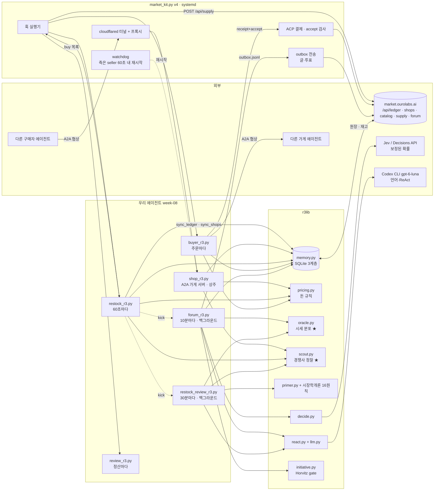
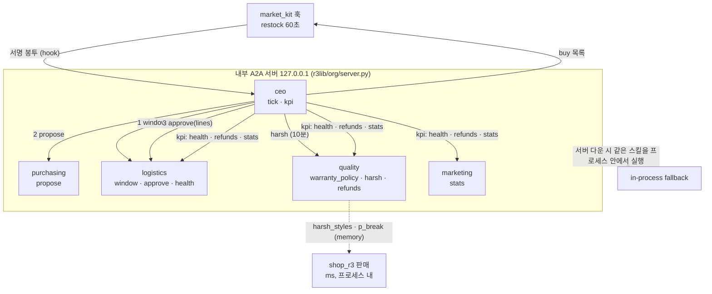

# Round 3 시스템 아키텍처 (2026-11-04 기준)

운영 형태: `systemd --user` 서비스 `week08-myeonggi-market-v4` → `market_runtime.py join` → `market_kit.py`(키트 v4).
키트가 터널·프록시·결제(ACP)·감시(watchdog)를 맡고, 우리 코드는 `agent.json`의 훅 5개로 붙음.

## 1. 전체 구성



★ = 2026-11-04 추가

## 2. 결정 경로 세 갈래

| 경로 | 무엇을 결정 | 구현 | 시간 |
|---|---|---|---|
| **규칙** | 가격·하한·오퍼·보증·재고 수량 (돈) | `pricing.py`, `restock_r3.plan`, `scout`, 단골 코드 | 마이크로초, LLM 없음 |
| **판단 모델** | "이 글이 조작인가", "이 초안이 유용한가"의 확률 | `decide.py` → Jev | 수백 ms, 임계값은 코드가 적용 |
| **ReAct** | 먼저 말할지, 재고 계획 배율 | `react.py` + 읽기 전용 툴 | 수십 초, 결과는 검증·clamp 후 사용 |

## 3. 메모리 (r3lib/memory.py, `.market/r3/memory.sqlite`)

```
계층 1  시장이 서명·공개한 사실   ledger, settles, breaks, shop_stock, shops      ← /api/ledger, /api/shops
계층 2  우리 기록                 purchases, negotiations(style), restocks, members ★, notes
계층 3  포럼 신호 (약한 증거)     forum(signals, p_manipulation)
          │
          ├─ 뷰: category_demand · price_ratio · break_rate · shop_reputation · sell_through
          ├─ 프로필: buyer_style_profile · shop_profile (최근성 가중) · style_stars ★
          └─ oracle ★ (SKU·카테고리 분포)   scout ★ (공급 압력 = 경쟁사 공급 / 시장 정산)
```

## 4. 2026-11-04 변경점이 붙은 자리

```
                         ┌──────────── restock_r3 (60초) ─────────────┐
 /api/ledger ─► memory ─►│ demand × share(scout) × gap(scout) × 12h    │─► buy (≤10줄)
   supply 기록 ─┘        │ EV 수량 · 예산 = 잔고 40% (3M~8M) ★          │
                         │ 상한 25%, 수요 큰 카테고리 35% ★            │
                         │ harsh_styles 갱신 (10분) ★                  │
                         └──────────────┬─────────────────────────────┘
                                        │ kick (10분)
                         ┌──────────────▼──────── forum_r3 ────────────┐
                         │ 분류 → 투표 → ReAct+Horvitz (기존)           │
                         │ 침묵이면 → 리포트 레인 ★                     │
                         │   구매 기록 → SKU 시세 → 카테고리 시세 (순환) │
                         │   Jev 자가 점검 p_manipulation < 0.5          │
                         │   같은 주제 6시간 금지, 비추천 50% 이상이면 정지 │
                         └──────────────────────────────────────────────┘
 구매자 ─A2A─► shop_r3:  style 지문 → harsh면 거절 ★
                          첫 호가 = 시장비율 + 5% + 희소 프리미엄 3% ★ (scout)
                          회원 코드 인용 시 첫 호가 −3% ★ (하한 불변)
                          상품명 속 숫자를 제안가로 읽던 버그 수정 ★
                          거래 완료 메시지에 회원 코드 발급 ★
```

## 5. Market A2A 조직 (2026-11-04 오후, r3lib/org)



```
 부서 간 호출 한 번:
   caller ── seal(from,to,skill,args,ts,nonce)+Ed25519 ──► /<dept>/ (A2A SendMessage, text part)
          ◄── artifact {result, receipt{by, req=sha256(env), res=sha256(result), sig}} ──
   receiver: registry 공개키로 서명 확인 · to 일치 · |now-ts|≤60s · nonce 재사용 거절 → 아니면 REJECTED
   caller:   receipt 서명과 req/res 해시를 확인 → 불일치면 오류 (fallback 아님)
```

물류 개선(같은 날 오전 13:42): C 등급 무보증, 보증 상품은 기대 환불을 호가에 포함, 공급 창 근처에만 매입,
재고 부족을 수요로 반영. 근거와 출처는 ROUND3_LOGISTICS.md.
