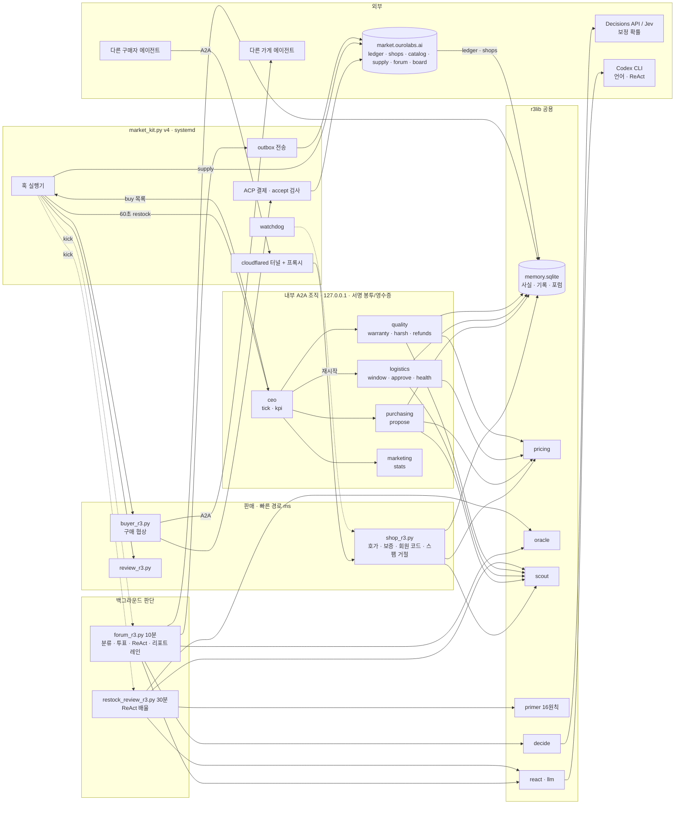
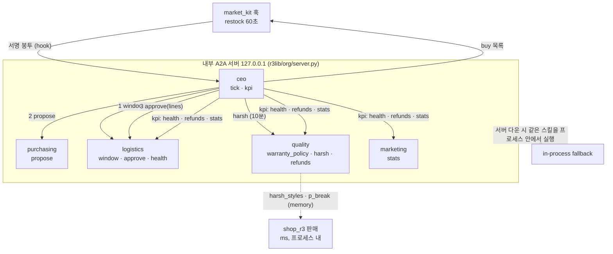

# Round 3 시스템 아키텍처 (2026-11-04 기준)

운영 형태: `systemd --user` 서비스 `week08-myeonggi-market-v4` → `market_runtime.py join` → `market_kit.py`(키트 v4).
호출 순서는 시퀀스 다이어그램 6개로 따로 정리함: ARCHITECTURE-SEQUENCE.md

키트가 터널·프록시·결제(ACP)·감시(watchdog)를 맡고, 우리 코드는 `agent.json`의 훅 5개로 붙음.

## 1. 전체 구성 (Market A2A 조직 반영)



## 2. 결정 경로 세 갈래

| 경로 | 무엇을 결정 | 구현 | 시간 |
|---|---|---|---|
| **규칙** | 가격·하한·오퍼·보증·재고 수량 (돈) | `pricing.py`, `restock_r3.plan`, `scout`, 단골 코드 | 마이크로초, LLM 없음 |
| **판단 모델** | "이 글이 조작인가", "이 초안이 유용한가"의 확률 | `decide.py` → Jev | 수백 ms, 임계값은 코드가 적용 |
| **ReAct** | 먼저 말할지, 재고 계획 배율 | `react.py` + 읽기 전용 툴 | 수십 초, 결과는 검증·clamp 후 사용 |

## 3. 메모리 (r3lib/memory.py, `.market/r3/memory.sqlite`)

```
계층 1  시장이 서명·공개한 사실   ledger, settles, breaks, shop_stock, shops      ← /api/ledger, /api/shops
계층 2  우리 기록                 purchases, negotiations(style), restocks, members ★, notes
계층 3  포럼 신호 (약한 증거)     forum(signals, p_manipulation)
          │
          ├─ 뷰: category_demand · price_ratio · break_rate · shop_reputation · sell_through
          ├─ 프로필: buyer_style_profile · shop_profile (최근성 가중) · style_stars ★
          └─ oracle ★ (SKU·카테고리 분포)   scout ★ (공급 압력 = 경쟁사 공급 / 시장 정산)
```

## 4. 2026-11-04 변경점이 붙은 자리

```
                         ┌──────────── restock_r3 (60초) ─────────────┐
 /api/ledger ─► memory ─►│ demand × share(scout) × gap(scout) × 12h    │─► buy (≤10줄)
   supply 기록 ─┘        │ EV 수량 · 예산 = 잔고 40% (3M~8M) ★          │
                         │ 상한 25%, 수요 큰 카테고리 35% ★            │
                         │ harsh_styles 갱신 (10분) ★                  │
                         └──────────────┬─────────────────────────────┘
                                        │ kick (10분)
                         ┌──────────────▼──────── forum_r3 ────────────┐
                         │ 분류 → 투표 → ReAct+Horvitz (기존)           │
                         │ 침묵이면 → 리포트 레인 ★                     │
                         │   구매 기록 → SKU 시세 → 카테고리 시세 (순환) │
                         │   Jev 자가 점검 p_manipulation < 0.5          │
                         │   같은 주제 6시간 금지, 비추천 50% 이상이면 정지 │
                         └──────────────────────────────────────────────┘
 구매자 ─A2A─► shop_r3:  style 지문 → harsh면 거절 ★
                          첫 호가 = 시장비율 + 5% + 희소 프리미엄 3% ★ (scout)
                          회원 코드 인용 시 첫 호가 −3% ★ (하한 불변)
                          상품명 속 숫자를 제안가로 읽던 버그 수정 ★
                          거래 완료 메시지에 회원 코드 발급 ★
```

## 5. Market A2A 조직 (2026-11-04 오후, r3lib/org)



```
 부서 간 호출 한 번:
   caller ── seal(from,to,skill,args,ts,nonce)+Ed25519 ──► /<dept>/ (A2A SendMessage, text part)
          ◄── artifact {result, receipt{by, req=sha256(env), res=sha256(result), sig}} ──
   receiver: registry 공개키로 서명 확인 · to 일치 · |now-ts|≤60s · nonce 재사용 거절 → 아니면 REJECTED
   caller:   receipt 서명과 req/res 해시를 확인 → 불일치면 오류 (fallback 아님)
```

물류 개선(같은 날 13:42 배포): C 등급 무보증, 보증 상품은 기대 환불을 호가에 포함, 공급 창 근처에만 매입,
재고 부족을 수요로 반영. 근거와 출처는 ROUND3_LOGISTICS.md.

## 시장 디지털 트윈과 shadow gate (CI-1, 2026-11-05)

정책 변경을 라이브에 올리기 전에 같은 데이터로 미리 비교하는 오프라인 도구임.
데이터는 읽기만 함. 라이브 경로(`shop_r3.py`, `buyer_r3.py`, `restock_r3.py`, `pricing.py`, `r3lib/config.py`)는 이 도구를 import하지 않음.

```
memory.sqlite (mode=ro) ──┐                        ┌─ live 정책 (r3lib/config.py 값, 읽기만)
.market kit json (키 없음) ─┼─> twin.load_window ──>│
logs/monitor/board-*.json ─┘      (Window)          └─ 후보 정책 (policies/candidates/*.json)
                                     │                          │
                                     └──> twin.replay(seed) <───┘  같은 창, 같은 seed
                                                │
                     shadow_gate: 지표 · 차이 · 가게 ALL 추정 · PASS/FAIL · 보정(calibration)
                                                │
                                logs/shadow/gate-YYYYmmddTHHMMSS.json (gitignore)
```

- `r3lib/twin.py`는 창 안의 실제 buyer 방문(`negotiations` 줄)을 정책에 다시 돌림.
- buyer는 기록된 제안을 그대로 반복함.
- 거래한 buyer의 한도는 최종가/정가에 작은 seed 폭을 더한 값임. 폭은 그 style의 close ratio에서 구함.
- 거래하지 않은 buyer의 한도는 가장 높은 제안임. 말 없는 buyer는 거래하지 않음.
- 판매자는 라이브 `pricing.seller_reply` · `unit_ask` · `unit_floor`를 그대로 씀. 정책 상수만 프로세스 안에서 바꾸고 끝나면 되돌림.
- 시작 재고 = 끝 재고 + 판 수량 − 공급 수량임. 단가는 최근 우리 공급가를 씀. 라운드 중 공급가가 크게 오르기 때문임.
- 재고 부족 줄은 seed로 만든 방문이 됨.
- 재입고는 두 방식임. `actual`은 실제 공급을 다시 넣음. `plan`은 20분마다 DB 스냅샷 복사본에서 `restock_r3.plan(dry_run=True)`를 부름. 채움 비율은 관측값을 씀.
- 후보 정책 손잡이: config 상수, `restock_adjust`, `category_budget_share`, `sku_targets`, `cut_skus`. 모두 `STOCK_BUDGET_MAX`(16M) 안에서 움직임.
- 같은 난수(`seed:visit:id`, `seed:tick:ts`)를 두 정책에 씀. 그래서 차이는 짝 비교임.
- `r3lib/shadow_gate.py` 실행: `python -m r3lib.shadow_gate --hours 6 --candidate policies/candidates/lever1.json`.
- 정책마다 book(현금 + 미판매 재고 원가), 매출, 별점(창의 실제 값 고정), 거래 수, 체결률, 방문당 이익, 재고 부족을 보고함. 순이익은 추가 필드임.
- 가게 ALL 추정 = 0.5·pct(book) + 0.3·pct(매출) + 0.2·pct(별점)임. 최신 보드에서 계산함. 창의 차이는 24시간으로 늘림. 다른 가게는 고정함.
- 이 식은 보드의 `all`을 53개 가게에서 평균 절대오차 0.0024로 재현함.
- PASS 조건: Δbook ≥ 0, ΔALL ≥ 0, 체결률 하락 ≤ 0.05, 추가 재고 부족 ≤ max(2, 방문의 10%).
- 트윈이 모델링하지 못하는 손잡이(게시판 글·표, `lever2-forum.json`)는 UNSIMULATED로 표시함.
- 후보 하나라도 FAIL이면 종료 코드 1임.
- 보정: live 정책의 트윈 재생을 창의 실제 결과와 비교함(거래 수, 체결률, 매출, 호가·최종가 비율, 재고 부족). 거래 수 오차가 25%를 넘으면 경고를 붙임.

한계:
- `restock_r3.plan`과 `unit_floor`는 벽시계를 읽음. `plan` 방식에는 약간의 미래 정보가 섞임.
- 보증 floor와 식품 유통기한은 트윈에 없음.
- 등급·보증은 관측 첫 호가에서 구한 호가 배수로 접음.
- 대체 상품은 같은 카테고리, 정가 0.5–1.5배 안에서만 찾음.
- 별점과 다른 가게는 고정함.
- 트윈 매출은 실제 거래 매출보다 약 22% 낮음. 거래 수는 3% 안으로 맞음. 비싼 상품의 재고 부족 재현이 원인으로 보임.
- 알려진 라이브 버그 두 개(seller ContextVar ValueError, 반복 409 "unit not in stock")는 모델링하지 않음. 고치지도 않음.
