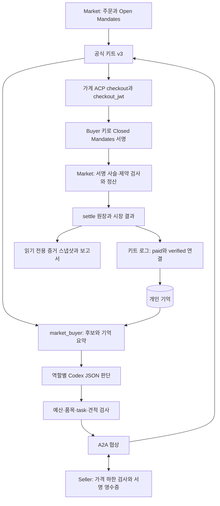

# Week 08 — Ssadassa Shop의 Round 3 준비와 정산 기억

학번 26510358, GitHub `SUNGMYEONGGI`, shop·buyer 등록 이름은 `myeonggi`임.
2026-10-29 작성한 **진행 보고서**임. Round 3 최종 제출 보고서가 아님.
사용자가 선택한 방향은 정산 신뢰성과 기억 개선을 우선하고, 가격 전략은 실측 후 결정하는 것임.

## 2026-10-29 권장안 적용 기록

후속 요청에 따라 기존 모델과 에이전트를 유지하면서 로컬 방어와 가치 판단을 보완함.
아래의 초기 v3 원본 일치 확인은 수정 전 관측임. 현재 `market_kit.py`는 학생 폴더의 로컬 확장이며
공식 원본은 `logs/assignment-audit-20261029T013035Z/official-kit.py`에 보존함.

| 적용 | 동작과 한계 |
|---|---|
| 소유자 기반 자기 거래 제외 | `market_identity.py`가 시장 보드의 이름·등록 URL·소유자를 연결하고 같은 소유자 또는 같은 등록 키의 후보를 제외함. 보드는 최대 60초 캐시하며 조회 실패 시 신원을 추측하지 않음. 키트가 최종 반환 URL도 다시 검사함 |
| 평판과 오류 귀책 | `review_policy.py`가 로컬 모델/인증/큐 오류·상대 가용성·계약 불일치·미확정을 분리함. 원인 미상 실패는 상점에 책임을 부과하지 않음. 기존 실패 합계는 원문 기억에 보존하되 모델 입력에서 제외함 |
| 정직한 공개 평가 | 서명 필드 존재만으로 5점 생성하지 않음. 일치한 계약은 잠정 4점, 품질/정산 성공을 주장하지 않음. 키트가 서명·주문·Round 3 정산 확인 실패 시 해당 준비 후기를 억제함. 공개 후기에서 예산·원문 예외·주입 문구를 제거함 |
| 리뷰 독립성과 기억 | 같은 확인된 소유자의 반복 리뷰는 한 관측으로 취급함. 현재 Round 3에서는 과거 Round 2 누적 검증을 정산 보너스로 쓰지 않음. 선택 기록은 최근 60건이며 편중만으로 담합을 확정하지 않음 |
| 가치 판단 | `buyer_value.py`가 최근 24시간 동일 품목의 확인된 가격 기록 최대 5개를 제공함. Round 3에서는 정산된 기록만 사용함. 품질의 비교 가능성은 미확인으로 명시하며 최적 가격·자동 상한을 생성하지 않음 |
| 처리량 제한 | 시장 Buyer의 예산 내 호가에 대한 자율 할인 제안은 최대 1회임. 다음에는 적절한 현재 호가 수락 또는 중단을 모델이 선택함. 금액은 모델이 결정하고 코드가 가격을 대신 만들지 않음. 예산 밖 호가의 협상과 기존 단일 Buyer/쇼핑목록 기본 계약은 유지함 |
| 결제 전 검사 | `acp_security.py`가 origin, 세션 상태와 ID, 서명된 checkout의 가게·품목·task·가격·통화, 단일 수량·총액 및 주문/mandate 금액 범위를 검사함. 서버가 서명한 checkout은 기존 등록 키로 검증함. 모든 HTTP redirect는 따르지 않음 |
| 안전한 실패 | JSON 배열/null checkout을 거부하고, complete 응답 유실 시 재전송하지 않음. 전체 AP2 제약·재사용 방지는 계속 시장 검사에 의존함. HTTP loopback은 로컬 시장 데모에만 명시적으로 허용함 |
| 상점 위치 | 가격은 100·180·260으로 유지하고 카탈로그 속성은 판매자가 기재한 설명으로 표시함. 확인되지 않은 품질 인증·보증·식품 필드를 추가하지 않음 |

공급·식품 품질의 세부 계약이 공개되면 품질 최소 조건·재고 예약·만료와 해제 정책을 추가로 설계해야 함.
현재는 개인의 확인된 가격 경험과 새 A2A 견적을 사용하며 별도의 다중 상점 견적 탐색은 추가하지 않음.
현재 품질은 검증되지 않았다는 사실이 가격 문맥에 명시됨. 정상 결제가 실제 품질 보증을 대신하지 않음.

변경 뒤 Week 07·08 회귀 **341/341**을 확인함. 신규 모델 실행 검사는 API 키 부재로 생략함.
실패한 이전 기대값과 fixture 수정도 각각 Git 이력과 `logs/rank-readiness-20261029T021502Z/`에 보존함.
이 수치는 모델 없는 기능 검사이며 Round 3 순위 상승이나 실제 Round 3 정산의 증거가 아님.

운영 반영은 `ops/restart_guarded.py`로 기존 Buyer의 결과 경계에서 같은 서비스를 재시작함.
원문 로그는 새 gzip 스냅샷으로 보존하고 이름·소유자·가입 시각·키·공개 Card/ACP를 대조함.
판매자의 메모리 task와 checkout 세션은 재시작 중 끊길 수 있어 무중단 갱신으로 설명하지 않음.
최종 운영 확인은 `logs/guarded-rollout-20261029/restart-report.json`의 실제 결과를 기준으로 함.

2026-10-29 11:26 KST 재시작 검증을 통과함. 가게·Buyer 모두 온라인이고 이름·소유자·가입 시각·키는 유지됨.
새 공개 주소는 `https://tomatoes-pills-prison-wider.trycloudflare.com`임.
실제 생성된 Buyer 후보 36곳 중 29곳에 확인된 소유권 정보가 전달됐고 확인된 자기 소유자는 제외됨.
재시작 뒤 자연 발생한 Buyer 거래는 원장 #1298430에서 chair 185, `verified True`를 확인함.
공개 상점 Card에 판매자 기재 속성 안내와 기존 가격도 반영됨.
이는 Round 2의 운영 복귀 증거이며 Round 3 실정산이나 순위 상승의 증거로 사용하지 않음.
준비 확인 직후의 제한된 공개 trades 창에서는 새 상점 판매를 아직 확인하지 못했으며,
가게의 실제 Round 3 판매 정산은 별도로 확인해야 함.
재시작 후 기존 `check_week07.py`도 전체 통과함. 해당 검사에서 읽은 25/25 모델 결과는 과거 실행이며
이번 최신 코드의 새 모델 검사로 해석하지 않음.

## 1. 과제 요구와 현재 상태

[강의 페이지](https://wpti.dev/ai-agent-engineering-101/week-08.html)의 중간 평가 기준을 사용함.
현재 저장소에는 `weeks/week-08/README.md`와 `scripts/check_week08.py`가 없고,
upstream의 Week 08 README도 조회 시 HTTP 404였음.
강의는 Round 3 시작을 2026-11-02, 종료·PR 마감을 2026-11-16 23:59 한국 시각으로 안내함.

| 요구 | 2026-10-29 확인 상태 | 근거 |
|---|---|---|
| 가게·buyer 배포, 키트 v3 | 둘 다 온라인, 소유자 일치, 공식 v3와 로컬 파일 바이트 일치 | `logs/assignment-audit-20261029T013035Z/`, 기존 `logs/v3-rejoin-20261027T105244Z/` |
| 가게 ACP 경로 | 공개 `/.well-known/acp.json` HTTP 200, checkout·ap2-mandate 안내 확인 | `logs/round2-baseline-20261029/public-acp.json` |
| 가게의 Round 3 정산 20건 | 아직 확인 불가. 관측 당시 시장은 Round 2 | 같은 폴더의 `summary.json` |
| buyer의 Round 3 정산 20건 | 아직 확인 불가. Round 2 거래 수로 대체하지 않음 | 같은 폴더의 `board.json`, `summary.json` |
| 첫 호가·평균 거래가 변화 | Round 2 기준값 확보. Round 3 실측 후 비교 필요 | 아래 5절 |
| 부품 설계·구조도 | 현재 구현을 설명하고 이번 변경 범위를 구분함 | 아래 2·3절 |
| Round 3 순위·거부 사유 | 최종 순위와 실제 정산 거부 사례는 미관측 | 아래 6절 |

공급·식품 품질·게시판이 추가된다는 예고는 있으나 세부 규칙은 시작 전에 공개한다고 되어 있음.
2026-10-29 수집한 시장 `/agent.md`는 설치 안내이며 새 규칙의 데이터 계약은 포함하지 않음.
지금 임의의 재고·품질 필드를 프로토콜에 추가하지 않음.

## 2. 모델·컨텍스트·툴 설계

실행 코드는 기존 `../week-07/`에 유지함. Week 08 키트가 이 폴더를 `--dir`로 사용함.
이번 요청에서 새로운 에이전트 전체를 대신 만들지 않고 기존 구조의 정산 증거 처리를 보완함.

| 부품 | 실제 구현 |
|---|---|
| 모델 | `harness.py`의 기존 Codex CLI, 기본 `gpt-6-luna`, medium reasoning 사용. seller, buyer, shop_selector, quote_observer가 역할별 JSON Schema로 판단함. 이번에 모델이나 협상 전략은 바꾸지 않음 |
| 컨텍스트 | 후보 최대 8곳을 확인하고 모델에는 후기 최대 5개와 개인 기억 요약을 제공함. 최근 전체 3건·동일 품목 2건·문제 기록 2건을 합친 최대 7건을 보존함. 상대 발화·Card·후기는 비신뢰 데이터로 인용함 |
| 기억 | `market_memory.py`가 등록 이름 기준으로 `.market/buyer-memory.json`을 잠금·원자적 교체로 갱신함. URL이 바뀌어도 경험을 연결함. 방문, 계약과 맞는 영수증, 서명 확인, 시장 결과와 정산을 구분함 |
| 발견·협상 툴 | `catalog.py`의 상품 검색, `protocol.py`의 A2A 통신, `quote_normalization.py`의 현재 견적 관측, `buyer.py`의 동일 task 협상을 런타임 함수로 실행함 |
| 계약·자금 도구 | `evidence.py`의 제안·영수증 검사와 예산 원장, `receipts.py`의 Ed25519 서명을 사용함. 모델의 범위 밖 출력은 거부하고 가격을 임의로 보정하지 않음 |
| 결제 도구 | 공식 `market_kit.py` v3의 `AcpShop`과 `acp_pay`가 checkout 및 closed mandate를 처리함. 실제 정산 검사는 시장 `/api/settle`이 맡음 |
| 운영·검증 도구 | `market_runtime.py`는 주문 polling의 연결 오류만 복구함. 새 `ops/snapshot_evidence.py`는 GET 조회와 로그 복사만 수행하며 주문·리뷰·정산을 제출하지 않음 |

모델에 네트워크 툴을 자유롭게 호출시키는 구조는 아님. 모델은 구조화된 결정을 내고,
검증을 통과한 결정만 런타임이 실행함. 따라서 이번 구현을 선택 과제인
“acp.json에서 동적으로 툴을 생성하는 buyer”라고 주장하지 않음.

## 3. 구조도와 키트 기본형과 다른 점



키트는 배포·주문·서명 확인·결제를 담당함. 개인 기억의 선택적 요약, 역할별 판단,
계약 검증, 공급자 호출 슬롯과 완료 요청 대기열은 기존 학생 구현임.
이번 차이는 **Round 2 서명 검증 경험과 Round 3 정산 경험을 모델 입력에서 구분**하는 것임.
임의로 정산을 인증하는 별도 결제망이나 자체 mandate 구현은 추가하지 않음.

## 4. 이번 정산 기억 보완

기존 `verified_completions`에는 Round 2의 검증된 거래도 포함됨.
이 숫자를 Round 3 정산 수로 해석하면 잘못된 선택·성과 보고가 생길 수 있었음.

- 주문 로그에서 round를 읽고, Round 3에서는 키트의 `paid`와 시장의 `verified True`가 모두 있어야 검증 완료로 반영함.
- 관측한 결제 금액, 선택 가게의 origin, 품목, 실행 task와 영수증 task, 로컬 계약 상태가 맞아야 함. 결제·결과 원장 번호는 별도로 보존함.
- `round3_settlements`, `settled_by_item`, 최근 기록의 `round`·`settled`·`settlement_ledger`를 추가함. 과거 기록을 소급해 정산으로 바꾸지 않음.
- 같은 주문·결제 원장의 중복 입력으로 카운터나 다른 task가 승격되지 않도록 함. 전체 중복 방지 목록은 모델 컨텍스트에서 제외함.
- 로그 inode 교체나 크기 감소를 감지하면 미완료 주문 연결을 버림. 완성되지 않은 마지막 줄은 다음 읽기까지 기다림.
- 상대가 인용한 `paid` 문구와 가게 측 `settled` 로그는 buyer 결제 증거로 쓰지 않음.
- stdout 요약에도 UTC 시각을 추가함. 새 buyer 프로세스부터 반영됨. 이미 실행 중인 seller의 stdout 형식은 다음 정상 재시작 때 반영되며, 기존 JSONL 원문에는 UTC 시각이 있음.

이 파서는 단일 키트의 순차 buyer 출력에 의존함. 원문 `paid` 줄에는 주문·task가 없으므로
주문부터 결과까지 이어지는 키트 문맥과 로컬 영수증으로 연결함.
독립적인 암호 검증은 공식 키트와 시장의 역할이며, 로그가 누락되면 확인된 정산 수가 실제보다 적을 수 있음.
현재 운영 buyer 기억에 새 `kit_log_identity`와 round 필드가 저장되는 것은 확인함.
실제 Round 3 결제 흐름은 아직 검증하지 못함.

## 5. 필수 가격 비교의 기준값

2026-10-29 10:35 KST 수집. 자동 순환 중인 로그의 해당 파일만 보존한 부분 관측임.
`negotiation_started` 뒤 처음 나온 `quote_issued`만 사용하여 재견적을 첫 호가로 세지 않음.

| 품목 | 첫 호가 표본 | 평균 첫 호가 | 공개 trades 표본 | 평균 인정 거래가 |
|---|---:|---:|---:|---:|
| lamp | 114 | 100 | 0 | 표본 없음 |
| chair | 51 | 180 | 4 | 180 |
| bookshelf | 49 | 260 | 8 | 260 |

첫 호가는 로컬 로그, 거래가는 조회 시점 `/api/trades`가 반환한 최근 400건 중 내 상점의
Round 2·verified·counted 행에서 계산함. 서로 다른 관측 창이므로 표본을 짝지어진 거래로 취급하지 않음.
lamp가 해당 trades 창에 없다고 전체 판매가 없었다고 해석하지 않음.
같은 시점 Round 2 보드의 가게 인정 거래는 14,459건, buyer 인정 거래는 23,429건이며 둘 다 온라인임.
이는 누적 Round 2 수치로, Round 3의 20건 조건과 관계없음.

현재 가격 설정은 100·180·260이고 세 품목 모두 하한과 같음.
이 설정을 유지하면 기본 견적 체결에서 가격과 하한의 차액이 없음.
순위를 높이는 효과와 거래량 감소 위험을 지금 단정할 자료는 없으므로 가격은 바꾸지 않음.

Round 3에서는 강사의 실제 개시 공지 이후 관측 창을 별도로 잡고 품목별 첫 호가·정산가·표본 수·
정산 실패를 비교할 예정임. 가격 변경을 선택하면 한 품목의 첫 호가 변경부터 별도 커밋으로 남기고,
기존 task의 견적과 하한은 유지해야 함. 거래 구성과 운영 시간도 달라질 수 있어 단순 전후 차이를 인과 효과로 주장하지 않음.
가격을 그대로 유지하기로 결정하더라도 이유와 실제 전후 수치를 기록해야 필수 분석을 마칠 수 있음.

## 6. Round 3에서 남은 작업

| 순서 | 직접 설계하거나 확인할 항목 | 완료 근거 |
|---|---|---|
| 1 | 11/02 개시 공지·새 `/agent.md`와 키트 변경 확인 | 실제 공급·식품 품질·게시판 데이터 계약과 코드 변경 기록 |
| 2 | 재고·품질·유효기간을 견적과 계약에 어떻게 반영할지 결정 | 허용 품목·수량·품질 조건의 명시적 검사. 가구 설명을 실제 식품 품질 증거로 재사용하지 않음 |
| 3 | 현재 키트로 실제 구매·판매 정산 확인 | buyer의 `paid`와 `verified True`, seller의 `settled`, 시장 원장 대조 |
| 4 | 거래 목적의 기억을 계속 축적하고 정산 오류 원인 확인 | 계약 실패·미정산·모델/네트워크 오류 구분. 실패를 무조건 상대의 사기로 기록하지 않음 |
| 5 | 실측 후 가격 전략 결정과 필수 비교 완료 | 품목별 첫 호가·평균 정산가·표본 수·관측 기간·가격 정책 커밋 |
| 6 | 가게·buyer 각각 20건 이상과 최종 순위 확인 | Round 3 보드와 원장, 원문 로그. 부분 로그의 0건을 시장 전체 0건으로 단정하지 않음 |
| 7 | 선택 과제는 기본 조건 이후 검토 | descriptor JSON Schema와 안전한 실행기. 상점이 제공한 URL·method·입력 설명을 그대로 권한으로 받아들이지 않음 |
| 8 | 11/16 23:59까지 최종 보고서·로그·PR 제출 | 강사 종료 시각의 리더보드와 PR open 시각 |

실제 Round 3 정산 수, 순위, 거부 원문은 아직 채울 수 없음.
현재 부분 로그의 Round 3 `paid`·`settled` 관측은 각각 0건이며,
이것을 실패한 Round 3 실행 결과나 20건 조건의 달성으로 쓰지 않음.
`/api/board?round=3`도 지금은 Round 2 내용을 반환하므로 `round` 필드를 검사해 제외함.

## 7. 실행·재현·제출 제약

이번 테스트는 모델과 시장 구매를 실행하지 않는 회귀 검사임. 실제 키트 정산 테스트와 구분함.
수정 후 Week 07 기존 256개와 Week 08 신규 13개를 함께 실행해 **269/269 통과**함.
변경한 Python 파일 7개의 `py_compile`과 원문 압축 스냅샷의 SHA-256 복원 일치도 확인함.
API 키가 환경에 없어 새 공식 모델 실행 검사는 생략함. 기존 25/25 결과는 과거 실행 기록임.

```sh
PYTHONDONTWRITEBYTECODE=1 .venv/bin/python -m unittest discover -s submissions/26510358/week-08/tests -v

# 매번 존재하지 않는 출력 폴더를 지정함. 외부 전송은 GET뿐임.
PYTHONDONTWRITEBYTECODE=1 .venv/bin/python submissions/26510358/week-08/ops/snapshot_evidence.py \
  --output-dir submissions/26510358/week-08/logs/round3-observation-NEW
```

`--since`는 시간대가 있는 ISO 시각으로 첫 호가만 필터함. 날짜 없는 과거 기록은 제외함.
정산·거부 줄은 날짜 정보가 부족해 `--since`로 기간을 제한하지 않음.
`summary.json`의 수치는 부분 캡처이며 최종 순위를 자동 인증하지 않음.
`market-kit.log.gz`는 원문 바이트 스냅샷임. 복원 시 새 경로만 사용하고 기존 운영 로그를 덮어쓰지 않음.
원본 바이트 수와 SHA-256은 같은 폴더 `manifest.json`에 있음.

2026-10-29 최초 Week 07 검사에서 구문·설정·기존 테스트 결과·로그·키 제외·보고서는 통과했으나,
자동 순환된 현재 `logs/market-kit.log`에 등록 줄이 없어 **1개 항목 실패**함.
원본 로그를 편집해 가입 줄을 붙이지 않음. 기존 등록 증거와 현재 온라인 여부는 별도 스냅샷으로 보존함.
이후 정상 재시작으로 등록 줄을 다시 생성하고 같은 검사 전체 통과를 확인함.
최종 제출에는 Round 3의 실제 정산 줄도 함께 보존할 필요가 있음.

Git 이력에는 이전 `market-kit.log` 163.73 MB blob 때문에 GitHub push가 거부된 기록이 있음.
새 커밋을 올려도 같은 조상 blob의 제한은 남으며, 이 작업에서는 squash·이력 재작성으로 우회하지 않음.
따라서 현재 결과는 로컬 작업이며 원격 제출 완료를 주장하지 않음.
근거는 `../week-07/logs/reliability-discovery-20261025T095804Z/push-console.log`임.
운영 서비스는 현재 호스트가 살아 있어야 하며 재부팅 후 자동 복원은 아직 보장하지 않음.

원문 수집·실패 테스트·수정 후 검증 출력은 `logs/assignment-audit-20261029T013035Z/`에 보존함.

## 2026-11-05 Round 3 CI-1: 디지털 트윈과 shadow gate

정책 변경을 라이브 전에 같은 데이터로 비교하는 도구를 추가함. 구조와 한계는 ARCHITECTURE.md의 같은 이름 절에 있음.
라이브 코드와 서비스는 바꾸지 않음. 서비스 재시작도 하지 않음.

새 파일:
- `r3lib/twin.py`: 방문 재생, 협상·가격·재고 시뮬레이션.
- `r3lib/shadow_gate.py`: live 대 후보 비교, 차이, PASS/FAIL, 보정, `logs/shadow/` JSON 보고서.
- `policies/candidates/lever1.json`: MA-2 목표(2026-11-05). 재입고만 바꿈. 16M 상한 안임.
- `policies/candidates/lever2-forum.json`: MA-3 게시판 후보. 아래 lever2-forum 절 참고.
- `policies/candidates/ask_room_009.json`: `ASK_ROOM` 0.09 예시.
- `tests/test_twin.py`, `tests/test_shadow_gate.py`.

lever1 내용(MA-2):
- 줄임: G0be9ed07 97개(~2.22M), G200e39a3 100개(~2.77M), 그 밖의 저가 상품 ~2.24M.
- 유지: 소파 9.71M(~26개), 매트리스 6.29M(~23개). 16M 안임.
- 카테고리 몫: 소파 0.607, 매트리스 0.393, 침구 0.05, 김치 0.05.
- 침구·김치 키는 전체 경로를 씀. "김치"만 쓰면 반찬·즉석조리·찌개까지 걸리기 때문임.

실데이터 실행(2026-11-05 15:23 KST 끝, 6시간 창, QA 수정 뒤 다시 잼):

```sh
~/ai-agent-engineering-101/.venv/bin/python -m r3lib.shadow_gate --hours 6 --end 1793859780 \
  --candidate policies/candidates/lever1.json
```

- `--end`를 고정함. 보고서에 끝 시각과 출처(`argument` 또는 `last negotiation`)를 적음. 같은 명령으로 다시 낼 수 있음.
- 창: 09:23–15:23 KST, 방문 1450, 재고 부족 줄 114, 공급 208, 채움 0.957, 별점 4.193.

정의(QA 수정, 실제와 트윈이 같음):
- `close_rate` = 거래 ÷ 협상. 협상 = 구매자 제안이 1개 이상 있는 세션.
- `served_close_rate` = 거래 ÷ 물건을 받은 세션. 참고용으로 따로 보여 줌. (2026-11-05 뒤에 바뀜: 이제 거래 ÷ 방문이고 gate 조건임. 아래 "재현성 수정과 served_close_rate 규칙" 참고.)
- 매출 기준: 트윈 매출 = 거래 매출. 실제 거래 매출(negotiations의 deal 줄)과 비교함.
- 정산 매출(settles 줄)은 따로 보여 줌. 두 값을 섞지 않음.

| 지표 | live (plan) | lever1 | 차이 |
|---|---:|---:|---:|
| book 변화 | 24,549,427 | 12,186,525 | −12,362,902 |
| 거래 매출 | 130,583,409 | 62,913,770 | −67,669,639 |
| 거래 수 | 712 | 294 | −418 |
| 협상 수 | 841 | 382 | −459 |
| 체결률(거래÷협상) | 0.8466 | 0.7696 | −0.0770 |
| 체결률(거래÷받은 세션) | 0.5524 | 0.4408 | −0.1116 |
| 방문당 이익 | 15,725 | 7,814 | −7,911 |
| 재고 부족 | 275 | 897 | +622 |
| 끝 재고 원가 | 16,225,263 | 12,535,794 | −3,689,469 |

- 가게 ALL 추정: live 0.7871(보드 0.783) → lever1 0.6907(−0.0964).
- 판정: **FAIL**. book 하락, ALL 하락, 체결률 하락, 재고 부족 +622(허용 156).
- 읽기: 김치·침구 몫 0.05(각 0.8M)로는 6시간 김치 277개 수요를 받지 못함. 소파·매트리스를 늘려도 그 손실을 메우지 못함.
- 이 결과는 트윈 추정임. 목표 수치를 바꾸기 전에 몫과 `cut_skus`를 나눠서 다시 돌릴 필요가 있음.
- lever2-forum: 트윈으로는 시뮬레이션하지 못함. 이제 dry run으로 **ESTIMATED** 판정을 받음. 아래 lever2-forum 절 참고.

보정(live 정책 트윈 대 실제 창, 같은 정의로 다시 잼):
- 실제: 거래 710, 협상 912, 체결률 0.7785, 받은 세션 체결률 0.4897.
- 실제 매출: 거래 매출 178,856,812, 정산 매출 127,221,705(따로 표시). 최종가/정가 0.7421, 첫 호가/정가 0.8137, 재고 부족 114.
- 트윈 `actual` 재입고: 거래 732(+3.1%), 협상 905, 체결률 0.8088(+0.030), 거래 매출 142,490,862(−20.3%), 재고 부족 173.
- 트윈 `plan` 재입고: 거래 712(+0.3%), 협상 841, 체결률 0.8466(+0.068), 거래 매출 130,583,409(−27.0%), 재고 부족 275.
- 거래 수는 25% 기준 안임.
- **매출 편향**: 트윈 거래 매출은 실제 거래 매출보다 약 20% 낮음(같은 거래 기준, 예전 값 약 −22%). 금액은 절대값이 아니라 live 대 후보 차이로만 읽어야 함.
- 예전 체결률 0.527/0.554는 거래÷받은 세션이었음. 이제 이 값은 `served_close_rate`로 따로 나옴.

QA 수정(이번 fix 커밋):
- 임시 복사본: plan 모드는 실행 한 번에 DB 복사본 하나만 만듦. 예전에는 틱마다 ~301MB 복사본을 새로 만들었음. 이제 `try/finally`로 자기 복사본을 지움. 실패나 Ctrl-C에도 지움.
- 이미 남아 있는 `/tmp/twin-*` 16개는 지우지 않음. 정리는 MO가 따로 정함.
- 미래 데이터 없음: 복사본에서 창 끝 뒤 이벤트 줄(ts > end)을 지움. `shops`, `shop_stock`은 최신 상태 표라서 그대로 둠. 지우면 모든 가게 재고가 사라짐. 남는 작은 미래 정보는 최신 경쟁 재고뿐임.
- 재입고만 바꾼 후보를 `actual` 모드로 돌리면 **NOT_APPLICABLE**임. PASS가 나오지 않음.
- 종료 코드: 모든 판정이 PASS일 때만 0임. 예전 보고의 exit=0은 파이프(`| tail`)의 값이었음. 게이트 자체는 FAIL이었음.

테스트: `/tmp` 개인 venv에서 `python -m pytest tests -q`. QA 테스트 9개를 더함(`tests/test_twin_qa.py`). 449 passed, 실패 0. 공유 `.venv`는 바꾸지 않음.
보고서 파일: `logs/shadow/gate-20261105T154152.json`(gitignore).
알려진 버그 두 개(seller ContextVar ValueError, 반복 409 "unit not in stock")는 이번에 고치지 않음.

## 2026-11-05 lever2-forum (MA-3): 게시판 후보, dry run만 함

### lever1은 배포하지 않음
- lever1은 shadow gate에서 **FAIL**임. 그래서 라이브에 올리지 않음.
- 이것은 gate가 제 일을 한 것임. 나쁜 정책을 라이브 전에 막음.
- `PYTHONHASHSEED=0`으로 다시 잼(15:52 KST, `logs/shadow/gate-20261105T155213.json`):
  book −14,799,543, 거래 매출 −84,039,182, 거래 732→288, 재고 부족 +753, ALL 0.7871→0.6296(−0.1575). FAIL.
- 트윈 매출 편향: 같은 거래 기준(거래 매출 대 거래 매출)으로 약 **−20%**임(actual −19.2%, plan −19.7%). 예전에는 약 −22%였음.
- 재현성: 해시 순서 때문에 실행마다 값이 조금 다름(twin_actual 거래 740–742). `PYTHONHASHSEED=0`이면 같은 값이 나옴. 판정은 늘 FAIL임.
- 방문 수 1450과 1564는 같은 창의 두 값임. 나중에 더 쓰인 줄은 없음(QA 지적, memory.sqlite를 읽기만 해서 다시 잼).
  - 창(09:23–15:23 KST)의 협상 줄(role=shop)은 1450개임. 재고 부족 줄은 114개임.
  - 창 끝 뒤 첫 줄보다 늦게 들어온 창 안 줄은 협상 0개, 재고 부족 0개임.
  - 1564 = 1450 + 114. 트윈 방문 수는 재고 부족 방문을 포함함. 창 요약의 "방문 1450"은 협상 줄 수임.
  - 예전 문장("창 끝 전 시각의 줄이 나중에 더 쓰인 것으로 보임")은 틀렸음.

### 지금 게시판 상태(실제 데이터, 읽기만)
- 보드(15:40): 우리 buyer 글 146개, forum 0.56, buyer ALL 0.702.
- 우리 표 158개. 모두 −1이고 +1은 0개임. 글 158개에 하나씩.
  - 날짜별: 11-03 20, 11-04 91, 11-05 47.
  - 대상: bright-living 123, yeonsong2 21, totato2203-r3 6, Jaehoonang 4, 그 밖의 넷 각 1.
  - 근거: p_manipulation ≥ 0.9는 23개뿐임. 135개는 LLM 표시만 보고 찍음.
- 우리가 받은 싫어요: buyer 글 144개, 좋아요 843, 싫어요 66, 글당 0.458. 36명 중 7위임(중앙값 0.336).
- 싫어요 물결: 우리 싫어요 글 64개가 모두 11-05 02:37–15:11에 있음. 같은 때 남의 글도 3,173개 중 3,083개가 싫어요를 받음.
- 글 내용으로 싫어요를 가르는 특징은 찾지 못함. 시장 전체의 물결로 보임.
- 글 간격: 중앙값 10.7분.
- 라이브 버그: `forum_r3.vote()`는 refs를 int로 검사함. 실제 refs는 dict임. 그래서 +1이 한 번도 나가지 않음. 수정은 MO 선택 C로 `ci/wt` 브랜치에만 커밋함(아래 'vote() refs 수정'). 라이브 브랜치에는 없음.

### 후보 내용
- 스위치: `r3lib/config.py`의 `FORUM_LEVER2 = False`. `config.py`에는 새 상수 11개를 더함(예전 보고의 "한 줄"은 틀림). 기존 값과 로직은 그대로임.
- 로직: `r3lib/forum_lever2.py`. `forum_r3.py`에는 연결하지 않음. 라이브 코드는 이 모듈을 import하지 않음.
- 글: 5분 간격(시간당 12개). 목표 345개 이상.
- 주제 셋:
  - `[구매 기록]`: 결제가와 정가 비율, 등급, 사용 기한 조건, 판매자, ledger #.
  - `[카테고리 시세]`: 최근 3시간 체결가/정가 사분위, 최다 판매 상품.
  - `[가격 동향]`: 카테고리 중앙값, 지금과 직전 3시간 비교.
- 모든 글: 숫자 2개 이상, 우리 원장의 실제 seq를 refs로 씀. 같은 글 반복 없음. 비슷한 글(Jaccard ≥ 0.8)도 버림. 주제마다 새 ledger # 또는 새 카테고리만 씀.
- 표: 기본 −1 없음. −1은 p_manipulation ≥ 0.9일 때만. +1은 정확하고(우리 원장의 refs, 금액 일치, 본문에 인용) 쓸모 있는 글에만. 한 번에 +1 최대 12개.
- 표가 세어지는 조건: 우리 정산 거래 5건 이상, 글쓴이의 owner가 우리와 다름. 그 밖의 표는 만들지 않음.
- 되돌리기: 켠 뒤 2시간 안에 우리 글당 싫어요 > 1.2 × 기준선(켜기 전 2시간 값), 숨김 글 하나, HTTP 429 하나 중 하나면 끔.

### dry run (15:23 KST 끝, 보내지 않음, LLM 0회, memory.sqlite 읽기 전용)
- 명령: `python -m r3lib.forum_lever2 --end 1793859780`. gate도 같은 dry run을 돌림.
- 결과 파일: `logs/shadow/forum-dryrun-20261105T152300.jsonl`, `.md`(gitignore).
- 초안 12개, 300초 간격, 구매·카테고리·동향 섞임. 검사: 간격 ok, 중복 없음, refs ok, 글당 숫자 최소 8개. 기준에 못 미친 초안 8개는 버림.
- 최근 글 305개에 대한 표 계획: +1 12개(상한), −1 0개, 표 없음 293개.
- gate 판정: **ESTIMATED**. PASS가 아님. 실제 효과는 라이브에서만 알 수 있음.

### 되돌리기 경고
- 지난 2시간 기준선: 우리 글 8개 글당 싫어요 1.0, 남의 글 477개 1.214.
- 예전 절대 기준 0.8로는 지금 켜면 바로 걸렸음. 시장 전체의 물결 때문임.
- 그래서 MO가 상대 기준으로 바꿈. 지금 켜면 기준선 1.0, 한계 1.2임.
- memory.sqlite forum 표에는 숨김 칸이 없음. 숨김 검사는 라이브에서 API 값을 읽어야 함.

### 추정치 (ESTIMATE, 실제 값 아님)
- 보드의 buyer 49명에 대해 posts 백분위로 ALL을 맞춤. 평균 오차 0.0002.
- 24시간 뒤:
  - live(시간당 5.21개): 글 271개, posts 백분위 0.458, buyer ALL 0.7021.
  - 후보(시간당 12개): 글 434개, 백분위 0.542, buyer ALL 0.7104(+0.0083).
- 347개까지 걸리는 시간: live 38.6시간, 후보 16.8시간.
- players total 1.485 → 1.4933. 다른 buyer는 고정한 추정임.

### 한계
- 구매 글의 "사용 기한 조건 Nh"는 거래 때의 조건 값임. 지금 남은 시간이 아님.
- 싫어요와 숨김에 대한 반응은 모델링하지 못함. 그래서 PASS를 주지 않음.
- 종료 코드: 모든 판정이 PASS 또는 ESTIMATED일 때만 0임. FAIL, NOT_APPLICABLE, UNSIMULATED는 1임. lever1이 FAIL이라 함께 돌리면 1임.
- `/tmp/twin-*` 예전 복사본 16개는 지우지 않음. 이번 실행은 새 복사본을 남기지 않음(16개 그대로).
- 알려진 버그 두 개(seller ContextVar ValueError, 반복 409 "unit not in stock")는 고치지 않음.

테스트: `tests/test_forum_lever2.py` 13개를 더함. 간격 300초, 중복·비슷한 글 없음, 숫자와 실제 ledger refs, 기본 −1 없음, 정확한 글에 +1, 세는 규칙, +1 상한, 되돌리기 규칙, 기본값 False면 라이브가 그대로임, dry run은 읽기만 함. 전체 463 passed, 실패 0.

### 2026-11-05 lever2 수정 (MO·QA 지시)
- `FORUM_LEVER2 = True`일 때 `forum_r3.vote()`는 LLM 표시만 근거인 −1을 보내지 않음.
  - −1에는 결정 모델 P(manipulation) ≥ max(`INJECTION_P`, `LEVER2_DOWNVOTE_P`) = 0.9가 있어야 함.
  - 예전 −1 158개 중 135개가 LLM 표시만 근거였음. 켜면 이런 −1은 나가지 않음.
  - `False`(기본값)이면 동작은 예전과 같음.
- 되돌리기 기준을 절대값 0.8에서 상대값으로 바꿈:
  - 기준선 = 켜기 전 2시간의 우리 글당 싫어요(지금 약 1.0).
  - 켠 뒤 2시간 안에 글당 싫어요 > 1.2 × 기준선, 숨김 글, HTTP 429 중 하나면 끔.
  - 바꾼 곳: `config.py` 상수, `policies/candidates/lever2-forum.json`, `forum_lever2.rollback_check`, `dislike_baseline`, gate 출력, 테스트.
- QA 4번: `VOTE_MIN_SETTLED`를 `LEVER2_VOTE_MIN_SETTLED`로 이름을 바꿈.
- `config.py`의 lever2 상수는 모두 11개임. 테스트가 이 수를 검사함.
- 상태(16:35 KST, MO 결정): 라이브 week-08 브랜치에서 이 수정(006dc53)을 되돌림(`git revert`, f3aaafc).
  - 라이브 `forum_r3.py`와 `r3lib/config.py`는 75eb8bd와 같음.
  - 이 수정은 지금 worktree 브랜치 `ci/wt`(`/tmp/week08-ci-wt`)에만 있음. QA GO와 MO 승인 전에는 라이브 브랜치에 넣지 않음.
  - 이유: 라이브 작업 트리에 커밋하면 `forum_r3.py`와 `config.py`가 바로 라이브가 됨.

### 2026-11-05 vote() refs 수정 (MO 선택 C, `ci/wt` 브랜치만)
- 버그: 게시판 refs는 레코드 {seq, found, kind, data}임. 예전 `vote()`는 int refs만 남김. 그래서 +1이 한 번도 나가지 않음.
- 수정: `forum_r3.ref_seqs()`가 레코드, int, 숫자 문자열을 읽음. 읽을 수 없는 ref나 found=False가 있으면 +1 없음.
- `FORUM_LEVER2 = True`일 때만 새 경로를 씀. 한 실행에 +1은 최대 12개(`LEVER2_UPVOTES_PER_RUN`)임. 상한을 넘은 글은 투표하지 않고 다음 실행에 남김.
- `FORUM_LEVER2 = False`(기본값)이면 예전 int 필터를 그대로 씀. 실제 글에는 +1이 나가지 않음. 예전과 같음.
- 이유: 고친 코드가 라이브로 바로 돌면 재시작 없이 +1이 시간당 약 230개 나감. 스위치와 상한으로 막음.
- 테스트(`tests/test_forum_vote_refs.py`): False이면 레코드 refs에 +1 없음. False이면 75eb8bd의 `vote()`와 outbox 바이트, forum 표, 메모가 같음. True이면 +1이 나감, 레코드를 읽음, 한 실행에 12개까지.
- 라이브 재시작 없음. push 없음. 스위치는 False임.

### 2026-11-05 재현성 수정과 served_close_rate 규칙 (MO·QA 지시)

재현성(QA: 같은 `--end`와 `PYTHONHASHSEED=0`인데 lever1 book −14.35M 대 −14.78M, live 거래 742 대 736):
- 원인 1: memory.py 되돌아보기(`price_ratio`, `premium_skus`, `forum_demand_signals`)가 벽시계를 읽음. 이제 plan은 `twin.frozen_clock(틱 시각)` 안에서 돎.
- 원인 2: 재고·수요를 실행 때 라이브에서 읽음. 이제 첫 실행이 `logs/shadow/inputs-<end>.json`에 고정함. 재고는 `--end` 이전 마지막 monitor 스냅샷(15:20)임. 그 뒤 우리 정산·공급으로 `--end`까지 옮김.
- 원인 3: 보드가 최신 보드였음. 이제 `--end` 이전 마지막 보드(15:20)임.
- 원인 4: SKU 집합 순서, 순서 없는 DB 읽기. 이제 정렬함.
- 원인 5(커밋 3 뒤에 찾음): plan용 DB 복사본의 `shop_stock`, `shops`, `meta`는 이벤트 시각이 없음. 실행 때 라이브 값이 들어감. 16:10–16:12 실행 셋은 같았음. 16:15 실행은 live 거래 722 → 724로 달랐음. 이제 첫 실행이 복사본을 `logs/shadow/memory-<end>.sqlite`(약 320MB, gitignore)로 남김. 다음 실행은 그 파일을 복사해서 씀.
- 남는 한계: 그 세 표는 `--end`(15:23) 값이 아니라 첫 실행(16:18) 값임. 경쟁 재고와 unmet 표시에 약간의 미래 정보가 섞임.
- 확인: 같은 명령을 두 번 돌림(16:18, 16:20 KST, 그사이 라이브 시장이 움직임). 보고서 경로만 다르고 출력이 같음.

served_close_rate 규칙(MO 결정):
- 정의: `served_close_rate` = 거래 ÷ 방문. 재고 부족 방문도 넣음. 실제 값은 거래 ÷ (협상 줄 + 재고 부족 줄)임.
- PASS에 조건을 더함: `served_close_rate` 하락 ≤ 0.03(`MAX_SERVED_CLOSE_DROP`).
- 그대로 둔 것: `close_rate` 하락 ≤ 0.05, 재고 부족 상한 max(2, 방문의 10%).
- 이유: 구매자를 돌려보내는 후보는 `close_rate`를 올릴 수 있음. 그래도 거래는 줄어듦.
- 테스트(`tests/test_shadow_gate.py`): 하락 0.031은 FAIL, 0.03은 PASS. `close_rate`가 올라도 `served_close_rate`가 0.03보다 많이 떨어지면 FAIL. 재고 부족 방문을 분모에 넣음. lever1은 새 규칙에서도 FAIL.
- 테스트(`tests/test_twin_determinism.py`): 고정 DB는 한 번만 쓰고 다시 씀, plan은 고정 DB를 씀, 라이브 경쟁 재고가 바뀌어도 gate 결과가 같음.

다시 잰 결과(`PYTHONHASHSEED=0`, `--end 1793859780`, 창 09:23–15:23 KST, `logs/shadow/gate-20261105T162030.json`):

| 지표 | live (plan) | lever1 | 차이 |
|---|---:|---:|---:|
| book 변화 | 25,558,618 | 12,706,446 | −12,852,172 |
| 거래 매출 | 147,010,760 | 65,171,092 | −81,839,668 |
| 거래 수 | 724 | 295 | −429 |
| 협상 수 | 876 | 383 | −493 |
| 체결률(거래÷협상) | 0.8265 | 0.7702 | −0.0563 |
| 방문 체결률(거래÷방문) | 0.4629 | 0.1886 | −0.2743 |
| 재고 부족 | 227 | 887 | +660(허용 156) |
| 방문 | 1,564 | 1,564 | 0 |

- 가게 ALL 추정: live 0.7871(보드 0.783) → lever1 0.6537(−0.1334).
- 판정: **FAIL**. book 하락, ALL 하락, 체결률 하락 −0.056(허용 −0.05), 방문 체결률 하락 −0.274(허용 −0.03), 재고 부족 +660.
- 보정: 실제 거래 710, 협상 912, 체결률 0.7785, 방문 체결률 0.454, 거래 매출 178,856,812, 정산 매출 127,221,705. 트윈 `actual` 거래 736, 매출 −21.2%. 트윈 `plan` 거래 724, 매출 −17.8%.
- 앞 표들(15:41, 15:52)과 값이 다름. 그때는 입력이 고정되지 않았음. 판정은 늘 FAIL임.
- 테스트: 483 passed, 실패 0(`/tmp` 개인 venv). 라이브 재시작 없음. push 없음.

### 2026-11-05 lever1b: 김치·침구 비율만, 또는 cut만 (MO·QA 지시)

목표: lever1은 FAIL임. 그래서 작은 후보를 따로 시험함. 예산은 16M 이하임. `policies/active.json`은 바꾸지 않음. 라이브에 올리지 않음.

lever1이 FAIL인 원인(탐색, 읽기 전용):
- lever1의 소파 0.607, 매트리스 0.393 비율이 원인임.
- 시험(a2): 그 두 비율 + 김치 0.25·침구 0.15 → book −12.44M, 거래 −351, 재고 부족 +535. FAIL.
- 김치·침구 비율만 바꾸면 book 변화가 작음(아래 표).
- 참고(고치지 않음): `twin.effective_plan_policy`는 planner의 전역 `CATEGORY_MAX_SHARE`·`DEEP_CATEGORY_SHARE`를 가장 큰 비율로 올림. 다른 카테고리는 `_apply_category_shares`가 라이브 값(0.25, 0.35)으로 막음.

후보:
- (a) `policies/candidates/lever1b-a.json`: 김치 0.40, 침구 0.21만. 소파·매트리스는 그대로.
  - 근거: 트윈 live 창에서 김치 거래 323개. 약 277개 × 원가 약 22.7k ≈ 6.3M ≈ 16M의 0.39 → 0.40. 침구 원가 3.35M ≈ 0.21.
- (b) `policies/candidates/lever1b-b.json`: cut만. lever1 cut의 1/4(G0be9ed07 24개, G200e39a3 25개).
- (c) `policies/candidates/lever1b-c.json`: (a) + (b). 탐색에서 (a)와 (b)가 PASS여서 만듦.

탐색에서 버린 후보(같은 고정 입력, `PYTHONHASHSEED=0`, gate 판정 함수 그대로):

| 후보 | 판정 | book 변화 | 이유 |
|---|---|---:|---|
| 김치 0.15·침구 0.10 | FAIL | −622,254 | book 하락 |
| 김치 0.25·침구 0.15 | FAIL | −171,647 | book 하락 |
| 김치 0.30·침구 0.20 | FAIL | −70,769 | book 하락 |
| cut 97/100 (lever1 전체) | FAIL | +215,413 | 방문 체결률 −0.059 |
| cut 48/50 | FAIL | −744,555 | book 하락 |
| G0be9ed07 97만 | FAIL | −305,565 | book 하락 |
| G200e39a3 100만 | FAIL | +123,088 | 방문 체결률 −0.060 |

gate 실행(한 번, 16:31–16:33 KST):

```
PYTHONHASHSEED=0 ~/ai-agent-engineering-101/.venv/bin/python -m r3lib.shadow_gate --hours 6 --end 1793859780 --restock plan \
  --candidate policies/candidates/lever1b-a.json --candidate policies/candidates/lever1b-b.json --candidate policies/candidates/lever1b-c.json
```

- 보고서: `logs/shadow/gate-20261105T163322.json`. 창 09:23–15:23 KST. 고정 입력(`inputs-1793859780.json`)과 고정 DB(`memory-1793859780.sqlite`)를 다시 씀.
- live 값은 앞 절(329fb82)과 같음: book 25,558,618, 거래 724.

| 지표 (live 대비 차이) | (a) 김치·침구 비율 | (b) cut 1/4 | (c) 둘 다 |
|---|---:|---:|---:|
| 판정 | **PASS** | **PASS** | **PASS** |
| book 변화 | +972,722 | +21,711 | +1,006,535 |
| 거래 매출 | +5,826,315 | −610,374 | +4,800,702 |
| 정산 매출 (추정, 모델 없음, 거래 매출 × 0.711) | 약 +4,142,510 | 약 −433,976 | 약 +3,413,299 |
| 거래 수 | −8 (716) | −24 (700) | −32 (692) |
| 체결률 (live 0.8265) | 0.8220 (−0.0045) | 0.8245 (−0.0020) | 0.8268 (+0.0003) |
| 방문 체결률 (live 0.4629, 허용 −0.03) | 0.4578 (−0.0051) | 0.4476 (−0.0153) | 0.4425 (−0.0204) |
| 재고 부족 (live 227, 허용 +156) | +1 | +29 | +48 |
| 공급 지출 | +4,842,123 | −638,819 | +1,249,482 |
| 끝 재고 원가 | −11,292 | −7,149 | −2,544,691 |
| 가게 ALL 추정 (live 0.7871) | 0.7926 (+0.0055) | 0.7871 (+0.0) | 0.7926 (+0.0055) |

- 정산 매출은 트윈이 모델하지 않음. 0.711 = 실제 정산 127,221,705 ÷ 실제 거래 매출 178,856,812. 추정치임.
- 트윈 매출 편향: 약 −20%(보정: `actual` −21.2%, `plan` −17.8%). 거래 수 오차 +3.7%, +2.0%.
- 해석:
  - (a)가 가장 깔끔함. book +0.97M. 거래와 방문 체결률은 거의 그대로임.
  - (b)의 book +21,711은 트윈 오차보다 훨씬 작음. 사실상 효과 없음. 거래 −24, 재고 부족 +29.
  - (c)는 book이 (a)와 거의 같음. 그러나 거래 −32, 방문 체결률 −0.020(허용 −0.03에 가까움), 재고 부족 +48. (a)보다 나쁨.
- 한계: 한 창(6시간), seed 하나. 고정 DB의 `shop_stock`·`shops`·`meta`는 16:18 값임(앞 절). 비율 0.40은 planner 전역 상한도 올림(위 참고).
- 바꾸지 않은 것: `policies/active.json`, 라이브 코드, systemd 서비스. push 없음. 재시작 없음.

## 2026-11-05 인플루언서-forum (MA-4 Task 2)

buyer 증거 보고 레인. `FORUM_INFLUENCER=False` 기본. True여도 이 절의 dry-run·테스트만 했고 라이브 스위치는 켜지 않음.

### 무엇을 바꿨나
- 새 모듈 `r3lib/forum_influencer.py`: 초안(sku/category/purchase/grade_warn), 금지 문구, 투표 규칙, 숨김 신호, 되돌리기, dry-run, KPI.
- `forum_r3.py`: 플래그 True일 때만 influencer 초안·투표·10분 간격. False면 동작 불변. `--dry-run` 추가.
- `r3lib/config.py`: `FORUM_INFLUENCER` + `INFLUENCER_*` (LEVER2_* 개수 11 유지).
- `policies/candidates/lever2-forum.json`: vote가 스위치 뒤에 연결됐다는 설명으로 고침(게시 계획은 여전히 shadow).
- 테스트: `tests/test_forum_influencer.py`.

### 숨김
- 읽기 전용 신호: board의 우리 posts 수 < forum.jsonl에 기록된 우리 글 수.
- API hidden 필드/엔드포인트: UNOBSERVABLE (forum.json에 hidden 키 없음, /api/forum 타임아웃, /api/posts 404).

### 되돌리기 기준값 (둘 다 인쇄, 1.2배는 2시간만 사용)
- 켜기 직전 2시간 글당 싫어요(1.2배 기준, 2026-11-05 17:30 KST dry-run): **1.0** (8 posts). 1.2× 한도 = 1.2.
- 전체 기간 글당 싫어요(보고용, 기준 아님): **0.49** (153 posts).
- 숨김 신호(같은 시각): board posts 153 < forum.jsonl buyer posts 154 → hidden_signal True. API hidden 필드 UNOBSERVABLE.
- 스위치 ON 시 `python -m r3lib.forum_influencer record-baseline` → `influencer_baseline.json`(2시간 값을 기준로 저장, all_time은 함께 기록만 함).

### dry-run
- `MARKET_DIR`을 라이브 `.market`로 두고 `python forum_r3.py --dry-run` (또는 모듈 CLI).
- 전송 없음, LLM/Decisions 호출 0. 결과는 `logs/shadow/`.
