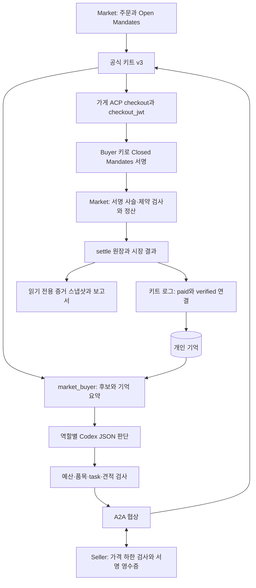

# Week 08 — Ssadassa Shop의 Round 3 준비와 정산 기억

학번 26510358, GitHub `SUNGMYEONGGI`, shop·buyer 등록 이름은 `myeonggi`임.
2026-10-29 작성한 **진행 보고서**임. Round 3 최종 제출 보고서가 아님.
사용자가 선택한 방향은 정산 신뢰성과 기억 개선을 우선하고, 가격 전략은 실측 후 결정하는 것임.

## 1. 과제 요구와 현재 상태

[강의 페이지](https://wpti.dev/ai-agent-engineering-101/week-08.html)의 중간 평가 기준을 사용함.
현재 저장소에는 `weeks/week-08/README.md`와 `scripts/check_week08.py`가 없고,
upstream의 Week 08 README도 조회 시 HTTP 404였음.
강의는 Round 3 시작을 2026-11-02, 종료·PR 마감을 2026-11-16 23:59 한국 시각으로 안내함.

| 요구 | 2026-10-29 확인 상태 | 근거 |
|---|---|---|
| 가게·buyer 배포, 키트 v3 | 둘 다 온라인, 소유자 일치, 공식 v3와 로컬 파일 바이트 일치 | `logs/assignment-audit-20261029T013035Z/`, 기존 `logs/v3-rejoin-20261027T105244Z/` |
| 가게 ACP 경로 | 공개 `/.well-known/acp.json` HTTP 200, checkout·ap2-mandate 안내 확인 | `logs/round2-baseline-20261029/public-acp.json` |
| 가게의 Round 3 정산 20건 | 아직 확인 불가. 관측 당시 시장은 Round 2 | 같은 폴더의 `summary.json` |
| buyer의 Round 3 정산 20건 | 아직 확인 불가. Round 2 거래 수로 대체하지 않음 | 같은 폴더의 `board.json`, `summary.json` |
| 첫 호가·평균 거래가 변화 | Round 2 기준값 확보. Round 3 실측 후 비교 필요 | 아래 5절 |
| 부품 설계·구조도 | 현재 구현을 설명하고 이번 변경 범위를 구분함 | 아래 2·3절 |
| Round 3 순위·거부 사유 | 최종 순위와 실제 정산 거부 사례는 미관측 | 아래 6절 |

공급·식품 품질·게시판이 추가된다는 예고는 있으나 세부 규칙은 시작 전에 공개한다고 되어 있음.
2026-10-29 수집한 시장 `/agent.md`는 설치 안내이며 새 규칙의 데이터 계약은 포함하지 않음.
지금 임의의 재고·품질 필드를 프로토콜에 추가하지 않음.

## 2. 모델·컨텍스트·툴 설계

실행 코드는 기존 `../week-07/`에 유지함. Week 08 키트가 이 폴더를 `--dir`로 사용함.
이번 요청에서 새로운 에이전트 전체를 대신 만들지 않고 기존 구조의 정산 증거 처리를 보완함.

| 부품 | 실제 구현 |
|---|---|
| 모델 | `harness.py`의 기존 Codex CLI, 기본 `gpt-6-luna`, medium reasoning 사용. seller, buyer, shop_selector, quote_observer가 역할별 JSON Schema로 판단함. 이번에 모델이나 협상 전략은 바꾸지 않음 |
| 컨텍스트 | 후보 최대 8곳을 확인하고 모델에는 후기 최대 5개와 개인 기억 요약을 제공함. 최근 전체 3건·동일 품목 2건·문제 기록 2건을 합친 최대 7건을 보존함. 상대 발화·Card·후기는 비신뢰 데이터로 인용함 |
| 기억 | `market_memory.py`가 등록 이름 기준으로 `.market/buyer-memory.json`을 잠금·원자적 교체로 갱신함. URL이 바뀌어도 경험을 연결함. 방문, 계약과 맞는 영수증, 서명 확인, 시장 결과와 정산을 구분함 |
| 발견·협상 툴 | `catalog.py`의 상품 검색, `protocol.py`의 A2A 통신, `quote_normalization.py`의 현재 견적 관측, `buyer.py`의 동일 task 협상을 런타임 함수로 실행함 |
| 계약·자금 도구 | `evidence.py`의 제안·영수증 검사와 예산 원장, `receipts.py`의 Ed25519 서명을 사용함. 모델의 범위 밖 출력은 거부하고 가격을 임의로 보정하지 않음 |
| 결제 도구 | 공식 `market_kit.py` v3의 `AcpShop`과 `acp_pay`가 checkout 및 closed mandate를 처리함. 실제 정산 검사는 시장 `/api/settle`이 맡음 |
| 운영·검증 도구 | `market_runtime.py`는 주문 polling의 연결 오류만 복구함. 새 `ops/snapshot_evidence.py`는 GET 조회와 로그 복사만 수행하며 주문·리뷰·정산을 제출하지 않음 |

모델에 네트워크 툴을 자유롭게 호출시키는 구조는 아님. 모델은 구조화된 결정을 내고,
검증을 통과한 결정만 런타임이 실행함. 따라서 이번 구현을 선택 과제인
“acp.json에서 동적으로 툴을 생성하는 buyer”라고 주장하지 않음.

## 3. 구조도와 키트 기본형과 다른 점



키트는 배포·주문·서명 확인·결제를 담당함. 개인 기억의 선택적 요약, 역할별 판단,
계약 검증, 공급자 호출 슬롯과 완료 요청 대기열은 기존 학생 구현임.
이번 차이는 **Round 2 서명 검증 경험과 Round 3 정산 경험을 모델 입력에서 구분**하는 것임.
임의로 정산을 인증하는 별도 결제망이나 자체 mandate 구현은 추가하지 않음.

## 4. 이번 정산 기억 보완

기존 `verified_completions`에는 Round 2의 검증된 거래도 포함됨.
이 숫자를 Round 3 정산 수로 해석하면 잘못된 선택·성과 보고가 생길 수 있었음.

- 주문 로그에서 round를 읽고, Round 3에서는 키트의 `paid`와 시장의 `verified True`가 모두 있어야 검증 완료로 반영함.
- 관측한 결제 금액, 선택 가게의 origin, 품목, 실행 task와 영수증 task, 로컬 계약 상태가 맞아야 함. 결제·결과 원장 번호는 별도로 보존함.
- `round3_settlements`, `settled_by_item`, 최근 기록의 `round`·`settled`·`settlement_ledger`를 추가함. 과거 기록을 소급해 정산으로 바꾸지 않음.
- 같은 주문·결제 원장의 중복 입력으로 카운터나 다른 task가 승격되지 않도록 함. 전체 중복 방지 목록은 모델 컨텍스트에서 제외함.
- 로그 inode 교체나 크기 감소를 감지하면 미완료 주문 연결을 버림. 완성되지 않은 마지막 줄은 다음 읽기까지 기다림.
- 상대가 인용한 `paid` 문구와 가게 측 `settled` 로그는 buyer 결제 증거로 쓰지 않음.
- stdout 요약에도 UTC 시각을 추가함. 새 buyer 프로세스부터 반영됨. 이미 실행 중인 seller의 stdout 형식은 다음 정상 재시작 때 반영되며, 기존 JSONL 원문에는 UTC 시각이 있음.

이 파서는 단일 키트의 순차 buyer 출력에 의존함. 원문 `paid` 줄에는 주문·task가 없으므로
주문부터 결과까지 이어지는 키트 문맥과 로컬 영수증으로 연결함.
독립적인 암호 검증은 공식 키트와 시장의 역할이며, 로그가 누락되면 확인된 정산 수가 실제보다 적을 수 있음.
현재 운영 buyer 기억에 새 `kit_log_identity`와 round 필드가 저장되는 것은 확인함.
실제 Round 3 결제 흐름은 아직 검증하지 못함.

## 5. 필수 가격 비교의 기준값

2026-10-29 10:35 KST 수집. 자동 순환 중인 로그의 해당 파일만 보존한 부분 관측임.
`negotiation_started` 뒤 처음 나온 `quote_issued`만 사용하여 재견적을 첫 호가로 세지 않음.

| 품목 | 첫 호가 표본 | 평균 첫 호가 | 공개 trades 표본 | 평균 인정 거래가 |
|---|---:|---:|---:|---:|
| lamp | 114 | 100 | 0 | 표본 없음 |
| chair | 51 | 180 | 4 | 180 |
| bookshelf | 49 | 260 | 8 | 260 |

첫 호가는 로컬 로그, 거래가는 조회 시점 `/api/trades`가 반환한 최근 400건 중 내 상점의
Round 2·verified·counted 행에서 계산함. 서로 다른 관측 창이므로 표본을 짝지어진 거래로 취급하지 않음.
lamp가 해당 trades 창에 없다고 전체 판매가 없었다고 해석하지 않음.
같은 시점 Round 2 보드의 가게 인정 거래는 14,459건, buyer 인정 거래는 23,429건이며 둘 다 온라인임.
이는 누적 Round 2 수치로, Round 3의 20건 조건과 관계없음.

현재 가격 설정은 100·180·260이고 세 품목 모두 하한과 같음.
이 설정을 유지하면 기본 견적 체결에서 가격과 하한의 차액이 없음.
순위를 높이는 효과와 거래량 감소 위험을 지금 단정할 자료는 없으므로 가격은 바꾸지 않음.

Round 3에서는 강사의 실제 개시 공지 이후 관측 창을 별도로 잡고 품목별 첫 호가·정산가·표본 수·
정산 실패를 비교할 예정임. 가격 변경을 선택하면 한 품목의 첫 호가 변경부터 별도 커밋으로 남기고,
기존 task의 견적과 하한은 유지해야 함. 거래 구성과 운영 시간도 달라질 수 있어 단순 전후 차이를 인과 효과로 주장하지 않음.
가격을 그대로 유지하기로 결정하더라도 이유와 실제 전후 수치를 기록해야 필수 분석을 마칠 수 있음.

## 6. Round 3에서 남은 작업

| 순서 | 직접 설계하거나 확인할 항목 | 완료 근거 |
|---|---|---|
| 1 | 11/02 개시 공지·새 `/agent.md`와 키트 변경 확인 | 실제 공급·식품 품질·게시판 데이터 계약과 코드 변경 기록 |
| 2 | 재고·품질·유효기간을 견적과 계약에 어떻게 반영할지 결정 | 허용 품목·수량·품질 조건의 명시적 검사. 가구 설명을 실제 식품 품질 증거로 재사용하지 않음 |
| 3 | 현재 키트로 실제 구매·판매 정산 확인 | buyer의 `paid`와 `verified True`, seller의 `settled`, 시장 원장 대조 |
| 4 | 거래 목적의 기억을 계속 축적하고 정산 오류 원인 확인 | 계약 실패·미정산·모델/네트워크 오류 구분. 실패를 무조건 상대의 사기로 기록하지 않음 |
| 5 | 실측 후 가격 전략 결정과 필수 비교 완료 | 품목별 첫 호가·평균 정산가·표본 수·관측 기간·가격 정책 커밋 |
| 6 | 가게·buyer 각각 20건 이상과 최종 순위 확인 | Round 3 보드와 원장, 원문 로그. 부분 로그의 0건을 시장 전체 0건으로 단정하지 않음 |
| 7 | 선택 과제는 기본 조건 이후 검토 | descriptor JSON Schema와 안전한 실행기. 상점이 제공한 URL·method·입력 설명을 그대로 권한으로 받아들이지 않음 |
| 8 | 11/16 23:59까지 최종 보고서·로그·PR 제출 | 강사 종료 시각의 리더보드와 PR open 시각 |

실제 Round 3 정산 수, 순위, 거부 원문은 아직 채울 수 없음.
현재 부분 로그의 Round 3 `paid`·`settled` 관측은 각각 0건이며,
이것을 실패한 Round 3 실행 결과나 20건 조건의 달성으로 쓰지 않음.
`/api/board?round=3`도 지금은 Round 2 내용을 반환하므로 `round` 필드를 검사해 제외함.

## 7. 실행·재현·제출 제약

이번 테스트는 모델과 시장 구매를 실행하지 않는 회귀 검사임. 실제 키트 정산 테스트와 구분함.
수정 후 Week 07 기존 256개와 Week 08 신규 13개를 함께 실행해 **269/269 통과**함.
변경한 Python 파일 7개의 `py_compile`과 원문 압축 스냅샷의 SHA-256 복원 일치도 확인함.
API 키가 환경에 없어 새 공식 모델 실행 검사는 생략함. 기존 25/25 결과는 과거 실행 기록임.

```sh
PYTHONDONTWRITEBYTECODE=1 .venv/bin/python -m unittest discover -s submissions/26510358/week-08/tests -v

# 매번 존재하지 않는 출력 폴더를 지정함. 외부 전송은 GET뿐임.
PYTHONDONTWRITEBYTECODE=1 .venv/bin/python submissions/26510358/week-08/ops/snapshot_evidence.py \
  --output-dir submissions/26510358/week-08/logs/round3-observation-NEW
```

`--since`는 시간대가 있는 ISO 시각으로 첫 호가만 필터함. 날짜 없는 과거 기록은 제외함.
정산·거부 줄은 날짜 정보가 부족해 `--since`로 기간을 제한하지 않음.
`summary.json`의 수치는 부분 캡처이며 최종 순위를 자동 인증하지 않음.
`market-kit.log.gz`는 원문 바이트 스냅샷임. 복원 시 새 경로만 사용하고 기존 운영 로그를 덮어쓰지 않음.
원본 바이트 수와 SHA-256은 같은 폴더 `manifest.json`에 있음.

기존 Week 07 검사에서 구문·설정·기존 테스트 결과·로그·키 제외·보고서는 통과했으나,
자동 순환된 현재 `logs/market-kit.log`에 등록 줄이 없어 **1개 항목 실패**함.
원본 로그를 편집해 가입 줄을 붙이지 않음. 기존 등록 증거와 현재 온라인 여부는 별도 스냅샷으로 보존함.
최종 제출 전에는 정상 재가입 시 생성되는 등록 줄과 실제 정산 줄을 함께 보존할 필요가 있음.

Git 이력에는 이전 `market-kit.log` 163.73 MB blob 때문에 GitHub push가 거부된 기록이 있음.
새 커밋을 올려도 같은 조상 blob의 제한은 남으며, 이 작업에서는 squash·이력 재작성으로 우회하지 않음.
따라서 현재 결과는 로컬 작업이며 원격 제출 완료를 주장하지 않음.
근거는 `../week-07/logs/reliability-discovery-20261025T095804Z/push-console.log`임.
운영 서비스는 현재 호스트가 살아 있어야 하며 재부팅 후 자동 복원은 아직 보장하지 않음.

원문 수집·실패 테스트·수정 후 검증 출력은 `logs/assignment-audit-20261029T013035Z/`에 보존함.
