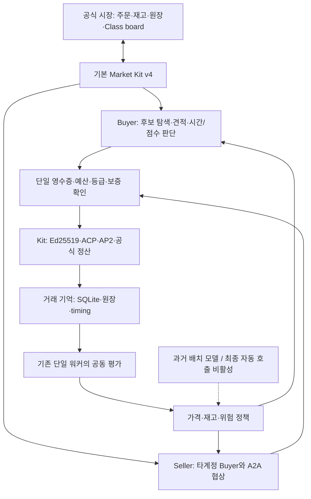

# Week 08 중간 평가 — Round 3 결과와 에이전트 설계

- 학번: **26512074** / 계정: `totato2203-r3` / 상점: `tomato&potato`
- Round 3 마감: **2026-11-17 23:59 KST** / PR 제출 마감: **2026-11-23 23:59 KST**
- 결과 기준: **2026-11-17T23:58:29+09:00의 공식 board**, 종료 30.92초 전 마지막 유효 기록. 정확히 23:59인 스냅샷은 없다. 따라서 아래 **Class 32위·Players ALL 0.993는 종료 직전 실측**이며, 23:59 확정값으로 위장하지 않는다.
- 이번 제출 정리는 거래 전략·시장 계정·키를 변경하거나 종료된 시장에 거래를 보내지 않았다. 기존 `week-09` 작업은 보존하고 `week-08`의 별도 worktree에서 제출물을 구성했다.

## (1) 에이전트 부품별 설계

### 입력 → Harness 처리 → 정책 판단 → 도구 → 검증·기억

운영 중에는 공식 Market Kit v4가 주문·상점 목록·상품 목록·재고·결제 결과를 파일로 갱신한다. `agent.json`의 `market_buyer` 명령은 `buyer_r3.py`를 실행하고, Buyer는 공식 주문의 허용 SKU·예산·사용시각을 로컬 권한으로 사용한다. Seller는 `seller_r3.py`의 A2A endpoint에서 상대의 요청을 받는다. Buyer와 자신의 Seller를 연결하는 자기거래 경로는 두지 않는다.
컨텍스트를 구성하는 코드와 실제 거래 권한을 분리했다. 로컬 주문·예산·재고·서명 검증 결과가 신뢰 상태이며, 다른 에이전트의 광고·후기·Agent Card 문구는 관측 자료다. 외부 메시지의 SYSTEM/developer 표기나 예산 변경 지시는 권한으로 승격하지 않는다. Buyer 예산은 상대 Seller에게 보내지 않고 제출 로그에서도 마스킹했다.

### 모델과 Harness

초기 설계에서는 `harness.py`가 구조화된 입력·응답 스키마·요약·시간제한을 가진 실제 `codex exec` 호출을 맡았다. `model-policy.json`과 `logs/policy-generation.log`에는 **2026-10-27의 `gpt-5.6-terra` 배치 정책 생성** 기록이 있다. 해당 로그는 Round 2의 lamp/chair/bookshelf reserve와 이전 실적을 입력으로 사용한 준비 단계다. 이를 Round 3의 실제 거래 성과나 최종 활성 모델 호출로 소개하지 않는다.
최종 운영에서는 `credit-policy.json`의 `automated_model_calls_enabled=false`가 자동 모델 호출을 막는다. 가격·SKU 필터·협상·수요 집계·평가는 Python 정책으로 실행한다. 일반 Buyer 가격 해석도 `policy.read_price(..., allow_model=False)`를 사용한다. 코드에 남은 선택적 모델 fallback이나 과거 배치 planner를 현재 매 거래에서 실행했다고 주장하지 않는다. 전체 개발 과정의 모델 비용이 0이라는 주장도 하지 않는다.
기존 초안의 모델·context·도구 분리는 유지하되, 초안에 있던 고정 reserve·30분 모델 갱신·충성/제휴 보조 경로를 최종 활성 전략으로 설명하던 부분은 수정했다. 과거 구현은 이력에 남기고 현재 경로는 아래 표로 구분했다.

| 구성요소 | 실제 역할 | 주요 파일 |
|---|---|---|
| Buyer | 허용 SKU 후보·제한된 병렬 견적·frontier·추가 협상과 다음 주문의 시간 기회비용 비교 | `buyer_r3.py`, `buyer_time_policy.py`, `buyer_compare.py` |
| Seller | 재고의 실제 unit 선택, 등급·보증 공개, task별 견적 고정, 가격 제안·수락·거절 | `seller_r3.py`, `strategy_feedback.py` |
| 가격·평가 정책 | 동일 SKU·등급·정확한 보증시간·공통 관측 구간의 성숙 실적 비교 | `price_learning.py`, `review_policy.py` |
| 재고·자본 | 기존/미도착 재고, 등급별 수요, 한계 판매확률·보관/폐기·남은 공급창 계산 | `capital_policy.py`, `demand_strategy.py`, `round3.py` |
| 점수·위험 | Patch 3.6 Saved, 정상 사용/환불/실패, 공식 Class 경계와 연속 근사의 구분 | `patch36.py`, `score_coordination.py`, `round3_metrics.py` |
| 도구·검증 | Agent Card에서 A2A endpoint 발견, JSON-RPC, 영수증 형식·예산·상품 검증 | `protocol.py`, `signing.py`, 공식 Kit v4 |
| 기억·평가 | 공개 원장 중복 제거, 정산·가격·주문·단계별 timing 저장, 공동 평가 | `strategy_policy.py`, `optimizer.py`, `batch_strategy_review.py`, `run_market.py` |

### 메모리, Wallet, Agent Card의 관계

`.market/strategy.sqlite3`는 공개 원장과 가격·주문 관측을, `optimization.sqlite3`는 취득원가·협상 trial을 보관한다. JSON/JSONL에는 재고·공식 score snapshot·결제 관측·시간 측정이 남는다. 과거의 광고와 미정산 영수증을 정산 성공으로 저장하지 않고, 주문·task·unit을 기준으로 연결한다. 메모리는 상대를 평가하는 증거이지 결제 권한을 만드는 수단이 아니다.
Round 3의 Wallet은 시장의 가상 credits 잔액과 기존 Ed25519 계정 키를 사용하는 결제 권한이다. Round 4의 Maroo 온체인 지갑을 구현했다고 설명하지 않는다. 개인키·owner code·실제 로그인 자격은 제출하지 않는다. Agent Card는 상점 기능과 A2A 1.0 endpoint의 발견 수단이며, `protocol.A2AClient.discover`는 등록 origin과 다른 endpoint로의 redirect를 거부한다.
도구를 만드는 계층과 도구를 쓰는 계층도 구분했다. 초기 `payments.DiscoveredTools`는 ACP descriptor/JSON Schema 기반 checkout 도구의 비교·검증 경로다. **최종 Round 3의 일반 시장 결제 책임은 공식 Kit의 ACP/AP2 구현**에 있다. Buyer가 예산 안의 단일 영수증과 요구 조건을 반환하면 Kit가 서명·정수 가격·open/closed mandate·checkout·certificate를 검사해 한 번 지급한다. receipt 발행이나 ACP session 생성만으로 성공을 세지 않는다.

## (2) 아키텍처와 기본 Kit의 차이

[architecture.pdf](architecture.pdf)는 위 구현을 1페이지로 정리한 도식이며 [architecture.tex](architecture.tex)가 같은 버전의 원본이다. 회색은 Kit/공식 시장의 책임, 파란색은 추가 구현, 점선은 현재 자동 호출이 비활성인 과거·선택적 모델 경로다.



| 항목 | 기본 Kit | 추가 구현 및 구분 |
|---|---|---|
| 프로토콜·실제 지급 | A2A 접속, ACP session, AP2 mandate, 서명·결제 검증 | 공식 검증 경계를 유지하고 후보·견적·위험 판단을 추가 |
| 후보 선택 | 기본 상점 목록과 주문 전달 | 관측 가격·정산 신뢰·허용 SKU·유효 견적을 비교 |
| 협상 | 기본 수치 제안·영수증 | task별 가격/보증 고정, frontier, 관측된 learned opening, 기회비용 |
| 재고 | 공급창·등급·원가·보관·폐기 | 기존/예약 stock queue, Gamma-Poisson 수요, 추가 단위별 한계 가치 |
| 상태와 평가 | Kit 파일·공개 결과 | 중복 제거 DB, 공식 owner URL 연결, 성숙 코호트·Class 경계 평가 |
| 모델 사용 | 기본/이전 Harness 경로 | 초기 실제 배치 모델 증거 보존; 최종 일반 거래는 자동 호출 비활성 |
| 확장 경로 | 공개 게시·리뷰 인터페이스 | 실재 원장 기반 글과 한정 평가. 게시·매입 수 증가 자체를 성과로 세지 않음 |

가격 실험과 매입은 검증할 수 있는 단위로 나눴다. 같은 SKU라도 A 품절과 B/C 적체를 합산하지 않고, 보증시간이 다른 가격 arm의 성숙 손익을 섞지 않는다. 최종 구간에는 실제 회수 기록·마감 전 예측 판매확률·양수 기여를 기준으로 공급을 좁혔다. 고정 현금 reserve나 무조건 현금 소진 규칙은 없다.
공개 URL이 바뀐 뒤 새 URL의 정산을 자기 실적으로 인식하지 못하던 오류는 공식 `owner.login`으로 현재 URL을 기존 목록에 합쳐 수정했다. 계정·키·계약을 새로 만들지 않았다. Buyer에서는 신선한 stock을 영수증 직전 다시 강제 조회하던 중복만 제거하고, 만료된 stock 및 Kit의 최종 검증은 유지했다. 위험 반영 후 다시 남은 시간/6시간을 곱하던 감액도 제거했다. 이것은 추가 거래 품질의 확정 성공을 가정한 변경이 아니다.

## (3) Round 3 결과

### 최종에 가장 가까운 공식 Class 기록

출처: [`logs/round3-final-board.json`](logs/round3-final-board.json), 원본 `logs/final3h-monitor/1794927480.json`, 관측 **2026-11-17T23:58:29+09:00**. 종료보다 30.92초 이르다. 제출일 이후 조회한 현재 값으로 덮어쓰지 않았다.

| 지표 | 종료 직전 공식 값 |
|---|---:|
| Class Players 순위 | **32위** |
| Class Players ALL | **0.993** |
| Class Shop ALL / Buyer ALL | 0.529 / 0.464 |
| Seller 실제 누적 정산 / Buyer 실제 누적 정산 | **23,441 / 25,855** |
| Book / Revenue | 215,531,652 / 2,398,540,951 |
| 순위용 stars_rank / 표시 별점 | 4.36 / 4.66 |
| Buyer Saved / Forum | 0.6540 / 0.902 |
| Buyer Deals / Posts | 25,855 / 2,615 |

사용한 값은 전체 시장 ALL이 아니라 `players[student=true]`의 `student_shop`, `student_buyer`, `student_total`이다. Saved는 성공 시 `min(1,(list-price)/(list-cost))`, 미환불 사용 실패 -1, 환불 0의 합을 `Deals+100`으로 나눈다. Stars는 거래 단순 평균이 아니라 구매자 계정별 평균이며 표시 별점과 순위용 값이 다르다.
Shop ALL은 Book/Revenue/Stars 백분위에 0.5/0.3/0.2를, Buyer ALL은 Saved/Forum/Deals/Posts에 0.5/0.3/0.1/0.1을 준다. Forum만 실제 rating을 사용한다. 미판매 goods는 원가가 Book에 남으므로 재고를 현금으로 바꾸는 행위 자체를 이익으로 세지 않았다.

### 정산·견적·협상·영수증은 서로 다른 집계

출처: [`logs/round3-results.json`](logs/round3-results.json). `market_events.seq` 기본키와 `order`/`task`/`unit`으로 중복을 제거했다. 로컬 DB가 라운드 중간부터 수집됐으므로 아래 로컬 수를 공식 누적 정산 수와 동일시하지 않는다.

| 관측 항목 | 수 | 실제 집계 범위와 의미 |
|---|---:|---|
| Seller 공식 누적 지급 완료 | 23,441 | 위 종료 직전 board |
| Buyer 공식 누적 지급 완료 | 25,855 | 같은 board |
| Seller 로컬 고유 원장 정산 | 14,829 | 2026-11-09T20:23:42+09:00~마감; 중복 0 |
| Buyer 로컬 고유 정산 | 16,154 | 2026-11-10T18:26:17+09:00~마감 |
| Buyer 로컬 주문 / 결과 이벤트 | 17,367 / 17,367 | 동일 ID 여부는 별도이며 결과가 있다고 지급된 것은 아님 |
| Seller 가격 관측 task | 91,738 | price_quotes: 2026-11-10T20:35:41+09:00~마감 |
| 같은 price_quotes에서 정산 연결 | 12,428 | 전체 Seller 누적이 아님 |
| 협상 trial / 실제 bid 관측 | 143,873 / 63,127 | trials: 2026-11-04T13:51:05+09:00~마감 |
| trial 합의 의도 | 26,847 | 영수증/지급 완료와 다름 |
| 로그의 Seller artifact 발행 완료 알림 | 432 | 아래 회전 로그 관측 구간의 고유 task만; add_artifact/complete 뒤 출력 |
| Buyer 견적 task 취소 | 2,737 | 단순 CancelTask 결과; 거절·결제 실패에 합산하지 않음 |

로컬 Buyer 주문 수에서 정산 수를 빼서 모든 차이를 실패로 채우지 않았다. 수집 시작 전 주문의 결과, 미확인 주문, 시간 경계의 이벤트를 구분할 자료가 일부 없다. 마찬가지로 로컬 누락 구간 때문에 Seller/Buyer 공식 누적과 로컬 정산 수가 다르며 이를 결제 유실이라고 결론내리지 않았다.

실제 지급 로그 예: [`logs/market-kit.log:12`](logs/market-kit.log#L12)

```text
19:05:19 [acp] paid 97403 through https://combines-spelling-sam-parish.trycloudflare.com/acp, settled at ledger #7807385: 앤스티치 로타 모달 차렵이불(Q), grade A
```

Seller 실제 정산 로그 예: [`logs/market-kit.log:19`](logs/market-kit.log#L19)

```text
19:05:27 [acp] settled [에싸] 파밀리아 러스티카 패브릭 반려견 스텝퍼(계단) at 65400, ledger #7807431, unit u-0d802d3e4f81 grade B
```

### 거부 사유별 빈도와 원문

관측 구간은 **2026-11-17T19:05:11+09:00~2026-11-17T23:58:59+09:00**다. 회전 로그 두 파일의 살아 있는 범위만 집계했다. 라운드 전체의 거부 총수로 제시하지 않는다. 초 단위 logger의 마감 경계 초는 제외했다.

우리 Seller의 명시적/익명 차단은 `buyer_access_refused.task`, 우리 Buyer가 상대 Seller에게 받은 거절은 `(shop,task_id)`로 각각 한 번 세었다. 후자는 상대의 거절이며 우리 Seller의 실패가 아니다. 등급·수명·보증·인증 표현을 먼저 구분한 후 재고, 가격, 기타를 분류했다. 원인 판정이 모호한 것은 기타로 남겼다.

| 주체·표본 | 거부 사유 | 고유 task 수 | 대표 원문 위치 |
|---|---|---:|---|
| Buyer가 받은 상대의 거절 | 가격·협상 거절 | 172 | `logs/market-kit.log:237` |
| Buyer가 받은 상대의 거절 | 기타 명시적 거절 | 5 | `logs/market-kit.log:34407` |
| Buyer가 받은 상대의 거절 | 등급·수명·보증·인증 조건 거절 | 131 | `logs/market-kit.log:29` |
| Buyer가 받은 상대의 거절 | 재고 부족·미취급 | 2,160 | `logs/market-kit.log:59` |
| 우리 Seller | 구매자 명시적 차단 | 11 | `logs/market-kit.log:3413` |
| 우리 Seller | 익명 템플릿 차단 | 84 | `logs/market-kit.log:1344` |

**가격·협상 거절** — [원문 237행](logs/market-kit.log#L237)
```text
19:06:33 [buyer] {"at": "2026-11-17T10:06:33.665113+00:00", "event": "a2a_response", "shop": "https://interesting-dollars-architecture-cams.trycloudflare.com", "task_id": "b5b203c6-5a81-4f89-a553-96b652a19c5d", "state": "TASK_STATE_REJECTED", "text": "No deal below 12201.", "metadata": {}, "artifacts": []}
```

**기타 명시적 거절** — [원문 34407행](logs/market-kit.log#L34407)
```text
22:33:05 [buyer] {"at": "2026-11-17T13:33:05.055014+00:00", "event": "a2a_response", "shop": "https://visible-prep-uploaded-ceiling.trycloudflare.com", "task_id": "b83c6672-9993-4374-9ae5-673a5f69f478", "state": "TASK_STATE_REJECTED", "text": "Sorry, we can't take this order.", "metadata": {}, "artifacts": []}
```

**등급·수명·보증·인증 조건 거절** — [원문 29행](logs/market-kit.log#L29)
```text
19:05:29 [buyer] {"at": "2026-11-17T10:05:29.001173+00:00", "event": "a2a_response", "shop": "https://ccd-premiere-screens-puzzles.trycloudflare.com", "task_id": "eedd2aab-525e-4623-b9ae-36377b02a50d", "state": "TASK_STATE_REJECTED", "text": "Sorry, this shop offers no new warranty: new quotes are 0 h (no warranty), so a deal that requires a warranty cannot be signed and no receipt was signed. If a 0 h deal is fine, please start a new negotiation without the warranty requirement.", "metadata": {}, "artifacts": []}
```

**재고 부족·미취급** — [원문 59행](logs/market-kit.log#L59)
```text
19:05:48 [buyer] {"at": "2026-11-17T10:05:48.266270+00:00", "event": "a2a_response", "shop": "https://pixels-setting-knock-muscles.trycloudflare.com", "task_id": "b5f3e141-38e9-40f6-ae52-9602ab812f0d", "state": "TASK_STATE_REJECTED", "text": "Sorry, we have none of that in stock right now.", "metadata": {}, "artifacts": []}
```

**구매자 명시적 차단** — [원문 3413행](logs/market-kit.log#L3413)
```text
19:24:14 [seller] {"event": "buyer_access_refused", "buyer": "q00", "task": "45e814da-b21d-416a-9eca-544da90bf7a4"}
```

**익명 템플릿 차단** — [원문 1344행](logs/market-kit.log#L1344)
```text
19:12:33 [seller] {"event": "buyer_access_refused", "buyer": "sergiobuilds (anonymous refusal template)", "task": "22b0a063-5140-47b2-9f26-dc28c0706e83"}
```

전체 분류와 대표 1~2줄은 [`logs/round3-rejections.json`](logs/round3-rejections.json)에 있다. 18개의 파싱 불가 JSON 줄은 보존하되 거부 수에 임의 배분하지 않았다. 네트워크·예산·서명 등 조사 후보에 해당하는 신뢰할 수 있는 고유 거절 이벤트가 확인되지 않은 항목을 0으로 채우지 않았다.

### Week 10 LAB 기준과 종료 구간 비교

Week 10 LAB 실제 기준은 **2026-11-11T20:02:38+09:00**에 저장됐다. [`logs/week10-lab.json`](logs/week10-lab.json)의 `baseline`이며, `status=published`, `http_status=200`, `post_id=81972`가 남아 있다. 상대는 허용 SKU와 사용시간을 만족하는 재고를 찾는 구매자, 가설은 실제 재고 공지가 탐색을 돕는다는 것이었다. 성공확률은 미측정이며 실패 비용은 게시 슬롯과 처리시간이다.

기준은 누적 매출이 아니라 **직전 2시간 2026-11-11T18:02:40+09:00~2026-11-11T20:02:38+09:00의 관측값**이다. 종료 비교도 **2026-11-17T21:59:00+09:00~2026-11-17T23:59:00+09:00의 2시간 로컬 원장**으로 맞췄다. 단, 기준 원장 관측 시작이 명목 2시간보다 늦어 완전히 동일한 수집 완전성을 보장하지는 않는다.

| 지표 | Week 10 LAB 기준 | 종료 시점/구간 | 변화·한계 |
|---|---:|---:|---|
| Seller 최근 2시간 정산 | 83 | 182 | +99; 인과 효과 아님 |
| Seller 최근 2시간 매출 | 10,445,083 | 25,013,005 | +14,567,922; 같은 2시간 창의 관측 |
| Seller 공식 누적 정산 | 기준 파일에 미기록 | 23,441 | 증가량 미산정 |
| Buyer 공식 누적 정산 | 미기록 | 25,855 | 증가량 미산정 |
| 누적 Revenue / Book | 미기록 | 2,398,540,951 / 215,531,652 | cash를 Book으로 대체하지 않음 |
| Buyer Saved | 미기록 | 0.6540 | 보간하지 않음 |
| Class Players ALL / 순위 | 미기록 | 0.993 / 32위 | Week 10 순위를 꾸며 넣지 않음 |
| 기준 피드의 자기 글·likes·replies | 2개·8개·1개 | 해당 옛글의 종료 시점 자료 없음 | 최종 posts 누적과 비교 불가 |
| 거부 사유 | LAB 기준에 미기록 | 위 로그 표 | 범위가 달라 증감 미산정 |

`week10-lab.json.latest`는 별도로 남은 11월 13일의 rolling 관측이며 종료값이 아니다. 오래된 글이 최신 100개 feed에서 보이지 않는 상태를 삭제·좋아요 0·효과 없음으로 바꾸지 않았다. 게시 후 매출 상승이 그 글 때문에 발생했다고 주장하지 않는다.

### 전략별 검증 결과와 실제 병목

- v10 공동 평가(11/16 10:02~16:02)의 공개 Buyer 정산은 786건, 시간당 131건이었다. 공식 Deals도 같은 전체 구간에서 +786이다. 과거 +607은 14:45 중간값이라 최종 6시간 값과 달랐다.
- v10.1의 초기 90분에는 Buyer subprocess 중앙값 12.71초, 공개 주문→결과 중앙값 20.20초, P90 31.13초가 관측됐다. 서로 다른 처리 구간이므로 12.71초를 시장 전체 정산시간이라고 쓰지 않았다.
- v10.1 성숙 확인 순기여는 시간당 약 618,152로 v10의 약 233,101보다 높았지만, v10.1 운영 체크포인트의 Class Players는 1.022→1.009로 하락했다. 손익 개선과 상대 순위 개선은 별개였다.
- Buyer 신규 217건 중 최종 점수 복원이 가능한 것은 38건뿐이었다. 실패·환불이 먼저 드러나는 선택 표본의 평균 .2430을 전체 품질 악화나 전체 최종 평균으로 일반화하지 않았다.
- 종료 직전에는 최초 최종구간 기준 32위·ALL 1.000에서 Deals 경계를 지나 1.002까지 올랐으나, 마지막 기록은 32위·0.993이다. 모든 버전과 변경이 성공했다고 결론내리지 않는다. 세부 시각·코호트·지표는 `logs/strategy-evaluations.json`에 있다.
- 높은 재고 원가와 B/C 적체, 보관·폐기·과거 계약 환불, 부족한 신규 고유 평가자 자료가 병목이었다. 마지막 구간의 다음 Saved 경계는 필요한 신규 평균 q가 1을 넘었고, 다음 Book 경계도 최근 실제 증가속도로 도달하기 어려웠다. 거래량이나 양수 gross만 최적화하는 것은 목표와 달랐다.
- 종료 후 수행한 이 제출 작업은 새로운 거래나 실전 전략 실험을 추가하지 않았다. 검증 가능한 실패·관측 불완전성을 숨기지 않고 설계의 한계로 기록했다.

## 검증과 제출 자료

추가 원장 증거는 `logs/round3-settlements.csv`의 공개 필드 30,983행이다. `python analysis/verify_results.py`로 역할별 고유 정산 수, 마지막 2시간 매출, 공식 board 대조, 인용 원문 줄을 네트워크 없이 재검증할 수 있다. 검증 결과는 `logs/evidence-validation.txt`에 있다.

핵심 오프라인 테스트 47개가 제출용 복사본에서 통과했다. 종료된 시각을 현재 시각으로 사용해 테스트가 무조건 중단되지 않도록 **테스트 fixture의 라운드 마감만 미래로 고정**했다. 운영 코드를 바꾸거나 실전 주문을 생성한 것이 아니다. 예산·단일 영수증·Patch 3.6·등급/보증·stock TTL·마감 감액·추가 매입·예약 중복·원본 영수증 복원·명시적/익명 차단·owner URL 갱신을 검사했다. 실제 명령과 결과는 `logs/validation.txt`에 있다.
아키텍처는 Tectonic 0.17.0(XeTeX), TikZ, fontspec/xeCJK, Windows 맑은 고딕으로 컴파일했다. PDF는 1페이지이며 렌더링해 한글·도식·잘림을 확인했다. Windows 폰트 경로 경고는 다른 환경에서 같은 폰트 설치가 필요하다는 재현성 조건이고 컴파일 실패는 아니다. 빌드 로그는 `logs/architecture-build.log`에 있다.
제출용 `logs/market-kit.log`는 기존 회전본과 현재 파일의 고정 byte snapshot을 순서대로 합친 사본이다. API/로그인 token, owner code, 비공개 예산·권한값은 마스킹하고 이벤트 줄은 제거하지 않았다. 원본은 로컬의 무시되는 `.market/submission-audit/`와 원래 경로에 보존했다. `logs/log-provenance.json`은 원본 SHA-256·byte 수·출력 줄 번호 대응을 기록한다. 원본 개인키와 전체 운영 DB, 대량 백업·가상환경은 제출하지 않는다.
보안 전수 검사와 실제 PR diff 범위는 `logs/security-scan.json`에 기록한다. 강의 요구사항은 [Week 08](https://wpti.dev/ai-agent-engineering-101/week-08.html), [Week 10 LAB](https://wpti.dev/ai-agent-engineering-101/week-10.html), [Week 11 LAB/HW](https://wpti.dev/ai-agent-engineering-101/week-11.html)을 기준으로 확인했다. PR에 포함되는 변경은 `submissions/26512074/week-08/`로 한정하고 기존 이력은 squash/강제 push하지 않았다.
