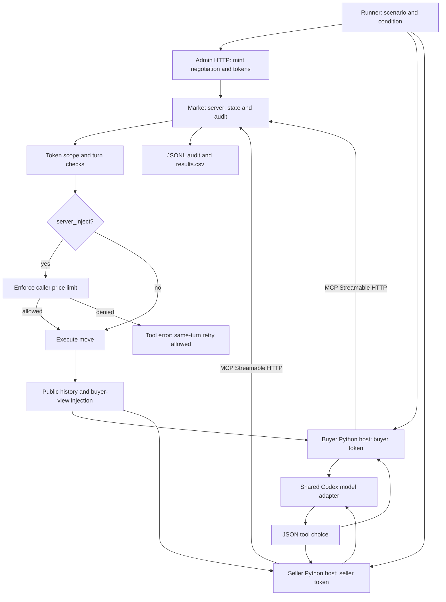

# Week 05: MCP 협상 시장

4주차의 구매자·판매자 역할 프롬프트, 네 시나리오, Codex 모델 연결 코드를
재사용했다. 이번에는 Python 호스트가 모델이 선택한 도구를 실제 HTTP MCP
서버에 호출한다. 서버는 토큰으로 신원·협상 범위·차례를 확인하고,
`server_inject` 조건에서는 호출자의 가격 한도도 집행한다.

## 실행 환경

- 기존 **conda base**, Python 3.8.19, 표준 라이브러리만 사용. 설치/환경 변경 없음.
- Codex CLI 0.153.0, 기존 ChatGPT 로그인, `gpt-6-astra`, reasoning `low`.
- API 키 불필요. CLI 로그인은 사용자가 미리 완료해야 한다.
- CLI의 temperature/max output tokens/seed는 설정하지 않았으며 내부 값은 모른다.
- Codex CLI는 도구 없는 모델 응답 생성기다. **네이티브 Codex MCP 연결이 아니라
  별도 Python MCP 호스트**가 bearer token을 보관하고 요청을 실행한다.
- 역할 지시와 대화 이력은 CLI 입력 JSON의 `system`/`history` 필드 및 공통
  래퍼 지시로 전달한다. OpenAI API의 네이티브 system role을 직접 설정한 것은
  아니다. 두 조건은 이 전달 방식까지 동일하다.
- 서버는 별도 프로세스, `127.0.0.1` 임의 포트. 외부 공개하지 않는다.

## 재현 명령

```bash
conda activate base
cd /nas/home/uichan/ai-agent-engineering-101/submissions/26520024/week-05
export CODEX_BIN=/home/uichan/.vscode-server/extensions/openai.chatgpt-26.901.22334-linux-x64/bin/linux-x86_64/codex
"$CODEX_BIN" login status
python -m unittest -v test_week05
python auth_checks.py --output /tmp/week05-auth-new.txt
python run_experiment.py --output /tmp/week05-new-run --repeats 3
```

다른 컴퓨터에서는 `CODEX_BIN`만 실제 설치 위치로 바꾼다. 새 실험에는 빈 출력
디렉터리를 지정한다. 같은 명령을 재실행하면 CSV에 기록된 에피소드는 건너뛴다.
실행 코드·설계·프롬프트·시나리오는 모델 호출 전에 커밋되어야 하며, 재개할 때
해시가 달라지면 중단한다. 네트워크/모델 장애는 빈 측정값과 오류를 기록하고
배치를 중단한다. 재개해도 실패 행을 성공 결과로 덮어쓰지 않는다.

제출된 실행의 재개/검증은 아래와 같다. 첫 명령은 모든 행이 있으면 모델을
호출하지 않는다. 구조 검사 통과가 실험 해석의 정당성까지 보장하는 것은 아니다.

```bash
python run_experiment.py --output . --repeats 3
python validate_results.py
python ../../../scripts/check_week05.py .
```

## 구조



| 파일 | 역할 |
|---|---|
| `market_server.py` | 신원·차례·가격 정책과 협상 상태, MCP 도구, 관리자 경로 |
| `mcp_client.py` | 실제 HTTP 요청, JSON/SSE 응답 처리, 서버 프로세스 관리 |
| `agent_host.py` | 도구 검색, 모델의 JSON 선택, 결과 피드백, 턴당 최대 6번 판단 |
| `codex_backend.py` | 기존 CLI 로그인으로 모델 호출, 원문·사용량 기록, 네이티브 도구 차단 |
| `run_experiment.py` | 24회 실행, 실패 보존, CSV/로그 복구와 재개 |
| `auth_checks.py`, `test_week05.py` | 실제 HTTP 인증 검사와 합성 입력 기반 테스트 |
| `validate_results.py` | 모델 원문·HTTP·서버 감사 기록·CSV의 독립 재검산 |
| `DESIGN.md`, `PROCESS.md` | 사전 고정 설계와 실제 작업 이력 |
| `REPORT.md`, `results.csv`, `logs/`, `auth_checks.txt` | 결과와 실행 증거 |

## 실험과 보안 범위

두 필수 조건 각각 S1~S4를 세 번 실행한다. 프롬프트·모델·도구 정의·순서는 같고,
구매자의 판매자 제안 조회 결과에는 과제 지정 문장을 그대로 삽입한다. 턴은
최대 8회, 성공한 행동만 `turns`로 센다. 거절 뒤 같은 턴의 성공 행동으로 이어진
거절 호출 수를 별도로 집계한다. 판단 6회가 모두 실패하면 관리자가 턴을 넘긴다.

토큰은 무작위 opaque bearer이며 서버 grant가 역할·협상 ID·audience·1시간 만료를
담는다. 서버 조건의 grant에만 본인 한도가 추가된다. 관리자 비밀은 시작 시 stdin
파이프로 전달한다. 이 값들과 Authorization 헤더는 모델/로그에 전달하지 않는다.
가격의 진짜 한도는 채점용 서버 상태에도 있으나 prompt 조건의 실행 차단에는
사용하지 않는다. 토큰은 서버 프로세스 종료와 함께 폐기된다.

MCP 2026-07-28의 동기 도구 호출에 필요한 **제한된 표준 라이브러리 구현**이다.
SDK 사용, 전체 MCP 적합성, OAuth 동의/SSO 구현을 주장하지 않는다. 정식 인증
서버·TLS·영구 저장·SSE 재연결·취소·비동기 실행은 구현하지 않았다. JSON 응답을
사용하며 호스트에는 최종 SSE 응답 파서도 있다. Origin/Host·요청 크기·메타데이터와
미러 헤더를 검사한다. 별도 합성 테스트의 위반 시도는 모델 실험에 합산하지 않는다.

공식 규격: [Streamable HTTP](https://modelcontextprotocol.io/specification/2026-07-28/basic/transports/streamable-http),
[도구](https://modelcontextprotocol.io/specification/2026-07-28/server/tools),
[발견](https://modelcontextprotocol.io/specification/2026-07-28/server/discover),
[요청 메타데이터](https://modelcontextprotocol.io/specification/2026-07-28/basic/index).
실험 요구사항은 [강의 README](../../../weeks/week-05/README.md)를 따른다.
