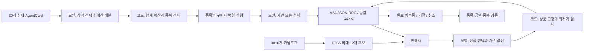

# Week 06: A2A 구매자와 판매자

기존 5주차의 Codex 모델 연결 코드를 재사용한 가상 가구 거래 실험이다.
공식 거래 테스트와 필수 도전 1·2만 수행한다. 실제 결제, 추가점수 실험,
공개 서버 배포는 하지 않는다. 결과와 한계는 `REPORT.md`에 정리한다.

## 실행 환경

- Python 3.10.22: 기존 `eraseanything` 인터프리터를 기반으로 한 과제 전용 `.venv`.
- 기존 conda 환경의 패키지는 변경하지 않았다. base Python 3.8로는 SDK를 실행할 수 없다.
- `a2a-sdk==1.2.0`, 나머지 정확한 버전은 `requirements.lock`.
- Codex CLI 0.153.0, `gpt-6-astra`, reasoning `low`, 기존 ChatGPT 로그인.
  별도 API 키를 읽거나 제출하지 않는다. CLI 사용 한도는 소모한다.
- `codex`가 PATH에 없으면 `CODEX_BIN`에 실행 파일 경로를 지정한다.

저장소 루트에서 환경을 새로 준비할 경우:

```bash
cd submissions/26520024/week-06
uv venv --python /home/uichan/miniconda3/envs/eraseanything/bin/python --no-project .venv
uv pip install --python .venv/bin/python --cache-dir .uv-cache -r requirements.lock
codex login status
```

다른 컴퓨터에서는 첫 명령의 Python 경로를 해당 컴퓨터의 Python 3.10+로 바꾼다.
기존 `.venv`가 있으면 생성 단계를 생략한다. 인증 토큰을 코드나 로그에 쓰지 않는다.

## 검증과 실제 실행

저장소 루트에서:

```bash
submissions/26520024/week-06/.venv/bin/python -m unittest discover -s submissions/26520024/week-06 -p 'test_week06.py' -v
submissions/26520024/week-06/.venv/bin/python scripts/trade_test_week06.py submissions/26520024/week-06
submissions/26520024/week-06/.venv/bin/python submissions/26520024/week-06/run_challenges.py --challenge 1
submissions/26520024/week-06/.venv/bin/python submissions/26520024/week-06/run_challenges.py --challenge 2
submissions/26520024/week-06/.venv/bin/python submissions/26520024/week-06/verify_evidence.py
submissions/26520024/week-06/.venv/bin/python scripts/check_week06.py submissions/26520024/week-06
```

NAS에서 공식 구조 검사가 무시된 런타임/캐시 디렉터리를 탐색하다 지연될 경우,
`python submissions/26520024/week-06/check_submission.py`를 사용할 수 있다.
생성된 환경·캐시만 제외한 동일 바이트의 제출 파일을 임시 폴더로 복사하고,
**수정하지 않은 같은 공식 검사기**를 실행한다. 파일별 SHA-256도 출력한다.

**주의:** 공식 거래 테스트는 `test-report.json`과 공식 로그를 덮어쓴다.
재실행 전 기존 파일들을 별도 디렉터리에 원본 그대로 보관해야 한다.
도전 실행기는 매번 UTC 시간 기반의 새 디렉터리를 생성하며 기존 기록을 덮어쓰지 않는다.
`verify_evidence.py`는 모든 보존된 도전 실행이 성공했는지도 검사하므로, 실패 실험을
추가했다면 실패 원인은 삭제하지 말고 별도 분석해야 한다.

## 구현 구성

| 파일 | 역할 |
|---|---|
| `seller.py` | SDK 서버, 상품 검색, 모델 협상, 영수증 artifact |
| `buyer.py` | AgentCard 발견, 모델 제안/철회, 동일 taskId, 영수증 검사 |
| `core.py` | FTS5 검색, 프롬프트, JSON 검증, 최저가·예산 보호 |
| `codex_backend.py` | 빈 임시 폴더에서 도구 없는 Codex 호출과 원본 사용량 기록 |
| `wire.py` | A2A 1.0 헤더와 JSON-RPC 요청/응답 |
| `run_challenges.py` | 상품 설명 6개, 실제 상점 20개, 4개 품목 동시 구매 3회 |
| `catalog.json`, `shops.json`, `shopping.json`, `challenge_cases.json` | 실행 전에 고정한 합성 실험 데이터 |
| `test_week06.py` | 명시적인 scripted mock을 쓰는 오프라인 테스트 |
| `verify_evidence.py` | 실제 응답·가격 제한·정상 종료·병렬 실행 독립 검증 |
| `snapshot.py` | 소스 해시·패키지·모델 재현성 메타데이터 생성 |



모델 입력은 명시적 상태와 최근 두 번의 교환, 최대 600자 요약이다.
원본 기록은 디스크에 보존하지만 다음 모델 입력에 모두 다시 넣지는 않는다.
예산을 나중에 공유하거나 동적으로 재배분하지 않으므로 안전하지만 남는 예산 활용에는 한계가 있다.
